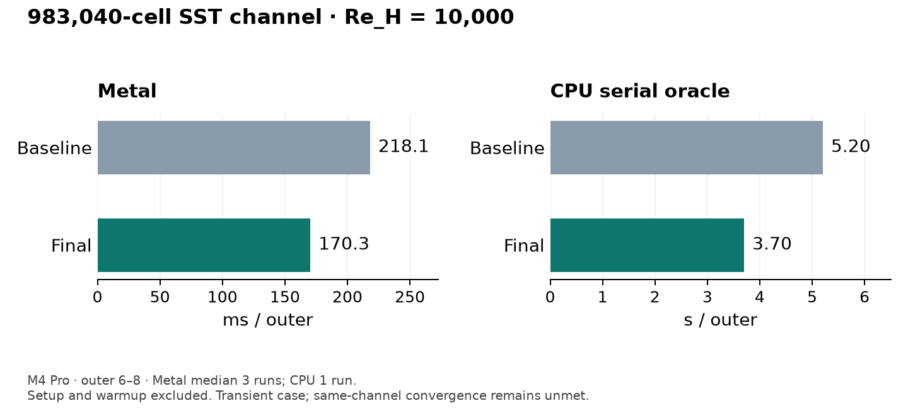
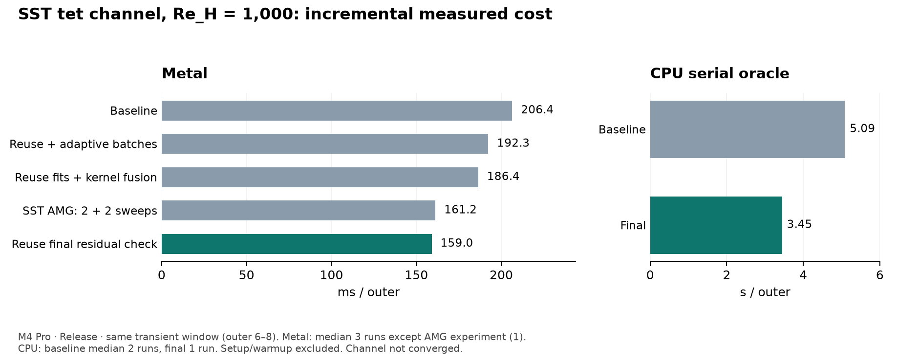
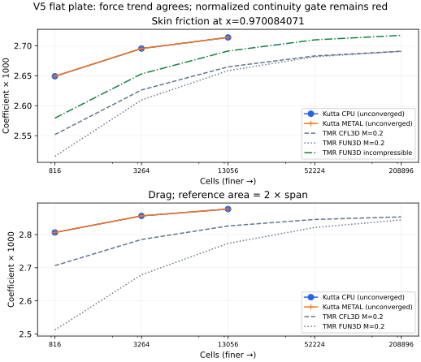
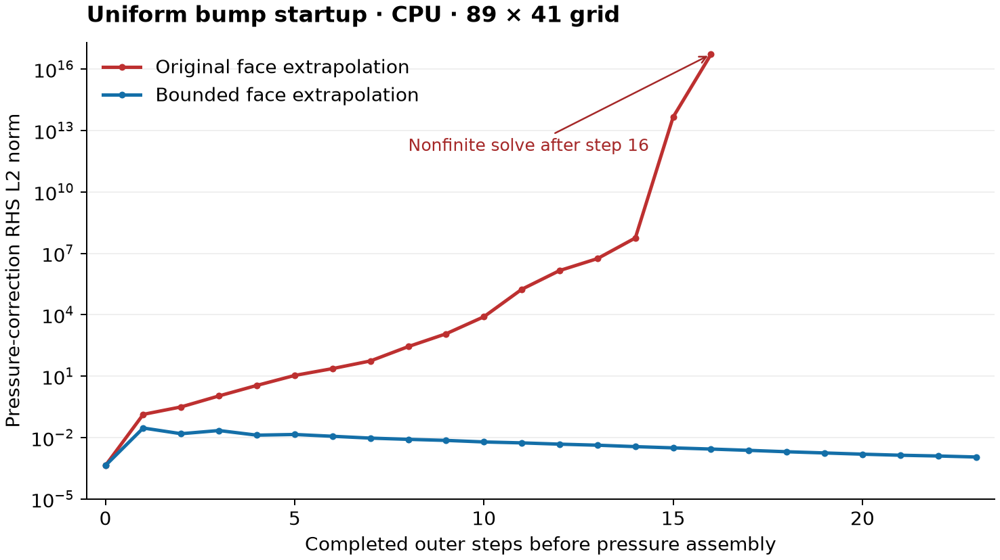

# Lane D verification

FSAE physics gates V7–V12 and their measured results are tracked separately in
[`validation/results/fsae_physics/REPORT.md`](../../../validation/results/fsae_physics/REPORT.md).
Their [formulation and input contracts](../../../docs/research/fsae-physics.md)
distinguish analytic proof from native Fluent input evidence. V12 remains a
failing native-fan acceptance gate. V7.2 now passes unchanged on CPU and Metal
with 0.093% poly pressure error; native rotating walls are enabled. The
[polyhedral reconstruction report](../../../validation/results/poly_pressure/REPORT.md)
records the operator evidence and full assertion comparison. Existing V1–V6
acceptance thresholds are unchanged.

This branch preserves the Fluent-class discretization and checks its operator
consistency separately from integrated-load accuracy. The former tet pointwise
pressure ≥1.8 gate was mathematically incompatible with that operator. The new
wall-load ≥1.8 gates remain strict and fail on tets; V2 is therefore **not fully
passed**. The V3 acceptance criterion is now a refinement study, not agreement
of a finite grid with rounded grid-converged numbers.

The current build/test results below use this worktree, Apple M4 Pro (24 GB),
macOS 26.6.2, AppleClang 21, C++20 Release (`-O3 -DNDEBUG`), HDF5 and Metal enabled.
CPU denotes the serial reference backend. CUDA runtime is not verified here.
The V1, V4 and performance tables retained below originally used source
`5e527dc856280e6e69f436f0fc7438b5340a903d`; they are historical measurements,
not fresh performance claims. Current correctness runs are listed at the end.

## Update after review fixes (2026-10-30)

The automatic pseudo-time length scale now uses the domain volume, as Fluent's
conservative method does, instead of the mean cell volume (about N^(1/3) smaller).
Tests and `bench_fv` now use Fluent's default time scale factor 1; the former
factors 3 and 5 compensated for that error. Closed domains pin the cell containing
`reference_point` instead of internal cell 0. Tables below that report iteration
counts or wall times predate this change; their accuracy values are unchanged
to the printed digits except where listed here.

Fresh slow tier (same machine): 6/7 cases pass in 1,261 s (was 2,891 s), and in 1,012 s after rebasing onto the device-resident linear solvers (same iteration counts). The
only failures are the six retained tet wall-force ≥1.8 assertions; the measured
orders are the same as below.

| Case | Outer iterations before | after |
| --- | ---: | ---: |
| V3 Re=1000, 65² / 129² / 257² (CPU) | 1,400 / 1,900 / 3,300 | 700 / 600 / 1,000 |
| V3 Re=100 / Re=400, 129² | 400 / 800 | 1,000 / 500 |
| V4 Fluent mesh Re=100 / 400 / 1000 | 300 / 600 / 900 | 600 / 300 / 500 |
| V2 tet n=16 | 500 | 440 |

On the 3,550-cell Fluent cavity mesh (Metal, relaxation 1) the outer iterations
to the driver's steady criterion for time scale factors 0.1 / 0.3 / 1 / 5 were
700 / 300 / 600 / 2,200 at Re=100 and 2,700 / 1,000 / 500 / 700 at Re=1000: the
best factor depends on the flow, and Fluent's default is a reasonable middle.

## Mesh, gradients and flow checks

CPU and Metal pass analytic wall-distance tests on hex/tet boxes translated by
1e8, finite wall tiles with edge/corner nearest points, and no-wall domains.
The host BVH evaluates exact double point-to-triangle distances on each wall
face's triangle fan, then stores floats. Wall-normal distances are checked
against analytic projections; non-wall entries are zero.

The inverse-distance-squared LSQ reconstruction includes actual boundary face
values. Maximum affine-gradient component errors are 3.8147e-7 (60-cell hex),
8.58307e-7 (144-cell tet), and 5.20766e-5 (86,803-cell real Fluent poly box), equal
on CPU and Metal. On the poly mesh, single-precision field quantization is
amplified by short centroid spacing: the kernel agrees with an independent
host reconstruction of the rounded field within 2e-6, and every analytical error
lies inside its propagated input-rounding bound plus 2e-6. The limiter keeps
every cell-to-face reconstruction inside its stencil range. Fused vector
and separate scalar gradient kernels agree bitwise.

Rest, forward/reverse inlet–outlet flow, default density-aware normal backflow,
and moving-wall/symmetry checks pass on both backends. In planar Couette flow,
400 outer iterations give maximum velocity error 1.19209e-7 and scaled momentum
defect 4.04177e-8. Top-wall viscous force is -0.1 in x and coefficient is -2 for
the supplied reference values. Shifting reference pressure by 2 changes the
normal force by -0.2, as expected. Moving-wall normal motion is projected out.

`SteadySolver`, settings, patch-condition variants, `iterate(n)`, monitor snapshots,
and wall forces are exposed without a CLI; caller usage is in [README](README.md).
Solvers are selected in one place, `transport.hpp`: BiCGStab/Jacobi for transport
and AMG-PCG for pressure. Closed domains use symmetric reference-cell elimination;
pressure outlets remove the pin. `device_mesh.hpp` has no changes.

## V1 scalar manufactured solution

The field is sin(pi*x) sin(pi*y) sin(pi*z), diffusivity 1, with exact source and
Dirichlet face data. Convection speed is 4 in x. Each study runs 8/16/32 cells per
axis; tet boxes have six tets per brick. Reported orders are the finest 16→32
pair after three refinements, not a fit over all three levels.

| Mesh | Backend | Diffusion order | FOU order | SOU order |
| --- | --- | ---: | ---: | ---: |
| Hex | CPU | 2.00206 | 0.854671 | 1.91201 |
| Hex | Metal | 2.00192 | 0.854671 | 1.91201 |
| Tet | CPU | 1.93250 | 0.993216 | 1.94919 |
| Tet | Metal | 1.93243 | 0.993216 | 1.94917 |

The hard finest-pair gates are diffusion ≥1.9, SOU ≥1.8, FOU ≥0.8. All pass.
The coarser tet diffusion slope is 1.82407, so the whole sequence is not claimed
to have an order ≥1.9. Finest CPU L2 errors (diffusion/FOU/SOU) are
0.000284123/0.00630692/0.000249390 for hex, and
0.000288447/0.00412068/0.000286845 for tet. Finest outer counts are 3/3/6 and
19/21/18 respectively; Metal uses 17 rather than 21 for tet FOU, with the same
reported error. Scalar convergence on a poly-dual family was not measured.

## V2 Navier–Stokes manufactured solution

The smooth divergence-free polynomial velocity, cosine pressure, viscosity 0.1
and exact forcing are in `tests/fv/test_navier_stokes.cpp`. Pressure errors remove
a volume-weighted constant gauge offset. Hex studies are extruded 2D boxes
(8/16/32 by the same number in y, one z layer); tet studies are full 3D boxes
(4/8/16 per axis). Orders again use the finest pair.

| Mesh | Velocity order | Pressure order | Finest velocity L2 | Finest pressure L2 | Finest outer iterations |
| --- | ---: | ---: | ---: | ---: | ---: |
| Hex, CPU and Metal | 1.91567 | 1.82088 | 0.00418077 | 0.00300871 | 840 |
| Tet, CPU and Metal | 1.98247 | 0.942387 | 0.0122571 | 0.0689336 | 500 |

### Pressure-operator contract

For this exact MMS pressure, the cell-centred Gauss gradient
`sum_f p(face centroid) S_f / V` is first order on Freudenthal tets even when
face pressure is exact. Midpoint-face quadrature errors cancel across opposite
hex faces, giving second order there; tets do not have those opposite pairs.
Inverse-distance² LSQ and Gauss applied to reconstructed Second Order pressure
also remain first order on tets. The deliberately matched Fluent-class momentum
pressure force uses this same Gauss form. Requiring second-order pointwise tet
pressure from this family was an unattainable gate, not evidence of a Kutta bug.
No reconstruction, quadrature, limiter or solver discretization was changed.

`FV MMS pressure gradient operator convergence` independently computes the
exact-face Gauss operator in host double precision. It also runs the actual
LSQ -> `fv_pressure_faces` -> `fv_momentum_source` device kernels on exact
cell pressure, supplying exact boundary face pressure to isolate the operator
from boundary extrapolation error. The source kernel returns the negative
pressure gradient; that sign is removed before comparison. All errors are
volume-weighted vector L2 norms against the analytic cell-centre gradient.
The hex operator mesh is extruded 2D, matching V2; tets are full 3D.

The exact-face finest-pair gate is tet order in [0.9,1.1] and hex ≥1.9. The
actual tet momentum operator must be ≥0.9. The pre-existing LSQ order ≥0.9
check remains in place on both meshes. The V2 solver tet pressure order must
be ≥ its independently measured actual momentum-operator order minus 0.1,
using the same 8→16 tet refinement. Hex pressure remains ≥1.8. The existing
velocity gate ≥1.9 is retained on both meshes (stronger than ≥1.8).

| Mesh | Exact-face Gauss order | Actual momentum operator order | LSQ order | Solver pressure order | Solver consistency threshold |
| --- | ---: | ---: | ---: | ---: | ---: |
| Hex, 8→16 | 1.99791 | 1.36247 | 1.56286 | 1.82088 (16→32) | 1.8 |
| Tet, 8→16 | 0.999409 | 1.01406 | 0.994008 | 0.942387 | 0.91406 |

CPU and Metal agree to the printed precision. Only the exact-face hex Gauss
operator must be ≥1.9. The reconstructed operator has a lower measured slope;
the load checks below assess its effect on the converged solution.

### Integrated wall-load contract

The same converged V2 solutions call `SteadySolver::forces` on the lower half
of xmin (`x=0, 0<=y<=1/2`, full span). Boundary faces are split into named wall
patches without moving or reordering any face. This avoids zero net pressure
from whole-wall cancellation; the selected wall also has nonzero viscous force. Pressure is aligned with the same
volume-mean gauge offset used for its L2 error. Force errors are vector norms
per unit span; the hex span is 1/n and the tet span is 1.

With outward normal `n=(-1,0,0)`, wall-on-solid pressure traction is
`p*n=(-cos(pi*y),0,0)` and viscous traction is
`-mu*(grad u+grad u^T)*n=(0,-20*y²*(1-y)²,0)`. Exact antiderivatives give
pressure force/span `(-1/pi,0,0)` and viscous force/span `(0,-1/3,0)`.
No approximate reference quadrature is used. The total-force gate cannot hide
cancellation because pressure and viscous forces are also gated separately.

| Mesh | n | Pressure error/span | Viscous error/span | Total error/span |
| --- | ---: | ---: | ---: | ---: |
| Hex | 8 | 0.0397838 | 0.0713798 | 0.0351425 |
| Hex | 16 | 0.0117129 | 0.0197706 | 0.00914660 |
| Hex | 32 | 0.00310731 | 0.00506342 | 0.00225342 |
| Tet | 4 | 0.161730 | 0.222746 | 0.152052 |
| Tet | 8 | 0.0714325 | 0.133492 | 0.0778614 |
| Tet | 16 | 0.0358039 | 0.0727936 | 0.0407649 |

| Mesh | Pressure-force order | Viscous-force order | Total-force order | ≥1.8 gates |
| --- | ---: | ---: | ---: | --- |
| Hex | 1.91437 | 1.96517 | 2.02112 | pass |
| Tet | **0.996464** | **0.874869** | **0.933580** | **all fail** |

The three ≥1.8 tet force assertions fail on each backend. This MMS does not
establish second-order tet loads for FSAE use, so V2 remains failed.

## V3 cavity refinement

Re=1000 uses uniform 65², 129² and 257² cell grids against every point in the
supplied Erturk 601² u/v centreline tables. The error is the maximum absolute
deviation separately for u and v, with linear interpolation to reference
coordinates. Each finest-grid error must be smaller than the 129² error, and
its finest-pair observed order must be ≥1.6. Orders use the actual cell-width
ratio 257/129, not an assumed ratio of two. The 65² level and its slope are
also reported. A 129² second-order solution cannot reasonably be required to
fall inside the printed rounding intervals of a nearly grid-converged 601²
reference; those intervals have been removed as an acceptance criterion.

The solver settings are unchanged: unit lid speed, viscosity 1/Re, symmetry
front/back, momentum/pressure relaxation limits 1, pseudo-time scale 5, monitors
every 100 iterations. Convergence requires momentum defects <5e-7 and corrected
mass L1 <1e-5. The refinement study tightens the maximum velocity update over
100 iterations to 2e-6 (from the reporting driver's default 2e-5).

| Grid | CPU outer iterations | Max u error vs Erturk | Max v error vs Erturk | u order | v order |
| --- | ---: | ---: | ---: | ---: | ---: |
| 65² | 1,400 | 0.020743157625 | 0.030959975930 | — | — |
| 129² | 1,900 | 0.004344232038 | 0.007102702184 | 2.280873 | 2.147893 |
| 257² | 3,300 | 0.000607678559 | 0.001067561871 | 2.853709 | 2.749453 |

Metal matches the 65²/129² rows to every printed digit. At 257² its max errors
are 0.000610226658 for u and 0.001065764046 for v, giving finest-pair orders
2.847639 and 2.751898, after 3,700 outer iterations. Both backends pass.
Fine-grid single-precision results
are close but not bitwise identical.

All four finest-pair component orders exceed 1.6 and both errors decrease
on each backend. These slopes
measure error against the finite, rounded 601² reference; they do not establish
a scheme order above two.

CPU centre and primary-vortex values:

| Grid | u at (0.5,0.5) | v at (0.5,0.5) | Primary-vortex psi | Primary-vortex omega |
| --- | ---: | ---: | ---: | ---: |
| 65² | -0.063983514905 | 0.024281581864 | 0.116309238798 | 2.047185257478 |
| 129² | -0.062479555607 | 0.025318449363 | 0.118306555813 | 2.062453139863 |
| 257² | -0.062144596130 | 0.025664789602 | 0.118777723601 | 2.066107778952 |
| Richardson, order 2 | -0.062031779164 | 0.025781439698 | 0.118936416589 | 2.067338689919 |
| Erturk extrapolated | — | — | 0.118942 | 2.067213 |
| Botella/Peyret spectral | — | — | 0.1189366 | 2.067753 |

Metal Richardson values are u=-0.062034249242, v=0.025782229027,
psi=0.118937994671 and omega=2.067430924350, at vortex position
(0.530771922789, 0.565226268158). Its psi differs from Botella by +1.39e-6
and omega by -3.22e-4.

The CPU Richardson vortex position is (0.530771834413, 0.565226296680), compared
with Botella/Peyret (0.5308, 0.5652). Its psi differs from Botella by -1.83e-7
and its omega by -4.14e-4. Erturk's extrapolated row has no centre coordinates.
The raw 601² table centre velocities are -0.0620 and 0.0258.

Second-order Richardson estimates use the finest pair and actual width ratio.
The primary vortex is measured independently of centreline velocities: integrate
`psi_y=u` from the stationary bottom wall with trapezoids, fit the local minimum
with a quadratic including its mixed derivative, and interpolate `-curl(u)`
there. A cheap analytic-streamfunction test checks this diagnostic's position,
sign and second-order psi/vorticity errors. These comparisons report deviations
from the supplied primary-vortex CSV; they do not impose rounding tolerances.

Re=100/400 comparisons retain reported deviations and convergence assertions;
no unsupported scatter band is inferred from Ghia alone. Only the supplied
SOURCE.md's suspect Re=400 v point at x=0.90625 is omitted.

Fresh Re=100/400 results on both backends:

| Re | Outer iterations | Ghia max u deviation | Ghia max v deviation |
| --- | ---: | ---: | ---: |
| 100 | 400 | 0.005039 | 0.008967 |
| 400 | 800 | 0.002638 | 0.004046 |

## V4 real Fluent cavity mesh

The historical driver read the exact file
`<checkout>/validation/fluent_examples/lid_driven_cavity/lid_driven_cavity.msh`.
It has 3,550 cells (71×50); `top_moving_wall` selects the moving wall. The driver
also solves a uniform box at the same cell count and a generated box mapped to
the exact Fluent x/y grid lines. This distinguishes spacing effects from import
or connectivity errors. All imported and comparison cases converge on CPU and
Metal. The comparison below concerns centerline velocities, not full cell fields.

| Re | Imported outer iterations | Ghia max abs u deviation | Ghia max abs v deviation |
| --- | ---: | ---: | ---: |
| 100 | 300 | 0.00530634 | 0.00904564 |
| 400 | 600 | 0.00328528 | 0.00343363 |
| 1000 | 900 | 0.00894912 | 0.00409038 |

| Re | Matched-grid max u difference | Matched-grid max v difference | Uniform-grid max u difference | Uniform-grid max v difference |
| --- | ---: | ---: | ---: | ---: |
| 100 | 3.72529e-07 | 3.72529e-07 | 0.00252729 | 0.000836089 |
| 400 | 6.25849e-07 | 2.23517e-07 | 0.0088028 | 0.00545676 |
| 1000 | 4.02331e-07 | 3.42727e-07 | 0.0203209 | 0.012485 |

These values are the same on CPU and Metal. The largest matched-grid difference
is 6.25849e-7. Re=1000 imported-mesh deviations from Erturk are 0.0118548 (u) and
0.0212349 (v). Equal cell counts alone do not imply equal grid spacing.

The current slow test reads the worktree copy at
`validation/fluent_examples/lid_driven_cavity/lid_driven_cavity.msh`, whose
SHA-256 matches the historical external fixture: `9b09f1287db71978e10c67a528616c1c95118cfcf4f763abad047df565e6a6dd`.
It passes convergence and all centreline samples against the generated grid
with identical grid lines, with a maximum allowed deviation of 2e-6, at
Re=100/400/1000 on CPU and Metal.

## Performance

### SST outer cost, 2026-10-30

Apple M4 Pro, 24 GiB, macOS 26.6.2 (25G83), AppleClang
21.0.0.21000101, Release C++20. Baseline solver source is
`e21866d7c4ae9511cc65c33e7ea939f12721d7c1`; the measured optimized solver is
`c329d5d74749c20edf8126bd1bc6937c31bb8c19`. All changes are local commits.
`src/kutta/app/**`, `src/kutta/setup/**`, convergence thresholds and numerical
acceptance protocols are unchanged.

The requested same-channel steady-convergence result remains **unmet** on both
source versions. Rates below cover transient outer iterations. The retained
V1–V6 gates have no new failures; V6 supplies separate matched-converged-field
evidence. This is not an accepted steady FSAE speed result.

The generated channel has **983,040 tetrahedra / 1,987,072 faces**: six
Freudenthal tets per brick, 128x32x40 bricks in a 4x1x0.5 domain, tanh wall
spacing with parameter 1.2 and a smooth interior x-skew of amplitude .015.
The first brick layer is .01460649 high; tet centroids resolve smaller wall
normal distances. Inlet velocity is 1, k=.0015 and omega=10; y walls are
stationary and z boundaries are symmetry. Momentum is SOU, turbulence FOU,
URFs .3/.05/.75/.75, fixed pseudo time .01. SST is active throughout.
This exercises unstructured gathers and graded wall cells. It is **not** a
Fluent poly-hexcore/prism mesh or an accepted FSAE validation case.

Five warmup steps, including their compulsory monitors, are excluded. Wall
throughput measures asynchronous outer steps 6–8 plus final completion, with
no periodic monitor. Profiling measures step 6 in a separate process with
completion around every operation; its times cannot be used as asynchronous
phase percentages. Setup/initialization are excluded from both. The million-cell
runs are transient; they were not run to convergence.

The primary comparison uses **Re_H=10,000** (viscosity .0001). Both versions
use the identical latest benchmark harness; the baseline library was rebuilt
from a `git archive` of e21866d. All 82 archived files under `src/kutta` were
checked byte for byte against that commit. The archive's CMake benchmark
version string is pinned to e21866d; its numerical sources are untouched.
The final harness is `fa2fcac1e080336c2b8f48f18259cae5a58c7506`.

| Re_H=10,000, 983,040 tets | Before ms/outer | After ms/outer | Before outer/s | After outer/s | Speedup |
| --- | ---: | ---: | ---: | ---: | ---: |
| Metal | 218.127 | **170.311** | 4.58449 | **5.87162** | **1.281x** |
| CPU serial oracle | 5,203.329 | **3,701.443** | .192185 | **.270165** | **1.406x** |

Metal is the median of three runs per version; final samples span
166.595–171.694 ms. CPU entries are single runs. These timing processes ran
after this lane's slow tier and other measurements finished; the subsequently
observed other-lane jobs start after the complete timing window. All six last
inner solves converge. Last u/v/w/pressure/k/omega counts are
2/2/2/26/3/3 before and 2/2/2/33/3/3 after; final pressure relative residual
is 9.85049e-4 against the unchanged 1e-3 target. Queued kernel calls fall
4,047 -> 3,345 per outer. The blocking-call/allocation inventory below is
the same as the pilot.



Higher-Re FV+SST traffic is **10,252.75 -> 9,035.21 logical B/cell/outer**;
all operations are **51,241.18 -> 34,003.89**. The pre-campaign STREAM reference is
**239.070 GB/s Metal / 119.14 GB/s CPU**. Using that Metal reference, the
higher-Re all-operation model implies **139.821 ms**, versus 170.311 observed:
**196.27 logical GB/s**, 82.1% of STREAM. A later run gives 217.274 /
111.733 GB/s and 85.20 us synchronized / .987 us batched dispatch, but overlaps
another lane's validation process; it is retained as a contended sample and
excluded from this roofline comparison. The high-Re timing logs close at
03:02:12 PDT; the other lane's first observed validation starts at 03:02:43.
The model/counter limits below apply.

After outer 8, corresponding higher-Re transient fields change by at most
2.05e-4 relative L2 for pressure and 2.67e-6 for velocity/k/omega/flux across
CPU and Metal. Converged-field evidence is the separate V6 comparison below.
These measured field differences are not mathematical residual-to-error bounds.


The Re_H=1,000 pilot provides per-change evidence on the same mesh and outer
window. Metal entries are medians of three independent runs except the
2+2-sweep experiment (one). CPU baseline is the median of two; other CPU
entries are single runs. Raw samples retain their spread. Intermediate stages were built before
their commits; their embedded source string is the then-current HEAD.
Metadata records the working changes and saved binary hashes. The final
comparisons use the clean source/artifact identities above.

| Incremental change, Re_H=1,000 | Metal ms/outer | CPU ms/outer |
| --- | ---: | ---: |
| Baseline | 206.424 | 5,087.357 |
| Reused Jacobi validation allocation; adaptive Krylov batches | 192.326 | 5,168.522 |
| Reused velocity fits; fused limiter/scale and SST blending/viscosity | 186.436 | 4,851.332 |
| SST pressure AMG V-cycle, 2+2 rather than 5+5 sweeps | 161.224 | Not separately measured |
| Reused final verified residual | **159.020** | **3,445.172** |

Final pilot throughput is **6.28851 outer/s Metal** and **.290261 outer/s
CPU**, versus 4.84439 and .196566: **1.298x / 1.477x**. The batching-only
CPU result is slower; no CPU win is claimed for that isolated change.



Krylov batches are capped by the previous converged solve's update count plus
one, up to the caller's `residual_check_interval`. Device convergence tests,
reliable residual replacement, breakdown handling and update counts are
unchanged. The final actual residual is reused only if x has not changed;
constant-nullspace solves retain the original final projection/verification.
Jacobi validation now owns persistent scratch rather than allocating at each
refresh. That adds one persistent float per equation row (about 19.7 MB across
five equations here), while removing five transient Device allocations/outer.

The SST driver retains velocity derivative fits after k changes, and reuses
its momentum reconstruction between transpose stress and assembly. New
cell-local fusions retain the staged kernels as independent entrypoints.
Tests compare staged and fused outputs bitwise on CPU and Metal. All six
saved fields plus face flux after outer 8 remain **bitwise identical** through
the batching/reuse/fusion changes on both backends. Only the cheaper pressure
preconditioner changes intermediate iterates. It uses equal pre/post counts,
retaining a symmetric V-cycle; the general AMG default remains 5+5.

The pilot's last u/v/w/pressure/k/omega inner update counts change from
2/1/1/28/3/3 to 2/1/1/35/3/3. All six final Metal diagnostic solves converge; pressure
relative residual is 8.38179e-4 against the unchanged 1e-3 target. More cheap
pressure cycles reduce total work. The final 3,329 queued kernels/outer compare
with 4,047 before.

| Public Device costs / outer, excluding final benchmark sync | Before | After |
| --- | ---: | ---: |
| Blocking norm reads | 41 | 35 |
| Status downloads | 9 | 10 |
| Scalar threshold uploads (blocking on Metal) | 6 | 6 |
| Total blocking API calls on Metal | 56 | 51 |
| Device allocations | 5 | 0 |
| Requested transient allocation bytes | 19,660,800 | 0 |

These count Device calls after warmup, not host C++ heap allocations or
backend/driver command-buffer and reduction scratch allocations. CPU has the
same API calls but no GPU waits. Profiler-imposed completion calls are excluded.

The profiler counts each entire buffer argument once per call (copy counts
read+write), including guarded queued work. These are **logical bytes**, not
measured DRAM traffic or a strict bound. Gather reuse, cache residency, boundary
subranges and frozen kernels change actual traffic. The Metal counter inventory
on this machine exposes only `GPUTimestamp`, so no DRAM-byte measurement is claimed.

| Intrusive Metal kernel group, Re_H=10,000 | Before ms | After ms | Before B/cell/outer | After B/cell/outer |
| --- | ---: | ---: | ---: | ---: |
| AMG-specific kernels | 412.086 | 327.954 | 24,773.86 | 12,894.26 |
| CSR/Krylov/validation kernels | 138.716 | 109.645 | 12,901.89 | 9,684.87 |
| FV kernels | 45.712 | 41.321 | 7,992.05 | 6,918.51 |
| SST kernels | 13.271 | 12.908 | 2,260.70 | 2,116.70 |
| Reductions | 51.752 | 35.334 | 2,960.61 | 2,000.61 |
| Runtime copies/fills | 26.980 | 32.298 | 352.08 | 388.95 |

These are name-based groups, not instrumented application phase boundaries.
Per-kernel calls, CPU/Metal times and logical bytes are preserved in the raw
logs and `kernels.json`. Examples: velocity vector fits fall from 6 to 4,
jump fits 9 to 6, true CSR residual passes 18 to 12, and `amg_smooth` dispatches
2,706 to 2,132 in profiled step 6. The latter's modeled payload halves from
24,000.77 to 11,959.18 B/cell despite more pressure Krylov iterations.

FV+SST logical traffic falls **10,252.75 -> 9,035.21 B/cell/outer**; all
operations fall **51,241.18 -> 33,557.26**. The ~2 KB FV target remains unmet.
The pre-campaign STREAM triad is **239.070 GB/s Metal / 119.14 GB/s CPU**; Metal
synchronized dispatch is 78.23 us, batched dispatch 1.50 us. At the measured
Metal STREAM rate, the final pilot's all-operation model implies **137.985 ms**,
versus 159.020 ms observed: **207.45 logical GB/s**, or 86.8% of STREAM.
This is a bandwidth-model position, not proof of DRAM saturation or a complete
FLOP/byte roofline measurement.

For the higher-Re payload, a bandwidth-only **projection** gives 43.983 ms /
22.74 outer/s on RTX 3080 10GB (760 GB/s), and 33.162 ms / 30.16 outer/s on
RTX 4090 (1,008 GB/s). At 70% of nominal bandwidth the projections are
15.92 / 21.11 outer/s. Card bandwidths are from NVIDIA's
[Ampere whitepaper, Table 2](https://www.nvidia.com/content/dam/en-zz/Solutions/geforce/ampere/pdf/NVIDIA-ampere-GA102-GPU-Architecture-Whitepaper-V1.pdf)
and [Ada whitepaper, Table 1](https://images.nvidia.com/aem-dam/Solutions/geforce/ada/nvidia-ada-gpu-architecture.pdf).
These estimates assume the logical-byte model transfers unchanged and omit
CUDA dispatch, host waits, cache behavior and instruction throughput. They are
**not CUDA timings**; CUDA has never executed on an NVIDIA GPU here.

Verification uses the unchanged protocols and the external fixtures at
`<checkout>/validation/fluent_examples`.

| Check | Observed result |
| --- | --- |
| Native quick tier | PASS: 169 cases / 1,539,982 assertions; 11.58 s |
| Final-harness `ctest -LE slow`, including portability lint | PASS: 2/2, 14.17 s while slow validation was active; earlier 10.13 s |
| Complete `-ts=slow -d` | Expected nonzero: 10 cases / 3,563 assertions, **50 retained failures**, 2,636.45 s |
| V1–V4 + Couette | Exactly six tet-force failures; all **308** numerical/progress lines identical to the retained main baseline |
| V5 plate + bump | **15 failures / 83**, versus 16 before; no added gate failure |
| V6 | **29 failures / 2,601**, unchanged; seeded/hybrid stops remain 350/550 on both backends |
| CUDA 13.0.2 image, CI configure options, HDF5 enabled | PASS: entire build for `75-real;86-real;89-real;120` |
| CUDA-container CPU quick tier + portability lint | PASS: 168 cases / 826,914 assertions; compiled-GPU-presence test excluded as in CI |
| CUDA GPU execution | Unverified: no NVIDIA device here |

The six flat-plate convergence failures remain. Its Cf/CD changes are below
7e-7 relative. Its normalized continuity changes at the known float floor;
it is not reported as an unchanged residual or as convergence. The fine CPU
bump advances 2,300 rather than 2,200 steps within the unchanged 600-second
budget (600.83 s at the next 100-step checkpoint). Its later transient endpoint
passes one former Cf gate. The bump retains nine failures rather than ten;
all Cp gates and three-grid trend gates retain their outcomes. It still fails
iterative convergence and fine-load stability. Fewer failed assertions do not
establish an accepted V5 solution.

A separate fixed-point check extends each V6 seeded/hybrid solve to 1,200
steps after every original gate, then compares all 17,822 corresponding cells
against the baseline at the same count, without resampling or gauge alignment:

| Baseline versus final relative L2 | CPU seeded | CPU hybrid | Metal seeded | Metal hybrid |
| --- | ---: | ---: | ---: | ---: |
| Velocity | 2.422e-7 | 4.282e-7 | 3.973e-7 | 5.143e-7 |
| Pressure | 1.019e-5 | 6.507e-6 | 2.721e-6 | 1.171e-5 |
| k | 3.574e-7 | 4.364e-7 | 6.212e-7 | 4.442e-7 |
| omega | 2.117e-7 | 5.009e-7 | 3.943e-7 | 5.986e-7 |

Velocity/k/omega differences remain below 1e-6. Pressure differences are below
the configured 1e-3 inner tolerance, but do not meet a 1e-6 relative field bound.
The original V6 accuracy/WFGC/fixed-point-drift failures remain. The optional
CSV-export run has four extra file-open assertions; it is separate from the
2,601-assertion original V6 gate.

The allocation/batch/final-read regressions fail before the changes (14 failed
assertions) and pass afterward. Staged/fused kernels match bitwise on CPU/Metal,
including limiter clipping, constitutive limits and low-Re/viscosity branches.
No acceptance assertion or tolerance was relaxed.

The smaller generated 24x8x4-brick / 4,608-tet Re_H=1,000 channel does **not**
converge in 3,000 steps on either baseline or final Metal. Its final transport
residuals remain O(1e-2), and normalized provisional continuity is thousands.
The benchmark now returns failure when that budget is exhausted. Consequently,
the requested smaller **same-channel** convergence result remains unmet.
A half-resolution 64x16x20-brick / 122,880-tet Re_H=10,000 check also fails:
the baseline reaches the linear solver's nonfinite-input guard after reported
checkpoint 2,840; the final run remains unconverged at 3,000 with unphysical
loads. The failure is not limited to the smallest mesh. V6 is
a separate converged unstructured SST diagnostic, not a substitute for that
missing result. Fixing the synthetic channel's stability and validating real
poly-hexcore/prism convergence remain necessary before a production speed claim.

Remaining measured costs are pressure smoothing, CSR/Krylov passes and repeated
SST reconstruction/constitutive work. No fixed momentum/turbulence sweep policy,
face-payload compression or new reordering was adopted without evidence; the
existing RCM order is retained. There are still 51 blocking calls/outer in the
pilot, and actual DRAM traffic, same-channel convergence, CUDA runtime performance
and a same-case Fluent wall-clock comparison remain unverified.

Reproduction and complete evidence (source/artifact hashes, frozen protocol
hashes, raw timings, test logs, kernel groups and numerical comparisons) are in
[`validation/results/sst_outer_2026-10-30`](../../../validation/results/sst_outer_2026-10-30/metadata.json).

```sh
cmake -S . -B build -G Ninja && cmake --build build
./build/bench_fv --case sst-tet --nx 128 --ny 32 --nz 40 --backend metal --repeats 3
./build/bench_fv --case sst-tet --nx 128 --ny 32 --nz 40 --backend cpu --repeats 3
./build/bench_fv --case sst-tet --nx 128 --ny 32 --nz 40 --backend metal --repeats 1 --profile 1
./build/bench_fv --case sst-tet --nx 128 --ny 32 --nz 40 --viscosity .0001 --backend metal --repeats 3
./build/bench_fv --case sst-tet --nx 24 --ny 8 --nz 4 --backend metal --converge 3000
python3 validation/results/sst_outer_2026-10-30/analyze.py
KUTTA_FLUENT_EXAMPLES=<checkout>/validation/fluent_examples ./build/kutta-tests --test-suite-exclude=slow
KUTTA_FLUENT_EXAMPLES=<checkout>/validation/fluent_examples ./build/kutta-tests -ts=slow -d
KUTTA_FLUENT_EXAMPLES=<checkout>/validation/fluent_examples ctest --test-dir build -LE slow --output-on-failure
```

### Historical 100-cubed laminar measurement

`bench_fv --size 100 --repeats 3` uses a 100³-cell moving-lid box, viscosity 0.01,
momentum relaxation 1 and pseudo-time scale 5. Mesh/solver setup and five warmup
steps are excluded. Outer step 6 is profiled with synchronization around every
operation; throughput measures asynchronous outer steps 7–9, with no periodic
monitor in that window. The 1M-cell case was not run to steady convergence.
Both backends' last pressure solve takes 11 iterations and reports convergence.

| Backend | Outer iterations/s | Wall time / outer |
| --- | ---: | ---: |
| CPU serial reference | 0.551709 | 1.81255 s |
| Metal, Apple M4 Pro | 3.09470 | 0.323133 s |

The profiler's 512-cell adapter check reproduces native Device velocity,
pressure and face flux bitwise on both backends. Timings are wall times including
dispatch/completion, not GPU event times. The following array-size model counts
the full size of each buffer argument once per call (copy counts read+write).
It is neither measured DRAM traffic nor a strict bound: boundary kernels touch
only part of some cell arrays, and gather reuse depends on cache. Consequently
modeled GB/s in the raw log can exceed hardware bandwidth.

FV kernels total **3,721.84 modeled bytes/cell/outer**, above the ~2 KB target.
All recorded operations, including Krylov/AMG, total 19,305.51 bytes/cell/outer.
The FV estimate at 240 GB/s implies 15.508 ms; the synchronized Metal FV kernels
sum to 21.588 ms. All synchronized operations sum to 1.941 s, illustrating the
intrusiveness of serial completion around the many inner-solver operations.
These measurements do not establish a speedup over Fluent.

| Kernel | Calls / outer | CPU µs / call | Metal µs / call | Logical bytes / cell / outer |
| --- | ---: | ---: | ---: | ---: |
| `fv_continuity` | 1 | 2055.8 | 396.8 | 68.12 |
| `fv_correct_flux` | 1 | 1768.2 | 785.8 | 52.24 |
| `fv_correct_velocity` | 1 | 723.4 | 734.3 | 44.00 |
| `fv_gradient` | 2 | 5162.9 | 1205.8 | 280.48 |
| `fv_limiter` | 3 | 7107.2 | 624.5 | 360.72 |
| `fv_momentum_faces` | 1 | 68861.1 | 889.5 | 185.32 |
| `fv_momentum_source` | 1 | 5786.4 | 760.1 | 128.48 |
| `fv_pressure_assemble` | 1 | 7533.7 | 901.0 | 160.00 |
| `fv_pressure_boundary` | 3 | 245.6 | 347.3 | 304.68 |
| `fv_pressure_faces` | 1 | 10055.1 | 690.6 | 136.48 |
| `fv_rhie_chow` | 1 | 15465.7 | 769.1 | 157.44 |
| `fv_transport_assemble` | 3 | 11218.8 | 1776.6 | 614.16 |
| `fv_transport_faces` | 3 | 18214.6 | 938.3 | 590.52 |
| `fv_vector_gradient` | 2 | 14128.4 | 898.2 | 345.44 |
| `fv_velocity_boundary` | 2 | 1032.2 | 196.4 | 293.76 |

A fresh `bench_bandwidth` run on the same source measures Metal triad 241.718
GB/s (best of seven, 256 MiB/array), add 241.658, copy 161.206, dot 238.897 and
sum 220.768 GB/s. Serial CPU triad is 126.982 GB/s. Metal single-dispatch
synchronization costs 90.96 µs; batched small dispatches cost 1.139 µs each.

## Test tiers and reproduction

The requested CMake configure and build succeed. Fresh numerical verification
uses source `f57c891`; the later `10b9a4f` only restores four existing LSQ
assertions and corrects a comment. A fresh rebuild, focused operator run and
quick suite pass with those assertions restored. No numerical code changed
after the full run began.

| Run | Cases passed / run | Failed assertions | Wall time |
| --- | ---: | ---: | ---: |
| Original baseline | 137 / 138 | 2, former tet pressure gate | 266.23 s |
| Final quick, excludes slow | 135 / 135 | 0 | 12.36 s |
| Full verification | 141 / 142 | 6, retained tet force gates | 2,890.75 s, 48m 10.75s |

The full run has exactly one failed case, V2 tet refinement: wall pressure,
viscous and total-force order each fail on CPU and Metal. Every other case
passes, including V1, both V3 studies, V4 and the Metal runtime/kernel checks.
The focused final operator run passes all 12 assertions; the final quick run
passes all 7,248,706 assertions.

| Slow case | Full-run wall time |
| --- | ---: |
| V1 scalar refinements | 107.476 s |
| V2 hex refinement | 44.318 s |
| V2 tet refinement | 112.646 s |
| Couette | 5.796 s |
| V3 Re=1000 refinement, both backends | 2,241.925 s |
| V3 Re=100/400 reports, both backends | 174.296 s |
| V4 imported/matched grids, both backends | 191.430 s |

The longest quick-tier case in the full run is external Fluent mesh acceptance
at 4.981 s. Every measured case over five seconds is in `slow`. The added
cavity studies account for the increase over the original ~270-second suite.

The `slow` doctest suite contains V1/V2 refinements, V3/V4 cavities and Couette
(the baseline Couette test exceeded five seconds). All other measured baseline
tests took <5 seconds. CI excludes `slow` on every job and retains its existing
GPU-presence exclusion. Full verification has no suite exclusion and continues
to return failure while the three tet force gates fail on each backend.

```sh
cmake -S . -B build -G Ninja && cmake --build build && ./build/kutta-tests
# Quick loop / CI (CI also excludes its GPU-presence test):
./build/kutta-tests --test-suite-exclude=slow
# Focused studies:
./build/kutta-tests --test-case='FV MMS pressure*'
./build/kutta-tests --test-case='FV V2*'
./build/kutta-tests --test-case='FV V3*,FV V4*'
# Optional standalone CSV checker, after generating all three grids:
./build/bench_fv --cavity 1000 --nx 65 --ny 65 --iterations 10000
./build/bench_fv --cavity 1000 --nx 129 --ny 129 --iterations 10000
./build/bench_fv --cavity 1000 --nx 257 --ny 257 --iterations 10000
python3 validation/cases/check_cavity_profiles.py
```

The generated Metal source is an array of raw-string parts, each ≤60,000 UTF-8
bytes, joined at runtime before appending the reduction kernels. Adjacent
literals would still produce one overlength literal. The current parts are 60,000 and 9,893 bytes. A fresh build emits no
`-Woverlength-strings` warning and the generated C++ compiles with
`-Werror=overlength-strings`. Generated kernel/transfer tests exercise CPU and Metal successfully.

Fresh evidence is in `build/baseline-tests.log`, `build/operator-tests.log`,
`build/v2-tests.log`, `build/quick-tests.log`, `build/full-tests.log`,
`build/quick-tests-final.log`, `build/operator-tests-final.log` and
`build/final-build.log`. These are local artifacts, not committed fixtures.
Only local commits are made; nothing is pushed.

## V6 mixing-elbow SST

Historical baseline below: hybrid initialization is implemented in the
2026-10-30 section at the end of this file. The WFGC limitation remains.

**The requested same-settings accuracy gate is not achieved.** SST transport and
momentum are coupled, but the strict adapter rejects the original elbow's
`recon/cell-lsf?` (warped-face gradient correction, WFGC). Its hybrid initializer
is also rejected by `initial_fields()`. The slow test keeps both requirements
failing. The numbers below are an explicitly labelled **diagnostic**: WFGC is
disabled and cold start uses the case's stored standard initialization values.
They are not results for Fluent's complete original settings.

Measured 2026-10-29 in worktree `t3-265ec8e3`, branch
`t3/couple-sst-steady-solver`, on Apple M4 Pro / 24 GiB, serial CPU and Metal.
Numerical implementation is `bbc176c`, setup `c70561a`, stopping criterion
`764fa63`; subsequent changes add diagnostics, input guards and this report.
macOS HDF5 is 2.2.0. Float fields, double/compensated reductions, deterministic
gather kernels, and the existing test thresholds are retained.

External files (not committed), from `KUTTA_FLUENT_EXAMPLES/mixing_elbow`:

| File | SHA-256 |
| --- | --- |
| `mixing_elbow.cas.h5` | `8145813f50f989a521ed8d1b02c891c7ca22ccc5fafa35a4eeba011949f19cbc` |
| `mixing_elbow.dat.h5` | `863a813227cf4274a9ca24fdad43e6c1f9f132dd62fcabc39a3be8cf493cff42` |

The saved solver version is Fluent **22.2**. The mesh has 17,822 cells, 91,581
faces, two velocity inlets, a pressure outlet, symmetry, and 2,436 wall faces.
There are **zero report definitions**. The saved iteration counter is **absent**;
the last retained residual sample is iteration **294**, with 294 samples. Do not
substitute 294 for a separately verified save counter. Fluent wall time is absent.

Active material `air` has constant density **1.225 kg/m³** and dynamic viscosity
**1.7894e-5 Pa s**; gravity is off. Although energy is enabled, neither density
nor viscosity depends on temperature, and there are no other enabled couplings
that feed energy back into these incompressible flow equations. Omitting energy
does not change this case's converged flow.

### Settings, classifications and remaining limits

Every item originally flagged by `kutta inspect` is accounted for:

| Setting | Effect and evidence | Adapter action |
| --- | --- | --- |
| Missing `turbulence/wall-omega-treatment` | Changes wall equations if a different model is selected. The case explicitly has legacy `kw-wall-omega-treatment-r13? #t`; the saved-field forensics establish this correlation's wall-cell omega, shear and y+ on this exact case. | Use the established legacy correlation; no version-independent default. Reject tabulated treatment. |
| `kw-wall-omega-treatment-r13? #t` | Discrete wall closure; forensics §3/§7 and the saved-field SST test are the evidence. | Implemented by `SstModel`. |
| `kw-dissipation-newton? #t` | Convergence path: Newton versus Picard linearization of destruction has the same source zero. | Picard implicit sink; recorded in setup notes. |
| `sst-des-iddes-simplify_omit_fe? #t` | Inactive: case configuration explicitly has `rp-des? #f`. | Accept only the globally disabled DES problem. |
| `sst-linearize-neg-cross-diff? #t` | Linearization path; source sign still changes the equation. | Signed cross diffusion, negative part as an implicit sink, implemented in SST. |
| Informational k-epsilon flags | Inactive in the explicitly selected k-omega SST model. | Parser's model allowlist retains their provenance. |
| Energy | Decoupled constant-property flow as verified above. | Record omission. |

Other consequential case settings:

- LSQ cell gradients, standard cell-to-face limiter, SOU momentum/k/omega,
  second-order pressure, momentum-based Rhie-Chow: represented. WFGC is **on**
  (`recon/cell-lsf? #t`): this changes gradients and hence the converged equations.
  The [Fluent WFGC documentation](https://ansyshelp.ansys.com/public/Views/Secured/corp/v242/en/flu_ug/flu_ug_sec_solve_conv_stab.html)
  describes its purpose but gives no reproducible algorithm. The adapter errors
  rather than silently disabling it.
- Coupled is replaced by SIMPLEC; implicit relaxation uses the recorded numerical
  factors (momentum/pressure .5, k/omega .75). Conservative automatic global
  pseudo-time uses scale 1. These substitutions affect the convergence path.
  Rhie-Chow uses the trace/3 of physical component momentum diagonals, including
  wall drag and excluding relaxation/pseudo-time. The scalar trace choice is
  rotationally invariant; exact equivalence to Fluent's undocumented high-order
  Rhie-Chow correction remains unverified.
- `wall-distance/method 2`, quad correction on: finite-surface BVH wall distance
  and face-normal wall-function distances are used. At the saved fields, wall
  distance relative L2 error is **2.09324e-5** (0.00209324%), max absolute
  **1.16476e-5 m**. This is much smaller than the eddy-viscosity discrepancy.
- Backflow pressure code 0 is total pressure: on backflow faces,
  `p=p0-rho*|u_cell|²/2`, using the adjacent cell velocity (UG 8.4.9.1.3 and 8-88).
  Outflow remains static pressure. The [boundary-condition chapter](https://ansyshelp.ansys.com/public/Views/Secured/corp/v261/en/flu_ug/flu_ug_bcs_sec_bound_cond.html)
  supplies the formulas; a CPU/Metal regression checks a nonzero gauge-pressure
  case. Backflow direction is normal and turbulence is intensity .05 / viscosity
  ratio 4. Prevent-reverse-flow is explicitly off.
- Inlets use `k=1.5*(U*I)²`, `ell=.07*Dh`,
  `omega=sqrt(k)/(.09^(1/4)*ell)`; viscosity-ratio specification instead uses
  `omega=rho*k/(mu*ratio)`. Cold inlet: speed 1, Dh .1016 m, k .00375,
  omega 15.72038792. Hot inlet: speed 1.2, Dh .0254 m, k .0054,
  omega 75.45786201. Both exactly match saved inlet fields. UG 8-73/75/79/80
  and the SVG exponent discrepancy are documented in the research report's
  authoritative corrections box.
- The case has `hyb-init? #t`. [Hybrid initialization](https://ansyshelp.ansys.com/public/Views/Secured/corp/v252/en/flu_ug/flu_ug_sec_init_hybrid.html)
  solves auxiliary Laplace equations and patches other variables from recipes.
  It changes the starting fields and iteration count, not the converged equations.
  This initializer is not implemented. The diagnostic cold proxy uses stored
  uniform defaults: velocity (.3771192189, .06864234338, 2.999943839e-17) m/s,
  pressure 8.731149137e-11 Pa, k 5.657097174, omega 597.1623783. Those defaults
  are not described as the hybrid result.

### Fixed-point residual check

Initialization maps source zone IDs through the solver's retained RCM permutation.
It primes physical momentum coefficients/face fluxes without advancing the fields.
`monitor()` does not change the seeded u/p/k/omega. Momentum residuals use the
physical diagonal, turbulence residuals use their own physical diagonals and omit
fixed wall-cell omega rows. Fluent's coupled/pseudo-time normalization can differ;
these numbers compare observed residuals, not equivalent normalization operators.
Continuity uses each Kutta run's first-five-iteration normalization, learned after
its initial snapshot. Fluent's scale is .002614088497 kg/s.

| Equation | Fluent final scaled | Kutta CPU at saved fields | Kutta Metal at saved fields |
| --- | ---: | ---: | ---: |
| x-velocity | 1.39741825e-06 | 0.00116463854 | 0.00116463849 |
| y-velocity | 3.88742419e-06 | 0.00204521918 | 0.00204521912 |
| z-velocity | 1.00155813e-06 | 0.000516084586 | 0.000516084586 |
| k | 5.16072107e-05 | 0.0118328971 | 0.0118328977 |
| omega | 2.10806917e-05 | 0.0306121987 | 0.0306121985 |
| continuity | 0.000947130927 | 0.0393532417 | 0.0393531944 |

Initial Kutta continuity L1 is .002068248363 kg/s on CPU and .002068248380 kg/s
on Metal, versus Fluent's final 2.475884062e-6 kg/s. At those same saved fields,
Kutta's eddy-viscosity relative L2 discrepancy is **3.40282%**, max absolute
**5.09735e-5 Pa s**. The existing independent SST saved-field test already measures
scatter from inverse-distance-squared reconstruction in strain-limited cells.
Thus the saved Fluent state is observably not a fixed point of these reconstructed
coefficients, before taking any solver step.

### Iteration counts, timings and field differences

Stopping requires every scaled steady momentum/k/omega defect <1e-6 and
provisional continuity L1 below Fluent's recorded final unscaled continuity,
2.475884062e-6 kg/s. This uses the reference run's physical mass scale; an earlier
arbitrary 1e-7 kg/s target ran into float-level flux noise despite sub-1e-7 steady
transport defects. The accuracy thresholds below were never changed. Monitors
run every 50 iterations; time includes iteration/monitor work, excludes setup,
input and force post-processing. Docker's emulated CUDA build was running
concurrently; these are observed wall times, not an isolated speed benchmark.
There is no measured speedup against Fluent.

| Backend | Start | Outer iterations | Wall time (s) | Velocity L2 (%) | Pressure L2 (%) | k L2 (%) | omega L2 (%) |
| --- | --- | ---: | ---: | ---: | ---: | ---: | ---: |
| cpu | seeded | 300 | 35.7029 | 3.925067 | 3.147520 | 15.618063 | 8.596569 |
| cpu | cold-standard-proxy | 600 | 83.6633 | 3.926663 | 3.145914 | 15.620213 | 8.596902 |
| metal | seeded | 300 | 11.2184 | 3.925066 | 3.147465 | 15.618062 | 8.596579 |
| metal | cold-standard-proxy | 600 | 20.2913 | 3.926664 | 3.145997 | 15.620217 | 8.596901 |

Unweighted cell relative L2 is `sqrt(sum(|q-q_ref|²)/sum(|q_ref|²))`; velocity
uses vector norms. Maximum is an absolute cell error in the field's SI units;
relative maximum divides that maximum by the reference field's maximum magnitude,
not by a potentially zero local reference value.

| Backend / start | Field | Max absolute difference | Relative maximum (%) |
| --- | --- | ---: | ---: |
| cpu / seeded | velocity | 0.443521633 | 26.711847 |
| cpu / seeded | pressure | 0.121506399 | 10.601535 |
| cpu / seeded | k | 0.01788308 | 63.397187 |
| cpu / seeded | omega | 10826.0641 | 12.012038 |
| cpu / cold-standard-proxy | velocity | 0.443568948 | 26.714696 |
| cpu / cold-standard-proxy | pressure | 0.121516323 | 10.602401 |
| cpu / cold-standard-proxy | k | 0.0178871275 | 63.411536 |
| cpu / cold-standard-proxy | omega | 10826.2565 | 12.012251 |
| metal / seeded | velocity | 0.443521575 | 26.711843 |
| metal / seeded | pressure | 0.121507532 | 10.601634 |
| metal / seeded | k | 0.0178830818 | 63.397193 |
| metal / seeded | omega | 10826.0837 | 12.012059 |
| metal / cold-standard-proxy | velocity | 0.443569083 | 26.714705 |
| metal / cold-standard-proxy | pressure | 0.121512196 | 10.602041 |
| metal / cold-standard-proxy | k | 0.0178871312 | 63.411549 |
| metal / cold-standard-proxy | omega | 10826.2878 | 12.012286 |

### Pressure drop and wall forces

Pressure drop is the area-weighted static pressure over both inlets minus the
area-weighted outlet static pressure. Reference cold/hot/outlet pressures are
.5016180027 / 1.087188619 / 0 Pa. Reference combined drop is **.5351137855 Pa**.

| Backend / start | Cold inlet (Pa) | Hot inlet (Pa) | Outlet (Pa) | Drop (Pa) | Drop error (%) |
| --- | ---: | ---: | ---: | ---: | ---: |
| cpu / seeded | 0.510110193 | 1.11442965 | 0 | 0.544678447 | 1.787407 |
| cpu / cold-standard-proxy | 0.510144157 | 1.11448749 | 0 | 0.544713776 | 1.794009 |
| metal / seeded | 0.510109738 | 1.11442894 | 0 | 0.544677976 | 1.787319 |
| metal / cold-standard-proxy | 0.510140742 | 1.11448362 | 0 | 0.544710335 | 1.793366 |

Forces below are on the body, in N. Saved `SV_WALL_SHEAR` is force on the fluid;
its sign is reversed for body shear. Saved face `SV_P` is integrated with the
same mesh's double face areas, gauge/reference pressure zero. Kutta uses its
SST wall shear, not a molecular-viscosity gradient approximation.

| Reference zone | Part | Fx (N) | Fy (N) | Fz (N) |
| --- | --- | ---: | ---: | ---: |
| wall-elbow | pressure | 0.006362455524 | -0.005934901867 | 0.01552523764 |
| wall-elbow | shear | 0.0003481685928 | 0.0006880408909 | -6.734241096e-05 |
| wall-elbow | total | 0.006710624117 | -0.005246860976 | 0.01545789523 |
| wall-inlet | pressure | 7.988724203e-05 | -4.692876481e-06 | 0.001612299233 |
| wall-inlet | shear | 1.013114139e-06 | 7.091390076e-05 | 4.221385465e-07 |
| wall-inlet | total | 8.090035617e-05 | 6.622102428e-05 | 0.001612721372 |

| Backend / start | Zone | Part | Fx (N) | Fy (N) | Fz (N) | Vector error (%) |
| --- | --- | --- | ---: | ---: | ---: | ---: |
| cpu / seeded | wall-elbow | pressure | 0.006429916884 | -0.005949214478 | 0.01528421649 | 1.408618 |
| cpu / seeded | wall-elbow | shear | 0.0003327747477 | 0.0006874346094 | -5.847051166e-05 | 2.296713 |
| cpu / seeded | wall-elbow | total | 0.006762691632 | -0.005261779868 | 0.01522574598 | 1.350647 |
| cpu / seeded | wall-inlet | pressure | 7.262223624e-05 | -5.181007285e-06 | 0.001601499837 | 0.806847 |
| cpu / seeded | wall-inlet | shear | 1.3234273e-06 | 7.261430428e-05 | 4.293509314e-07 | 2.437173 |
| cpu / seeded | wall-inlet | total | 7.394566354e-05 | 6.7433297e-05 | 0.001601929188 | 0.797971 |
| cpu / cold-standard-proxy | wall-elbow | pressure | 0.006430119715 | -0.005949366355 | 0.01528612308 | 1.398680 |
| cpu / cold-standard-proxy | wall-elbow | shear | 0.0003327702131 | 0.0006874739025 | -5.847263314e-05 | 2.296916 |
| cpu / cold-standard-proxy | wall-elbow | total | 0.006762889928 | -0.005261892453 | 0.01522765045 | 1.340429 |
| cpu / cold-standard-proxy | wall-inlet | pressure | 7.262826666e-05 | -5.181260033e-06 | 0.001601611789 | 0.800897 |
| cpu / cold-standard-proxy | wall-inlet | shear | 1.323552797e-06 | 7.261475904e-05 | 4.294074343e-07 | 2.437836 |
| cpu / cold-standard-proxy | wall-inlet | total | 7.395181945e-05 | 6.7433499e-05 | 0.001602041197 | 0.791975 |
| metal / seeded | wall-elbow | pressure | 0.006429920191 | -0.005949211152 | 0.01528422088 | 1.408598 |
| metal / seeded | wall-elbow | shear | 0.0003327746459 | 0.0006874345954 | -5.847054399e-05 | 2.296723 |
| metal / seeded | wall-elbow | total | 0.006762694837 | -0.005261776557 | 0.01522575033 | 1.350626 |
| metal / seeded | wall-inlet | pressure | 7.262227842e-05 | -5.181003054e-06 | 0.001601498779 | 0.806900 |
| metal / seeded | wall-inlet | shear | 1.323425071e-06 | 7.261429323e-05 | 4.293473738e-07 | 2.437158 |
| metal / seeded | wall-inlet | total | 7.394570349e-05 | 6.743329018e-05 | 0.001601928127 | 0.798025 |
| metal / cold-standard-proxy | wall-elbow | pressure | 0.006430107648 | -0.005949365789 | 0.01528597329 | 1.399470 |
| metal / cold-standard-proxy | wall-elbow | shear | 0.0003327700705 | 0.0006874736837 | -5.847260683e-05 | 2.296935 |
| metal / cold-standard-proxy | wall-elbow | total | 0.006762877719 | -0.005261892106 | 0.01522750068 | 1.341240 |
| metal / cold-standard-proxy | wall-inlet | pressure | 7.262727542e-05 | -5.181244506e-06 | 0.001601602589 | 0.801403 |
| metal / cold-standard-proxy | wall-inlet | shear | 1.323563213e-06 | 7.261472454e-05 | 4.294127328e-07 | 2.437791 |
| metal / cold-standard-proxy | wall-inlet | total | 7.395083863e-05 | 6.743348003e-05 | 0.001602032001 | 0.792482 |

### Gate outcomes and diagnosis

| Gate | Required | Observed | Outcome |
| --- | --- | --- | --- |
| Original case settings / initializer | Both represented | WFGC and hybrid initialization explicitly rejected | FAIL |
| Cell velocity relative L2 | <0.5% | 3.9251–3.9267% | FAIL, all four runs |
| Pressure drop | Within 0.5% | 1.7873–1.7940% | FAIL, all four runs |
| Integrated wall shear | Within 0.5% per zone | Elbow ~2.297%; inlet ~2.437–2.438% | FAIL, both zones/all runs |
| Integrated total wall force | Within 0.5% per zone | Elbow ~1.34–1.35%; inlet ~0.792–0.798% | FAIL, both zones/all runs |
| Fixed-point drift, max of u/p/k/omega relative L2 | <0.1% | 15.6181%, dominated by k | FAIL, both seeded runs |
| Diagnostic convergence | Steady defects <1e-6 and reference mass target | All four runs satisfy | PASS for the diagnostic equations |

The slow case exits nonzero with **28 retained failed assertions**. There are no
threshold exceptions, expected-failure decorators or skipped accuracy assertions.

A concrete discrepancy is reconstruction-dependent eddy viscosity: already at
the saved state mu_t differs by 3.40% L2 and k/omega residuals are .0118/.0306,
far above Fluent's final residuals. Wall distance has a much smaller global L2
error; its isolated nonlinear effect has not been measured.
Missing WFGC is a known spatial mismatch, and inverse-distance LSQ's effect on
strain-limited viscosity was independently established by the existing SST test.
The contribution of WFGC alone has **not** been isolated: no Fluent executable or
same-case WFGC-off reference was available. It would be unsupported to attribute
all drift to that one switch.

Other unresolved discrete details remain the wall-face omega reconstruction's
known ~0.42% systematic offset, unverified wall-cell production blending, and
Fluent's unpublished high-order Rhie-Chow correction. The treatment of the
isotropic `-2*rho*k/3` momentum stress is also unresolved in research A1; no
physical-pressure equivalence is claimed for it here. The data file contains
primary fields, not the gradients/source terms needed to settle these separately.
The constitutive options retain their documented/inferred provenance in
`turbulence/README.md`; the production limiter is inactive in the saved fields,
which does not verify its form during a cold solve. Hybrid initialization explains
only why the requested cold iteration-count comparison remains unverified.

Two implementation defects were resolved during verification: extrapolated
boundary feedback can preserve seeded gradients in deficient tet stencils (the
new constant-field CPU/Metal regression reproduces and removes it), and unscaled
identity wall-omega rows swamp the inexact Krylov residual (retaining the physical
row scale removes the artificial ~1e-3 interior-omega residual plateau). Neither
fix was made by relaxing an accuracy gate.

### Reproduction and repository checks

```sh
export KUTTA_FLUENT_EXAMPLES=<checkout>/validation/fluent_examples
cmake -S . -B build -G Ninja
cmake --build build
./build/kutta inspect "$KUTTA_FLUENT_EXAMPLES/mixing_elbow/mixing_elbow.cas.h5" \
  --data "$KUTTA_FLUENT_EXAMPLES/mixing_elbow/mixing_elbow.dat.h5"
./build/kutta-tests --test-suite-exclude=slow
ctest --test-dir build -LE slow --output-on-failure
# Expected nonzero exit while the accuracy/settings gates above remain unmet:
KUTTA_V6_ITERATIONS=1200 ./build/kutta-tests --test-case='FV V6*'
# Optional single backend; omitting it runs every compiled/present backend:
KUTTA_V6_BACKEND=metal ./build/kutta-tests --test-case='FV V6*'
```

Fixtures are located through `KUTTA_FLUENT_EXAMPLES` or `KUTTA_SOURCE_DIR`; absent
HDF5 or the external case/data pair produces a clean skip. The independent SST
saved-field test now honors the same environment variable. No Ansys data is added
to git. No push, deployment or remote-resource change is performed.

Final checks at code commit `94cdeca` (the final documentation-only commit
follows):

| Check | Result |
| --- | --- |
| Fresh macOS CMake/Ninja build | PASS |
| Default quick tier, CPU + Metal | 146/146 cases, 1,415,147 assertions; **8.82 s** |
| `ctest -LE slow`, external fixture environment enabled | 2/2 entries pass, including portability lint; doctest 17.74 s during the emulated CUDA build (earlier fixture-enabled run 13.11 s) |
| V6 slow case, CPU + Metal | Expected FAIL: 28 accuracy/settings assertions, 2,601 total assertions |
| CUDA 13.0.2 / Ubuntu 24.04 / HDF5 1.10.10 | Library, generated kernels and full test executable compile for `75-real;86-real;89-real;120` |
| CUDA build's CPU-oracle quick tier | 145/145 cases, 764,034 assertions pass; GPU-presence test excluded as in CI |
| Linux portability lint | PASS |
| CUDA GPU execution | UNVERIFIED: no NVIDIA device exposed |

CUDA configuration uses the exact CI command:

```sh
cmake -S /src -B /build/compile -G Ninja -DKUTTA_ENABLE_CUDA=ON \
  -DCMAKE_CUDA_ARCHITECTURES="75-real;86-real;89-real;120"
cmake --build /build/compile -j 6
/build/compile/kutta-tests --test-suite-exclude=slow \
  --test-case-exclude='compiled GPU backends*'
python3 tools/lint_portability.py
```

The container starts from `nvidia/cuda:13.0.2-devel-ubuntu24.04`, with CI's apt
packages `cmake ninja-build python3 libhdf5-dev zlib1g-dev git`. A temporary local
image cached those packages for the final incremental current-source check;
this does not change the CUDA/HDF5 toolchain. The original container's in-flight
build predated the last input guard and was superseded by that successful final
build, rather than being used as current-source proof.
Local evidence: `build/v6-evidence.log`, `build/v6-results.json`,
`build/ctest-final.log`, `build/quick-final-default.log`,
`build/quick-with-fixture.log`, `build/input-tests.log`, and
`build/cuda-evidence/{build,tests,lint}.log`. The complete V1–V4 slow ladder was not rerun: prior
retained failures above remain unresolved, and no claim is made that these
laminar long runs have been revalidated after the boundary-gradient change.

## Laminar regression repair after SST coupling

Code commit `bf4f2f5` restores the verified laminar reconstruction when SST is
disabled. `bbc176c` had enabled `boundary_least_squares()` for every flow solve,
omitting extrapolated wall/outlet/symmetry observations as appropriate to each
field. That changes the pressure-face reconstruction, Gauss momentum source,
Rhie–Chow pressure jumps, velocity reconstruction and pressure-correction
gradient. It is a discretization change, not just an SST initialization change.
The wall-momentum and effective-viscosity hooks already return without changing
laminar flow. This repair keeps the boundary-aware reconstruction for SST and
the full original stencil for laminar flow, including wall-force reconstruction.
It also copies the common laminar momentum diagonal/inverse directly instead of
rounding it through the SST trace/3 average. No Fluent-matching correction is
being introduced, and no existing threshold is changed.

The original `fbb5111` test binary reproduced n=4/8 nonconvergence after 2,000
steps (`u_L2=0.564466/1.30634`) and the n=16 AMG invalid-diagonal exception.
Controlled 384-cell tet experiments on CPU and Metal isolated the change:

| Reconstruction restored to main | Steps | Velocity L2 | Outcome |
| --- | ---: | ---: | --- |
| Pressure correction only | 200 (limit) | 0.566300 | Still fails convergence |
| Pressure field only | 140 | 0.226447 | Converges to a degraded solution |
| Full laminar gradient path | 160 | 0.177223 | Reference accuracy restored |

`FV laminar tet manufactured solution converges without SST` reuses the V2
analytical solution on 4³ bricks / 384 tetrahedra. It retains the existing V2
residual criterion, requires convergence within 200 steps, and checks velocity
L2 < .18 and gauge-adjusted pressure L2 < .28 on every available backend. The
pre-fix run fails both convergence and velocity accuracy on CPU and Metal in
2.88 s. The slow V2 studies retain their 2,000-step limit and all existing gates.

A fresh isolated archive/build of main `4e98429` supplies a direct V2 reference;
only the new test harness is copied into that archive. A separate field
comparison after 160 steps checks all 2,400 floats in u/v/w/p/face mass flux for
the 384-cell tet: fixed versus main is **bitwise equal on CPU and Metal**.
The reference's full V2 runs converge at hex n=8/16/32 in 140/320/840 steps and
tet n=4/8/16 in 160/220/420 steps, with only the six known tet wall-force-order
failures. The historical accuracy/iteration tables above predate some changes;
the direct main comparison is authoritative for this regression.

### Complete post-repair verification

The rebuilt Release binary at code commit `bf4f2f5` has SHA-256
`09d26f3ce46777a0a08b136416b3b1a02e7134a5fc0cb7f421e29da6088b54f3`.
Runs use this worktree on macOS 26.6.2 / arm64, CPU and Metal, with HDF5 enabled.
Both tiers use
`KUTTA_FLUENT_EXAMPLES=<checkout>/validation/fluent_examples`;
V6 and the independent saved-field SST quick check actually run.

| Check | Result | Wall time |
| --- | --- | ---: |
| `cmake --build build` | PASS, current source rebuilt | — |
| `python3 tools/lint_portability.py` | PASS | — |
| `./build/kutta-tests --test-suite-exclude=slow -d` | **147/147 cases; 1,449,526/1,449,526 assertions pass** | **8.62 s** |
| New 384-cell tet quick regression, both backends | PASS, 6 assertions | 3.09 s (included above) |
| `./build/kutta-tests -ts=slow -d` | **6/8 cases pass; 34 retained failures in 3,476 assertions** | **1,020.69 s** |

Every slow case ran; none skipped. The nonzero slow exit is exactly 28 V6
assertions and six tet force-order assertions. There are no convergence,
velocity/pressure-order, AMG or other new failures.

| Slow case | Main/reference outcome | Fixed outcome, CPU and Metal | Case time |
| --- | --- | --- | ---: |
| V1 scalar refinements | PASS; diffusion/FOU/SOU gates 1.9/.8/1.8 | PASS; finest-pair orders below | 68.08 s |
| V2 hex | PASS; fresh main 140/320/840 steps | PASS; same steps and printed solution/load values | 28.37 s |
| V2 tet | FAIL, six wall-force-order gates; fresh main 160/220/420 steps | Same six failures only; same steps and printed solution/load values | 71.23 s |
| Couette | PASS; documented max error 1.19209e-7, residual 4.04177e-8 | PASS; 400 steps, max error 1.78814e-7, residual 3.1049e-8, both backends | 4.60 s |
| V3 Re=1000 refinement | PASS; updated CPU counts 700/600/1000 | PASS; CPU 700/600/1000, Metal 700/600/900; finest errors/orders below | 581.09 s |
| V3 Re=100/400 | PASS; updated counts 1000/500 | PASS; same counts; max u/v deviations .005038/.008966 and .002639/.004047 | 78.22 s |
| V4 imported/matched Fluent cavity | PASS; updated Re=100/400/1000 counts 600/300/500 | PASS; same counts, every matched-grid sample within the existing 2e-6 gate | 73.26 s |
| V6 elbow (not present on main) | Prior SST branch: FAIL, 28 settings/accuracy gates | Same 28 failures; all recorded numerical diagnostics unchanged to printed precision | 115.76 s |

Except for the fresh V2 comparison, the reference numbers here are the
historical measurements retained above, not a second complete main slow run.
Small differences from those tables are reported explicitly rather than
claimed as bitwise agreement. The Couette max-error difference is 5.96e-8.

V1 finest-pair orders (diffusion / FOU / SOU):

| Mesh / backend | Documented reference | Fixed |
| --- | --- | --- |
| Hex CPU | 2.00206 / .854671 / 1.91201 | 2.002060 / .854671 / 1.912087 |
| Hex Metal | 2.00192 / .854671 / 1.91201 | 2.002005 / .854671 / 1.912087 |
| Tet CPU | 1.93250 / .993216 / 1.94919 | 1.931832 / .993209 / 1.949123 |
| Tet Metal | 1.93243 / .993216 / 1.94917 | 1.931099 / .993197 / 1.949137 |

V2 comparison checks all 12 solutions and 204 printed numeric values, including
velocity/pressure errors, forces and orders, against fresh main within the
displayed rounding. Fresh-main finest hex velocity/pressure errors are
.00418355/.00301253; the fixed slow log rounds them to .004184/.003013. Both
tet backends report .012256/.068933. Tet finest velocity/pressure orders are
1.982589/.942388; retained pressure/viscous/total wall-force orders are
.996553/.874871/.933505, all identical to fresh main at the printed precision.

V3 finest Re=1000 comparisons against Erturk:

| Backend | Documented u / v error | Fixed u / v error | Fixed finest u / v order |
| --- | --- | --- | --- |
| CPU | .000607678559 / .001067561871 | .000613706079 / .001062930888 | 2.839101 / 2.755230 |
| Metal | .000610226658 / .001065764046 | .000614044335 / .001062692470 | 2.838302 / 2.755555 |

All errors decrease on refinement and both orders exceed the unchanged 1.6
gate. V4 imported-mesh Ghia max u/v deviations at Re=100/400/1000 are
.005306/.009046, .003285/.003434 and .008948/.004081 on both backends, versus
the historical .00530634/.00904564, .00328528/.00343363 and .00894912/.00409038.

V6 comparison covers all four seeded/cold CPU/Metal iteration counts, all 16
field relative-L2 errors, all 24 wall-force vectors and relative errors, and all
four pressure drops. Every comparison matches the preceding V6 report within
its printed precision. Seeded/cold counts stay 300/600 on both backends;
velocity L2 remains 3.925066–3.926664%, and pressure-drop error remains
1.787319–1.794009%. Only measured wall times changed. No V6 discretization,
initializer, stopping criterion or accuracy threshold was edited.

Local evidence: `build/laminar-evidence-identity.txt`,
`build/laminar-tet-before.log`, `build/laminar-tet-quick-before.log`,
`build/laminar-tet-correction-only.log`, `build/laminar-tet-pressure-only.log`,
`build/laminar-tet-quick-after.log`, `build/laminar-field-compare.log`,
`build/laminar-main-v2.log`, `build/laminar-v2-compare.log`,
`build/laminar-v6-compare.log`, `build/laminar-couette-detail.log`,
`build/laminar-slow-final.log`, `build/laminar-quick-final.log`,
`build/laminar-build-final.log` and `build/laminar-portability-final.log`.
Temporary reference sources/builds and the field-comparison harness were
removed after retaining the results and field hashes. Commits are local only.

## Fluent flux/gradient implementation measurement (2026-10-29)

**Acceptance is not complete.** The required changes improve V6 but introduce V2 refinement failures. No acceptance threshold was relaxed and no laminar/SST reconstruction switch was restored. The unchanged V6 original-settings and accuracy gates remain failing. See the laminar diagnosis below.

Baseline is the clean starting commit `9cdbe6a20b3fa0a8c7f7bfaf1398f3fbc512d93c`; numerical implementation is `40bc8bfa482b4739ef7d4cd16bb200a93e72de91`, with local commits `5312bb8`, `52ff319`, `5de28d4`, and `40bc8bf`. Nothing was pushed. Measurements use this worktree, Apple M4 Pro, macOS 26.6.2 arm64, Release AppleClang 21, CPU serial oracle and Metal, float storage and double reductions. The external case/data SHA-256 values are unchanged from the V6 section above.

The baseline full V6 run uses a saved copy of the unmodified starting executable. An isolated `git archive` of the starting commit, with only test-output instrumentation, supplies its raw saved-field residuals; those scaled residuals reproduce the unmodified executable. Final V6 was rerun on the rebuilt final executable (SHA-256 `cae300f3c4b1c3b1575100e5c42fcaf4443f5452ecc577b0599727a52cf93b13`).

### Implemented scope

- Momentum flux averages physical-a_P-weighted, per-component limited side reconstructions. Outlet predictors and advected outlet velocity use the cell value. Rhie–Chow uses Green–Gauss of momentum's second-order face pressures; a_P remains physical, without pseudo-time or relaxation.
- All flow models use the same per-field LSQ policy. Pressure includes zero-difference wall/inlet/symmetry observations, independently of extrapolated momentum boundary pressure. Velocity includes projected symmetry values and omits outlet rows. k/omega retain their independent inlet/wall observations. SOU and diffusion use plain LSQ 1/d², with the existing per-component face-centroid Barth–Jespersen limiter for SOU.
- Symmetry has zero net viscous force, while its implicit normal coefficient is balanced explicitly and remains in a_P. Outlet transpose stress is retained. Wall shear and harmonic wall-cell k production are unchanged.
- SST production and viscosity limiting share LSQ2 without wall rows plus one half-jump fit. The face-row geometry matrix is precomputed. Omega destruction is Newton-linearized with the matching RHS correction; production remains alpha*rho*P_k/mu_t.
- `ResidualValue::scaled` retains the existing steady-monitor convention; new `fluent_scaled` and `fluent_normalization` expose component momentum and sink/pseudo-time turbulence scaling. The solver has no energy equation, so no energy monitor was added. No atomics or host-side solve-field loops were introduced.

### Full V6 before/after

These remain **diagnostics**: the original WFGC flag is rejected and cold start uses the stored standard proxy rather than hybrid initialization. The new strain derivative is a likely WFGC-related approximation, not an implementation of the complete original flag. S means seeded from Fluent; C means cold-standard-proxy. Stopping uses the unchanged legacy steady residual and absolute continuity gates.

| Backend/start | Iterations before → after | Seconds before → after | Drop Pa before → after | Drop error % before → after |
| --- | ---: | ---: | ---: | ---: |
| cpu/S | 300 → 300 | 29.466349 → 36.456238 | 0.54467845 → 0.53755602 | 1.787407 → 0.456396 |
| cpu/C | 600 → 500 | 62.443878 → 55.968848 | 0.54471378 → 0.53758691 | 1.794009 → 0.462167 |
| metal/S | 300 → 300 | 7.7052269 → 8.0159244 | 0.54467798 → 0.53755857 | 1.787319 → 0.456872 |
| metal/C | 600 → 500 | 16.263123 → 11.415624 | 0.54471033 → 0.53758764 | 1.793366 → 0.462305 |

Times are observed, with slow-tier/Docker/probe work concurrent; they are not isolated performance benchmarks. All four runs converge. Fluent pressure drop is 0.5351137855 Pa.

| Backend/start | Field | L2 % before → after | Max absolute before → after (SI) | Relative max % before → after |
| --- | --- | ---: | ---: | ---: |
| cpu/S | velocity | 3.925067 → 2.502106 | 0.44352163 → 0.28718162 | 26.711847 → 17.296003 |
| cpu/S | pressure | 3.147520 → 1.177819 | 0.1215064 → 0.042969369 | 10.601535 → 3.749113 |
| cpu/S | k | 15.618063 → 11.419892 | 0.01788308 → 0.0080515299 | 63.397187 → 28.543424 |
| cpu/S | omega | 8.596569 → 8.743751 | 10826.064 → 11713.757 | 12.012038 → 12.996975 |
| cpu/C | velocity | 3.926663 → 2.503539 | 0.44356895 → 0.28721976 | 26.714696 → 17.298300 |
| cpu/C | pressure | 3.145914 → 1.180174 | 0.12151632 → 0.042985507 | 10.602401 → 3.750521 |
| cpu/C | k | 15.620213 → 11.424049 | 0.017887128 → 0.0080517357 | 63.411536 → 28.544154 |
| cpu/C | omega | 8.596902 → 8.743866 | 10826.257 → 11713.838 | 12.012251 → 12.997065 |
| metal/S | velocity | 3.925066 → 2.502105 | 0.44352158 → 0.28718145 | 26.711843 → 17.295993 |
| metal/S | pressure | 3.147465 → 1.178059 | 0.12150753 → 0.042972297 | 10.601634 → 3.749369 |
| metal/S | k | 15.618062 → 11.419893 | 0.017883082 → 0.0080515313 | 63.397193 → 28.543429 |
| metal/S | omega | 8.596579 → 8.743763 | 10826.084 → 11713.787 | 12.012059 → 12.997009 |
| metal/C | velocity | 3.926664 → 2.503540 | 0.44356908 → 0.2872201 | 26.714705 → 17.298320 |
| metal/C | pressure | 3.145997 → 1.180287 | 0.1215122 → 0.042986863 | 10.602041 → 3.750640 |
| metal/C | k | 15.620217 → 11.424048 | 0.017887131 → 0.0080517492 | 63.411549 → 28.544202 |
| metal/C | omega | 8.596901 → 8.743874 | 10826.288 → 11713.827 | 12.012286 → 12.997053 |

L2 and maxima use the definitions in the V6 section above, without changing reference pressure or field alignment. CPU seeded gap reduction is 36.25% for velocity, 62.58% for pressure and 26.88% for k; omega error increases by 1.71%.

Wall force vectors below are on the body, in N, reference pressure zero. The Fluent reference vectors are listed in the earlier V6 force table and printed in both raw logs.

| Backend/start | Wall / part | Vector before (Fx,Fy,Fz) | Vector after (Fx,Fy,Fz) | Vector error % before → after |
| --- | --- | --- | --- | ---: |
| cpu/S | wall-elbow / pressure | (0.006429916884,-0.005949214478,0.01528421649) | (0.006391833166,-0.005947184161,0.01560256609) | 1.408618 → 0.469895 |
| cpu/S | wall-elbow / shear | (0.0003327747477,0.0006874346094,-5.847051166e-05) | (0.0003393058146,0.0006925559117,-6.241457295e-05) | 2.296713 → 1.434058 |
| cpu/S | wall-elbow / total | (0.006762691632,-0.005261779868,0.01522574598) | (0.006731138981,-0.005254628249,0.01554015152) | 1.350647 → 0.482339 |
| cpu/S | wall-inlet / pressure | (7.262223624e-05,-5.181007285e-06,0.001601499837) | (8.125025784e-05,-4.750439119e-06,0.001620376565) | 0.806847 → 0.507453 |
| cpu/S | wall-inlet / shear | (1.3234273e-06,7.261430428e-05,4.293509314e-07) | (1.00551305e-06,6.990126857e-05,4.74597542e-07) | 2.437173 → 1.429758 |
| cpu/S | wall-inlet / total | (7.394566354e-05,6.7433297e-05,0.001601929188) | (8.225577089e-05,6.515082945e-05,0.001620851163) | 0.797971 → 0.514273 |
| cpu/C | wall-elbow / pressure | (0.006430119715,-0.005949366355,0.01528612308) | (0.006391996417,-0.005947290521,0.01560404008) | 1.398680 → 0.477968 |
| cpu/C | wall-elbow / shear | (0.0003327702131,0.0006874739025,-5.847263314e-05) | (0.0003393041704,0.0006925858344,-6.241667007e-05) | 2.296916 → 1.435684 |
| cpu/C | wall-elbow / total | (0.006762889928,-0.005261892453,0.01522765045) | (0.006731300587,-0.005254704686,0.01554162341) | 1.340429 → 0.490659 |
| cpu/C | wall-inlet / pressure | (7.262826666e-05,-5.181260033e-06,0.001601611789) | (8.125696102e-05,-4.750579942e-06,0.001620450067) | 0.800897 → 0.512012 |
| cpu/C | wall-inlet / shear | (1.323552797e-06,7.261475904e-05,4.294074343e-07) | (1.005553647e-06,6.990135533e-05,4.746065951e-07) | 2.437836 → 1.429636 |
| cpu/C | wall-inlet / total | (7.395181945e-05,6.7433499e-05,0.001602041197) | (8.226251467e-05,6.515077539e-05,0.001620924674) | 0.791975 → 0.518791 |
| metal/S | wall-elbow / pressure | (0.006429920191,-0.005949211152,0.01528422088) | (0.006391840013,-0.005947185334,0.01560267109) | 1.408598 → 0.470455 |
| metal/S | wall-elbow / shear | (0.0003327746459,0.0006874345954,-5.847054399e-05) | (0.0003393058534,0.000692556058,-6.24145869e-05) | 2.296723 → 1.434061 |
| metal/S | wall-elbow / total | (0.006762694837,-0.005261776557,0.01522575033) | (0.006731145866,-0.005254629276,0.0155402565) | 1.350626 → 0.482924 |
| metal/S | wall-inlet / pressure | (7.262227842e-05,-5.181003054e-06,0.001601498779) | (8.125103288e-05,-4.750450376e-06,0.001620383892) | 0.806900 → 0.507908 |
| metal/S | wall-inlet / shear | (1.323425071e-06,7.261429323e-05,4.293473738e-07) | (1.005506658e-06,6.990128913e-05,4.745941925e-07) | 2.437158 → 1.429729 |
| metal/S | wall-inlet / total | (7.394570349e-05,6.743329018e-05,0.001601928127) | (8.225653954e-05,6.515083875e-05,0.001620858487) | 0.798025 → 0.514724 |
| metal/C | wall-elbow / pressure | (0.006430107648,-0.005949365789,0.01528597329) | (0.006391999661,-0.005947291088,0.01560408313) | 1.399470 → 0.478199 |
| metal/C | wall-elbow / shear | (0.0003327700705,0.0006874736837,-5.847260683e-05) | (0.0003393042162,0.000692585891,-6.241671641e-05) | 2.296935 → 1.435679 |
| metal/C | wall-elbow / total | (0.006762877719,-0.005261892106,0.01522750068) | (0.006731303878,-0.005254705197,0.01554166641) | 1.341240 → 0.490899 |
| metal/C | wall-inlet / pressure | (7.262727542e-05,-5.181244506e-06,0.001601602589) | (8.125737223e-05,-4.750586393e-06,0.001620454888) | 0.801403 → 0.512310 |
| metal/C | wall-inlet / shear | (1.323563213e-06,7.261472454e-05,4.294127328e-07) | (1.005547355e-06,6.990137836e-05,4.745972016e-07) | 2.437791 → 1.429603 |
| metal/C | wall-inlet / total | (7.395083863e-05,6.743348003e-05,0.001602032001) | (8.226291958e-05,6.515079197e-05,0.001620929485) | 0.792482 → 0.519086 |

The drop and elbow total-force gates now pass. Both shear gates and inlet total force still fail (inlet total is about 0.515%, against 0.5%). The velocity and seeded all-field gates still fail. Final V6 reports 20 failures, reduced from 28; the two added saved-field ratchets pass on both backends.

### Residuals at Fluent's saved fields

The following raw L1 defects compare directly with Fluent's raw column. Final values use Kutta's recomputed constitutive flux and viscosity, not Fluent's saved conservative flux or viscosity. This differs from the parse-only momentum report's operator isolation.

| Backend | Equation | Fluent raw | Kutta raw before → after | Fluent scaled | Kutta legacy scaled before → after | Kutta final Fluent-form scaled |
| --- | --- | ---: | ---: | ---: | ---: | ---: |
| cpu | x-velocity | 2.3565662e-06 | 0.00089966505 → 0.00047166741 | 1.3974183e-06 | 0.0011646385 → 0.00061155289 | 0.00026238395 |
| cpu | y-velocity | 6.5561341e-06 | 0.0015798998 → 0.00070247674 | 3.8874242e-06 | 0.0020452192 → 0.00091081485 | 0.00039075333 |
| cpu | z-velocity | 1.701408e-06 | 0.00039866726 → 0.0002894943 | 1.0015581e-06 | 0.00051608459 → 0.00037535152 | 0.00015994122 |
| cpu | k | 2.4964801e-07 | 5.1706615e-05 → 3.352245e-05 | 5.1607211e-05 | 0.011832897 → 0.0076293569 | 0.006522952 |
| cpu | omega | 0.0019203082 | 2.2533911 → 1.9464532 | 2.1080692e-05 | 0.030612199 → 0.023553652 | 0.020431395 |
| metal | x-velocity | 2.3565662e-06 | 0.00089966501 → 0.00047166741 | 1.3974183e-06 | 0.0011646385 → 0.0006115529 | 0.00026238395 |
| metal | y-velocity | 6.5561341e-06 | 0.0015798998 → 0.00070247678 | 3.8874242e-06 | 0.0020452191 → 0.0009108149 | 0.00039075335 |
| metal | z-velocity | 1.701408e-06 | 0.00039866726 → 0.0002894943 | 1.0015581e-06 | 0.00051608459 → 0.00037535152 | 0.00015994122 |
| metal | k | 2.4964801e-07 | 5.1706618e-05 → 3.3522449e-05 | 5.1607211e-05 | 0.011832898 → 0.0076293568 | 0.0065229519 |
| metal | omega | 0.0019203082 | 2.2533911 → 1.9464532 | 2.1080692e-05 | 0.030612199 → 0.023553652 | 0.020431395 |
| cpu | continuity | 2.4758841e-06 | 0.0020682484 → 0.00076560919 | 0.00094713093 | first-five scales differ by run | 0.29287807 (Fluent saved scale) |
| metal | continuity | 2.4758841e-06 | 0.0020682484 → 0.0007656092 | 0.00094713093 | first-five scales differ by run | 0.29287807 (Fluent saved scale) |

Final Kutta normalization denominators (CPU; Metal agrees to shown precision) are 1.797622959 / 1.797749829 / 1.810004303 for momentum, 0.00513915321 for k and 95.26775816 for omega. Kutta automatic pseudo time is 0.02452421188 s at the saved state; Fluent saved 0.04265362362 s. Consequently these denominators are not claimed to reproduce Fluent's normalization numbers: the formulas match, but the pseudo time, flux and viscosity differ. Continuity in the last column alone uses Fluent's recorded scale 0.002614088497 kg/s. Energy is decoupled and unsolved.

Reweighting only the pseudo-time contribution to Fluent's saved 0.04265362362 s,
using the saved rho, volumes and velocity magnitude, gives momentum denominators
1.687423913 / 1.687550783 / 1.699805257: +0.0624% / +0.0624% / +0.0615%
relative to Fluent. This passes the report's 0.2% momentum normalization identity
without changing any solver coefficient. The corresponding k/omega differences
are -0.312% / -1.310%; their new constitutive coefficients differ from the saved
ones. `normalize-saved-time.py` and its log reproduce this offline calculation;
it is not a separate solver run or a claim that the original automatic-time
values match Fluent.

Legacy omega scaling also changes when its implicit sink becomes Newton-linearized; the reduction in that scaled number alone is not a reduction in physical imbalance. Raw omega drops from 2.25339 to 1.94645, still about 1014 times Fluent. Final momentum raw defects remain about 107–200 times Fluent; continuity remains 309 times Fluent.

### Cheap contribution isolation

These are sequential CPU **saved-state** probes, not independent estimates of converged field contributions. Each uses the preceding changes. Single-step/cold outputs in these probe logs are not accepted convergence results.

| Cumulative change | Provisional continuity L1 kg/s | mu_t L2 % | Legacy u / v / w scaled | Legacy k / omega scaled |
| --- | ---: | ---: | --- | --- |
| Starting commit | 0.0020682484 | 3.402821 | 0.0011646385 / 0.0020452192 / 0.00051608459 | 0.011832897 / 0.030612199 |
| Boundary values and unified LSQ | 0.0021319 | 3.401673 | 0.0011060095 / 0.0020747537 / 0.00054052118 | 0.011872312 / 0.030624514 |
| Limited side flux + momentum-gradient RC | 0.00076525572 | 3.401673 | 0.00062033102 / 0.00091954839 / 0.00035550277 | 0.01104708 / 0.029745876 |
| Zero symmetry viscous force / physical diagonal | 0.00076475627 | 3.401673 | 0.00061842344 / 0.00091660653 / 0.00037769719 | 0.011046466 / 0.029745743 |
| Half-jump strain derivative | 0.00076560919 | 1.032625 | 0.00061155289 / 0.00091081485 / 0.00037535152 | 0.0076293569 / 0.026227434 |
| Newton omega + Fluent monitor diagnostics | 0.00076560919 | 1.032625 | 0.00061155289 / 0.00091081485 / 0.00037535152 | 0.0076293569 / 0.023553652 |

The final saved-field ratchets are continuity <8e-4 kg/s and mu_t relative L2 <1.1%; both pass on CPU and Metal. Parse-only `strain_gradient.py` and `momentum_residual.py`, rerun with `/tmp/kutta-v6probe/.venv/bin/python -I`, reproduce the reports' conclusions.

### Laminar regression diagnosis

The quick 384-cell tet case passes with 80 steps (previously 160), velocity L2 0.115124 and pressure L2 0.142933 (gates 0.18/0.28, <=200 steps). No per-model gradient policy is used. Full V2, however, adds failures even though it converges faster.

| Controlled V2 hex probe (both backends) | Finest velocity / pressure order | Pressure / viscous / total force order | Outcome |
| --- | --- | --- | --- |
| All required changes | 1.82875 / 1.57490 | 1.17395 / 1.00488 / 0.684743 | all five gates fail |
| Only RC jump reverted to LSQ pressure gradient | 1.82277 / 1.57034 | 1.16372 / 1.00107 / 0.692760 | all five gates fail |
| Only extrapolated pressure LSQ feedback restored | 1.82533 / 1.57363 | 1.19867 / 1.05281 / 0.797068 | all five gates fail |
| Only previous weighted-point velocity interpolant restored | 1.91555 / 1.82103 | 1.87560 / 1.93796 / 2.00169 | all hex gates pass |

This isolates the hex accuracy conflict to the requested independently reconstructed side-velocity mean, rather than pressure rows or the GG Rhie–Chow gradient. These probes were removed and the required Fluent-matching interpolant restored. A model/mesh switch or the undocumented high-order flux correction would exceed the resolved formulas; neither was introduced. Every probe meets the same steady residual criteria, which points to a discretization error rather than incomplete outer convergence. This is an unmet acceptance requirement, not a claimed successful regression.

### Slow-tier results

The complete `-ts=slow -d` run takes **1,032.613457 s (17.21 min)**:
**5/8 cases pass; 40/3,468 assertions fail**. Exactly 20 failures are V2 and
20 are V6. V2 previously had six retained tet-force failures, so this adds
14 V2 failures while removing eight V6 failures. Every case runs; none skips.
The full-tier binary predates only unused boundary-kernel argument cleanup,
the independent jump-gradient quick test, and the final V6 output/ratchets.
It has the same numerical equations. The final rebuilt V2/V6 and quick-tier
reruns reproduce its numbers; the four final V6 ratchet assertions also pass.

The reference column below is VERIFICATION.md's preceding laminar-repair
section, rather than an invented new full starting-commit slow run.

| Slow case | Documented baseline | Required-change result (CPU / Metal) | Seconds |
| --- | --- | --- | ---: |
| V1 scalar | PASS; hex finest 3/3/6 steps; tet historical 19/21/18 CPU and 19/17/18 Metal | PASS; hex 3/3/6 both; tet 15/15/15 CPU and 14/14/15 Metal | 70.216514 |
| V2 hex 8/16/32 | PASS; 140/320/840 steps; finest velocity/pressure L2 .00418355/.00301253 | FAIL; 80/120/280 steps both; finest .005356/.00879722 | 13.339769 |
| V2 tet 4/8/16 | Six force-order failures; 160/220/420 steps; finest .012256/.068933 | Ten failures; 80/160/420 steps both; finest .011553/.039499 | 69.910117 |
| Couette | PASS; 400 steps, max velocity error 1.78814e-7, residual 3.1049e-8 | PASS; 400 steps; detailed error/residual below | 5.589687 |
| V3 Re=1000 65²/129²/257² | PASS; CPU 700/600/1000, Metal 700/600/900 | PASS; 700/600/1100 both | 602.707528 |
| V3 Re=100/400, 129² | PASS; 1000/500 steps; max u/v .005038/.008966 and .002639/.004047 | PASS; same steps; .005114/.008968 and .002815/.003910 both | 74.407447 |
| V4 imported/matched Fluent cavity Re=100/400/1000 | PASS; 600/300/500 steps; max Ghia u/v .005306/.009046, .003285/.003434, .008948/.004081 | PASS; same steps; .005823/.009383, .003396/.003925, .007030/.005620 both; all matched-grid samples within 2e-6 | 82.073933 |
| V6 elbow | 28 failures; 300/600 seeded/cold steps both | 20 failures; 300/500 steps both; complete measurements above | 114.368462 |

V2 finest-pair velocity / pressure / pressure-force / viscous-force / total-force
orders are 1.828754 / 1.574898 / 1.173950 / 1.004885 / .684743 on hex and
1.687730 / .857145 / 1.077591 / .879702 / .689143 on tet, equal on both
backends at printed precision. The tet pressure gate is .914063 (momentum
operator order 1.014063 minus .1), so it fails too. Finest force errors per span
(pressure / viscous / total) are .014071/.022362/.008300 for hex and
.033293/.061292/.028638 for tet, versus documented .00310731/.00506342/.00225342
and .0358039/.0727936/.0407649. Improved absolute tet errors do not replace
failed refinement orders.

| V3 finest Re=1000 | Documented u/v max error | New u/v max error | New u/v finest order |
| --- | --- | --- | --- |
| CPU | .000613706079/.001062930888 | .000686523583/.001088384009 | 2.648674/2.748874 |
| Metal | .000614044335/.001062692470 | .000686562326/.001088413811 | 2.648592/2.748834 |

Convergence does not broadly deteriorate: V2 is faster, V3 coarse and V4 counts
are unchanged, V6 cold saves 100 steps, and only the finest V3 adds 100 CPU /
200 Metal steps. All runs converge. No model-specific reconstruction switch,
iteration cap, residual threshold, mesh refinement or force threshold was
changed to obtain these outcomes.

V1 detailed final values (diffusion / FOU / SOU):

| Mesh/backend | Documented prior orders | New orders | New finest L2 |
| --- | --- | --- | --- |
| Hex/cpu | 2.002060/.854671/1.912087 | 2.00206 / 0.854671 / 1.91209 | 0.000284123 / 0.00630692 / 0.000249379 |
| Tet/cpu | 1.931832/.993209/1.949123 | 1.93183 / 0.993209 / 1.94912 | 0.00028859 / 0.0041207 / 0.000286859 |
| Hex/metal | 2.002005/.854671/1.912087 | 2.002 / 0.854671 / 1.91209 | 0.000284135 / 0.00630692 / 0.000249379 |
| Tet/metal | 1.931099/.993197/1.949137 | 1.9311 / 0.993197 / 1.94914 | 0.000288734 / 0.00412074 / 0.000286863 |

Scalar operators are unchanged by this task for the boundary kinds in V1; their small differences from historical values reflect the existing device linear solver, not a changed acceptance criterion.

Couette on both backends has maximum velocity error 1.19209e-7 and momentum
residual 2.01581e-8 after the unchanged 400 steps, versus the preceding
1.78814e-7 / 3.1049e-8. Its 14 assertions, including force values, pass.

### Checks and remaining open items

| Check | Result |
| --- | --- |
| Release build | PASS, no compiler warnings |
| Quick tier, external fixtures enabled | PASS: 148/148 cases, 1,450,428 assertions; summed case time 7.00 s |
| Starting quick tier | PASS: 147/147 cases, 1,449,526 assertions |
| Final `ctest -LE slow` after removing probes | PASS: tests and portability lint, 7.09 s |
| Full slow tier | FAIL as detailed above; 40 assertions, no convergence failures |
| CUDA CI configure/build | PASS in local `nvidia/cuda:13.0.2-devel-ubuntu24.04`, native arm64, NVCC 13.0.88 |
| CUDA-container CPU quick tier | PASS: 147 cases after excluding GPU presence; external Fluent pair not mounted, saved-field test skips |

CUDA uses exactly the CI apt packages (`cmake ninja-build python3 libhdf5-dev
zlib1g-dev git`) and configure line:

```sh
cmake -S /src -B /tmp/kutta-cuda -G Ninja -DKUTTA_ENABLE_CUDA=ON \
  -DCMAKE_CUDA_ARCHITECTURES="75-real;86-real;89-real;120"
```

Image ID is `sha256:5dc1bca23d05bd37b011be68ec470c03b403a5da07ec3a86e41af9470e9d0cc6`.
The temporary container and isolated baseline source/build were removed after
retaining logs and the baseline instrumentation patch. The worktree contains
no diagnostic switches or probe implementation. No CUDA GPU is available, so
CUDA runtime remains unverified.

- Exact WFGC/LSF and high-order Rhie–Chow terms, including the polyhedral SOU residual floor; Fluent consecutive data files or per-cell residuals are still needed to distinguish saved-state drift from the missing reconstruction ingredient.
- Wall-cell velocity reconstruction rows/weights, exact geometric jump weights and warped-face centroids. Wall rows remain present for convection and absent only in the strain base, as the reports distinguish.
- Harmonic versus arithmetic effective-viscosity interpolation, which derivative gradient diffusion uses, optional pressure limiting, and unexplained omega layers 2–4/cross diffusion. These were not changed.
- The production limiter is inactive in this fixture, so the case does not establish its exact form.
- Complete original WFGC settings, hybrid initialization, energy evolution, CUDA runtime and Fluent-equivalent residual normalization values remain unverified. CUDA compilation and CPU execution in the container do not establish GPU runtime agreement.

Local evidence is under `build/evidence/`: `identity.txt`, `v6-before.log`,
`v6-before-raw.log`, `v6-final.log`, the four `v6-*-initial.log` probes,
`v2-after.log`, `v2-probe-*.log`, `slow-after.log`, `quick-before.log`,
`quick-final.log`, `ctest-final-committed.log`, `cuda-final.log`, `jump-test.log`,
`forensics-{strain,momentum}.log`, `normalize-saved-time.{py,log}`,
`v1-couette-detail.log` and `couette-detail.log`. These are local artifacts,
not redistributed Fluent fixtures.

## Momentum interpolation order recovery and Fluent conflict (2026-10-29)

The independently reconstructed side mean is rejected. The retained solver uses
one point-corrected momentum interpolant for every flow model and mesh. No
acceptance threshold, iteration cap, mesh, source, or stopping condition changed.
The work starts at `cafce49b8eead9689495869ab68f0ea3b1ce7abe` in
`<checkout>`, using its Release `./build` on
Apple M4 Pro, CPU and Metal, float fields and double reductions. All measurements
below are new runs unless explicitly identified as the preceding report.

### Why affine exactness did not protect V2

Write `w=aP/(aP+aN)`, `rP=xf-xP`, `rN=xf-xN`, and
`rbar=w*rP+(1-w)*rN`. For one velocity component the two formulas are

```text
point = w*uP + (1-w)*uN + (GP+GN)/2 . rbar
side  = w*(uP+GP.rP) + (1-w)*(uN+GN.rN)
side-point = (GP-GN)/2 . [w*rP-(1-w)*rN].
```

Both reproduce an affine field, including unequal diagonals and skewness. The
old comment about correcting the weighted point is correct, but affine exactness
alone cannot distinguish these formulas. Their difference is curvature, not a
missing correction of the interpolation point.

For a uniform orthogonal face with equal diagonals, `rP=d/2`, `rN=-d/2`, so
`side-point=(GP-GN).d/4=-h^2*u_nn/4+O(h^4)`. With exact smooth gradients,
`point=u(xf)+h^2*u_nn/8+O(h^4)` and
`side=u(xf)-h^2*u_nn/8+O(h^4)`. The opposite-face errors cancel to second
order in a smooth interior divergence. At a no-penetration wall the boundary
flux is exactly zero. The first interior face's O(h^2) velocity defect has no
matching boundary-face defect, producing an O(h) local divergence.

The actual LSQ boundary row matters too. In a one-dimensional normal stencil,
with wall value zero and cells at h/2, 3h/2, 5h/2, inverse-distance-squared LSQ
has `G0=(u0+u1)/(2h)` and `G1=(u2-u0)/(2h)`. At the first interior face,

```text
point = (u0+u1)/2
side  = (6*u0+5*u1-u2)/8.
```

For `u_n=a*x^2`, their difference is `-7*a*h^2/16`. This is the leading
near-wall term of the V2 normal velocity, not a limiter effect. V2 has
`limit=false`. `tools/forensics/mms_flux.py` isolates the equal-diagonal exact
field stencil without a momentum solve or RC. It confirms first-order local
wall divergence for BOTH formulas. The point formula's measured second-order
loads belong to the complete converged operator; point interpolation by itself
does not make every boundary truncation term second order.

Rhie-Chow cannot cancel this curvature term at the exact smooth solution. On
an orthogonal interior stencil its pressure jump is O(h^3), while physical
`V/aP=O(h^2/mu)`. Its velocity correction is O(h^4/mu), compared with the
O(h^2) difference between the velocity interpolants. Near a wall, an O(h)
pressure error changing across one cell can instead create an O(h) jump and
an O(h^2) RC velocity correction. That permits continuity to balance the new
velocity defect with a first-order pressure layer. A layer of thickness O(h)
with O(h) pressure error contributes O(h^1.5) to the domain L2 norm, consistent
with the measured 1.57490 order. The different velocity
`aP` weights and RC `mean(V/aP)` weights affect its coefficient, especially
where the boundary diagonal jumps. They do not remove the curvature term.
The preceding report's controlled RC-gradient reversal also failed to recover
hex order. A fresh volume-consistent RC trial below fails tet pressure order.

The force kernel exposes the same sensitivity. At a flat stationary xmin wall,
its normal viscous traction is `4*mu*u0/h`. An O(h^2) change in the first cell's
normal velocity therefore produces an O(h) normal-force change. The wall traction reconstruction itself is only first order when supplied the
exact quadratic normal cell velocity. The point formulation recovers the V2
load orders through the converged boundary coupling, not through a generally
second-order normal derivative at the wall. A higher-order boundary traction
operator and Fluent's matching boundary flux remain open. Inspecting only the
tangential shear force would miss this limitation.

### Where the V2 error sits

Fresh CPU and Metal runs reproduce all five starting hex failures. Both backends
agree to the printed precision. The added `FV_V2_LAYER` output measures distance
from the four physical walls, excluding the symmetry caps from the layer count.
Layer 3 here means every cell beyond the first two layers.

| Side mean, hex | n=16 | n=32 | Finest-pair order |
| --- | ---: | ---: | ---: |
| Whole-domain velocity L2 | .0190261 | .00535600 | 1.82875 |
| Whole-domain pressure L2 | .0262082 | .00879722 | 1.57490 |
| First-wall-layer pressure L2 | .0446935 | .0216592 | 1.045 |
| Beyond-two-layers pressure L2 | .0183188 | .00490890 | 1.900 |
| Wall pressure-force error per unit span | .0317484 | .0140711 | 1.17395 |
| Spurious normal viscous force per unit span | .0447878 | .0223574 | 1.002 |
| Viscous-force vector error per unit span | .0448767 | .0223625 | 1.00488 |
| Total-force vector error per unit span | .0133414 | .00829993 | .684743 |

At n=32 the first layer occupies 12.1094% of the volume but carries 73.40% of
squared pressure error. Its pressure maximum is .0346918 at
`(.203125,.984375,.015625)`. The tangential viscous force is -.332859 against
-1/3, while its erroneous normal component is +.0223574. The force-order loss
is predominantly the normal component. These facts explain why a domain
velocity norm near order 1.8 concealed a much worse load error.

### Restoring the previous interpolant alone is insufficient on tet

The requested isolation changes only the interior velocity formula, retaining
all other `cafce49` changes, including the limiter, GG momentum-pressure RC,
physical diagonal, outlet values, and SST changes. It restores hex orders
`1.91555 / 1.82103 / 1.87560 / 1.93796 / 2.00169` for velocity, pressure,
pressure force, viscous force and total force. Its tet orders are
`1.50425 / .687524 / .945910 / .783857 / .719434`. Thus it still has ten tet
failures across CPU and Metal, not merely the six retained force failures.

The retained point formula also corrects three boundary/pressure issues.

- Projected symmetry velocity is a value at the normal foot of the cell
  centroid. Treating it as a prescribed value at a tangentially displaced face
  centroid introduces a false tangential jump. `BoundaryObservation` now
  distinguishes omitted data, face values and normal-foot values. The new skew
  tet affine-gradient test exercises the actual LSQ construction on both backends.
- Extrapolated pressure data supplies no independent LSQ observation. Only
  prescribed outlet pressure contributes a boundary row. This also avoids the
  old self-referential gradient loop and its seeded null-space modes. Momentum
  still uses extrapolated boundary pressure and second-order interior pressure.
- Symmetry retains a normal velocity constraint and zero tangential traction.
  The previous `ap+=d; rhs+=d*u` cancels every normal-velocity constraint.
  With a single closed symmetry cell, zero pressure/source, and initial velocity
  `(1,.4,-.2)`, that state is a false fixed point. An isolated archive of
  `cafce49`, with only the new regression test added, retains speed **1.09545**
  after 100 steps. The corrected CPU and Metal test reaches speed 3.30311e-10.
  The normal coefficient remains in the physical diagonal.

The RC pressure jump returns to the LSQ reconstruction. The momentum-GG RC probe with the boundary fixes still has tet velocity and
pressure orders 1.80353 and .698795. There is no
laminar/SST or hex/tet branch. These changes qualify the saved-field boundary
inferences in the two forensics reports rather than treating their rankings as
complete formulas.

### Bounded correction candidates

Let `Delta=side-point`. The tested smooth corrections use
`u_face=point+alpha*Delta`. These are experimental consistency corrections,
not claims about Fluent's undocumented high-order term. No candidate remains
in the runtime except the selected point formula, `alpha=0`.

| Candidate and pressure/boundary policy | Hex u / p orders | Tet u / p orders | CPU seeded V6 velocity / pressure L2 %, drop error % | Decision |
| --- | --- | --- | --- | --- |
| Side mean, starting branch | 1.82875 / 1.57490 | 1.68773 / .857145 | 2.50211 / 1.17782, .456396 | Reject hex and tet |
| Point only, all other branch changes | 1.91555 / 1.82103 | 1.50425 / .687524 | 3.60644 / 2.97303, .587709 | Reject tet |
| Advective share of physical aP, normal-foot symmetry, stored pressure rows, GG RC | 1.91708 / 1.88361 | 1.74045 / .665823 | 2.35860 / 1.40656, .162415 | Reject tet |
| Product of both cells' advective shares, normal constraint, extrapolated pressure, LSQ RC | 1.91400 / 1.82609 | 1.97491 / .912962 | 2.48400 / 1.79240, .295579 | Reject tet pressure |
| Product correction plus volume-consistent LSQ RC, omitted extrapolated pressure rows | 1.91483 / 1.82752 | 1.96452 / .838804 | 2.49719 / 1.78807, .297985 | Reject tet pressure |
| Face-normal Peclet from interpolated cell velocity, omitted pressure rows, LSQ RC | 1.91913 / 1.90276 | 1.94472 / .818176 | 2.95834 / 1.77484, 1.06145 | Reject tet pressure |

The product candidate misses the tet pressure gate **.914063** by .001101.
It remains rejected. Replacing extrapolated feedback with omitted rows gives
.912961, so a feedback-memory artifact does not rescue it. The advective share
is `sum(max(F_out,0))/aP_physical`; its product variant multiplies the two
cell shares. The face variant uses
`rho*abs(S.(UP+UN)/2)/(rho*abs(S.(UP+UN)/2)+2*mu_eff*diffusion)`.
A preliminary face variant using the corrected mass flux instead of cell
velocity stalled above the 1e-6 steady gate through iteration 1150 and was
stopped. Its output is not a converged V6 result.

The volume-consistent trial uses `rc=(VP+VN)/(aP+aN)` and the volume-weighted
pressure gradient dotted with `xN-xP`. It pairs the coefficient and gradient
weights consistently, but does not fix the order conflict. The
[Fluent 2025 R1 beta documentation](https://ansyshelp.ansys.com/public/Views/Secured/corp/v251/en/fluent_beta_doc/flu_beta_solver_rc_mod.html)
only specifies a volume-weighted pressure-gradient interpolation while keeping
the standard high-order velocity interpolation. It does not publish the missing
high-order term, and does not identify this trial as Fluent's exact algorithm.

### Saved Fluent SV_FLUX comparison

All variants were checked with
`/tmp/kutta-v6probe/.venv/bin/python -I tools/forensics/face_flux.py`
against the same external mixing-elbow pair. Section 5 now reconstructs
extrapolated momentum boundary pressure and distinguishes projected symmetry
observations from actual face values. Section 3 keeps the original round-1
operators for comparison. Boundary fluxes remain Fluent's saved fluxes in these
offline divergence sums. The physical aP is still a proxy assembled from saved
flux and effective viscosity, so these are operator rankings, not exact Kutta
saved-state residuals. Quiet faces are the same 15,324 deep, unlimited faces
used in round 1.

| Frozen-field candidate | Median relative face error | Quiet median | p90 | Sum absolute divergence kg/s |
| --- | ---: | ---: | ---: | ---: |
| Starting side, original boundary rows and reconstructed momentum-GG RC | 6.049879e-4 | 3.305136e-4 | .01439854 | 7.951466e-4 |
| Point only, original boundary rows and momentum-GG RC | .007651763 | .003515610 | .1191746 | .001951701 |
| Advective-share correction, normal-foot symmetry, stored pressure, GG RC | 9.821156e-4 | 4.448235e-4 | .02970439 | 6.620787e-4 |
| Product correction, corrected boundaries, LSQ RC | .001520552 | 6.541258e-4 | .05346603 | .001071592 |
| Product correction, corrected boundaries, volume-consistent LSQ RC | .001538883 | 6.500665e-4 | .05307724 | .001057555 |
| Face-normal correction from cell velocity, corrected boundaries, LSQ RC | 9.492376e-4 | 5.143498e-4 | .03617074 | .001376756 |
| Retained point, corrected boundaries, LSQ RC | .007621661 | .003535306 | .1220404 | .002193444 |

Fluent's saved conservative flux has sum absolute divergence 7.66e-8 kg/s;
its final reported constitutive continuity defect is 2.475884e-6 kg/s. The
retained formulation clearly fits the saved flux worse. The best frozen-field
matches above fail exact-solution order. That conflict remains unresolved;
the fallback does not claim Fluent's flux has been recovered.

The SST strain base, half-jump derivative, omega linearization, outlet cell
predictor and outlet transpose stress from the starting branch remain. The
normal-foot change applies to the velocity gradient used for momentum
reconstruction and diffusion. It does not reinterpret the separate inferred
SST strain operator as an exact Fluent gradient.

### Full V6 isolation and retained fallback

S means Fluent-seeded; C means the stored standard cold proxy. All twelve runs
below converge using the unchanged legacy steady and absolute continuity gates.
The original WFGC and hybrid-initialization gates still fail. This remains a
diagnostic comparison, not a successful same-settings Fluent reproduction.

| Backend/start | Iterations side / point-only / retained | Seconds side / point-only / retained | Drop Pa side / point-only / retained | Drop error % side / point-only / retained |
| --- | --- | --- | --- | --- |
| cpu/S | 300 / 400 / 350 | 32.2872998 / 48.0252402 / 40.3141283 | 0.537556022 / 0.538258699 / 0.541459418 | 0.456396 / 0.587709 / 1.185847 |
| cpu/C | 500 / 550 / 600 | 52.6474416 / 61.1333202 / 66.570044 | 0.537586906 / 0.538278694 / 0.541450905 | 0.462167 / 0.591446 / 1.184256 |
| metal/S | 300 / 400 / 350 | 8.19935638 / 12.1149239 / 10.8856801 | 0.53755857 / 0.538257857 / 0.541462259 | 0.456872 / 0.587552 / 1.186378 |
| metal/C | 500 / 550 / 600 | 11.9382926 / 13.7054578 / 17.607656 | 0.537587644 / 0.538278802 / 0.541446503 | 0.462305 / 0.591466 / 1.183434 |

Times are observations with other local work concurrent, not isolated performance
benchmarks. Fluent pressure drop is 0.5351137855 Pa. The original 9cd values below
are quoted from the preceding measurement section; that original executable was
not rerun in this investigation. Side, point-only and retained values are fresh.

| CPU seeded error % | Original 9cd, documented | Side cafce49 | Point only, all other branch changes | Retained |
| --- | ---: | ---: | ---: | ---: |
| velocity L2 | 3.925067 | 2.502106 | 3.606442 | 3.601635 |
| pressure L2 | 3.147520 | 1.177819 | 2.973035 | 2.962578 |
| k L2 | 15.618063 | 11.419892 | 15.743962 | 15.482444 |
| omega L2 | 8.596569 | 8.743751 | 8.563185 | 8.474890 |
| Drop error | 1.787407 | 0.456396 | 0.587709 | 1.185847 |

The side mean supplies most of the apparent field gain. Restoring only the
point formula raises velocity from 2.5021% to 3.6064% and pressure from 1.1778%
to 2.9730%. The order-preserving fallback cannot retain that gain. It retains
a smaller improvement over the documented original run and reduces drop error
from 1.7874% to about 1.19%. None of the better V6 candidates passed all V2 gates.

| Backend/start | Field | L2 % point-only / retained | Max absolute SI point-only / retained | Relative max % point-only / retained |
| --- | --- | ---: | ---: | ---: |
| cpu/S | velocity | 3.606442 / 3.601635 | 0.364406673 / 0.341633023 | 21.947013 / 20.575431 |
| cpu/S | pressure | 2.973035 / 2.962578 | 0.10422037 / 0.112198098 | 9.093315 / 9.789378 |
| cpu/S | k | 15.743962 / 15.482444 | 0.0138753254 / 0.015487387 | 49.189323 / 54.904232 |
| cpu/S | omega | 8.563185 / 8.474890 | 11306.2839 / 10979.0827 | 12.544865 / 12.181819 |
| cpu/C | velocity | 3.607028 / 3.601407 | 0.36440982 / 0.341606196 | 21.947203 / 20.573816 |
| cpu/C | pressure | 2.971543 / 2.961910 | 0.104206125 / 0.112183875 | 9.092072 / 9.788137 |
| cpu/C | k | 15.747353 / 15.478887 | 0.0138755564 / 0.0154879998 | 49.190142 / 54.906404 |
| cpu/C | omega | 8.563286 / 8.474899 | 11306.4147 / 10979.1042 | 12.545010 / 12.181843 |
| metal/S | velocity | 3.606443 / 3.601635 | 0.364406997 / 0.341632925 | 21.947033 / 20.575426 |
| metal/S | pressure | 2.973169 / 2.962494 | 0.104221696 / 0.112200378 | 9.093430 / 9.789577 |
| metal/S | k | 15.743965 / 15.482445 | 0.0138753291 / 0.0154873889 | 49.189336 / 54.904238 |
| metal/S | omega | 8.563188 / 8.474892 | 11306.2936 / 10979.0973 | 12.544875 / 12.181835 |
| metal/C | velocity | 3.607027 / 3.601409 | 0.364409663 / 0.341606274 | 21.947193 / 20.573820 |
| metal/C | pressure | 2.971621 / 2.962213 | 0.104206184 / 0.112177043 | 9.092077 / 9.787541 |
| metal/C | k | 15.747359 / 15.478878 | 0.0138755582 / 0.0154880296 | 49.190148 / 54.906510 |
| metal/C | omega | 8.563268 / 8.474903 | 11306.3571 / 10979.1178 | 12.544946 / 12.181858 |

L2 and maxima use the same field definitions, reference pressure and cell
alignment as the preceding V6 table. Wall forces are on the body, in N, with
reference pressure zero. Their Fluent reference vectors are unchanged and are
printed in both logs and the preceding force table.

| Backend/start | Wall / part | Point-only vector Fx,Fy,Fz | Retained vector Fx,Fy,Fz | Error % side / point-only / retained |
| --- | --- | --- | --- | ---: |
| cpu/S | wall-elbow / pressure | 0.006404891927,-0.005935332334,0.01516697787 | 0.0064189715,-0.0059432396,0.0152539786 | 0.469895 / 2.027097 / 1.557609 |
| cpu/S | wall-elbow / shear | 0.0003332827946,0.0006866569307,-5.78121062e-05 | 0.0003329832,0.0006876458,-0.0000586821 | 1.434058 / 2.290457 / 2.259001 |
| cpu/S | wall-elbow / total | 0.006738174721,-0.005248675403,0.01510916576 | 0.0067519547,-0.0052555938,0.0151952966 | 0.482339 / 1.982032 / 1.506973 |
| cpu/S | wall-inlet / pressure | 7.072641496e-05,-4.928922414e-06,0.001571329152 | 0.0000732919,-0.0000049168,0.0015794794 | 0.507453 / 2.600684 / 2.073780 |
| cpu/S | wall-inlet / shear | 1.258316316e-06,7.145114492e-05,3.913203918e-07 | 0.0000012662,0.0000712628,0.0000003892 | 1.429758 / 0.833811 / 0.609580 |
| cpu/S | wall-inlet / total | 7.198473128e-05,6.652222251e-05,0.001571720473 | 0.0000745581,0.0000663460,0.0015798686 | 0.514273 / 2.596372 / 2.070384 |
| cpu/C | wall-elbow / pressure | 0.006405000413,-0.005935397276,0.01516782771 | 0.0064188998,-0.0059431963,0.0152537698 | 0.477968 / 2.022428 / 1.558668 |
| cpu/C | wall-elbow / shear | 0.0003332810422,0.000686676531,-5.781349514e-05 | 0.0003329836,0.0006876398,-0.0000586811 | 1.435684 / 2.290354 / 2.259035 |
| cpu/C | wall-elbow / total | 0.006738281455,-0.005248720745,0.01511001421 | 0.0067518834,-0.0052555565,0.0151950887 | 0.490659 / 1.977289 / 1.508065 |
| cpu/C | wall-inlet / pressure | 7.073059662e-05,-4.928998963e-06,0.001571370367 | 0.0000732896,-0.0000049168,0.0015794690 | 0.512012 / 2.598136 / 2.074441 |
| cpu/C | wall-inlet / shear | 1.258329417e-06,7.145117746e-05,3.913177401e-07 | 0.0000012662,0.0000712629,0.0000003892 | 1.429636 / 0.833861 / 0.609697 |
| cpu/C | wall-inlet / total | 7.198892604e-05,6.65221785e-05,0.001571761685 | 0.0000745559,0.0000663461,0.0015798582 | 0.518791 / 2.593825 / 2.071043 |
| metal/S | wall-elbow / pressure | 0.006404887577,-0.005935331256,0.01516694155 | 0.0064189765,-0.0059432405,0.0152540714 | 0.470455 / 2.027297 / 1.557105 |
| metal/S | wall-elbow / shear | 0.0003332827601,0.0006866569146,-5.78121038e-05 | 0.0003329833,0.0006876459,-0.0000586821 | 1.434061 / 2.290461 / 2.258988 |
| metal/S | wall-elbow / total | 0.006738170337,-0.005248674342,0.01510912944 | 0.0067519598,-0.0052555945,0.0151953893 | 0.482924 / 1.982235 / 1.506458 |
| metal/S | wall-inlet / pressure | 7.072618463e-05,-4.928916869e-06,0.001571325561 | 0.0000732924,-0.0000049168,0.0015794837 | 0.507908 / 2.600904 / 2.073511 |
| metal/S | wall-inlet / shear | 1.258310977e-06,7.145113812e-05,3.913198942e-07 | 0.0000012662,0.0000712628,0.0000003892 | 1.429729 / 0.833799 / 0.609575 |
| metal/S | wall-inlet / total | 7.198449561e-05,6.652222125e-05,0.001571716881 | 0.0000745587,0.0000663460,0.0015798729 | 0.514724 / 2.596592 / 2.070115 |
| metal/C | wall-elbow / pressure | 0.006404997205,-0.005935394195,0.01516781705 | 0.0064188847,-0.0059432031,0.0152535832 | 0.478199 / 2.022485 / 1.559678 |
| metal/C | wall-elbow / shear | 0.0003332809933,0.0006866764601,-5.781353524e-05 | 0.0003329835,0.0006876396,-0.0000586810 | 1.435679 / 2.290357 / 2.259054 |
| metal/C | wall-elbow / total | 0.006738278199,-0.005248717735,0.01511000351 | 0.0067518682,-0.0052555635,0.0151949022 | 0.490899 / 1.977348 / 1.509097 |
| metal/C | wall-inlet / pressure | 7.073053907e-05,-4.928995273e-06,0.001571369321 | 0.0000732883,-0.0000049168,0.0015794587 | 0.512310 / 2.598200 / 2.075080 |
| metal/C | wall-inlet / shear | 1.258329644e-06,7.145116132e-05,3.913213788e-07 | 0.0000012662,0.0000712629,0.0000003892 | 1.429603 / 0.833840 / 0.609704 |
| metal/C | wall-inlet / total | 7.198886871e-05,6.652216604e-05,0.001571760643 | 0.0000745546,0.0000663461,0.0015798479 | 0.519086 / 2.593889 / 2.071682 |

At the saved Fluent state, the following values use each solver's own
recomputed constitutive flux and viscosity. They do not substitute SV_FLUX.

| Backend | Equation | Raw point-only / retained | Legacy scaled point-only / retained | Fluent-form scaled point-only / retained | Retained normalization |
| --- | --- | ---: | ---: | ---: | ---: |
| cpu | x-velocity | 0.000803403845 / 0.0008810781 | 0.00104602749 / 0.0011470679 | 0.000448527293 / 0.0004918581 | 1.79132584 |
| cpu | y-velocity | 0.00147579252 / 0.0016257835 | 0.00192147395 / 0.0021165934 | 0.000823852598 / 0.0009075224 | 1.79145271 |
| cpu | z-velocity | 0.000415312751 / 0.0004614751 | 0.000540734973 / 0.0006007904 | 0.00023027065 / 0.0002558481 | 1.80370718 |
| cpu | k | 3.99344874e-05 / 4.10201e-05 | 0.00914253352 / 0.009387766 | 0.00780997622 / 0.0080198775 | 0.0051148077 |
| cpu | omega | 2.06838031 / 2.08297359 | 0.0252197763 / 0.0253789632 | 0.0218545849 / 0.0219946973 | 94.7034442 |
| metal | x-velocity | 0.000803403819 / 0.0008810781 | 0.00104602746 / 0.0011470679 | 0.000448527279 / 0.0004918581 | 1.79132584 |
| metal | y-velocity | 0.0014757926 / 0.0016257835 | 0.00192147404 / 0.0021165933 | 0.000823852637 / 0.0009075224 | 1.79145271 |
| metal | z-velocity | 0.000415312754 / 0.0004614751 | 0.000540734978 / 0.0006007904 | 0.000230270652 / 0.0002558481 | 1.80370718 |
| metal | k | 3.99344894e-05 / 4.10201e-05 | 0.00914253398 / 0.0093877663 | 0.00780997661 / 0.0080198778 | 0.0051148077 |
| metal | omega | 2.06838032 / 2.08297358 | 0.0252197764 / 0.0253789631 | 0.021854585 / 0.0219946973 | 94.7034442 |

| Backend/start | Initial raw continuity kg/s side / point-only / retained |
| --- | ---: |
| cpu/S | 0.00076560919 / 0.00200811037 / 0.0022586119 |
| cpu/C | 0.0208697447 / 0.0208155099 / 0.0208156234 |
| metal/S | 0.000765609203 / 0.00200811039 / 0.0022586119 |
| metal/C | 0.0208697447 / 0.0208155099 / 0.0208156234 |

The 8e-4 saved-field continuity gate therefore remains failed. The 1.1%
saved-field mu_t gate still passes. The fallback leaves a substantial saved
momentum/continuity defect and does not establish Fluent-equivalent residual
normalization or the undocumented high-order RC term.

### Retained V2 orders

The final full-tier executable gives identical printed CPU and Metal values.

| Mesh | Finest velocity order | Pressure order | Momentum-pressure operator order | Pressure / viscous / total force order | Result |
| --- | ---: | ---: | ---: | --- | --- |
| Hex 8/16/32 | 1.914494 | 1.817950 | 1.485543 | 1.913713 / 1.959266 / 2.013659 | Every unchanged gate passes |
| Tet 4/8/16 | 1.977865 | .920055 | 1.014063 | 1.007244 / .861329 / .871812 | Only the six retained force-order failures |

The hex velocity gate remains >=1.9, pressure and force gates >=1.8. The tet
pressure gate remains operator order minus .1, here .914063. The finest hex
velocity/pressure L2 errors are .004184/.003012, compared with .005356/.008797
for the side mean. Finest tet errors are .013126/.076424. Hex runs take
80/140/240 steps; tet runs take 120/200/400, on both backends. The V2 probe
backend selector is test-only; no interpolation selector remains in the solver.

### Final checks and evidence

The full `-ts=slow -d` run takes 971.068957 summed case seconds, about 16.18
minutes. It passes 6/8 cases and 3,448/3,484 assertions. Its 36 failures are
exactly six retained tet-force assertions and thirty V6 assertions. The latter
are two unsupported original-setting checks, two saved-continuity checks, four
velocity-L2 checks, two seeded all-field checks, sixteen shear/total-force
checks, and four pressure-drop checks. There are no other failures, skips, or
convergence failures in the slow tier.

| Slow case, both CPU and Metal | Result | Seconds |
| --- | --- | ---: |
| V1 scalar diffusion / FOU / SOU, hex and tet | PASS | 68.292266 |
| V2 hex | PASS, orders above | 11.222616 |
| V2 tet | Six retained force failures only | 66.894083 |
| Planar Couette | PASS, including loads | 5.571253 |
| V3 Re=1000, 65/129/257 refinement | PASS; CPU 700/600/900 steps, Metal 700/600/1100 | 517.289065 |
| V3 Re=100/400 | PASS; 1100/500 steps on both | 86.481950 |
| V4 imported and matched Fluent cavity | PASS | 78.361547 |
| V6 mixing elbow | 30 settings / accuracy failures, all four solves converge | 136.956177 |

V3 finest velocity orders are 2.85443/2.74920 on CPU and 2.85562/2.74881 on
Metal, against the unchanged 1.6 gates. V1 finest hex diffusion/FOU/SOU orders
are 2.00206/.854671/1.91209 on CPU and 2.00200/.854671/1.91209 on Metal.
Tet scalar orders are 1.93183/.993209/1.94912 and
1.93110/.993197/1.94914. Scalar discretization was not changed.

| Other check | Result |
| --- | --- |
| Release rebuild | PASS, no compiler warnings |
| Quick tier with external fixtures | PASS, 150 cases and 1,451,402 assertions |
| `ctest -LE slow` with external fixtures | PASS, tests and portability lint, 10.14 s |
| Skew symmetry affine-gradient regression | PASS on CPU and Metal |
| Closed symmetry-cell regression | Starting branch FAIL, retained CPU/Metal PASS |
| CUDA CI configure and build | PASS, exact architecture list, NVCC 13.0.88 |
| CUDA-container CPU quick tier | PASS, 149 cases and 764,975 assertions, GPU-presence test excluded |
| CUDA runtime | Unverified, no NVIDIA GPU available |

CUDA uses `nvidia/cuda:13.0.2-devel-ubuntu24.04`, image
`sha256:5dc1bca23d05bd37b011be68ec470c03b403a5da07ec3a86e41af9470e9d0cc6`,
and the CI configure line:

```sh
cmake -S /src -B /tmp/kutta-cuda -G Ninja -DKUTTA_ENABLE_CUDA=ON \
  -DCMAKE_CUDA_ARCHITECTURES="75-real;86-real;89-real;120"
```

The initial dependency install encountered an NVIDIA apt mirror hash/size
mismatch. Disabling only that repository inside the temporary container allowed
the unchanged CI Ubuntu dependency packages to install. No CUDA package or
compiler changed. External Fluent files were not mounted into that container;
its saved-field fixture checks report their absence. The temporary container
and isolated symmetry-baseline source/build were removed.

The same final executable was used for quick, slow and CTest, SHA-256
`dac045e0e92f44e78c39b90cbc57ce610b0ae9fc06c79937e4b1674c5af102e0`.
The external case/data SHA-256 values remain
`8145813f50f989a521ed8d1b02c891c7ca22ccc5fafa35a4eeba011949f19cbc`
and `863a813227cf4274a9ca24fdad43e6c1f9f132dd62fcabc39a3be8cf493cff42`.
The source identity is `cafce49` plus this committed diff; documentation was
completed after the measurements without changing the tested numerical code.

Evidence is under `build/evidence/flux-order/`. It includes `identity-final.txt`,
`final-numerics.patch`, `v2-side-layers.log`, `v2-point.log`, the named V2/V6
candidate logs, `v6-side.log`, `v6-point.log`, `slow-final.log`, `quick-final.log`,
`ctest-final.log`, `cuda-final.log`, `cuda-identity.log`, `symmetry-before.log`,
`symmetry-after.log`, `fluent-candidates.log`, `mms-flux-final.log`, and
`v6-tables.json`. Rejected source snapshots are confined to that ignored
evidence directory. Runtime code contains no candidate switches or host loops
over solve fields. Nothing was pushed.

## V5 NASA TMR SST verification

### Protocol frozen before Kutta measurements (2026-10-29)

These are external-code verification comparisons, not experimental validation.
The fixtures and their pinned provenance are in
[`validation/data/nasa_tmr/SOURCE.md`](../../../validation/data/nasa_tmr/SOURCE.md).
The closest reference to Fluent-default Kutta is **SST-2003m**, because both use
strain-limited eddy viscosity, strain-squared production, a factor-10 cap in
both transport equations, and omit isotropic turbulent stress. Flat-plate data
is SST-Vm; bump SSTm and SST-Vm are secondary model-spread diagnostics.

The following gates are fixed before running Kutta on these grids; they will
not be relaxed to accommodate measured errors:

| Quantity, finest completed level | Gate against finest CFL3D reference |
| --- | --- |
| Flat plate Cf at x=0.970084071 | relative error <= 5% |
| Flat plate CD, reference area 2 times span | relative error <= 7% |
| Bump Cf at x=0.6321975, 0.75, 0.8678025 | each relative error <= 10% |
| Bump Cp at the same three stations | each absolute error <= 0.03 |
| Grid trend, each case, >=3 levels | finest reference-error norm < coarsest reference-error norm |
| Iterative convergence, every level | steady u/v/k/omega scaled defects and normalized provisional continuity <=1e-5; station/drag change <=0.1% over last 100 iterations |

The trend norm is the maximum relative error over flat-plate Cf/CD, and the
maximum of bump station Cf relative errors and Cp absolute errors divided by
0.03. It does not demand a prescribed order from coarse boundary-layer grids.
Accuracy assertions remain meaningful even if iterative convergence fails;
unconverged numbers are diagnostics and cannot pass V5.

The 5/7% plate allowance budgets about 1% compressibility, sub-percent
coefficient/production differences in simple shear, and remaining coarse-grid
and wall-closure error. The 10%/0.03 bump allowances budget increased
pressure-gradient/model sensitivity and O(M^2) pressure changes. These are
engineering acceptance limits, not proven uncertainty bounds on the Fluent
wall closure. A larger wall discrepancy must be diagnosed, not excused.

Use U=1, rho=1, nu=1/(5e6) for 2DZP and 1/(3e6) for 2DBC.
TMR's k=9e-9*a_inf^2 and omega=1e-6*a_inf^2/nu become k=2.25e-7
and omega=125 (plate) / 75 (bump), retaining mu_t/mu=0.009.
Initialize uniformly with those values; do not seed from reference profiles.
Use SOU momentum and FOU turbulence, matching TMR's turbulence advection order.
Run the Fluent-default constitutive model first, then isolate model switches.

Boundary mapping: NMF subsonic total-condition inflow becomes a uniform
VelocityInlet at its equivalent freestream static speed; back_pressure becomes
PressureOutlet at zero static gauge pressure with freestream backflow data.
viscous_solid becomes stationary Wall. All NMF symmetry ranges, including the
one-cell extrusion caps, become Symmetry. The flat-plate farfield_riem top is
an open PressureOutlet with freestream backflow, allowing boundary-layer
entrainment; compare a Symmetry top as a domain/BC sensitivity. The bump top
is a physical slip/symmetry boundary, not an open farfield. Neither case needs
a characteristic compressible farfield in the incompressible solver.

Sources: [TMR SST definitions](https://tmbwg.github.io/turbmodels/sst.html),
[2DZP setup](https://tmbwg.github.io/turbmodels/flatplate.html),
[2DZP SST-Vm and incompressible comparisons](https://tmbwg.github.io/turbmodels/flatplate_sst.html),
[2DBC setup](https://tmbwg.github.io/turbmodels/bump.html), and
[2DBC SST-2003m](https://tmbwg.github.io/turbmodels/bump_sst2003.html).

### Model equivalence and measured differences

**V5 is not passed.** Matching flat-plate forces does not establish a verified
SST transport implementation when continuity still fails. Bump breakdowns and
unfinished load convergence prevent attribution of its force discrepancy to
SST physics. NACA 0012 was not attempted while these mandatory cases remain red.

The principal model comparison is to **SST-2003m**. Flat-plate SST-Vm is a
secondary reference because it is the supplied plate dataset; TMR reports that
its standard SST/SST-V variants nearly coincide on this simple shear flow.
All statements below distinguish constitutive formulas from their discretization.

| Difference | Size or isolated effect |
| --- | --- |
| Production form | Our `mu_t*S^2` is exactly SST-2003m/SSTm's incompressible production. SST-Vm uses `mu_t*Omega^2`. Switching only production to vorticity on the 816-cell plate changes Cf +0.00111% and CD +0.00162%. This is a coarse-grid, steady-load diagnostic; continuity remains red. |
| Viscosity limiter and production cap | Strain limiter, cap 10, and limited production in both equations agree with SST-2003m. SSTm/Vm instead use rotation in the viscosity limiter, cap 20, and uncapped omega production. The grouped `1994` diagnostic changes plate Cf -0.000814% / CD -0.001084%. This is not an isolation of each individual switch and says nothing about their pressure-gradient effect. |
| Blended gamma | Default computed gamma is .553166667 / .440262557; SST-2003m uses 5/9 / .44. Switching just gamma to 2003 changes coarse-plate Cf -0.47594% / CD -0.46357%. The difference is therefore measurable rather than silently classified as identical. |
| Diffusion constants | Fluent reciprocal sigmas give sigma_k1=.850340136 versus TMR .85 (+0.0400%); sigma_omega2=.856164384 versus .856 (+0.0192%). This is the coefficient-level estimate, not a measured force-error bound. It also shifts computed outer gamma by -0.0209% relative to unrounded 1994 constants. |
| Signed cross-diffusion clip | Fluent's inferred cap is absent from TMR. Disabling it on the coarse plate gives bitwise-identical exported u/v/k/omega/mu_t and identical loads: zero effect in that run. Bump impact is not established by its failed solves. |
| Wall production | Fluent replaces wall-cell volumetric production by a harmonic wall-law blend. TMR uses volumetric production. Disabling the override changes coarse-plate Cf -0.00000958% / CD +0.00000051%. This does not settle its effect on the bump. |
| k wall condition | Fluent zero normal flux versus TMR k_wall=0. This is a genuine model/BC difference. At the fine plate's first-cell sample near x=.95, k=6.53e-8 and mu_t/mu=5.80e-8; a hypothetical molecular Dirichlet flux is about 1.30e-8 per unit area, about 20% of that cell's integrated k destruction. Local eddy viscosity is negligible, but an integrated force effect cannot be bounded from that fact alone. |
| Omega wall condition | TMR prescribes `60*nu/(.075*Delta_d1^2)` **at the wall** and solves adjacent cells. Fluent fixes the **cell** at a power blend asymptoting to `2*nu/(.072*d_cell^2)`, with a separate reconstruction-only face value. The Fluent cell coefficient is 0.34722 of the continuum near-wall asymptote `6*nu/(.075*d_cell^2)`; an equivalent asymptotic displacement is +0.6971*d_cell. This is a large local difference, not a 65% Cf-error estimate. For Delta_d1=2*d_cell on these cell-centred grids, Fluent's viscous reconstruction face value is 0.41667 of TMR's prescribed wall value. Applying TMR's wall value directly to our fixed cell would be a different boundary problem. No propagated Cf/CD effect was isolated; a matched resolved-wall transport treatment is still needed for strict equation verification. |
| Wall shear correlation | Fluent blends viscous and log branches, using wall kappa=.4187 versus model kappa=.41. At the fine plate max wall y+ is .362, so the stress is close to the viscous branch. At large y+, the implemented log-branch stress scales linearly with kappa at fixed U/k/d: +2.12%. The coupled flow effect is not isolated, and that limit is not an error estimate for this low-y+ run. |
| Floors and viscosity ceiling | Plate min k=1.32e-10, min omega=5.13, peak mu_t/mu=407.7, so the configured k/omega floors and 1e5 viscosity ceiling are inactive at the exported fine-grid state. TMR's sample input also uses a 1e5 viscosity ceiling. |
| Freestream turbulence | Values are matched explicitly, not specified through an approximate intensity/length conversion: k=2.25e-7, omega=125/75, mu_t/mu=.009. Both models permit freestream decay; no sustaining sources, low-Re correction, curvature or turbulent compressibility correction is enabled. |
| Spatial numerics | TMR CFL3D uses UMUSCL and a structured stencil; Kutta uses its existing limited SOU/LSQ and jump-corrected strain. Both use FOU turbulence for this study. These are finite-grid differences, not evidence of identical discrete equations. |

The switch measurements above use 3,000 steps and identical grids/start fields.
Their load changes over the last 100 steps are below 0.00012%, but their failed
continuity convergence still limits what can be inferred. Raw outputs and
reproduction modes are retained; they are not substitute acceptance solutions.

The external bump references themselves quantify model sensitivity. Finest
CFL3D Cf at front / peak / aft is:

| TMR variant | x=.6321975 | x=.75 | x=.8678025 |
| --- | ---: | ---: | ---: |
| SST-2003m, primary | .00502471253 | .00593328336 | .00260245614 |
| SSTm | .00506227138 | .00584823033 | .00248941756 |
| SST-Vm | .00503194705 | .00600116979 | .00267947139 |

Relative to 2003m, SSTm changes these by +0.747%, -1.433%, -4.344%; SST-Vm
changes them by +0.144%, +1.144%, +2.959%. Aft-wall Cf is more sensitive than
plate Cf. The primary reference is not selected after observing Kutta's errors.

### Compressibility and boundary estimates

The supplied incompressible plate data gives finest Cf=.002717360621 (FUN3D),
.0027211939 (SC/Tetra), and .0027108542 (GHOST), compared with compressible
CFL3D .00269085355. The difference is **+0.743% to +1.128%**, including
inter-code numerical scatter; paired FUN3D incompressible/compressible values
isolate about +0.997%. Thus the fine Kutta plate's roughly +0.86% raw offset
from compressible CFL3D is consistent in size and direction with incompressibility.
Its deviation from incompressible FUN3D is about -0.13%. This does not supply
an independently measured CD correction: the plate drag gate stays against raw
CFL3D CD=.00285332397, with its predeclared 7% allowance.

For pressure, linearized Prandtl–Glauert theory gives
`Cp_incomp ~= sqrt(1-M^2)*Cp_comp`, a **2.0204% reduction in magnitude** at
M=.2. This is a small-disturbance estimate, not an exact correction for a viscous
channel. Applied to the bump reference, it predicts Cp changes of +.00506,
+.01353, +.00498 at the three stations. Raw CFL3D Cp is -.2505676114,
-.6698700000, -.2466382173; the estimates are -.2455051176,
-.6563358776, -.2416551134. They are inside the fixed .03 allowance.
The source is [TU Delft's pressure-coefficient correction](https://ocw.tudelft.nl/wp-content/uploads/AE1101-Aero-6.pdf).
There is no matched incompressible bump dataset here; its Cf compressibility
allowance is estimated at the percent scale from the plate and O(M^2)
low-speed scaling, not measured separately from pressure-gradient effects.

TMR total-inlet pressure/temperature ratios are 1.02828/1.008 at M=.2, with
static back pressure ratio 1. The incompressible inlet fixes the corresponding
freestream static speed rather than solving an energy/characteristic inlet.
Compressible density and viscosity changes are consequently not represented.
The frozen raw-reference gates include that approximation; no exact
compressible mass-flow equivalence is claimed.

The top-boundary experiment replaces only the plate's open pressure top by
Symmetry. On 816 cells it increases Cf +0.2551% and CD +0.2575%, while wall Cp
at the reference station changes from .0002021 to .0030666. This is small for
plate friction but nonzero. The open condition is retained because it permits
entrainment. No new farfield condition was necessary for these two mapped
geometries; NACA farfield behavior has not been tested.

### Numerical failures and retained gates

Two fixes have independent before/after CPU and Metal regressions:

- A non-solenoidal provisional flux can make `aP_relaxed+sum(aN)` nonpositive.
  The previous `max(denominator,1e-20)` produced an inverse of 1e20 (the cheap
  reproduction expects .7). The fallback now uses the positive SIMPLE momentum
  diagonal in that state. Positive SIMPLEC denominators retain their formula.
- Kahan accumulation of Galerkin contributions `[1e8,1,-1e8]` returned zero.
  Neumaier accumulation returns one on CPU and Metal, in both gather variants;
  host hierarchy construction uses the same summation. The independent double
  PtAP hierarchy test still passes. Deterministic gathers and no-atomics are
  preserved. This fix alone does not cure the bump.

Before the SIMPLEC fix, the coarse bump pressure solve returned its zero initial
correction (linear residual ratio 1) and all Cp values stayed zero. After both
fixes the coarse CPU bump fails at 18 completed steps because AMG finds a
nonpositive diagonal. The captured fine pressure matrix is exactly symmetric,
yet has smallest eigenvalue **-1.10101827e-11** and fails double-precision
Cholesky. Its diagonal range is 1.24645e-14 to .00592642, a ratio 4.75e11.
Negative row-sum roundoff in the stored float operator destroys positive
definiteness before AMG. No diagonal regularization or weakened solver gate
was added to hide this. The captured matrix, checksum, configuration and
independent analyzer are in
[`validation/results/tmr_v5`](../../../validation/results/tmr_v5/README.md).
This proves the coarse-grid cause; it does not establish that every finer-grid
transient failure has precisely the same cause.

Flat-plate field/load convergence is much better than its normalized continuity.
For example, the 816-cell CPU state at 3,000 steps has u/v/k/omega scaled defects
1.04e-7 / 2.47e-8 / 1.52e-7 / 3.66e-8 and load change 2.14e-7. Its provisional
continuity L1 is 2.90e-7, divided by initial normalization 1.84e-4, giving .00158;
corrected imbalance is 9.78e-9, about 9.8e-7 of inlet mass flow .01. These are
small absolute defects but **do not meet the frozen normalized <=1e-5 gate**.
Calling this a precision/convergence plateau does not waive that gate.

The run budget is 3,000 outer steps or 600 solve seconds per grid, checked every
100 steps. The time budget was added after measuring the serial CPU cost;
it terminates with a failed convergence gate and does not change any accuracy
or convergence threshold. `bench_tmr` accepts a larger time budget explicitly.
The bump uses fixed dt=.01, momentum relaxation .5 and pressure relaxation .3:
its huge outer domain made the automatic global pseudo-time unsuitable for a
uniform no-slip-wall start. These are convergence controls, not altered steady
physics. A budget-limited solution remains unverified.

The individual flat-plate `rotation-limiter`, `cap20`, `uncapped-omega` and
`cd-floor1994` modes separate the grouped 1994 experiment. Cf/CD changes are,
respectively: -0.000763%/-0.001052%, -0.00000557%/+0.00002623%,
-0.00003273%/+0.00000020%, and exactly zero. Thus the cap and CD-floor changes
are negligible for this plate state; that result is not extrapolated to the bump.

### Reproduction

All long solves are in doctest's `slow` suite. Reference parsing and the two
numerical regression cases remain in the quick suite. The grid preparation
script only expands bundled gzip data after verifying SOURCE.md checksums;
it downloads nothing and refuses to overwrite a different existing grid.
Derived grids are ignored by git. `read_plot3d` applies the sibling NMF ranges
and extrudes exactly one .01-wide cell layer with symmetry caps.

```sh
cmake -S . -B build -G Ninja
cmake --build build
python3 tools/prepare_tmr.py
mkdir -p build/v5
ctest --test-dir build -LE slow --output-on-failure
./build/kutta-tests --test-suite=slow --test-case='V5*' --duration \
  > build/v5/slow-v5-final.log 2>&1
./build/kutta-tests --test-suite=slow --test-case-exclude='V5*' --duration
# V6 and saved-field checks need the external fixture location explicitly:
KUTTA_FLUENT_EXAMPLES=<checkout>/validation/fluent_examples \
  ./build/kutta-tests --test-suite=slow --test-case='*V6*' --duration
```

Create `build/v5` before redirecting if starting from a clean build. The slow
commands intentionally return nonzero while the documented gates are unmet.
For an individual run, the level is 0/1/2 (coarse to fine), backend is
cpu/metal/cuda, and the final time-budget argument is optional:

```sh
./build/bench_tmr validation/data/nasa_tmr plate cpu 2 3000 build/v5/plate-cpu-2 default 600
./build/bench_tmr validation/data/nasa_tmr bump metal 2 3000 build/v5/bump-metal-2 default 600
# Same grid/start/order; change only the named model switch or boundary:
./build/bench_tmr validation/data/nasa_tmr plate cpu 0 3000 build/v5/sensitivity-2003 2003
# Modes: default, 2003, 1994, rotation-limiter, cap20, uncapped-omega,
# cd-floor1994, vorticity, no-wall-production, no-cross-clip, symmetry-top.
python3 tools/report_tmr.py --test-log build/v5/slow-v5-final.log
# For optional profile export, run the fine plate bench command above first.
# Optional scientific plots (matplotlib required):
python3 tools/plot_tmr.py
# Independent pressure-matrix check (NumPy required):
python3 tools/analyze_tmr_pressure.py
```

`history.csv` records all three station Cf/Cp, drag, defects, normalized and raw
continuity, corrected mass imbalance and pressure-solve reduction. `cells.csv`
retains original input cell IDs, coordinates, velocity, k, omega and mu_t/mu.
No reference solution is used to initialize a solve or alter its coefficients.
The reporting script preserves failed states as NaN; the trend gate requires
three finite measurements and cannot treat a missing coarse solution as an
infinite error that makes any fine solution pass.

CUDA compile reproduction uses the **CI configure flags** in
`nvidia/cuda:13.0.2-devel-ubuntu24.04` (linux/amd64 under Docker on this Mac):

```sh
cmake -S . -B build -G Ninja -DKUTTA_ENABLE_CUDA=ON \
  -DCMAKE_CUDA_ARCHITECTURES='75-real;86-real;89-real;120'
cmake --build build
./build/kutta-tests --test-suite-exclude=slow \
  --test-case-exclude='compiled GPU backends*'
python3 tools/lint_portability.py
```

No app/setup source, CMake packaging or CI files were changed. Local commits
only; no push, deploy or remote resource mutation.

### Flat-plate profile diagnostic

The 137x97 CPU export is interpolated along each original cell row to the Cf
station, then in y. It is compared with the supplied finest CFL3D profiles,
without a Mach correction. The eddy-viscosity reference column is at
x=.970126629, 4.26e-5 from our station. These are diagnostic comparisons,
not additional post-hoc acceptance thresholds.

| y | Kutta u/U | TMR u/U | Kutta mu_t/mu | TMR mu_t/mu |
| ---: | ---: | ---: | ---: | ---: |
| .0001 | .399685 | .397045 | 3.77206 | 3.70759 |
| .001 | .660011 | .657169 | 65.5952 | 64.9761 |
| .003 | .772500 | .769307 | 171.652 | 170.212 |
| .01 | .941879 | .939262 | 138.469 | 131.590 |
| .02 | 1.001858 | .998550 | .145482 | .00715649 |

Velocity differences are .0026–.0033 U at these samples. Eddy viscosity differs
by about 1–5% within the layer, and by a factor of about 20 in the small outer
tail at y=.02 (absolute difference .1383 times molecular viscosity). Force
agreement does not demonstrate profile agreement. Grid interpolation, wall
closure, compressibility and the retained continuity defect have not been
separately resolved in these differences.

### Three-level flat-plate results

Every row completed 3,000 outer steps. Setup time is excluded from solve time;
it was .009/.033/.142 s on CPU and .024/.038/.128 s on Metal. Timings are
observed wall times on this shared Apple M4 Pro, not isolated performance claims.
The finest completed plate grid is 137x97. The available 273x193 grid was not
run: the three-level study already exposed the continuity plateau and unresolved
wall-equation mismatch, and its CPU cost was projected beyond the per-grid
budget. This is not a finest-available-grid or asymptotic-order claim.

| Grid (cells) | Backend | Solve s | Cf(.97) | CD | Normalized continuity |
| --- | --- | ---: | ---: | ---: | ---: |
| 35x25 (816) | CPU | 8.70 | .00264911089 | .00280632390 | .001576 |
| 69x49 (3,264) | CPU | 39.09 | .00269536663 | .00285637043 | .006299 |
| 137x97 (13,056) | CPU | 213.66 | .00271390907 | .00287701823 | .043738 |
| 35x25 (816) | Metal | 93.76 | .00264910898 | .00280632328 | .002337 |
| 69x49 (3,264) | Metal | 97.55 | .00269536641 | .00285637045 | .002724 |
| 137x97 (13,056) | Metal | 118.03 | .00271391043 | .00287701796 | .029880 |

The external CFL3D trend on those same grids is Cf=.00255183387,
.00262624887, .00266477116 and CD=.00270623102, .00278506994,
.00282596960. Its finest supplied results (208,896 cells) are Cf=.00269085355
and CD=.00285332397. FUN3D shows the same increasing trend with refinement;
its numerical values are retained in the supplied convergence files and plot.

Kutta's finest raw errors are **+0.857% Cf and +0.830% CD** on CPU, with Metal
agreeing within 1.4e-9 in Cf and 2.8e-10 in CD. Both raw force limits pass.
The declared reference-error norm falls from 1.647% on the coarsest grid to
.857% on the finest, passing the literal endpoint trend gate. It is not
monotone against the compressible reference: the middle grid's norm is .168%.
Against incompressible FUN3D's finest Cf, the absolute error decreases at all
three levels, from 2.511% through .809% to .127%. Compressibility accounts for
why the middle grid happens to be closer to the compressible reference.
Every iterative-convergence gate still fails, so this is **not an accepted V5
plate solution**.



### Three-level bump results

All grids are the supplied NMF-mapped family. Coarse and middle rows terminate
with an actual solver error; their forces are undefined, not zero. The CPU
fine run stops at the time budget after 2,300 steps; Metal completes 3,000.
Setup times are .036/.149/.619 s on CPU and .047/.133/.485 s on Metal.
The latter solve took 149.72 s in the final slow run (an earlier standalone
benchmark took 137.66 s); neither is an equal-iteration CPU/Metal speedup study.

| Grid (cells) | Backend | Completed steps | Solve s | Outcome |
| --- | --- | ---: | ---: | --- |
| 89x41 (3,520) | CPU | 18 | .18 | Nonpositive AMG diagonal |
| 177x81 (14,080) | CPU | 474 | 19.31 | Nonfinite linear-solve input after divergent transient |
| 353x161 (56,320) | CPU | 2,300 | 623.37 | Time budget; loads changing 1.916% per 100 steps |
| 89x41 (3,520) | Metal | 17 | .28 | Nonfinite linear-solve input |
| 177x81 (14,080) | Metal | 474 | 8.91 | Nonfinite linear-solve input after divergent transient |
| 353x161 (56,320) | Metal | 3,000 | 149.72 | Iteration limit; loads changing 1.217% per 100 steps |

Fine-grid values below are **unconverged**:

| Station x | CFL3D 2003m Cf | CPU Cf (error) | Metal Cf (error) | CFL3D Cp | CPU Cp | Metal Cp |
| ---: | ---: | ---: | ---: | ---: | ---: | ---: |
| .6321975 | .005024713 | .005523674 (+9.930%) | .005344139 (+6.357%) | -.2505676 | -.2503826 | -.2492228 |
| .75 | .005933283 | .006756305 (+13.871%) | .006504827 (+9.633%) | -.6698700 | -.6542497 | -.6508498 |
| .8678025 | .002602456 | .003257643 (+25.176%) | .002934992 (+12.778%) | -.2466382 | -.2526844 | -.2502616 |

Raw Cp limits pass at all three stations on both backends. The CPU peak/aft
and Metal aft Cf limits fail. Every convergence gate fails; neither backend
has three finite outcomes, so both grid-trend gates fail. TMR's 2003m
coarse/middle/fine Cf is .004895232/.004925039/.004977043 at the front,
.005239672/.005696174/.005849025 at the peak, and
.002580855/.002586450/.002596808 aft, increasing toward the finest reference
values listed above. Kutta has not established an equivalent trend.

For completeness, fine CD is .00401446649 (CPU) / .00384898776 (Metal), versus
finest CFL3D .003582138512 (+12.07% / +7.45%). No new drag gate is added after
measurement. The observed Cf/CD excess cannot be assigned to the wall model
while the loads still drift. Fixing conservative pressure precision and then
repeating the grid study precedes any claim of an isolated SST discrepancy.

### Final verification and evidence identity

Numerical changes are `5ff0bf9` (startup inverse) and `a1d6d7e` (Galerkin
summation); case/gate infrastructure is `a8abab5`, runtime/failure reporting
`1f12a3c`, and individual switch modes `4f5e1b3`. The final native test
executable SHA-256 is
`c318750b118ee3e9ae009395654b7b633a5dce162b2db0523fee04448a633ef2`.
This is the exact worktree `<checkout>`,
Apple M4 Pro / 24 GiB, macOS 26.6.2, AppleClang 21, C++20 Release, CMake 4.4.5,
HDF5 enabled. CUDA is compile/CPU-oracle checked, not GPU-runtime verified.

| Check | Result |
| --- | --- |
| Native quick tier with external Fluent fixtures | 153/153 cases; 1,451,422 assertions pass |
| `ctest -LE slow`, including portability lint | PASS, 8.91 s (7.30 s without external fixtures) |
| V1–V4 plus Couette slow regressions | All prior accepted gates pass; exactly the six existing V2 tet force-order failures remain; 854.55 summed case seconds |
| V6, exact external pair selected explicitly | Same 30 retained settings/accuracy failures; 142.37 s |
| New V5 slow tier | Both cases fail, 25 failed / 83 assertions; plate 571.20 s, bump 803.26 s |
| All ten distinct slow cases, executed in scoped runs | 61 failed assertions: six V2 + thirty V6 + twenty-five V5; no gate relaxed |
| CPU/Metal cheap numerical regressions | Negative SIMPLEC denominator and cancellation-prone Galerkin sum: fail before, pass after |
| Independent double PtAP hierarchy check | PASS after Galerkin change |
| CUDA 13.0.2 Docker CI configure/build | PASS, exact architecture list `75-real;86-real;89-real;120` |
| CUDA-container CPU quick tier and portability lint | PASS: 152 cases, 764,991 assertions; GPU-presence case excluded because no NVIDIA device is available |
| Captured pressure matrix, independent NumPy analysis | Negative eigenvalue and failed Cholesky reproduced |

The external V6 pair's freshly checked hashes match the values recorded in V6
above. Its first default-path slow invocation skipped the absent worktree copy;
the explicit external-path run supplies the actual V6 result reported here.
The final CUDA container mounts this exact source tree read-only and also mounts
its Git common directory read-only; its logged source head is the full
`4f5e1b325a836ed5543d9e9c542bca7f8c497a4a`.

Machine-readable measurements, raw V5 doctest output, profile samples, figure
and pressure-matrix evidence are retained in
[`validation/results/tmr_v5`](../../../validation/results/tmr_v5/README.md).
No result is relabelled converged, no failing assertion is skipped or marked
expected-failure, and no test threshold was loosened after measurement.

## Float pressure M-matrix repair (2026-10-29)

**The stored-pressure definiteness defect is repaired. Aerodynamic verification
remains separate.** Numerics are commit `be8b993`; reproducible pressure
capture/replay tooling is `35042d5`. All results below use this checkout,
`<checkout>`, Apple M4 Pro, macOS 26.6.2,
AppleClang 21, C++20 Release, HDF5 enabled. The native test executable SHA-256 is
`e77c1a44c9945e294a68fdaf17669e484441203da8106f3e0f6a89bc7da232cc`.
Raw logs, assembly inputs, matrices, hashes and machine-readable results are in
[`validation/results/pressure_float`](../../../validation/results/pressure_float/README.md).

### Construction and scope

Pressure first stores its symmetric nonpositive off-diagonals, gathering all
faces shared by each cell pair into the same CSR entry. It then computes each
diagonal from those **final stored entries**, once per neighbour, plus the
stored float Dirichlet and eliminated-reference coefficients. Independent
face-diagonal summation is removed from both runtime assembly and initial host
hierarchy construction.

The portable accumulator uses TwoSum to retain each float addition's exact
rounding error. Its low word accumulates with upward rounding, and the final
high-plus-low addition rounds upward too. `nextafter` advances only a result
whose exact addition rounded down; exact sums and zero remain exact. This
gives a tight upper bound without FP64 kernel arithmetic on Metal. There is no
epsilon shift, tuned diagonal floor, atomic operation or new host field loop
in solve/refresh. Overflow/nonfinite inputs still fail the existing solver
guards; this construction assumes finite nonnegative coefficients and row
sums within the representable float range.

The resulting stored matrix is a symmetric weakly diagonally dominant
M-matrix. Writing `w_ij=-a_ij>=0` and `s_i=a_ii-sum(w_ij)>=0`, its energy is
`sum_{i<j} w_ij*(x_i-x_j)^2 + sum_i s_i*x_i^2`. It is positive semidefinite;
it is positive definite when each connected stored-edge component has an
anchor. Reference row **and column** elimination remains symmetric, with
eliminated edges retained as diagonal anchors. Boundary conditions still
select the explicit nullspace mode; rounded row sums do not select it.

Pressure explicitly requests `OperatorStructure::SymmetricMMatrix`. Its AMG
coarse edges use canonical fine-edge order, so opposite entries remain exactly
equal. Coarse diagonals are reconstructed from the stored coarse edges plus
aggregated fine-row surpluses, using the same upper-bound accumulator during
host setup, intermediate pairing, and device refresh. This is a property-
preserving rounding of the graph form of `P^T A P`, rather than a diagonal
regularization. General AMG retains Neumaier entrywise Galerkin sums and its
independent double `P^T A P` regression.

Momentum and k/omega share the same vulnerable transport assembly. Their
diagonals now use stored off-diagonals, net outward mass flux, boundary anchors
and implicit sinks. This protects diffusion and solenoidal upwind transport.
A genuinely negative transient mass surplus remains negative; nonsymmetric
non-solenoidal transport is not falsely declared SPD. Relaxation, pseudo time,
fixed wall-omega row scaling, and the positive SIMPLEC startup fallback remain.

### Exact original-state replay and conditioning

A CPU-only build of archived source `152ac72` recaptured the original face
coefficients and provisional flux after 18 completed coarse-bump steps. Its
entire COO output matches the archived unmodified matrix **byte for byte**.
The new kernel reassembles those exact inputs; no state is inferred from a
negative row sum and no boundary term is reconstructed from the matrix.

| Independent double check | Original float operator | Reassembled float operator |
| --- | ---: | ---: |
| Symmetry error | 0 | 0 |
| Negative row sums (`math.fsum`) | 1,712 | 0 |
| Smallest eigenvalue | -1.10101827e-11 | +1.87656240e-17 |
| Cholesky | FAIL | PASS |
| Stored off-diagonals changed | — | 0 |

CPU and Metal reassembly are byte identical. Exactly 1,750 diagonals change;
the largest change is 4.65661287308e-10. Some diagonals decrease by tiny amounts
where the previous independent sum rounded upward farther than the ceiling
of the stored row. The diagonal range remains 1.24645387463e-14 to
.0059264251031: no regularization removes the mesh's physical coefficient range.

Diagonal scaling is useful for conditioning but cannot repair indefiniteness:
the original operator remains indefinite under diagonal congruence. For the
reassembled operator, the double spectral condition estimate falls from
4.75113e14 to 3.85366e7 under `D^-1/2 A D^-1/2`. No float row/column scaling
transform was added: it would itself require property-preserving rounding and
an original-operator residual acceptance check. Existing L1/Jacobi smoothing
and the repaired AMG meet the unchanged pressure linear gate in **six
iterations on both backends**, full stored-operator residual ratio
.000955778245003 (target .001).

That replay also exposes a separate failure: the captured original state's
RHS norm is already **1.33542359297e14**, and its pressure correction reaches
**4.64774617491e25**. Thus the original nonpositive AMG diagonal was not the
first evidence of a divergent flow transient. An actual repaired-path coarse
matrix after 15 completed steps also has zero negative row sums and passing
Cholesky (smallest eigenvalue 6.98154696e-14), even while its next monitor
reports enormous loads. Positivity alone does not establish a stable nonlinear
startup, local continuity accuracy, or an isolated SST-model discrepancy.

### Retained numerical and portability gates

The new quick regressions exercise a validated 32-cell graded mesh with cell
widths spanning **1e7** and aspect ratio **2.5e7**. They check stored-value
diagonal dominance and symmetry, independent double Cholesky, Dirichlet/pinned/
Neumann variants, repeated neighbour faces, deterministic reassembly, diffusion/
upwind/sink transport, actual pressure AMG operators through nonuniform refresh,
and explicit constant-nullspace projection with incompatible-RHS rejection.
The repeated-neighbour case fails on CPU and Metal with independent face-
diagonal summation, and passes with structural assembly restored. Tests retain
the full stored-operator residual; no convergence target is weakened.

| Check | Result |
| --- | --- |
| Native quick tier, external Fluent fixtures | 161/161 cases; 1,539,181 assertions; **8.30 s** |
| `ctest -LE slow`, including portability lint | 2/2 entries pass; **8.01 s** |
| V1–V4 and Couette, CPU + Metal | 7 cases, 879 assertions; exactly the **six retained V2 tet wall-force failures**; 738.99 s |
| V3 finest-pair orders, CPU u/v | 2.875062 / 2.712819, both above 1.6 |
| V3 finest-pair orders, Metal u/v | 2.875029 / 2.712785, both above 1.6 |
| V6, explicit external pair, CPU + Metal | Same **30 retained failures** / 2,605 assertions; 140.62 s |
| CUDA 13.0.2 Docker CI configure/build | PASS, architecture list `75-real;86-real;89-real;120` |
| CUDA-container CPU quick tier + portability lint | PASS: 160 cases / 809,150 assertions; GPU-presence case excluded as in CI |
| CUDA GPU execution | Unverified; no NVIDIA device is available |

V1 finest diffusion/SOU orders are 2.0020/1.9121 on hex and at least
1.9310/1.9225 on tet. V2 hex velocity/pressure orders are 1.915134/1.818924 on
both backends. The retained tet wall pressure/viscous/total force orders remain
1.007284/.861350/.871823. V4 imported/matched-grid comparisons pass. No slow
assertion or acceptance threshold was changed.

### V6 measured numbers

The external case/data hashes freshly match the V6 hashes above. These remain
WFGC-disabled, standard-cold-proxy diagnostics; the original WFGC and hybrid
initialization requirements still fail. Iterative convergence passes in all
four runs, but saved-field, same-settings and accuracy gates still fail.

| Backend/start | Steps | Solve s | Velocity L2 % | Pressure L2 % | k L2 % | omega L2 % | Drop Pa (error %) |
| --- | ---: | ---: | ---: | ---: | ---: | ---: | ---: |
| CPU seeded | 350 | 42.11 | 3.601603 | 2.962122 | 15.482040 | 8.474921 | .541470034 (1.187831) |
| CPU cold proxy | 600 | 68.83 | 3.601375 | 2.961934 | 15.478484 | 8.474925 | .541454152 (1.184863) |
| Metal seeded | 350 | 10.73 | 3.601602 | 2.962225 | 15.482037 | 8.474866 | .541469335 (1.187701) |
| Metal cold proxy | 600 | 17.18 | 3.601376 | 2.961857 | 15.478487 | 8.474923 | .541454670 (1.184960) |

Across those four runs, elbow-wall shear/total-force errors are
2.2589%/1.5049–1.5078%; inlet-wall shear/total-force errors are
.6096–.6098%/2.0692–2.0710%. Their .5% gates remain failed. Full SI force
vectors, maxima, saved-field residuals and pressure normalization are retained
in `slow_v6.log`; this change does not claim to resolve the prior V6 blockers.


### V5 frozen rerun: flat plate

The original V5 settings, uniform initialization, three grids, 3,000-step /
600-second per-grid budget and every gate are unchanged. The following
before values are the original retained V5 measurements, not a new baseline
run. All six repaired-path plate runs reach 3,000 steps. Timings are observed
on this shared machine; they are not isolated speedup measurements.

| Grid | Backend | Solve s | Cf(.97) | CD | Continuity before / after | Cf change % |
| --- | --- | ---: | ---: | ---: | ---: | ---: |
| 35x25 | cpu | 8.93 | 0.00264909846 | 0.00280631200 | 0.001576 / 0.000448 | -0.000469 |
| 69x49 | cpu | 39.62 | 0.00269533063 | 0.00285632816 | 0.006299 / 0.007839 | -0.001336 |
| 137x97 | cpu | 213.20 | 0.00271377013 | 0.00287685782 | 0.043738 / 0.028116 | -0.005119 |
| 35x25 | metal | 95.24 | 0.00264909988 | 0.00280631263 | 0.002337 / 0.001292 | -0.000344 |
| 69x49 | metal | 101.13 | 0.00269533061 | 0.00285632817 | 0.002724 / 0.011241 | -0.001328 |
| 137x97 | metal | 123.32 | 0.00271376979 | 0.00287685755 | 0.029880 / 0.024713 | -0.005182 |


Finest CPU raw errors are +.851647% Cf and +.824787% CD, both within the frozen
5%/7% limits. The endpoint error norm decreases from 1.647621% to .851647%;
Metal gives the same trend. Relative to the original study, finest Cf changes
-.005119% (CPU) / -.005182% (Metal). The structural fix therefore preserves the
plate's force accuracy while leaving its convergence gate unmet.

Every plate field defect and final load-change value passes its numerical
limit; **normalized provisional continuity still fails on every grid**.
The finest CPU value .0281158 is about 2,812 times the 1e-5 gate; Metal is
.0247128. Corrected mass imbalance is 5.19e-8 / 4.87e-8 on the finest CPU /
Metal grids. Those small absolute values do not waive the normalized gate.
The change does not turn these diagnostics into accepted V5 plate solutions.


### V5 frozen rerun: bump

The coarse/middle grids still diverge, now with a nonfinite linear-solve input
rather than the original coarse CPU nonpositive AMG diagonal. Failed states
remain NaN. The pressure construction fixes definiteness; it does not repair
this nonlinear transient.

| Grid | Backend | Completed steps before / after | Solve s after | Outcome after |
| --- | --- | ---: | ---: | --- |
| 89x41 | CPU | 18 / 16 | .18 | Nonfinite linear-solve input |
| 177x81 | CPU | 474 / 467 | 19.69 | Nonfinite linear-solve input |
| 353x161 | CPU | 2,300 / 2,200 | 618.76 | Time budget; load change 2.0295% |
| 89x41 | Metal | 17 / 13 | .23 | Nonfinite linear-solve input |
| 177x81 | Metal | 474 / 456 | 8.70 | Nonfinite linear-solve input |
| 353x161 | Metal | 3,000 / 3,000 | 152.20 | Iteration limit; load change 1.2115% |

The CPU time cutoff is still **600 seconds, checked every 100 steps**. The
618.76-second endpoint is the first completed check after that cutoff, just
as the original run checked at 623.37 seconds. It does not use a larger
budget. The current CPU fine result has 100 fewer outer steps than the prior
study; comparing its raw loads is not an equal-iteration accuracy comparison.

Fine-grid station results are all **unconverged**:

| Station x | CFL3D 2003m Cf | CPU Cf (error %) | Metal Cf (error %) | CFL3D Cp | CPU Cp | Metal Cp |
| ---: | ---: | ---: | ---: | ---: | ---: | ---: |
| 0.6321975 | 0.005024713 | 0.005559935 (+10.652) | 0.005343091 (+6.336) | -0.2505676 | -0.2501620 | -0.2488455 |
| 0.75 | 0.005933283 | 0.006807337 (+14.731) | 0.006503838 (+9.616) | -0.6698700 | -0.6544345 | -0.6504617 |
| 0.8678025 | 0.002602456 | 0.003317696 (+27.483) | 0.002934327 (+12.752) | -0.2466382 | -0.2526301 | -0.2498536 |


All six raw Cp accuracy checks pass. CPU front/peak/aft Cf now fail, and Metal
aft Cf still fails. The additional CPU front Cf assertion (10.652% versus the
prior 9.930%) raises the V5 total from **25 to 26 failed assertions / 83**;
these are unequal, budget-limited transient endpoints, not a changed gate.
Neither backend has three finite grid outcomes, so both bump trend gates
still fail. Fine normalized continuity is .000213026 (CPU) / .000179141
(Metal), also above 1e-5. The load changes remain above .1%.

Fine CD is .004047988055 (CPU, +13.005% from finest CFL3D) and .003846721258
(Metal, +7.386%). No drag gate is introduced after observing those values.
Plate and bump doctest cases take 581.83 and 801.28 seconds, respectively.
All ten slow cases, executed in the scoped runs, retain **62 failures**:
six V2, thirty V6, twenty-six V5. Previously accepted V1–V4 gates remain
passed; neither V5 case is accepted. Stable nonlinear startup and the
continuity floor remain open before a FSAE aero accuracy claim is justified.

### Repair reproduction and evidence identity

All native quick and slow runs explicitly set
`KUTTA_FLUENT_EXAMPLES=<checkout>/validation/fluent_examples`.
The original matrix and original V5 results are retained unchanged. The new
`bump_iteration18.assembly.gz` contains actual captured inputs, not an edited
operator. `identity.json`, `cuda_identity.json`, `source_sha256.json` and
`artifact_sha256.json` bind the tests, source files, image and matrices to the
recorded artifacts. Documentation/plotting changes after `35042d5` do not
change the compiled numerical sources or test executable.

```sh
cmake -S . -B build -G Ninja
cmake --build build
python3 tools/prepare_tmr.py
export KUTTA_FLUENT_EXAMPLES=<checkout>/validation/fluent_examples
./build/kutta-tests --test-suite-exclude=slow
ctest --test-dir build -LE slow --output-on-failure
# These scoped slow runs retain their real nonzero exit statuses:
./build/kutta-tests --test-suite=slow --test-case-exclude='V5*,*V6*' --duration
./build/kutta-tests --test-suite=slow --test-case='*V6*' --duration
./build/kutta-tests --test-suite=slow --test-case='V5*' --duration
python3 tools/report_tmr.py --test-log build/verification/slow_v5.log \
  --output validation/results/pressure_float
python3 tools/analyze_tmr_pressure.py \
  validation/results/pressure_float/bump_iteration18_reassembled.coo.gz \
  --compare validation/results/tmr_v5/bump_pressure_iteration18.coo.gz --require-spd
```

The capture/replay and plotting commands are in the evidence README. CUDA
uses the unchanged CI configure flags in
`nvidia/cuda:13.0.2-devel-ubuntu24.04`, linux/amd64 under Docker:

```sh
cmake -S . -B build -G Ninja -DKUTTA_ENABLE_CUDA=ON \
  -DCMAKE_CUDA_ARCHITECTURES='75-real;86-real;89-real;120'
cmake --build build
./build/kutta-tests --test-suite-exclude=slow \
  --test-case-exclude='compiled GPU backends*'
```

Local commits only. No push, deployment, remote resource change, solver-gate
relaxation or case-specific tuning is part of this repair.

## Hybrid initialization and bounded pressure skew correction (2026-10-30)

**Hybrid initialization is implemented. The uniform-start bump no longer
diverges, but V5 is not accepted.** All twelve plate/bump grid runs are finite;
the frozen V5 assertions retain **16 failures / 83**, down from 26 / 83 after
the pressure M-matrix repair. V1–V4 retains exactly its six tet-force failures.
V6 retains 29 settings/accuracy failures rather than 30: its hybrid requirement
now passes, while the original WFGC limitation remains.

Implementation commits are `8b7e954` (hybrid setup), `f7e6ef3` (pressure skew
bound), and `4be291c` (regressions/diagnostics). Measurements use this worktree,
`t3-6a23cb77`, Apple M4 Pro, macOS 26.6.2 arm64, Release AppleClang 21, HDF5,
CPU serial oracle and Metal. Storage remains float with double/compensated
reductions and deterministic gather kernels. No atomics are added. Raw logs,
full field comparisons, hashes and reproduction commands are in
[`validation/results/hybrid_startup`](../../../validation/results/hybrid_startup/README.md).

### Hybrid recipe and real execution paths

The adapter parses a standard-field or hybrid-control variant. The CLI and V6
both call `setup::initialize()`. Hybrid initializes velocity from a Laplace
potential with prescribed inlet normal velocity, impermeable walls/symmetry,
and zero outlet potential. It initializes pressure with the documented boundary
recipe/Laplace problem and k/omega from local or domain-averaged inlet recipes.
The case's stored iteration count, scalar solve switches, tolerances, implicit
and explicit relaxation, turbulence averaging, linear potential patch,
constant-speed option, and specified-inlet-pressure option are used.

The [implementation contract](../../../docs/research/hybrid-initialization.md)
links the public Ansys guides and documents every gap and chosen recipe: UI/rpvar
mapping, discretization, averaging weights, auxiliary iteration semantics,
linear solver substitution, constant-speed magnitude, missing-boundary fallbacks,
reference frame, and conservative face-flux reconstruction. The potential is
stored as a perturbation to an analytical linear field to avoid float subtraction
of large potentials across thin wall cells. Kutta AMG's substitution for Fluent's
hybrid AMG cycles/methods is printed. Only the driver's supported flow fields
are initialized; its existing constant-property, decoupled-energy classification
is unchanged.

The generated-CFF CLI test exercises hybrid selection without standard defaults.
An actual 17,822-cell elbow CLI run also completes initialization and one CPU
iteration without `--data`, writes finite fields and records `data_file=null`.
That local diagnostic copy changes **only** `recon/cell-lsf?` to false, as in V6;
all stored hybrid settings remain. Its summary correctly says iteration limit,
`converged=false`. The original external case/data hashes match the earlier V6
hashes; the original files are unchanged.

### Startup mechanism and structural repair

Let `rP=xf-CP`, `rN=xf-CN`, `d=CN-CP`, and
`s=xf-(CP+CN)/2`. The previous Rhie–Chow pressure jump was

```text
Jside = pP-pN + (gP+gN)/2 dot d + (gP-gN) dot s
Jlink = pP-pN + (gP+gN)/2 dot d
```

The final term extrapolates the **difference** of two independent gradients
to a displaced face. On the coarse bump, `max(|s|/|d|)=53.8577`; the maximum
boundary-centroid offset/normal-distance ratio is 109.03. The uniform/no-slip
mismatch supplies a pressure transient, and this remote skew extrapolation
amplifies it. SPD pressure correction does not bound that explicit nonlinear
term. Matrix construction, pseudo-time, relaxation and the turbulence model
are unchanged by the repair.

The new jump is `Jlink + w*(Jside-Jlink)`, with a geometry-only weight:
`w=1` for `|s|<=|d|`, `w=(4-|s|²/|d|²)/3` between one and two link lengths,
and `w=0` beyond two lengths. The one/two-length limits are Kutta's bounded
extrapolation choice, not a published Fluent algorithm. The original jump is
returned exactly on ordinary faces; the actual side-reconstructed pressure
face value used for momentum forces is retained everywhere. One rule applies
to laminar and SST flow.

The same uniform coarse CPU start, with the original pressure-jump kernel,
fails after 16 completed steps. At the pressure assembly following step 16,
RHS L2 is `5.21295e16`; the bounded path gives `2.76294e-3`. At step 12 the
norms are `1.43606e6` and `4.79286e-3`. At step 1 the largest skew term on
faces beyond two link lengths changes from `.1491368` to `8.75e-9` (float
arithmetic in the independently evaluated diagnostic). The old-kernel
24-step regression fails on CPU and Metal; the new one passes on both.
The full coarse and middle grids now reach 3,000 steps on both backends.



Replacing the side jump by the shared derivative **on every face** was rejected:
it added two tet pressure-order failures, `.844306 < .914063`. The geometry
bound restores the original V2 results, including pressure order `.920065` on
tet. All **308** printed V1–V4 numerical result/progress lines match a fresh
baseline run byte for byte. The six retained tet wall-force failures remain;
no gate was weakened to keep the startup repair.

### V5 frozen rerun

The original uniform initialization, three grids, SOU momentum/FOU turbulence,
boundary conditions, SST coefficients, 3,000-step/600-second budget and all
accuracy/convergence gates are retained. The bump still uses `dt=.01`,
momentum relaxation `.5` and pressure relaxation `.3`. It does not use hybrid
initialization. CPU's 626.88-second fine endpoint is the first completed
100-step check after the unchanged 600-second cutoff.

| Bump grid (nodes) | Backend | Cells | Steps | Solve s | Provisional continuity | Last-100 load change % |
| --- | --- | ---: | ---: | ---: | ---: | ---: |
| 89x41 | CPU | 3,520 | 3,000 | 35.92 | 2.03313e-4 | .060016 |
| 177x81 | CPU | 14,080 | 3,000 | 215.18 | 2.35599e-4 | .015202 |
| 353x161 | CPU | 56,320 | 2,200 | 626.88 | 8.38414e-5 | 2.029184 |
| 89x41 | Metal | 3,520 | 3,000 | 81.43 | 6.19219e-5 | .008397 |
| 177x81 | Metal | 14,080 | 3,000 | 119.44 | 1.35144e-4 | .054144 |
| 353x161 | Metal | 56,320 | 3,000 | 151.50 | 2.93230e-4 | 1.212121 |

Finest completed endpoints are still transient diagnostics:

| Station x | CFL3D Cf | CPU Cf (error %) | Metal Cf (error %) | CFL3D Cp | CPU Cp | Metal Cp |
| ---: | ---: | ---: | ---: | ---: | ---: | ---: |
| .6321975 | .005024713 | .005560066 (+10.654) | .005343011 (+6.335) | -.2505676 | -.2504592 | -.2489396 |
| .75 | .005933283 | .006807334 (+14.731) | .006503831 (+9.616) | -.6698700 | -.6547021 | -.6505374 |
| .8678025 | .002602456 | .003317700 (+27.483) | .002934287 (+12.751) | -.2466382 | -.2528888 | -.2499316 |

All six finest Cp checks pass. CPU's three Cf checks and Metal's aft Cf check
fail the unchanged 10% limit. Both three-grid trend gates now pass: the frozen
error norm decreases `2.111969 -> .505597` on CPU and `2.109161 -> .644420`
on Metal. Every bump iterative-convergence gate still fails, and the finest
load-change gates remain above .1%. The bump retains **10 failures / 47**.

Flat-plate numerical results are unchanged from the pressure-float section:
all six runs reach 3,000 steps; finest CPU Cf/CD errors are +.851647%/+.824787%,
and force/trend gates pass on both backends. Normalized provisional continuity
still fails on every grid (finest .0281158 CPU / .0247128 Metal), retaining six
convergence failures. The combined V5 result is **16 failures / 83**. Neither
case is an accepted V5 solution; the continuity floor and fine-bump transient
and shear-accuracy gaps remain.

The first scoped run completed all plate measurements but encountered a missing
expanded fine-bump fixture. Its partial log is labelled accordingly. After
`tools/prepare_tmr.py` verified and expanded the bundled gzip, the complete
six-run bump study above was rerun. No missing grid is counted as a result.

### V6 initialization comparison

The normal V6 stopping criteria and accuracy gates are unchanged. The original
WFGC-enabled setup still fails its setting assertion. With the same explicitly
disabled WFGC diagnostic used before, seeded solves take 350 steps on both
backends, hybrid cold starts take **550**, and stored-standard-proxy starts
take **600**. Times below cover outer iterations and exclude initialization;
the iteration saving is not an end-to-end speedup measurement.

| Backend / cold start | Steps | Solve s | Velocity L2 % | Pressure L2 % | k L2 % | omega L2 % | Drop Pa (error %) |
| --- | ---: | ---: | ---: | ---: | ---: | ---: | ---: |
| CPU hybrid | 550 | 69.28 | 3.601459 | 2.961922 | 15.478919 | 8.474918 | .541455295 (1.185077) |
| CPU standard proxy | 600 | 74.20 | 3.601375 | 2.961934 | 15.478484 | 8.474925 | .541454152 (1.184863) |
| Metal hybrid | 550 | 15.42 | 3.601459 | 2.961804 | 15.478919 | 8.474926 | .541453602 (1.184760) |
| Metal standard proxy | 600 | 16.95 | 3.601376 | 2.961857 | 15.478487 | 8.474923 | .541454670 (1.184960) |

An additional comparison extends each run to 1,200 steps **after** evaluating
every original V6 gate. All transport defects remain below `1e-6`; continuity
is below Fluent's stored raw target `2.475884062e-6`. Full corresponding-cell
fields are compared without resampling or pressure-gauge alignment:

| Hybrid versus standard, relative L2 | CPU | Metal |
| --- | ---: | ---: |
| velocity | 2.74658e-7 | 2.51230e-7 |
| pressure | 1.52240e-5 | 4.74199e-6 |
| k | 4.91747e-7 | 4.92487e-7 |
| omega | 2.55432e-7 | 2.75294e-7 |

Pressure spread is below the configured inner pressure tolerance `1e-3`, but
does **not** meet a `1e-6` relative field-difference bound. The largest raw
pressure differences are `9.95e-6 Pa` CPU and `3.64e-6 Pa` Metal. Residual
tolerances are not componentwise field-error bounds. The recipes leave no
initialization-specific term in the steady equations. The remaining original
V6 saved-field, WFGC and accuracy failures are **29**, with no new failures.

### Verification and artifact identity

| Check | Observed result |
| --- | --- |
| Native quick tier, external Fluent fixtures selected | PASS: 165 cases, 1,539,822 assertions; **12.32 s** |
| `ctest -LE slow`, including portability lint | PASS: 2/2 entries; **12.22 s** |
| V1–V4 + Couette, CPU/Metal | 7 cases / 879 assertions; exactly **six** retained tet-force failures; 308 numerical lines identical to baseline |
| V5, complete scoped plate + bump runs | **16 retained failures / 83**; all 12 grid outcomes finite |
| V6, CPU/Metal hybrid and explicit standard proxy | **29 retained failures** in each study; both cold starts converge |
| CUDA 13.0.2 image, unchanged CI configure/build | PASS, `75-real;86-real;89-real;120` |
| CUDA-container CPU quick tier + portability lint | PASS: 164 cases / 809,561 assertions; GPU-presence test excluded as in CI |
| CUDA GPU execution | Unverified; no NVIDIA device is available |

The tested native executable SHA-256 is
`211d5d79ddf3ad0479b5d4428f5faf6b6b7683ff1208fd1c3d2378b849ae41a5`.
`metadata.json` binds the source kernels, baseline, unchanged protocol files,
external inputs, build artifacts and check counts. Reproduction includes the
same nonzero exits for retained slow gates. These are local commits; nothing
was pushed or released.


## V7 SA and V8 realizable k-epsilon (2026-10-30)

**Fluent model acceptance is incomplete; the case allowlist remains closed.**
Experimental resolved-wall SA and scalable-wall realizable k-epsilon have
Device-native constitutive/transport paths and small steady-solver hooks.
SA automatic walls and full k-epsilon EWT are unavailable and throw. The
implemented EWT algebra/Kader helpers do not constitute a complete wall model.
Standard/RNG are deferred until the prerequisite acceptance is met.

The [complete gate report](../../../validation/results/car_turbulence/README.md)
pins source, machine, executable, grids, reference data and raw logs. Measurements
use Apple M4 Pro / 24 GiB, CPU and Metal. Numerical commits are `7a24c46` (SA
study, unchanged in the later fix) and `b0e5aab` (consistent wall epsilon floor,
full repeated k-epsilon study). CUDA 13.0.2 compiles all CI architectures; its
CPU oracle suite passes 174 cases / 810,115 assertions. CUDA hardware was not run.
The quick tier passes; model/parity/GPU-presence checks pass 1,427 assertions,
and the real external Fluent SST saved-field regression passes 34,204.

V7 retains **17 failed / 70 assertions**: all twelve grid/backend convergence
checks fail, and five finest-bump accuracy assertions fail. Finest plate Cf/CD
errors are about +.784%/+.721% on both backends, within their 5%/7% limits.
All four three-grid trend checks pass. Finest bump Cf errors at front/peak/aft
are +8.211%/+13.030%/+21.742% on CPU and +5.805%/+10.507%/+13.909% on Metal
(limit 10% each). Bump Cd errors are +12.397%/+8.863% (limit 10%); all finest
Cp absolute errors pass .03. The CPU finest run reaches its frozen 600-second
budget at 2,500 steps. These are unconverged diagnostics, not accepted solutions.

V8 passes **18/18 assertions**, with all six channel runs converged. Against
MKM nominal Re_tau=590 (actual 587.19), finest maximum velocity errors are
5.6351% CPU / 5.6352% Metal (limit 10% for y+>=30). Wall shear errors are
.2174%/.2173% (limit 2%). This is validation of a fully developed 1D transport
reduction; quick tests separately exercise the coupled steady solver and wall
forces. It is not a Fluent code-to-code or 3D car acceptance result.

The [model contract](turbulence/car_models.md) distinguishes documented
formulas from wall-treatment interpretations, missing algorithms and case
selector provenance. No external realizable-code execution, Fluent same-mesh
comparison, separately converged default-no-ft2 SA study, or new model release
is claimed. Existing V1-V6 slow gates were not rerun or reclassified in this lane.

## Polyhedral face reconstruction (2026-10-30)

The [complete report](../../../validation/results/poly_pressure/REPORT.md) records
before/after exact-state operators on three hex/poly refinement levels, quadratic
manufactured velocity fluxes, full slow assertion identities, source/fixture
hashes, and CPU/Metal/CUDA evidence. The analytic Taylor–Couette solution supplies
the reference; no Fluent annulus run exists or is required.

Controlled ablations identify the mass predictor as the principal V7.2 pressure
cause: projected diffusion alone leaves 1.678% pressure error; projected momentum
interpolation alone gives .0686%; both give .0927%. Diffusion is retained for
its quadratic-flux consistency and improved V2 field/force errors. The report
records why viscosity scaling can also arise through Rhie–Chow mobility.

The retained laminar reconstruction projects tangentially onto the face-normal
line with a symmetric quadratic fit. It preserves the implicit primary diffusion
coefficient, the normal two-point stencil and compact momentum coupling. Wall
traction uses the same assembled normal flux. This is a standard quadratic
geometric extension of Fluent's documented linear primary/secondary split;
Fluent's proprietary reconstruction weights are not claimed to match it.
Second Order pressure, cell pressure LSQ, the momentum pressure source and the
Rhie–Chow pressure term are unchanged. The velocity/mass predictor is corrected.

For quadratic velocity `(x²,−2xy,0)`, coarse/fine radial viscous-flux order rises
from .995 to 1.987; finest `u` flux RMS falls from .00683831 to .0000856878.
The inner-wall error remains first order and exactly matches hex. For exact
Taylor–Couette, the corresponding radial-flux order rises from .988 to 1.954,
and bulk continuity order from .938 to 2.342. Local viscous/pressure cell
truncation norms do not all become second order; the full per-operator tables
retain those limits and any increased error magnitudes.

The unchanged V7.2 pressure gate passes on CPU and Metal: poly 0.093%,
hex 0.312%, against the 1% bound. Native rotating walls are enabled in the
strict adapter. Three-grid poly pressure convergence and controlled diffusion/
interpolation ablations are recorded in the report. No original gate was relaxed.
SST, SA and realizable-k-epsilon retain their diffusion and wall-function
contracts; V6 remains approximately 3.60% velocity / 2.96% pressure error, with
its existing WFGC mismatch and failed accuracy assertions unresolved.
