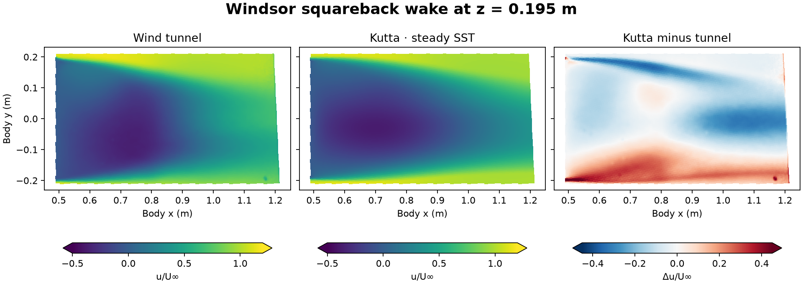

# Kutta physical-time and aerodynamic validation

Kutta now advances physical time for fixed-mesh incompressible laminar flow and fully turbulent SST. It exports instantaneous fields, equally spaced sample means and dimensional force histories. The two analytical checks below establish temporal accuracy on those problems. The public automotive case still has a 19% drag shortfall.

## Windsor squareback at 2.5° yaw

The steady solution on the 6,307,136-cell public G1 grid gives drag coefficient **0.26711** against **0.3298** measured, and lift coefficient **−0.13706** against **−0.0382** measured. Kutta met the case's residual and load convergence criteria after 1,421 iterations. The experimental comparison uses the no-wheel configuration, the four support pins, body axes and the workshop reference probe. The experimental forces are 300-second means. The simulation values come from the final steady field. [Workshop prescription](https://autocfd.org/case1/) · [Loughborough Set B data](https://repository.lboro.ac.uk/articles/dataset/Windsor_Body_Experimental_Aerodynamic_Dataset/13161284)



At all **52,673 valid planar PIV positions**, the horizontal-speed RMS error is **15.14% of freestream speed**. The streamwise and lateral components have RMS errors of 15.70% and 9.11%. The streamwise velocity signs disagree at 5,448 locations, or 10.34%. The comparison samples the CFD at the reported z coordinate of 0.195 m, excludes all 35,012 missing experimental vectors and covers every remaining location. Each dataset uses its own freestream reference, 40 m/s for the planar experiment and 40.1701 m/s for CFD. The supplied reader describes the horizontal data as transformed into model coordinates. We interpret both in-plane components in those axes. The horizontal-speed error is independent of the component basis. [Data reader supplied with the experiment](https://ndownloader.figshare.com/files/28639503)

The measured base tap mean is −0.3047 Cp against −0.2458 computed. This weaker suction is consistent with a drag deficit. Separate face integrals give lift contributions of +0.82861 on upward-facing body surfaces, −0.98835 on downward-facing surfaces and +0.02261 on steep surfaces. The base and pins account for the remainder. These partitions reproduce total drag, side force and lift within 1e−8. There is no corresponding experimental integral for each partition. [Tap comparisons and experimental setup](../workbench_aero/REPORT.md)

The nominal 1% inlet intensity decays to 0.266% at the tunnel reference probe, 0.232% one metre ahead of the model at z=0.5 m and 0.198% above the model at z=1.15 m. These values use the isotropic estimate from modeled k. The facility reports about 0.2% in an empty tunnel. Its 60 mm floor boundary-layer measurement is at the centre of the empty working section. At x=−1 m in the installed-model CFD, the velocity at z=60 mm is 96.2% of its value at z=0.5 m. The outer profile varies with height, so treating that upstream location as the empty-tunnel measurement would misstate the comparison. [Facility measurements](https://www.nwtf.ac.uk/dataset/1709/)

Seven seeded physical-time attempts failed the first-step acceptance check. The original numerical settings gave a predictor mass imbalance of 19.4 cell masses per step at 1 ms. With SIMPLE, a differentiable momentum limiter and relaxation of 0.65 for momentum and 0.35 for pressure, the maximum fell to 0.00114 at 50 µs and 120 correctors. On that trial the maximum corrected imbalance was 2.88e−6, and the largest equation residual was 2.10e−6. The predictor still exceeded the required 1e−4. At 25 µs and 300 correctors its maximum was 0.00122. With distance-weighted face interpolation at 50 µs and 180 correctors the predictor reached 0.000171, with corrected imbalance 3.22e−6 and equation residual 5.33e−8. At 10 µs with the same distance weighting and 180 correctors, the maximum predictor imbalance increased to 0.000927 while the corrected imbalance fell to 7.18e−7. Reducing the time step alone did not resolve startup. The failed-cell reports distinguish the large local predictor change from the final pressure-corrected mass error. This study produced **zero accepted Windsor physical steps**.

The first three diagnostics initialized directly from the previous steady snapshot, verified identical reordered topology and restored cell fields in original mesh order. The remaining attempts used the integrated CLI and its mesh-checked native checkpoint containing those same velocity, pressure, k and omega fields. A clean reproduction can generate that checkpoint with the steady case and `--write-restart`. The uncertainty still includes wake resolution and turbulence closure. A 2026 Windsor study compares mesh refinement and three closures and reports better results with IDDES-SST. Kutta's physical-time implementation here solves laminar flow or URANS. [Guilmineau, 2026](https://www.sciencedirect.com/science/article/pii/S0142727X2600192X)

## Measured wing loads

A two-dimensional moving-ground test used the Tyrrell 026 section at Re=462,000 and the reported 0.2% tunnel turbulence. The comparison targets the centre-section downforce coefficient inferred by pressure integration, expressed positive down. The assumed inlet eddy-to-molecular-viscosity ratio is one. All four cases converged. [Zerihan, *An Investigation into the Aerodynamics of Wings in Ground Effect*](https://eprints.soton.ac.uk/426058/1/00192634.pdf)

| Clearance / chord | Tunnel | Decaying SST | Sustained SST | Relative error, decaying → sustained |
|---:|---:|---:|---:|---:|
| 0.224 | 1.286 | 1.3988 | 1.3944 | +8.77% → +8.43% |
| 0.090 | 1.371 | 1.4066 | 1.3957 | +2.60% → +1.80% |

The sustaining terms kept the upstream freestream near 0.200% at x/c=−1 and y/c=3. The freely decaying cases delivered about 0.06–0.07% there. The change in load is modest despite the change in local turbulence. Sustaining terms remain an explicit fully turbulent SST setting. [SST sustaining-source equations](https://tmbwg.github.io/turbmodels/sst.html)

Two additional S1223 Reynolds numbers were withheld from the earlier 200k/300k study. The as-tested geometry stays at 4.76°. Measurements below are interpolated between bracketing clean-polar points at the same Reynolds number. The freestream intensity is 0.1% and the assumed viscosity ratio is one. [UIUC Low-Speed Airfoil Tests](https://m-selig.ae.illinois.edu/uiuc_lsat.html) · [Data provenance and use terms](../../data/uiuc_lsat_s1223/SOURCE.md)

| Re | Measured Cl / Cd | SST Cl / Cd | Intermittency Cl / Cd | Sustained SST Cl / Cd |
|---:|---:|---:|---:|---:|
| 149,700 | 1.5015 / 0.03000 | 1.5614 / 0.03137 | 1.5587 / 0.03279 | 1.5592 / 0.03155 |
| 249,700 | 1.5067 / 0.02223 | 1.6023 / 0.02912 | 1.6426 / 0.02577 | 1.6002 / 0.02930 |

At Re=249,700, intermittency reduced the drag error from +31.0% to +15.9% and increased the lift error. At Re=149,700 it increased the drag error, and the run reached the statistically-steady verdict only. The other five wing runs met the full convergence criteria. Changing the force measurement also leaves a discrepancy. On the 200k SST case, wall Cd is 0.03007 and the simulated wake survey 1.25 chords behind the trailing edge gives 0.02917, against 0.02450 in the tunnel. That survey assumes recovered far-wake static pressure. The local maximum static offset is 4.5% of dynamic pressure, so the survey is a cross-check. [Experimental wake-survey method](https://m-selig.ae.illinois.edu/pubs/SeligGopalarathnamGiguereLyon-2001-AIAA-Fixed-and-Flapping-Wing-MAVs-HiRes.pdf)

An independent XFOIL 6.99 check converged at 50 of 53 published conditions using independent cold starts and default free transition with Ncrit=9. From 150k through 300k, mean absolute relative drag errors were 9.1%, 6.0%, 7.9% and 17.6%. Mean absolute lift-coefficient errors were 0.262, 0.218, 0.221 and 0.176. These numbers describe XFOIL on the same UIUC dataset. [XFOIL and model documentation](https://web.mit.edu/drela/Public/web/xfoil/)

## Physical-time verification

The native integrator uses backward Euler startup and fixed-step BDF2 thereafter. It transports momentum and both SST scalars with a two-level history. The collocated face interpolation retains the difference between the conservative mass flux and the reconstructed velocity flux at the two previous time levels. Each physical step checks the normalized equations and maximum per-cell predictor and corrected mass defects. A rejected step stops the run and records its location. [Momentum-weighted interpolation for collocated arrangements](https://www.sciencedirect.com/science/article/pii/S0021999118305539)

* **Impulsively rotating shaft.** At t=0.040 s, the velocity-profile error on a 65-point radial traverse fell from 1.332% to 0.386%, 0.249% and 0.229% as the time step was halved three times. Orders from differences between successive numerical solutions were 2.37 and 2.30. CPU and Metal produced the same reported values. Before the boundary export fix the finest profile had 5.10% error because the viewer reconstructed the rotating wall with zero speed. [Analytical Bessel-series comparison](../../cases/transient_shaft.py)
* **Homogeneous turbulence decay.** For zero strain and far-field blending, omega(t)=omega₀/(1+β₂ omega₀t), and k(t)=k₀(1+β₂ omega₀t)^(−β*/β₂). Halving dt from 0.1 s to 0.05 s and 0.025 s gave orders 2.03–2.06 on both k and omega. At t=0.4 s the finest errors were below 0.038%. At the prescribed sustained equilibrium both scalars stayed within 2e−8 relative error. At the finest time step, mean-field errors were 0.0504% for k and 0.0444% for omega. A separate nine-sample force check reproduced the means, RMS fluctuations and extrema calculated directly from the dimensional history. [Executable SST verification](../../cases/transient_sst_decay.py)

### Periodic cylinder wake at Re=100

The DFG 2D-2 benchmark prescribes a 0.1 m cylinder, a parabolic inlet with mean 1 m/s, and a 0.41 m channel. Each Kutta inlet segment uses the exact integral mean of the parabolic profile. Kutta uses a static-pressure outlet in place of the reference's traction boundary. The comparison uses the published FeatFlow level-six, 5 ms table. Its reference gives peak Cd 3.2200, peak Cl 0.9859 and Strouhal number 0.30188. The site also lists an updated force-integration archive, which could not be retrieved for this comparison. [Geometry, conditions, sampling window and reference tables](https://wwwold.mathematik.tu-dortmund.de/~featflow/en/benchmarks/cfdbenchmarking/flow/dfg_benchmark2_re100.html)

| Cells | Time step | Simulated time | Peak Cd | Peak Cl | Strouhal |
|---:|---:|---:|---:|---:|---:|
| 4,564 | 5 ms | 8 s | 3.21056 | 0.91180 | 0.27119 |
| 4,564 | 2.5 ms | 8 s | 3.21003 | 0.90824 | 0.27119 |
| 4,564 | 5 ms | 30 s | 3.21066 | 0.91188 | 0.27119 |
| 11,880 | 2.5 ms | 8 s | 3.22422 | 0.95436 | 0.28933 |
| 23,680 | 2.5 ms | 8 s | 3.22105 | 0.95333 | 0.29520 |

Rows use the final four complete lift-peak cycles. On the 30 s run, the last complete lift-minimum cycle in the published 25–30 s window ran from 29.240 s to 29.610 s. Its peak Cd was 3.21061, peak Cl 0.91188 and one-cycle Strouhal number 0.27027. Halving the step on the coarse grid left the frequency error at 10.2%. Spatial refinement reduced it to 4.2% and then 2.2%. On the finest grid, peak drag was 0.033% high and peak lift 3.30% low. The four-cycle peak lift stayed between 0.95296 and 0.95333. That lift error persisted across the last two grids.

The finest case used a 150-iteration steady checkpoint as its initial field. That initial solve hit its iteration limit. Two starts from rest failed the first transient step on the predictor criterion, including one with 400 correctors. All 3,200 steps from the checkpoint passed the original 1e−4 limit. The short runs measure grid sensitivity in an earlier window and the fine grid starts from different fields. No discretization uncertainty interval follows from these observations.

## Workbench and repeat runs

The integrated desktop workbench inspected an unresolved wing–flap gap on the generated mesh and ran three independent grids of the same moving-road geometry. The inspector shows the cut through the fluid cells and lets a user place a refinement box at the selected gap. The three grids used the same tunnel, zones, operating condition and convergence settings. Each met both the residual and force criteria. These are workflow tests on a low-Re synthetic two-element wing.

| Cells | Iterations | Drag (N) | Downforce (N) | Front balance (%) | Sampled gaps below 3 cells |
|---:|---:|---:|---:|---:|---:|
| 1,758 | 381 | 0.39290 | 0.16340 | −10.99 | 2 |
| 6,282 | 401 | 0.40813 | 0.16020 | −14.85 | 1 |
| 16,113 | 361 | 0.41345 | 0.16029 | −16.53 | 0 |

The medium-to-fine changes were +1.30% in drag, +0.051% in downforce and −1.68 percentage points in front balance. The coarse gaps were under-resolved and downforce changed direction between refinement pairs. The UI reports these differences and withholds an uncertainty interval. [Three converged grids](mesh-study.png) · [Wing-gap section](gap-section.png)

A speed sweep through the native solver used the medium mesh at five matched inlet and road speeds from 1.8 to 2.2 m/s. All 15 CPU solves met the same residual and 300-iteration force criteria. The following are elapsed times from one interleaved pass on the same host.

| Initialization | Five-point time | Total iterations | Largest drag or downforce difference from cold | Peak process footprint |
|---|---:|---:|---:|---:|
| Cold at every speed | 74.83 s | 1,965 | Baseline | 120.60 MB |
| Warm, increasing speed | 64.75 s | 1,745 | 0.00016% | 128.17 MB |
| Warm, decreasing speed | 68.13 s | 1,765 | 0.00379% | 121.03 MB |

Warm starts reduced total iterations by 10–11% and elapsed time by 9–13% on this wing. Each chain started cold. All modes wrote checkpoints and included process startup. [Reproducible sweep](../../cases/moving_road_sweep.py)

Native steady restarts verify the mesh and transported variables before reusing the cell fields. On five shaft speeds, forward and reverse warm starts took 5.48 s and 5.38 s versus 5.02 s cold. The maximum matched torque difference was 0.0059%. [Shaft sweep and memory measurements](../native_restart_sweep/REPORT.md)

## Reproduction

The [case guide](../../../docs/kutta-case.md) documents transient options, field and force averaging, and SST ambient terms. For the distance-weighted Windsor trials, start with the [public case](../../cases/autocfd5-windsor-g1.kutta.json), set its coupling to `simple`, its gradient limiter to `differentiable`, its flux type to `rhie-chow-distance` and its momentum/pressure relaxation to 0.65/0.35. Use the checkpoint from the original steady setup. Use fresh output directories. The published Windsor grid and experimental flow files are large and are fetched separately. The [Windsor setup instructions](../workbench_aero/REPORT.md) identify the grid and the Set B pressure input. Use the Set B horizontal 40 m/s flow plane for the wake comparison. The held-out S1223 study requires the mesh used in the [earlier airfoil work](../workbench_aero/REPORT.md), and the ground-effect study uses the [two L2 ground-effect meshes](../ground_effect_wing/REPORT.md).

```sh
uv run --with scipy python validation/cases/transient_shaft.py build/kutta OUT/shaft
python3 validation/cases/transient_sst_decay.py build/kutta OUT/decay
uv run --with scipy python validation/cases/dfg_periodic.py build/kutta OUT/dfg --dt 0.005
uv run --with scipy python validation/cases/dfg_periodic.py build/kutta OUT/dfg-fine --dt 0.0025 --steps 3200 --scale 0.44 --correctors 140 --steady-seed-iterations 150
python3 validation/cases/s1223_holdout.py build/kutta OUT/airfoil
python3 validation/cases/ground_effect_ambient.py build/kutta OUT/ground
python3 validation/cases/wing_wake.py build/kutta runs/s1223-workbench --out OUT/wake.json
uv run --with matplotlib python validation/cases/windsor_loads.py build/kutta RUN --pressure-data PRESSURES --flow-data FLOW --wake-map OUT/windsor.png
python3 validation/cases/windsor_inflow.py build/kutta RUN OUT/approach.json
python3 validation/cases/moving_road_sweep.py build/kutta GRID/grid.kutta.json OUT/wing-sweep
```

On the integrated checkout, 354 regular native cases and five selected slow cases passed. The four top-level checks passed, as did all 15 workbench tests, including two GUI tests. The analytical cases ran on CPU and Metal. CUDA and the other 32 slow cases were outside this verification run.

The [machine-readable evidence](evidence.json) records measurements, mesh identifiers, available executable hashes and the validation checkout. The CFD runs used local Release builds on an Apple M4 Pro. The independent XFOIL executable and its input coordinate-file hash are recorded separately.
