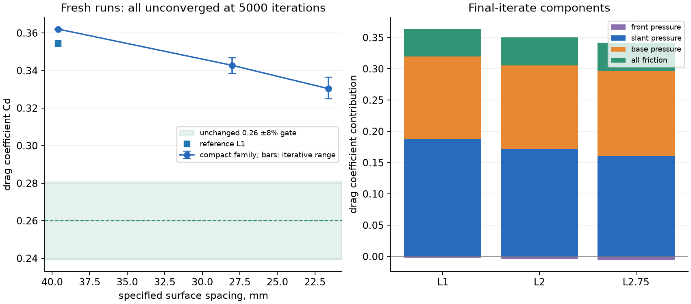
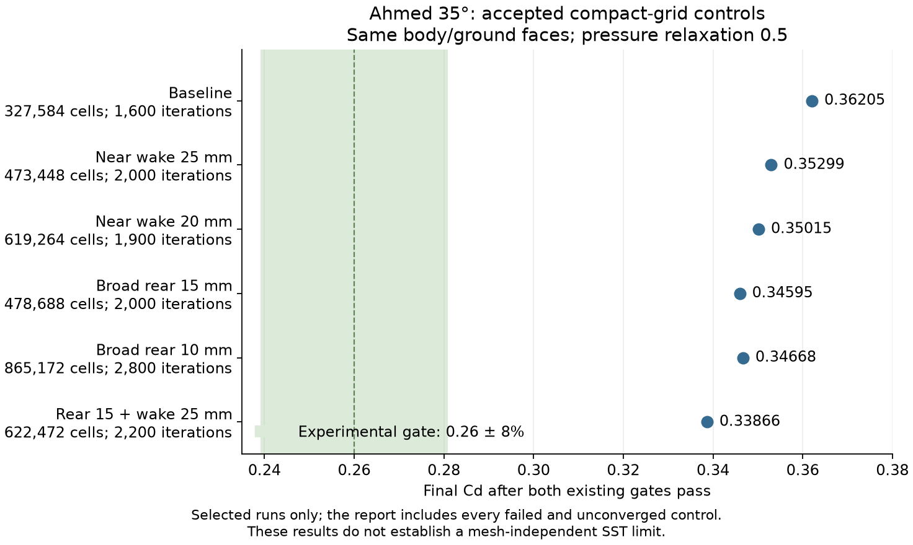
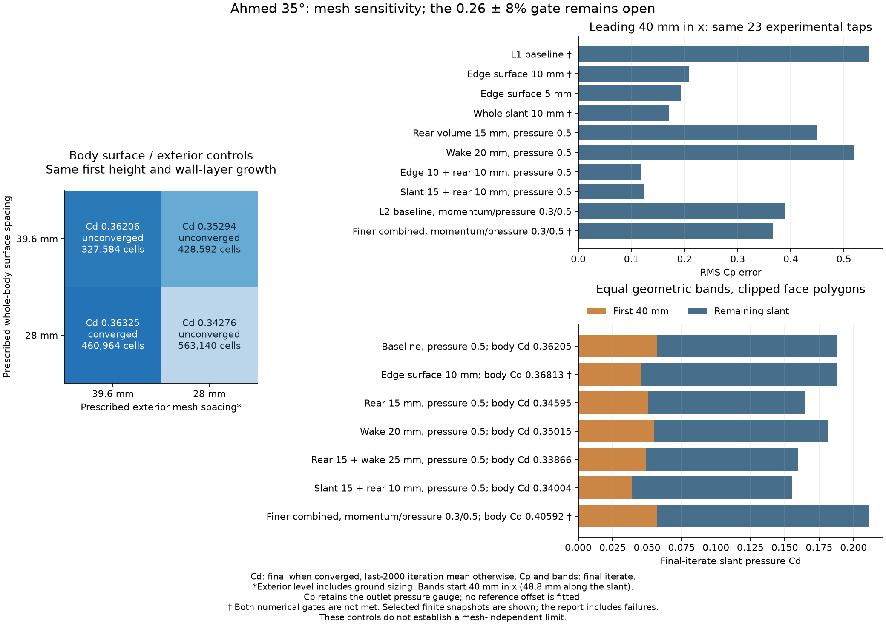
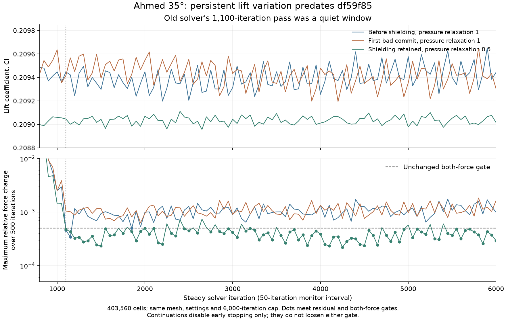

# Ahmed 35 degree drag diagnosis

The latest investigation is in [the 2026-11-03 section](#2026-11-03-leading-slant-controls-and-a-pressure-interface-settling-regression). The preceding sections preserve the earlier investigation.

The 0.26 drag gate and its 8% tolerance are unchanged. The original finest
full-model result, Cd 0.3137 on 1.33M cells, remains a failure. This investigation
adds a smaller refinement family, separates pressure and friction forces, and
fixes errors in the reporting code. It does not yet establish a mesh-independent
SST drag or a new solver-arithmetic defect. The measured compact-family
refinement response is Cd 0.36207 → 0.33032; it is not a solver recovery.
The original +20.7% result is not fixed, and its numerical/model split remains
unidentified. Native-mesh robustness failures and unsuccessful method controls
are recorded below.

## Source and method

The four hex-mesh runs and the initial numerical controls use the Release build of
`8866cc0e16df5b0642b2243611099ddccd7f3cd3`,
Apple Metal on the shared M4 Pro, macOS 26.6.2 and AppleClang 21.0.0. The benchmark binary SHA-256 is
`9dfa41d6c775d95b8367b5eaf2a54c309230a8cea14be8ad32572158bdce8a31`.
No source under `src/`, solver default, test gate or iteration budget changes.
The benchmark also exposes the existing pressure-interpolation setting, with its
second-order default preserved. The two pressure-scheme controls use a rebuild
of `57b593e9019b6723d0eb0d960ef1100fe7c6e744`. Their receipt records the actual
scheme and executable hash; an unconfirmed explicit scheme is rejected.

The case is the existing full Ahmed body with 35 degree slant, L 1.044 m,
W 0.389 m, H 0.288 m, 0.222 m slant length, R 0.100 m nose radii and 0.050 m
clearance. It omits stilts. The domain, stationary ground, slip far boundaries,
Re_L 2.78e6, Tu 1%, viscosity ratio 1 and reference area 0.112032 m² are unchanged.
The wall layers start at 15 µm, grow by 1.35 and span 17.283 mm in 20 layers.
SST uses its existing defaults. Convection is second-order upwind. SIMPLEC uses
0.7 momentum and 1.0 pressure relaxation; the explicitly named Coupled control
uses its existing 0.5/0.5 relaxation defaults.

Each run retains the existing 5000-iteration cap, residual criterion 1e-3 and
relative lift-and-drag change criterion 5e-4 over 1000 iterations. There is no
wall-clock stop. A run which misses any convergence condition is labelled
unconverged. For such runs, the quoted Cd is the mean of the last 2000 iterations,
as in the earlier reports; it is an iterative statistic, not a physical time
average. Force components and field comparisons use the final iterate, not that
mean. Wall times are omitted because the GPU was shared. Only one heavy solve
ran at a time in this lane.

`MallocSpaceEfficient=1` is set before launching the benchmark. Unlike `kutta`
it does not re-execute itself with that allocator setting. Peak memory is the
macOS `phys_footprint` reported by `/usr/bin/time -l`, including Metal buffers.

## Mesh study

The original mesher refines a large outer volume. Its threshold reaches the
0.4 m far-field spacing at 3 m from the body, and the wake box has a 2 m
transition thickness. The compact family changes those distances to 0.6 and
0.3 m. It keeps the domain, body surface algorithm, wall-normal layers and
wake-box extents. Each level divides the specified body surface spacing by
sqrt(2). These are local refinements, not geometrically similar uniform grids;
cell-count^(-1/3) would give a misleading refinement ratio.

The new options default to the original values. The recorded regression meshes
and `validation/generated_fixtures.tsv` are unchanged. Regenerating the default
L1 15 µm mesh reproduces the ledger SHA-256
`9f39867109f04f2f0cc2bcc1207e195d7029f68f4d094c3676d67911918cb135`
byte for byte. Mesh hashes, metadata and
portable solve commands are in `summary.json`. Rebuilding compact L1 through
the retained CLI reproduced every byte after the mesh's comment line. The
comment differed because the exploratory call used integer `35` and the CLI
used float `35.0`.

| run | cells | iterations | Cd | last-2000 range | max residual | converged | peak GB |
| --- | --- | --- | --- | --- | --- | --- | --- |
| compact_L1 | 327,584 | 5000 | 0.36207 | 0.36197–0.36215 | 9.4e-06 | no | 1.03 |
| compact_L2 | 563,140 | 5000 | 0.34275 | 0.33833–0.34680 | 0.0074 | no | 1.68 |
| compact_L2.75 | 919,620 | 5000 | 0.33032 | 0.32498–0.33650 | 0.0087 | no | 2.66 |
| reference_L1 | 446,364 | 5000 | 0.35448 | 0.35443–0.35454 | 5.1e-06 | no | 1.36 |



The original-grading L1 control has exactly the same body-wall face centroids
and areas as compact L1. Changing only off-body grading raises the last-2000
mean Cd by **0.00759**, from 0.35448 to 0.36207. Compact and original mesh
levels therefore cannot be pooled into a single refinement series. The current
ledger L1 contains 446,364 cells; the older archived study reported 446,128.
Those archived values are not asserted to be exact same-mesh reruns.

### Richardson extrapolation

Use `Cd(h) = Cd_infinity + C h^p`, with h the specified surface spacing.
A three-point algebraic fit alone is not evidence of the asymptotic range.
The analysis code supports unequal refinement ratios and explicitly rejects
nonmonotonic series and series with no positive-order solution.

The earlier thin-wall study's exact archived means are 0.35451567, 0.33264874,
0.31440100 and 0.30308473 at L1, L2, L3 and L3.5. Fitting L1–L3 gives
p = 0.5221 and **Cd_infinity = 0.2224**. The next triplet, L2/L3/L3.5,
has no positive-order fit. The extrapolated 0.2224 is therefore rejected.
It is not a prediction or a gate pass. Those archived runs predate this branch;
they are retained evidence from the external-3D report, not fresh runs here.

The fresh compact triplet gives a formal p = 0.5042 and Cd_infinity = 0.2416. Using the eight combinations of the observed iterative range endpoints gives 6 positive-order fits, with Cd_infinity 0.2209–0.3362. This endpoint exercise is a sensitivity check, not a confidence interval. Fixed wall-normal/far-field resolution, unconverged snapshots and the exterior-mesh control prevent a mesh-independent model-error attribution. An extrapolation inside tolerance is not treated as a physical-gate pass.

## Force accounting and location of the error

For fluid-outward face normal n, pressure drag is `sum(Cp n_x A)/A_ref` and
friction drag is `-sum(tau_x A)/(0.5 A_ref)`. `walls.csv` stores stress on the
fluid, hence the minus sign. The front includes the nose and its 100 mm fillets;
the slant and base use their CAD orientation. The remaining roof, underside
and sides are also included so that the components close to the force monitor.
No pressure offset is fitted to improve the comparison.

| run | total Cd | pressure Cd | friction Cd | front P/F | slant P/F | base P/F | other P/F |
| --- | --- | --- | --- | --- | --- | --- | --- |
| compact_L1 | 0.36204 | 0.31780 | 0.04424 | -0.00170 / 0.00866 | 0.18796 / -0.00058 | 0.13154 / 0.00000 | 0.00000 / 0.03616 |
| compact_L2 | 0.34636 | 0.30174 | 0.04462 | -0.00367 / 0.00864 | 0.17215 / -0.00050 | 0.13326 / 0.00000 | 0.00000 / 0.03648 |
| compact_L2.75 | 0.33650 | 0.29148 | 0.04502 | -0.00529 / 0.00867 | 0.16075 / -0.00040 | 0.13603 / 0.00000 | 0.00000 / 0.03676 |
| reference_L1 | 0.35450 | 0.31058 | 0.04391 | -0.00385 / 0.00862 | 0.18506 / -0.00055 | 0.12937 / 0.00000 | 0.00000 / 0.03585 |

Pressure drag of an individual open surface depends on the pressure datum.
A constant Cp shift changes the front, slant and base components while cancelling
on the complete closed body. Therefore a negative front component alone does
not prove a front-pressure defect. Liu and Moser explicitly warn about the
reference-pressure dependence of components. Experiment and outlet-gauge CFD
components must be interpreted with that limitation.

Edge bands use Cartesian distances: the first 40 mm in x after the roof edge,
and the outer 30 mm in y/z on the base.

| run | slant first 40 mm | rest of slant | base outer 30 mm | base centre |
| --- | --- | --- | --- | --- |
| compact_L1 | 0.05931 | 0.12865 | 0.07955 | 0.05198 |
| compact_L2 | 0.04882 | 0.12333 | 0.07639 | 0.05687 |
| compact_L2.75 | 0.04266 | 0.11808 | 0.07501 | 0.06101 |

A frozen-field check uses exact mesh wall-owner cells, matched to the exported
cell centroids within 1e-8 m. On compact L1, replacing extrapolated wall pressure
with owner-cell pressure changes slant Cd 0.1879629 → 0.1879338. The leading
40 mm changes 0.0593139 → 0.0592874. This direct load-evaluation effect is tiny
compared with the observed suction error. It is not an ablation of pressure
reconstruction inside the momentum equations. `bench_wall_owners` makes the
owner map without constructing a solver or modifying a field.


The compact-family final-iterate slant pressure drag falls by 0.02722, while
friction changes by only +0.00077. Of the slant change, 0.01665 occurs in the
first 40 mm in x. Base pressure drag rises by 0.00449 over these snapshots.
This is evidence of a mesh-sensitive roof/slant suction field, not evidence that
all of the total-drag excess is mesh error.

## Experiment, CFX and wake profiles

The unchanged Cd 0.26 gate comes from Ahmed et al. at 60 m/s, Re_L 4.29e6.
The pressure/profile comparison uses Lienhart–Becker at 40 m/s, Re_L 2.78e6.
That experimental/setup difference cannot be silently assigned to SST model error.

[ERCOFTAC KBwiki AC1-05, Lienhart–Becker experiment](https://kbwiki.ercoftac.org/w/index.php/Test_Data_AC1-05)
provides rear Cp, hot-wire slant profiles and LDA wake planes,
including x = 80, 200 and 500 mm behind the base. It provides no total drag for
the Lienhart–Becker experiment. Coordinates in the rear Cp and velocity files are numerically in mm,
including hot-wire files whose metadata says m. Velocity columns are selected
by their metadata names: experimental BL files have U/W, whereas CFX BL files
have U/V/W. U and W are divided by the experimental bulk velocity, 40 m/s.

Pressure comparisons use the nearest wall face within 6 mm. Velocity comparisons
use the nearest cell within 6 mm for BL profiles and 30 mm for wake planes.
These are bounded sampling diagnostics, not interpolation or additional gates.
Counts are reported because coarser meshes do not support every near-wall point.
Different coverage must not be mistaken for a mesh-convergence trend in RMS error.
Steady/iterative snapshots are compared to experimental mean velocities; this
also limits the interpretation of oscillatory runs.

Finest compact mesh, final iterate. Counts are matched/eligible.

| reference | region | taps | reference mean Cp | Kutta mean Cp | Cp RMS error |
| --- | --- | --- | --- | --- | --- |
| experiment | slant | 139/139 | -0.2876 | -0.3831 | 0.1960 |
| experiment | base | 98/99 | -0.2203 | -0.2546 | 0.0893 |
| experiment | slant_leading_40mm | 42/42 | -0.2690 | -0.5137 | 0.3371 |
| experiment | slant_remaining | 97/97 | -0.2956 | -0.3265 | 0.0763 |
| CFX-5 SST | slant | 1099/1110 | -0.2334 | -0.3689 | 0.1711 |
| CFX-5 SST | base | 1027/1041 | -0.1734 | -0.2825 | 0.1627 |
| CFX-5 SST | slant_leading_40mm | 358/360 | -0.2330 | -0.4303 | 0.2473 |
| CFX-5 SST | slant_remaining | 741/750 | -0.2336 | -0.3393 | 0.1177 |

Common supported taps across all listed fresh runs. experiment slant: 87, experiment base: 68, CFX-5 SST slant: 562, CFX-5 SST base: 521.

| run | experiment slant RMS | experiment base RMS | CFX slant RMS | CFX base RMS |
| --- | --- | --- | --- | --- |
| compact_L1 | 0.3090 | 0.1556 | 0.3390 | 0.2158 |
| compact_L2 | 0.2258 | 0.1176 | 0.2676 | 0.1742 |
| compact_L2.75 | 0.1932 | 0.0871 | 0.1733 | 0.1580 |
| reference_L1 | 0.3113 | 0.1715 | 0.3173 | 0.1878 |

Finest compact mesh, final iterate. Errors are normalized by bulk velocity.

| reference | station, mm | matched/available | U RMS error / U∞ | W RMS error / U∞ |
| --- | --- | --- | --- | --- |
| experiment | x=80 | 840/840 | 0.1199 | 0.0664 |
| experiment | x=200 | 840/840 | 0.1393 | 0.0511 |
| experiment | x=500 | 840/840 | 0.0840 | 0.0257 |
| experiment | BL_x=-163 | 11/14 | 0.0874 | 0.0581 |
| experiment | BL_x=-123 | 18/20 | 0.1615 | 0.0629 |
| experiment | BL_x=-83 | 21/24 | 0.1438 | 0.0682 |
| experiment | BL_x=-43 | 19/27 | 0.1305 | 0.0774 |
| experiment | BL_x=-3 | 17/30 | 0.1060 | 0.0741 |
| CFX-5 SST | x=80 | 3619/3619 | 0.1285 | 0.0607 |
| CFX-5 SST | x=200 | 3428/3428 | 0.1718 | 0.0798 |
| CFX-5 SST | x=500 | 3336/3336 | 0.0976 | 0.0319 |
| CFX-5 SST | BL_x=-163 | 30/36 | 0.1119 | 0.0659 |
| CFX-5 SST | BL_x=-123 | 35/39 | 0.1554 | 0.0578 |
| CFX-5 SST | BL_x=-83 | 36/41 | 0.1284 | 0.0481 |
| CFX-5 SST | BL_x=-43 | 36/44 | 0.0747 | 0.0384 |
| CFX-5 SST | BL_x=-3 | 26/34 | 0.0875 | 0.0447 |

| run | roof -203 / slant -163,-123,-83,-43,-3 mm | reversed slant area |
| --- | --- | --- |
| compact_L1 | - R R R R R | 86.1% |
| compact_L2 | - R R R R A | 86.6% |
| compact_L2.75 | - R R R R A | 87.4% |
| reference_L1 | - R R R R R | 85.8% |

The finest compact snapshot still has excessive leading-slant suction: mean Cp
-0.514 against -0.269 over the supported experimental taps. The remaining slant
is much closer, -0.327 against -0.296. Common-population errors decrease with
refinement on both slant and base. Inspection of bounded nearest-cell
centreline wake profiles shows too little upper-wake velocity deficit at 80 and
200 mm: forward flow recovers too quickly there. The table gives the full-plane
aggregate errors rather than treating a centreline impression as a wake-length
measurement. The last slant station also reattaches in the finer snapshots,
where the experimental and CFX profiles remain reversed.

## What published SST results establish

[Liu and Moser, *Numerical modeling of airflow over the Ahmed body*, 2003,
Table 1](https://www.jasonyunlong.com/pdf/Vancouver2003_AB.pdf) lists SST Cd
0.241 at 35 degrees. It lists front/base/slant components 0.026/0.107/0.108.
The SST setup is not described sufficiently to make this a matched solver
oracle. Its component sum equals its tabulated total, so the table also cannot
supply an independent friction benchmark. The paper lists LSTM base/slant
components 0.129/0.121, distinct from Ahmed's 0.095/0.090. The earlier report's
0.055 friction estimate is the remainder of Ahmed's total and pressure components,
not a measured Lienhart–Becker friction force.

[Demuren and Trehan, *Computational aerodynamics of the Ahmed model car body*,
FEDSM2006-98285, Table 3](https://citeseerx.ist.psu.edu/document?doi=df6700ff91de91eb85a8c1277510500079798402&repid=rep1&type=pdf)
reports steady Fluent 6.2 SST Cd 0.28 at 35 degrees, against its quoted
experimental 0.257. They use second-order upwind convection and 2.88M tetrahedra
after a grid study with k-epsilon. Their SST solution misses the observed slant
separation and wake structure. Its apparently close drag is not full validation.

The [ERCOFTAC CFX-5 SST fields, Kuntz, Menter and Durand](https://kbwiki.ercoftac.org/w/index.php/CFD_Simulations_AC1-05)
are the closest available Ansys-family field
comparison: 2.5M cells on a half model, y+ around 1, second-order convection,
Tu 1% and viscosity ratio 1. They are not a same-mesh Fluent solution.
In the archived 25-degree cross-check, CFX and Kutta both fail to reproduce the experiment's slant
reattachment. That cross-check supports a model limitation for topology; it does
not measure the SST contribution to Kutta's 35 degree total-drag error.

These results establish that published SST calculations can give much less drag
than the current coarse Kutta meshes. They do not establish a unique expected
SST Cd, a transferable model-error percentage, or permission to change the gate.

## Demonstrated fixes

The reporting code had two errors, reproduced with analytic synthetic surfaces
before checking the corrected behavior:

- `ahmed_breakdown` always used the 35 degree slant mask. A 25 degree slant face
  at x = -0.19 m contributed zero. It now uses the run's slant angle and the
  force monitor's requested reference area. The analytic example gives
  0 → 0.1056545654 with A_ref = 2 m².
- The Cp comparison used a height range to identify slant taps. It included
  49 side-wall taps at 35 degrees and 38 at 25 degrees. It now selects the
  slant plane, allowing 0.5 mm for CFX's exported coordinate offset and rounded
  experimental coordinates. The full 35 degree slant reference population is
  139 taps, mean Cp -0.287554, instead of 188 taps, mean -0.265926. At 25 degrees
  it is 143 taps, mean -0.597972, instead of 181, mean -0.554547. A run's 6 mm
  sampling bound can reduce those populations further.

Both focused checks fail against `8866cc0` reporting code and pass after the
fix. They change the interpretation of earlier Cp tables, not the solver's
fields or drag. No solver default was adjusted to hit a literature value.

## What was tried and what remains

The prior 50 → 15 µm wall-spacing experiment changes Cd by less than 0.4% at
matching mesh levels. The existing poor-cell pressure fix already makes those
wall layers run. Neither can explain the original 20.7% finest-mesh excess.
The earlier report locates that robustness defect in sheared first-layer cells
at sharp edges. It is already fixed on this branch's base, not a new recovery
claimed here.

The compact mesh saves memory, but its measured +0.00759 exterior-grading
effect at L1 prevents treating it as an interchangeable version of the original
family. The memory-scale report already measures 4.50 GB for the original
1.33M-cell path. That is why this study stops its hex family at 919,620 cells
and a measured 2.66 GB, rather than reproducing the original finest mesh.

A half-model generator was attempted to keep the original exterior resolution
at half the cell count. Gmsh either invalidated the discrete layer shell when
meshing its shared rim, or rejected the merged surface with
`PLC Error: A segment and a facet intersect at point`. No valid half mesh or
half-model solve resulted. That attempted code was removed.

The native tet/prism mesh retains 55,371 tetrahedra and 74,960 prisms before
hex subdivision. Its 130,331 cells cost less than 0.5 GB. The following controls
all retain the 5000-iteration cap and original convergence criteria. Failed
runs have no physical Cd result; their final forces are not drag predictions.

| control | iterations | last-2000 mean Cd | max residual | result | peak GB |
| --- | --- | --- | --- | --- | --- |
| compact L2, SIMPLEC, differentiable, second-order pressure | 1500 | invalid | 22.1 | nonfinite solver input after 1500-iteration monitor | 1.684 |
| native, SIMPLEC, Standard limiter, second-order pressure | 250 | invalid | 0.688 | nonfinite solver input after 250-iteration monitor | 0.418 |
| native, identical default after adapter rebuild | 250 | invalid | 0.688 | nonfinite solver input after 250-iteration monitor | 0.417 |
| native, Coupled, differentiable, second-order pressure | 5000 | 0.42867 | 0.0227 | unconverged | 0.480 |
| native, SIMPLEC, Standard limiter, Standard pressure | 5000 | 0.49832 | 0.000317 | unconverged | 0.440 |

Changing only native pressure interpolation from second-order to Standard
prevents the nonfinite failure for all 5000 iterations, but Cd is 0.49832 and
the force criterion is still missed. This isolates pressure interpolation as
a stability-sensitive choice on this mesh. It does not isolate a faulty
pressure term, establish which field is accurate, or justify a default change.

The two native default runs, before and after adding the explicit scheme flag,
have identical values in every monitored column except seconds, through all
five monitors before failure. Thus the new adapter has not changed the default
failure. Late failed fields contain extreme velocities on flat roof and
underside wall layers as well as the base; they are too late to identify the
first failing face. A numeric location of the maximum after blow-up is not a
root cause.

The differentiable limiter is an existing opt-in, with its default coefficient
unchanged. Fluent's [Theory Guide 23.3.4.3, Gradient
Limiters](https://ansyshelp.ansys.com/public/Views/Secured/corp/v261/en/flu_th/flu_th_sec_grad_limit.html)
describes convergence problems with non-differentiable limiters. That supports
the experiment, not a claim that Kutta uses identical Fluent coefficients. On
this target the existing opt-in does not provide an accepted solution. The
Coupled-plus-differentiable run changes two choices and therefore isolates only
the combination, not either choice separately.

Source inspection also rejected a missing face-value bound as a proposed fix:
`fv_moment_momentum` already bounds its extrapolated value to the sample cloud
and applies the minimum cell limiter; the limiter itself is clamped to [0,1].
Adding another clamp would not address a demonstrated missing invariant. No
speculative kernel fix or tuned default is retained.

The measured attribution is therefore limited:

- **Mesh:** compact L1 → L2.75 lowers the last-2000 mean Cd by 0.03175,
  with unchanged solver settings and wall-normal layers. This is a measured
  response to refinement, not the remaining mesh error on the original 1.33M
  mesh. The separate exterior-grading effect is +0.00759 at L1. Neither can be
  converted into a percentage of the original finest-mesh excess.
- **Kutta numerics/robustness:** the native default failure and the hex
  differentiable-limiter failure are reproducible limitations. Direct wall
  pressure load reconstruction contributes only about 0.00003 to coarse slant
  Cd. No controlled experiment yet identifies a faulty arithmetic term that
  explains the hex pressure excess. The reporting defects above are fixed.
- **SST:** the 25-degree topology cross-check is consistent with a model
  limitation. Published 35-degree SST Cd spans at least 0.241–0.28 in the cited
  unmatched setups. A numeric SST share of the current excess remains
  unidentified; assigning the residual error to SST would be unsupported.

A matched, converged Fluent solve on one of these exact meshes is unavailable.
That is the remaining way to distinguish a Kutta discretization discrepancy
from different SST formulations/settings without relying on unrelated literature
meshes. Further refinement also needs a valid half mesh or better local cell
allocation before a mesh-independent Cd can be claimed under 3 GB.

## Verification and reproduction

Release configuration and build succeeded on Metal/CPU. The two analytic
reporting regressions and four analysis checks pass. Portability lint and
`git diff --check` pass. The default mesh regenerates to its ledger hash, and
all fresh runs fit the measured 3 GB budget. Exported integrated forces close
to the monitor within the recorded CSV precision; exact closure errors and
wall-owner identity errors are retained in `summary.json`. Own monitor histories
and portable receipts are in `evidence/`. Failed receipts mark physical fields
null because post-failure exports are not valid solutions. `-` in the topology
table means no supported slant faces at that station; -203 mm is on the roof
for the 35-degree geometry, not an attached-flow observation.

The complete quick tier passes: **277 tests, 7,457,592 assertions, zero
failures**, with `--test-suite-exclude=slow` and the prescribed fixture
environment. No skips or expected-failure markers were added. This validates
the unchanged default path and integration; it does not recover the Ahmed
physical gate.

The new benchmark's invalid pressure-scheme value is rejected before solver
creation. Explicit scheme requests are checked against the benchmark's emitted
configuration before analysis. Neither CUDA compilation nor CUDA runtime was
verified in this lane.

The new code does not change solver arithmetic. A full slow-tier comparison is
therefore not claimed or substituted by the earlier lane's comparison. The main
baseline XML is read-only and was not copied into this report. No slow XML,
restricted curves, generated meshes or cell fields are committed.

From `<checkout>`, with gmsh 4.15.2, numpy, scipy and matplotlib in `build-py`,
and a read-only link to the restricted ERCOFTAC tree at
`validation/data/ercoftac_ahmed_body`:

```sh
cmake -S . -B build -G Ninja -DCMAKE_BUILD_TYPE=Release
cmake --build build -j 2
build-py/bin/python tools/fsae_aero/ahmed.py --slant 35 --level 2 \
  --first 1.5e-5 --refinement-reach .6 --wake-padding .3 \
  --out runs/ahmed_drag/mesh/compact_L2.msh
build-py/bin/python tools/ahmed_drag/run.py \
  --mesh runs/ahmed_drag/mesh/compact_L2.msh --out runs/ahmed_drag/compact_L2
build/bench_wall_owners runs/ahmed_drag/mesh/compact_L2.msh body \
  > runs/ahmed_drag/compact_L2/owners.csv
# Other refinement levels: 1 and 2.75. Run one solve at a time.
# Existing method controls: --limiter differentiable, --coupled,
# --pressure-scheme standard. Native mesh: ahmed.py --cell-type tet-prism.
# Native default is known to fail; this is a diagnostic, not an accepted case.
build-py/bin/python tools/ahmed_drag/analyze.py runs/ahmed_drag/compact_L1 \
  runs/ahmed_drag/compact_L2 runs/ahmed_drag/compact_L2.75 --out runs/ahmed_drag/summary.json
build-py/bin/python -m unittest discover -s tools/fsae_aero -p 'test_*.py'
build-py/bin/python -m unittest discover -s tools/ahmed_drag -p 'test_*.py'
python3 tools/lint_portability.py
KUTTA_FLUENT_EXAMPLES=<reference-checkout>/validation/fluent_examples \
KUTTA_RUNS=<reference-checkout>/runs build/kutta-tests --test-suite-exclude=slow
```

## 2026-11-03: Leading-slant controls and a pressure-interface settling regression

The experimental drag gate remains open. On the compact mesh, accepted rear-volume and wake refinement reduces Cd **0.36205 → 0.33866** (6.46%), with all boundary faces unchanged. An edge-surface/rear-volume combination reduces leading-slant Cp RMS error **0.54655 → 0.11894**. The surface-only controls show that other slant and base loads can offset a large local pressure improvement. These are substantial numerical sensitivities; they do not establish a mesh-independent SST result. The finer baseline passes after stronger relaxation at Cd 0.33922; the finer combined trial fails force settling within the unchanged cap. These outcomes leave the drag correction unconfirmed on a settled refinement family.

The historical SIMPLEC settling regression is isolated to **`df59f85`**. Existing pressure relaxation 0.5 restores the first accepted window and reduces subsequent lift variation while retaining the native tet/prism finite trajectory. It stays opt-in: the full slow comparison has no assertion regressions, but a materially worse S1223 reported drag error. No solver-arithmetic change or automatic relaxation change is retained.

### Inputs and comparisons

The study starts from `e014e36`. Cold compact runs use Re 2.78e6, U and rho 1, length 1.044 m, area 0.112032 m², stationary ground, fully turbulent SST, inlet turbulence intensity 1% and viscosity ratio 1 unless named otherwise. SIMPLEC momentum/pressure relaxation is 0.7/1 unless stated. All retain the prior 5,000-iteration cap, maximum residual limit 1e-3 and **both-force** relative-change limit 5e-4 over 1,000 iterations, checked every 50. No wall-clock cap is used.

Compact meshes retain the full body and domain extents; their body-refinement reach and wake transition are 0.6/0.3 m rather than the default 3/2 m. The 327,584-cell compact L1 baseline has prescribed body spacing 39.598 mm and 20 wall layers starting at 15 μm, growth 1.35, total thickness 17.283 mm. Global L2 body spacing is 28 mm. Exterior-level changes also alter ground/far-field sizing; they do not isolate ground resolution. Independent body/surface fields hold other prescribed inputs, but remeshing can alter neighbouring cells. Exact geometry identity is claimed only where checked. Growth 1.1 uses 51 layers and 19.219 mm thickness; first height 50 μm uses 16 layers and 17.245 mm thickness.

Accepted rows report **final Cd**. Finite unconverged rows report a last-2,000-iteration mean and range, which are diagnostic steady-iteration averages. Pressure/friction, force partitions and Cp always use the final snapshot. Failed-run forces are invalid; their iteration counts are last completed monitors, not exact rejection iterations. A failure before its first monitor has no measured residual. A pressure-gauge offset cancels on the closed body but redistributes front/slant/base loads; regional comparisons retain the same outlet gauge.

Cp uses the restricted ERCOFTAC data locally. Tables compare the common supported taps across finite rows, without exporting reference curves or fitting a pressure offset. The leading comparison uses 23 taps, reference mean -0.26839; the full-matrix remaining-slant intersection contains 39 taps. A separately labelled four-case comparison below retains 70 remaining taps. Exact face-polygon clipping defines the first 40 mm in x (48.8 mm along the slant). The former centroid selection included 4.44% too much coarse-grid area; correcting this attribution does not change solver forces or gates.

The archived receipts pin full commands, mesh hashes and executables. Most cold controls use the frozen `e014e36` solver and `1c36f4d` bench adapter. `MallocSpaceEfficient=1` is set before launch. Memory means `/usr/bin/time -l` peak physical footprint including Metal allocations; contended elapsed times are not performance claims. For example, from `<checkout>` with gmsh 4.15.2:

```sh
build-py/bin/python tools/fsae_aero/ahmed.py --slant 35 --level 1 \
  --first 1.5e-5 --refinement-reach .6 --wake-padding .3 \
  --slant-edge-volume-size .015 --slant-edge-volume-reach .25 \
  --wake-volume-size .025 --out runs/ahmed_cause/mesh/shear15_wake25_L1.msh
MallocSpaceEfficient=1 build/bench_fsae_aero \
  --mesh runs/ahmed_cause/mesh/shear15_wake25_L1.msh --backend metal \
  --re 2.78e6 --length 1.044 --area .112032 --walls body --lift-z --tu .01 \
  --window 1000 --iterations 5000 --urf-p .5 --cells \
  --out runs/ahmed_cause/shear15_wake25_L1_pressure05
```

### Experiment matrix

| Control | Cells | Iterations / last monitor if failed | Cd | Last-2000 range, unconverged only | Pressure / friction Cd, final | Max residual | Converged | Peak GB |
| --- | ---: | ---: | ---: | --- | --- | ---: | --- | ---: |
| [L1 baseline](evidence/2026-11-03/baseline_L1.json) | 327,584 | 5000 | 0.36206 | 0.36197 to 0.36214 | 0.31781 / 0.04424 | 1.07e-05 | no | 1.029 |
| [Edge surface 10 mm](evidence/2026-11-03/edge10_L1.json) | 374,892 | 5000 | 0.36813 | 0.36807 to 0.36820 | 0.32398 / 0.04417 | 6.82e-06 | no | 1.159 |
| [Small edge volume 10 mm](evidence/2026-11-03/volume10_L1.json) | 415,108 | 5000 | 0.36728 | 0.36721 to 0.36741 | 0.32297 / 0.04428 | 9.94e-06 | no | 1.274 |
| [Edge surface + small volume 10 mm](evidence/2026-11-03/both10_L1.json) | 455,788 | 5000 | 0.37439 | 0.37434 to 0.37445 | 0.33015 / 0.04420 | 4.38e-06 | no | 1.384 |
| [Whole slant surface 10 mm](evidence/2026-11-03/slant10_L1.json) | 516,900 | 5000 | 0.36437 | 0.36429 to 0.36446 | 0.31996 / 0.04439 | 9.93e-06 | no | 1.547 |
| [Edge surface 5 mm](evidence/2026-11-03/edge5_L1.json) | 440,276 | 3400 | 0.36990 | - | 0.32585 / 0.04406 | 1.09e-05 | yes | 1.318 |
| [Broad rear volume 15 mm](evidence/2026-11-03/shear15_L1.json) | 478,688 | 5000 | 0.34603 | 0.34596 to 0.34610 | 0.30165 / 0.04436 | 3.91e-06 | no | 1.448 |
| [Body surface 28 mm, L1 exterior sizing](evidence/2026-11-03/body_L2_volume_L1.json) | 460,964 | 1700 | 0.36325 | - | 0.31859 / 0.04466 | 4.72e-06 | yes | 1.386 |
| [L2 exterior sizing, L1 body surface](evidence/2026-11-03/volume_L2_body_L1.json) | 428,592 | 5000 | 0.35294 | 0.35044 to 0.35530 | 0.31046 / 0.04403 | 0.00712 | no | 1.313 |
| [L2 exterior sizing, L1 body, momentum relaxation 0.5](evidence/2026-11-03/volume_L2_body_L1_urf05.json) | 428,592 | 5000 | 0.34977 | 0.34935 to 0.35056 | 0.30646 / 0.04399 | 0.00104 | no | 1.295 |
| [L2 baseline](evidence/2026-11-03/baseline_L2.json) | 563,140 | 5000 | 0.34276 | 0.33833 to 0.34682 | 0.30200 / 0.04462 | 0.0074 | no | 1.679 |
| [L2 + edge surface 10 mm](evidence/2026-11-03/edge10_L2.json) | 619,516 | 5000 | 0.34976 | 0.34113 to 0.35818 | 0.31326 / 0.04481 | 0.0117 | no | 1.835 |
| [Normal-layer growth 1.1](evidence/2026-11-03/normal_g11_L1.json) | 676,024 | 250 | invalid | - | - | 16.27044 | failed | 1.980 |
| [First height 50 micrometres](evidence/2026-11-03/wall50_L1.json) | 283,308 | 200 | invalid | - | - | 12.08643 | failed | 0.895 |
| [Normal-foot pressure rows](evidence/2026-11-03/normalfoot_L1.json) | 327,584 | 5000 | 0.36203 | 0.36196 to 0.36209 | 0.31781 / 0.04424 | 1.01e-05 | no | 1.029 |
| [Standard pressure](evidence/2026-11-03/pressure_standard_L1.json) | 327,584 | 1600 | 0.37008 | - | 0.32569 / 0.04439 | 1.57e-06 | yes | 1.004 |
| [Differentiable velocity limiter; scalar limiting unchanged](evidence/2026-11-03/differentiable_L1.json) | 327,584 | 1600 | 0.36137 | - | 0.31723 / 0.04415 | 7.51e-07 | yes | 1.023 |
| [Kato-Launder production](evidence/2026-11-03/kato_L1.json) | 327,584 | 5000 | 0.36485 | 0.36475 to 0.36493 | 0.32049 / 0.04442 | 9.98e-06 | no | 1.029 |
| [SST production cap off](evidence/2026-11-03/limiter_off_L1.json) | 327,584 | 5000 | 0.36634 | 0.36625 to 0.36641 | 0.32150 / 0.04481 | 6.65e-06 | no | 1.029 |
| [Inlet viscosity ratio 100](evidence/2026-11-03/ratio100_L1.json) | 327,584 | 5000 | 0.36526 | 0.36518 to 0.36533 | 0.32065 / 0.04462 | 7.1e-06 | no | 1.029 |
| [Moving ground](evidence/2026-11-03/moving_ground_L1.json) | 327,584 | 5000 | 0.35645 | 0.35640 to 0.35653 | 0.31272 / 0.04375 | 8.21e-06 | no | 1.029 |
| [Vorticity viscosity limiter](evidence/2026-11-03/viscosity_vorticity_L1.json) | 327,584 | 5000 | 0.36261 | 0.36255 to 0.36265 | 0.31857 / 0.04403 | 6.82e-06 | no | 1.012 |
| [Vorticity production](evidence/2026-11-03/production_vorticity_L1.json) | 327,584 | 5000 | 0.37412 | 0.37401 to 0.37423 | 0.32945 / 0.04464 | 1.05e-05 | no | 1.013 |
| [First-order turbulence transport](evidence/2026-11-03/turbulence_fou_L1.json) | 327,584 | 5000 | 0.35672 | 0.35210 to 0.36116 | 0.31129 / 0.04406 | 0.00505 | no | 1.013 |
| [L2 pressure relaxation 0.5](evidence/2026-11-03/baseline_L2_pressure05.json) | 563,140 | 5000 | 0.34260 | 0.33857 to 0.34662 | 0.30056 / 0.04460 | 0.00717 | no | 1.680 |
| [L2 pressure relaxation 0.5, compensated momentum](evidence/2026-11-03/baseline_L2_pressure05_compmomentum.json) | 563,140 | 5000 | 0.34260 | 0.33837 to 0.34660 | 0.30105 / 0.04460 | 0.00719 | no | 1.825 |
| [L2 pressure relaxation 0.5, k/omega relaxation 0.25](evidence/2026-11-03/baseline_L2_pressure05_sst025.json) | 563,140 | 5000 | 0.34205 | 0.33754 to 0.34673 | 0.29490 / 0.04461 | 0.00686 | no | 1.679 |
| [L2 pressure relaxation 0.5, compensated SST transport](evidence/2026-11-03/baseline_L2_pressure05_sstcomp.json) | 563,140 | 5000 | 0.34259 | 0.33841 to 0.34660 | 0.30093 / 0.04460 | 0.00718 | no | 1.697 |
| [L2 pressure relaxation 0.5, pseudo-time scale 0.25](evidence/2026-11-03/baseline_L2_pressure05_time025.json) | 563,140 | 5000 | 0.34252 | 0.33899 to 0.34719 | 0.29984 / 0.04460 | 0.00817 | no | 1.680 |
| [L2 baseline, momentum 0.3 and pressure 0.5](evidence/2026-11-03/baseline_L2_urfu03_urfp05.json) | 563,140 | 4250 | 0.33922 | - | 0.29462 / 0.04460 | 2.79e-06 | yes | 1.678 |
| [Compensated momentum, thin compact mesh](evidence/2026-11-03/compensated_L1.json) | 327,584 | 5000 | 0.36206 | 0.36199 to 0.36215 | 0.31785 / 0.04424 | 1.06e-05 | no | 1.098 |
| [Edge surface 10 + broad rear volume 10 mm, pressure relaxation 0.5](evidence/2026-11-03/edge10_shear10_L1_pressure05.json) | 902,480 | 3600 | 0.34274 | - | 0.29855 / 0.04419 | 1.24e-05 | yes | 2.624 |
| [L2 combined surface/rear/wake refinement, momentum 0.3 and pressure 0.5](evidence/2026-11-03/final_refined_L2_urfu03_urfp05.json) | 951,976 | 5000 | 0.40592 | 0.39078 to 0.42462 | 0.34564 / 0.04514 | 0.000138 | no | 2.754 |
| [Full plane-offset stack, same connectivity, pressure relaxation 0.5](evidence/2026-11-03/full_plane_layer_L1_pressure05.json) | 327,584 | 1600 | 0.35893 | - | 0.31422 / 0.04470 | 1.94e-05 | yes | 1.000 |
| [Hybrid initialization](evidence/2026-11-03/hybrid_L1.json) | 327,584 | 5000 | 0.36207 | 0.36200 to 0.36217 | 0.31778 / 0.04423 | 0.000166 | no | 1.083 |
| [Kato-Launder production, pressure relaxation 0.5](evidence/2026-11-03/kato_L1_pressure05.json) | 327,584 | 1550 | 0.36484 | - | 0.32042 / 0.04442 | 2.14e-05 | yes | 1.007 |
| [L2 Kato-Launder production](evidence/2026-11-03/kato_L2.json) | 563,140 | 5000 | 0.34411 | 0.34155 to 0.34670 | 0.29755 / 0.04475 | 0.00397 | no | 1.679 |
| [Normal-layer growth 1.1, pressure relaxation 0.5](evidence/2026-11-03/normal_g11_L1_pressure05.json) | 676,024 | 3200 | 0.38482 | - | 0.34075 / 0.04407 | 4.7e-05 | yes | 1.989 |
| [Omega production denominator mu_t + 0.001 mu, pressure relaxation 0.5](evidence/2026-11-03/omega_regularization001_L1_pressure05.json) | 327,584 | 1600 | 0.36205 | - | 0.31777 / 0.04428 | 2.06e-05 | yes | 1.007 |
| [Plane-offset inner layers, fixed outer shell](evidence/2026-11-03/plane_layer_L1.json) | 327,584 | 5000 | 0.36320 | 0.36308 to 0.36332 | 0.31845 / 0.04467 | 1.6e-05 | no | 1.010 |
| [L1 pressure relaxation 0.5](evidence/2026-11-03/pressure_urf05_L1.json) | 327,584 | 1600 | 0.36205 | - | 0.31782 / 0.04423 | 2.15e-05 | yes | 1.007 |
| [Poor-cell quality cutoff 0.1](evidence/2026-11-03/quality01_L1.json) | 327,584 | 5000 | 0.36225 | 0.36216 to 0.36234 | 0.31796 / 0.04423 | 1.89e-05 | no | 1.012 |
| [Poor-cell quality cutoff 0](evidence/2026-11-03/quality0_L1.json) | 327,584 | 50 | invalid | - | - | 8.58220 | failed | 1.003 |
| [Broad rear volume 10 mm](evidence/2026-11-03/shear10_L1.json) | 865,172 | 2200 | invalid | - | - | 0.28678 | failed | 2.520 |
| [Broad rear volume 10 mm, pressure relaxation 0.5](evidence/2026-11-03/shear10_L1_pressure05.json) | 865,172 | 2800 | 0.34668 | - | 0.30228 / 0.04439 | 1.44e-05 | yes | 2.521 |
| [Broad rear volume 10 mm, quality cutoff 0.1](evidence/2026-11-03/shear10_L1_quality01.json) | 865,172 | 1150 | invalid | - | - | 0.02098 | failed | 2.515 |
| [Broad rear volume 15 mm, pressure relaxation 0.5](evidence/2026-11-03/shear15_L1_pressure05.json) | 478,688 | 2000 | 0.34595 | - | 0.30159 / 0.04436 | 1.81e-05 | yes | 1.422 |
| [L2 + broad rear volume 15 mm, momentum 0.3 and pressure 0.5](evidence/2026-11-03/shear15_L2_urfu03_urfp05.json) | 707,568 | 5000 | 0.33302 | 0.32578 to 0.35941 | 0.28110 / 0.04468 | 2.88e-05 | no | 2.080 |
| [Broad rear 15 + near-wake 25 mm, pressure relaxation 0.5](evidence/2026-11-03/shear15_wake25_L1_pressure05.json) | 622,472 | 2200 | 0.33866 | - | 0.29432 / 0.04434 | 1.59e-05 | yes | 1.844 |
| [Slant surface 15 + broad rear volume 10 mm, pressure relaxation 0.5](evidence/2026-11-03/slant15_shear10_L1_pressure05.json) | 940,648 | 4800 | 0.34004 | - | 0.29575 / 0.04429 | 2.1e-05 | yes | 2.729 |
| [CFL3D transport preset (combined model controls)](evidence/2026-11-03/transport_cfl3d_L1.json) | 327,584 | none | invalid | - | - | - | failed | 1.004 |
| [L2 exterior / L1 body, both relaxations 0.5](evidence/2026-11-03/volume_L2_body_L1_bothurf05.json) | 428,592 | 5000 | 0.35072 | 0.34963 to 0.35178 | 0.30762 / 0.04398 | 0.00169 | no | 1.313 |
| [L2 exterior sizing, L1 body, pressure relaxation 0.5](evidence/2026-11-03/volume_L2_body_L1_pressure05.json) | 428,592 | 5000 | 0.35296 | 0.35050 to 0.35528 | 0.30772 / 0.04399 | 0.00685 | no | 1.313 |
| [L2 exterior / L1 body, momentum 0.3 and pressure 0.5](evidence/2026-11-03/volume_L2_body_L1_urfu03_urfp05.json) | 428,592 | 3650 | 0.34959 | - | 0.30561 / 0.04398 | 2.13e-06 | yes | 1.310 |
| [Near-wake volume 20 mm, pressure relaxation 0.5](evidence/2026-11-03/wake20_L1_pressure05.json) | 619,264 | 1900 | 0.35015 | - | 0.30603 / 0.04413 | 1.53e-05 | yes | 1.834 |
| [Near-wake volume 25 mm, pressure relaxation 0.5](evidence/2026-11-03/wake25_L1_pressure05.json) | 473,448 | 2000 | 0.35299 | - | 0.30883 / 0.04416 | 2.07e-05 | yes | 1.429 |
| [First height 50 micrometres, pressure relaxation 0.5](evidence/2026-11-03/wall50_L1_pressure05.json) | 283,308 | 1550 | 0.35950 | - | 0.31248 / 0.04702 | 1.43e-05 | yes | 0.913 |

| Control | Front P/F | Slant P/F | Base P/F | Other P/F | Leading / remaining slant P |
| --- | --- | --- | --- | --- | --- |
| [L1 baseline](evidence/2026-11-03/baseline_L1.json) | -0.00170 / 0.00866 | 0.18796 / -0.00058 | 0.13154 / 0.00000 | 0.00000 / 0.03615 | 0.05730 / 0.13066 |
| [Edge surface 10 mm](evidence/2026-11-03/edge10_L1.json) | -0.00072 / 0.00867 | 0.18807 / -0.00056 | 0.13664 / 0.00000 | 0.00000 / 0.03606 | 0.04570 / 0.14236 |
| [Small edge volume 10 mm](evidence/2026-11-03/volume10_L1.json) | -0.00135 / 0.00866 | 0.19158 / -0.00056 | 0.13274 / 0.00000 | 0.00000 / 0.03618 | 0.05754 / 0.13404 |
| [Edge surface + small volume 10 mm](evidence/2026-11-03/both10_L1.json) | -0.00065 / 0.00865 | 0.19405 / -0.00051 | 0.13674 / 0.00000 | 0.00000 / 0.03605 | 0.04708 / 0.14697 |
| [Whole slant surface 10 mm](evidence/2026-11-03/slant10_L1.json) | -0.00014 / 0.00866 | 0.17670 / -0.00041 | 0.14340 / 0.00000 | 0.00000 / 0.03614 | 0.04368 / 0.13302 |
| [Edge surface 5 mm](evidence/2026-11-03/edge5_L1.json) | -0.00063 / 0.00863 | 0.18654 / -0.00052 | 0.13995 / 0.00000 | 0.00000 / 0.03595 | 0.04384 / 0.14269 |
| [Broad rear volume 15 mm](evidence/2026-11-03/shear15_L1.json) | -0.00240 / 0.00866 | 0.16472 / -0.00038 | 0.13933 / 0.00000 | 0.00000 / 0.03607 | 0.05090 / 0.11382 |
| [Body surface 28 mm, L1 exterior sizing](evidence/2026-11-03/body_L2_volume_L1.json) | -0.00070 / 0.00863 | 0.18910 / -0.00058 | 0.13019 / 0.00000 | 0.00000 / 0.03661 | 0.05260 / 0.13650 |
| [L2 exterior sizing, L1 body surface](evidence/2026-11-03/volume_L2_body_L1.json) | -0.00269 / 0.00864 | 0.18403 / -0.00055 | 0.12912 / 0.00000 | 0.00000 / 0.03595 | 0.05649 / 0.12754 |
| [L2 exterior sizing, L1 body, momentum relaxation 0.5](evidence/2026-11-03/volume_L2_body_L1_urf05.json) | -0.00246 / 0.00864 | 0.18183 / -0.00059 | 0.12709 / 0.00000 | 0.00000 / 0.03594 | 0.05556 / 0.12627 |
| [L2 baseline](evidence/2026-11-03/baseline_L2.json) | -0.00377 / 0.00864 | 0.17225 / -0.00049 | 0.13351 / 0.00000 | 0.00000 / 0.03648 | 0.04908 / 0.12317 |
| [L2 + edge surface 10 mm](evidence/2026-11-03/edge10_L2.json) | -0.00412 / 0.00868 | 0.17153 / -0.00034 | 0.14586 / 0.00000 | 0.00000 / 0.03647 | 0.04290 / 0.12863 |
| [Normal-foot pressure rows](evidence/2026-11-03/normalfoot_L1.json) | -0.00172 / 0.00866 | 0.18796 / -0.00058 | 0.13157 / 0.00000 | 0.00000 / 0.03616 | 0.05730 / 0.13066 |
| [Standard pressure](evidence/2026-11-03/pressure_standard_L1.json) | 0.00622 / 0.00870 | 0.18769 / -0.00049 | 0.13178 / 0.00000 | 0.00000 / 0.03619 | 0.06028 / 0.12741 |
| [Differentiable velocity limiter; scalar limiting unchanged](evidence/2026-11-03/differentiable_L1.json) | 0.00097 / 0.00869 | 0.19025 / -0.00064 | 0.12601 / 0.00000 | 0.00000 / 0.03610 | 0.06025 / 0.13000 |
| [Kato-Launder production](evidence/2026-11-03/kato_L1.json) | -0.00151 / 0.00879 | 0.18953 / -0.00054 | 0.13247 / 0.00000 | 0.00000 / 0.03617 | 0.05821 / 0.13132 |
| [SST production cap off](evidence/2026-11-03/limiter_off_L1.json) | 0.00623 / 0.00883 | 0.18560 / -0.00058 | 0.12966 / 0.00000 | 0.00000 / 0.03656 | 0.05684 / 0.12876 |
| [Inlet viscosity ratio 100](evidence/2026-11-03/ratio100_L1.json) | 0.00539 / 0.00878 | 0.18557 / -0.00058 | 0.12969 / 0.00000 | 0.00000 / 0.03643 | 0.05680 / 0.12878 |
| [Moving ground](evidence/2026-11-03/moving_ground_L1.json) | -0.01156 / 0.00859 | 0.18955 / -0.00058 | 0.13473 / 0.00000 | 0.00000 / 0.03574 | 0.05760 / 0.13195 |
| [Vorticity viscosity limiter](evidence/2026-11-03/viscosity_vorticity_L1.json) | -0.00163 / 0.00848 | 0.19132 / -0.00062 | 0.12888 / 0.00000 | 0.00000 / 0.03617 | 0.05854 / 0.13278 |
| [Vorticity production](evidence/2026-11-03/production_vorticity_L1.json) | -0.00049 / 0.00893 | 0.19942 / -0.00055 | 0.13052 / 0.00000 | 0.00000 / 0.03626 | 0.06333 / 0.13609 |
| [First-order turbulence transport](evidence/2026-11-03/turbulence_fou_L1.json) | -0.00242 / 0.00855 | 0.17698 / -0.00062 | 0.13672 / 0.00000 | 0.00000 / 0.03613 | 0.05150 / 0.12548 |
| [L2 pressure relaxation 0.5](evidence/2026-11-03/baseline_L2_pressure05.json) | -0.00389 / 0.00864 | 0.17435 / -0.00051 | 0.13009 / 0.00000 | 0.00000 / 0.03647 | 0.04959 / 0.12477 |
| [L2 pressure relaxation 0.5, compensated momentum](evidence/2026-11-03/baseline_L2_pressure05_compmomentum.json) | -0.00386 / 0.00864 | 0.17381 / -0.00051 | 0.13120 / 0.00000 | 0.00000 / 0.03647 | 0.04950 / 0.12431 |
| [L2 pressure relaxation 0.5, k/omega relaxation 0.25](evidence/2026-11-03/baseline_L2_pressure05_sst025.json) | -0.00312 / 0.00864 | 0.17519 / -0.00051 | 0.12284 / 0.00000 | 0.00000 / 0.03648 | 0.04896 / 0.12623 |
| [L2 pressure relaxation 0.5, compensated SST transport](evidence/2026-11-03/baseline_L2_pressure05_sstcomp.json) | -0.00386 / 0.00864 | 0.17392 / -0.00051 | 0.13088 / 0.00000 | 0.00000 / 0.03647 | 0.04951 / 0.12440 |
| [L2 pressure relaxation 0.5, pseudo-time scale 0.25](evidence/2026-11-03/baseline_L2_pressure05_time025.json) | -0.00386 / 0.00864 | 0.17616 / -0.00051 | 0.12754 / 0.00000 | 0.00000 / 0.03647 | 0.04990 / 0.12626 |
| [L2 baseline, momentum 0.3 and pressure 0.5](evidence/2026-11-03/baseline_L2_urfu03_urfp05.json) | -0.00348 / 0.00864 | 0.17212 / -0.00050 | 0.12598 / 0.00000 | 0.00000 / 0.03646 | 0.04858 / 0.12353 |
| [Compensated momentum, thin compact mesh](evidence/2026-11-03/compensated_L1.json) | -0.00171 / 0.00866 | 0.18798 / -0.00058 | 0.13169 / 0.00000 | 0.00000 / 0.03615 | 0.05730 / 0.13068 |
| [Edge surface 10 + broad rear volume 10 mm, pressure relaxation 0.5](evidence/2026-11-03/edge10_shear10_L1_pressure05.json) | -0.00257 / 0.00865 | 0.15817 / -0.00035 | 0.14294 / 0.00000 | 0.00000 / 0.03589 | 0.03814 / 0.12003 |
| [L2 combined surface/rear/wake refinement, momentum 0.3 and pressure 0.5](evidence/2026-11-03/final_refined_L2_urfu03_urfp05.json) | -0.00060 / 0.00867 | 0.21098 / -0.00033 | 0.13526 / 0.00000 | 0.00000 / 0.03680 | 0.05720 / 0.15377 |
| [Full plane-offset stack, same connectivity, pressure relaxation 0.5](evidence/2026-11-03/full_plane_layer_L1_pressure05.json) | -0.00194 / 0.00869 | 0.18460 / -0.00058 | 0.13157 / 0.00000 | 0.00000 / 0.03659 | 0.05661 / 0.12798 |
| [Hybrid initialization](evidence/2026-11-03/hybrid_L1.json) | -0.00172 / 0.00866 | 0.18797 / -0.00058 | 0.13153 / 0.00000 | 0.00000 / 0.03615 | 0.05730 / 0.13067 |
| [Kato-Launder production, pressure relaxation 0.5](evidence/2026-11-03/kato_L1_pressure05.json) | -0.00153 / 0.00879 | 0.18952 / -0.00054 | 0.13243 / 0.00000 | 0.00000 / 0.03617 | 0.05820 / 0.13132 |
| [L2 Kato-Launder production](evidence/2026-11-03/kato_L2.json) | -0.00323 / 0.00876 | 0.17639 / -0.00052 | 0.12439 / 0.00000 | 0.00000 / 0.03650 | 0.04947 / 0.12692 |
| [Normal-layer growth 1.1, pressure relaxation 0.5](evidence/2026-11-03/normal_g11_L1_pressure05.json) | 0.00374 / 0.00886 | 0.20032 / -0.00061 | 0.13669 / 0.00000 | 0.00000 / 0.03583 | 0.05754 / 0.14278 |
| [Omega production denominator mu_t + 0.001 mu, pressure relaxation 0.5](evidence/2026-11-03/omega_regularization001_L1_pressure05.json) | -0.00171 / 0.00867 | 0.18794 / -0.00058 | 0.13154 / 0.00000 | 0.00000 / 0.03619 | 0.05729 / 0.13065 |
| [Plane-offset inner layers, fixed outer shell](evidence/2026-11-03/plane_layer_L1.json) | -0.00157 / 0.00870 | 0.18783 / -0.00057 | 0.13219 / 0.00000 | 0.00000 / 0.03654 | 0.05735 / 0.13048 |
| [L1 pressure relaxation 0.5](evidence/2026-11-03/pressure_urf05_L1.json) | -0.00172 / 0.00866 | 0.18797 / -0.00058 | 0.13157 / 0.00000 | 0.00000 / 0.03615 | 0.05730 / 0.13067 |
| [Poor-cell quality cutoff 0.1](evidence/2026-11-03/quality01_L1.json) | -0.00169 / 0.00866 | 0.18802 / -0.00058 | 0.13163 / 0.00000 | 0.00000 / 0.03615 | 0.05732 / 0.13070 |
| [Broad rear volume 10 mm, pressure relaxation 0.5](evidence/2026-11-03/shear10_L1_pressure05.json) | -0.00217 / 0.00866 | 0.16359 / -0.00035 | 0.14086 / 0.00000 | 0.00000 / 0.03609 | 0.05052 / 0.11307 |
| [Broad rear volume 15 mm, pressure relaxation 0.5](evidence/2026-11-03/shear15_L1_pressure05.json) | -0.00242 / 0.00866 | 0.16471 / -0.00037 | 0.13931 / 0.00000 | 0.00000 / 0.03607 | 0.05088 / 0.11383 |
| [L2 + broad rear volume 15 mm, momentum 0.3 and pressure 0.5](evidence/2026-11-03/shear15_L2_urfu03_urfp05.json) | -0.00431 / 0.00864 | 0.15392 / -0.00036 | 0.13149 / 0.00000 | 0.00000 / 0.03640 | 0.04357 / 0.11035 |
| [Broad rear 15 + near-wake 25 mm, pressure relaxation 0.5](evidence/2026-11-03/shear15_wake25_L1_pressure05.json) | -0.00266 / 0.00866 | 0.15948 / -0.00036 | 0.13749 / 0.00000 | 0.00000 / 0.03604 | 0.04935 / 0.11013 |
| [Slant surface 15 + broad rear volume 10 mm, pressure relaxation 0.5](evidence/2026-11-03/slant15_shear10_L1_pressure05.json) | -0.00284 / 0.00867 | 0.15524 / -0.00029 | 0.14335 / 0.00000 | 0.00000 / 0.03591 | 0.03923 / 0.11601 |
| [L2 exterior / L1 body, both relaxations 0.5](evidence/2026-11-03/volume_L2_body_L1_bothurf05.json) | -0.00266 / 0.00864 | 0.18169 / -0.00060 | 0.12858 / 0.00000 | 0.00000 / 0.03595 | 0.05555 / 0.12614 |
| [L2 exterior sizing, L1 body, pressure relaxation 0.5](evidence/2026-11-03/volume_L2_body_L1_pressure05.json) | -0.00257 / 0.00864 | 0.18660 / -0.00061 | 0.12368 / 0.00000 | 0.00000 / 0.03595 | 0.05668 / 0.12992 |
| [L2 exterior / L1 body, momentum 0.3 and pressure 0.5](evidence/2026-11-03/volume_L2_body_L1_urfu03_urfp05.json) | -0.00253 / 0.00864 | 0.18158 / -0.00060 | 0.12656 / 0.00000 | 0.00000 / 0.03594 | 0.05542 / 0.12616 |
| [Near-wake volume 20 mm, pressure relaxation 0.5](evidence/2026-11-03/wake20_L1_pressure05.json) | -0.00200 / 0.00866 | 0.18179 / -0.00063 | 0.12623 / 0.00000 | 0.00000 / 0.03609 | 0.05507 / 0.12672 |
| [Near-wake volume 25 mm, pressure relaxation 0.5](evidence/2026-11-03/wake25_L1_pressure05.json) | -0.00192 / 0.00866 | 0.18220 / -0.00062 | 0.12855 / 0.00000 | 0.00000 / 0.03612 | 0.05539 / 0.12681 |
| [First height 50 micrometres, pressure relaxation 0.5](evidence/2026-11-03/wall50_L1_pressure05.json) | -0.00177 / 0.00956 | 0.18877 / -0.00066 | 0.12547 / 0.00000 | 0.00000 / 0.03812 | 0.05802 / 0.13075 |

| Control | Common leading taps | Leading reference / Kutta Cp | Leading RMS | Common rest taps | Rest reference / Kutta Cp | Rest RMS |
| --- | ---: | --- | ---: | ---: | --- | ---: |
| [L1 baseline](evidence/2026-11-03/baseline_L1.json) | 23 | -0.2684 / -0.7100 | 0.5465 | 39 | -0.2919 / -0.4004 | 0.1656 |
| [Edge surface 10 mm](evidence/2026-11-03/edge10_L1.json) | 23 | -0.2684 / -0.4691 | 0.2081 | 39 | -0.2919 / -0.4297 | 0.1712 |
| [Small edge volume 10 mm](evidence/2026-11-03/volume10_L1.json) | 23 | -0.2684 / -0.7221 | 0.5595 | 39 | -0.2919 / -0.4135 | 0.1698 |
| [Edge surface + small volume 10 mm](evidence/2026-11-03/both10_L1.json) | 23 | -0.2684 / -0.4860 | 0.2258 | 39 | -0.2919 / -0.4403 | 0.1755 |
| [Whole slant surface 10 mm](evidence/2026-11-03/slant10_L1.json) | 23 | -0.2684 / -0.4362 | 0.1712 | 39 | -0.2919 / -0.3848 | 0.1182 |
| [Edge surface 5 mm](evidence/2026-11-03/edge5_L1.json) | 23 | -0.2684 / -0.4574 | 0.1933 | 39 | -0.2919 / -0.4411 | 0.1871 |
| [Broad rear volume 15 mm](evidence/2026-11-03/shear15_L1.json) | 23 | -0.2684 / -0.6139 | 0.4505 | 39 | -0.2919 / -0.3535 | 0.1053 |
| [Body surface 28 mm, L1 exterior sizing](evidence/2026-11-03/body_L2_volume_L1.json) | 23 | -0.2684 / -0.6096 | 0.4380 | 39 | -0.2919 / -0.4121 | 0.1647 |
| [L2 exterior sizing, L1 body surface](evidence/2026-11-03/volume_L2_body_L1.json) | 23 | -0.2684 / -0.6958 | 0.5298 | 39 | -0.2919 / -0.3939 | 0.1606 |
| [L2 exterior sizing, L1 body, momentum relaxation 0.5](evidence/2026-11-03/volume_L2_body_L1_urf05.json) | 23 | -0.2684 / -0.6850 | 0.5193 | 39 | -0.2919 / -0.3906 | 0.1554 |
| [L2 baseline](evidence/2026-11-03/baseline_L2.json) | 23 | -0.2684 / -0.5660 | 0.3957 | 39 | -0.2919 / -0.3708 | 0.1378 |
| [L2 + edge surface 10 mm](evidence/2026-11-03/edge10_L2.json) | 23 | -0.2684 / -0.4353 | 0.1728 | 39 | -0.2919 / -0.3801 | 0.1338 |
| [Normal-foot pressure rows](evidence/2026-11-03/normalfoot_L1.json) | 23 | -0.2684 / -0.7100 | 0.5465 | 39 | -0.2919 / -0.4004 | 0.1656 |
| [Standard pressure](evidence/2026-11-03/pressure_standard_L1.json) | 23 | -0.2684 / -0.7456 | 0.6512 | 39 | -0.2919 / -0.3853 | 0.1539 |
| [Differentiable velocity limiter; scalar limiting unchanged](evidence/2026-11-03/differentiable_L1.json) | 23 | -0.2684 / -0.7888 | 0.6316 | 39 | -0.2919 / -0.4055 | 0.1837 |
| [Kato-Launder production](evidence/2026-11-03/kato_L1.json) | 23 | -0.2684 / -0.7268 | 0.5725 | 39 | -0.2919 / -0.4039 | 0.1683 |
| [SST production cap off](evidence/2026-11-03/limiter_off_L1.json) | 23 | -0.2684 / -0.7051 | 0.5428 | 39 | -0.2919 / -0.3949 | 0.1619 |
| [Inlet viscosity ratio 100](evidence/2026-11-03/ratio100_L1.json) | 23 | -0.2684 / -0.7043 | 0.5419 | 39 | -0.2919 / -0.3948 | 0.1617 |
| [Moving ground](evidence/2026-11-03/moving_ground_L1.json) | 23 | -0.2684 / -0.7146 | 0.5502 | 39 | -0.2919 / -0.4050 | 0.1681 |
| [Vorticity viscosity limiter](evidence/2026-11-03/viscosity_vorticity_L1.json) | 23 | -0.2684 / -0.7255 | 0.5579 | 39 | -0.2919 / -0.4071 | 0.1730 |
| [Vorticity production](evidence/2026-11-03/production_vorticity_L1.json) | 23 | -0.2684 / -0.8191 | 0.6763 | 39 | -0.2919 / -0.4300 | 0.1998 |
| [First-order turbulence transport](evidence/2026-11-03/turbulence_fou_L1.json) | 23 | -0.2684 / -0.6313 | 0.4714 | 39 | -0.2919 / -0.3823 | 0.1422 |
| [L2 pressure relaxation 0.5](evidence/2026-11-03/baseline_L2_pressure05.json) | 23 | -0.2684 / -0.5710 | 0.3993 | 39 | -0.2919 / -0.3752 | 0.1402 |
| [L2 pressure relaxation 0.5, compensated momentum](evidence/2026-11-03/baseline_L2_pressure05_compmomentum.json) | 23 | -0.2684 / -0.5702 | 0.3985 | 39 | -0.2919 / -0.3739 | 0.1395 |
| [L2 pressure relaxation 0.5, k/omega relaxation 0.25](evidence/2026-11-03/baseline_L2_pressure05_sst025.json) | 23 | -0.2684 / -0.5641 | 0.3926 | 39 | -0.2919 / -0.3803 | 0.1388 |
| [L2 pressure relaxation 0.5, compensated SST transport](evidence/2026-11-03/baseline_L2_pressure05_sstcomp.json) | 23 | -0.2684 / -0.5703 | 0.3989 | 39 | -0.2919 / -0.3742 | 0.1398 |
| [L2 pressure relaxation 0.5, pseudo-time scale 0.25](evidence/2026-11-03/baseline_L2_pressure05_time025.json) | 23 | -0.2684 / -0.5741 | 0.4018 | 39 | -0.2919 / -0.3796 | 0.1423 |
| [L2 baseline, momentum 0.3 and pressure 0.5](evidence/2026-11-03/baseline_L2_urfu03_urfp05.json) | 23 | -0.2684 / -0.5600 | 0.3894 | 39 | -0.2919 / -0.3722 | 0.1349 |
| [Compensated momentum, thin compact mesh](evidence/2026-11-03/compensated_L1.json) | 23 | -0.2684 / -0.7099 | 0.5463 | 39 | -0.2919 / -0.4004 | 0.1652 |
| [Edge surface 10 + broad rear volume 10 mm, pressure relaxation 0.5](evidence/2026-11-03/edge10_shear10_L1_pressure05.json) | 23 | -0.2684 / -0.3817 | 0.1189 | 39 | -0.2919 / -0.3598 | 0.0945 |
| [L2 combined surface/rear/wake refinement, momentum 0.3 and pressure 0.5](evidence/2026-11-03/final_refined_L2_urfu03_urfp05.json) | 23 | -0.2684 / -0.6277 | 0.3665 | 39 | -0.2919 / -0.4517 | 0.2081 |
| [Full plane-offset stack, same connectivity, pressure relaxation 0.5](evidence/2026-11-03/full_plane_layer_L1_pressure05.json) | 23 | -0.2684 / -0.6998 | 0.5369 | 39 | -0.2919 / -0.3951 | 0.1618 |
| [Hybrid initialization](evidence/2026-11-03/hybrid_L1.json) | 23 | -0.2684 / -0.7100 | 0.5466 | 39 | -0.2919 / -0.4004 | 0.1656 |
| [Kato-Launder production, pressure relaxation 0.5](evidence/2026-11-03/kato_L1_pressure05.json) | 23 | -0.2684 / -0.7268 | 0.5724 | 39 | -0.2919 / -0.4039 | 0.1683 |
| [L2 Kato-Launder production](evidence/2026-11-03/kato_L2.json) | 23 | -0.2684 / -0.5761 | 0.4089 | 39 | -0.2919 / -0.3832 | 0.1432 |
| [Normal-layer growth 1.1, pressure relaxation 0.5](evidence/2026-11-03/normal_g11_L1_pressure05.json) | 23 | -0.2684 / -0.7157 | 0.5385 | 39 | -0.2919 / -0.4318 | 0.1877 |
| [Omega production denominator mu_t + 0.001 mu, pressure relaxation 0.5](evidence/2026-11-03/omega_regularization001_L1_pressure05.json) | 23 | -0.2684 / -0.7098 | 0.5464 | 39 | -0.2919 / -0.4004 | 0.1655 |
| [Plane-offset inner layers, fixed outer shell](evidence/2026-11-03/plane_layer_L1.json) | 23 | -0.2684 / -0.7077 | 0.5439 | 39 | -0.2919 / -0.4011 | 0.1672 |
| [L1 pressure relaxation 0.5](evidence/2026-11-03/pressure_urf05_L1.json) | 23 | -0.2684 / -0.7100 | 0.5465 | 39 | -0.2919 / -0.4004 | 0.1656 |
| [Poor-cell quality cutoff 0.1](evidence/2026-11-03/quality01_L1.json) | 23 | -0.2684 / -0.7101 | 0.5476 | 39 | -0.2919 / -0.4004 | 0.1655 |
| [Broad rear volume 10 mm, pressure relaxation 0.5](evidence/2026-11-03/shear10_L1_pressure05.json) | 23 | -0.2684 / -0.6118 | 0.4484 | 39 | -0.2919 / -0.3546 | 0.1039 |
| [Broad rear volume 15 mm, pressure relaxation 0.5](evidence/2026-11-03/shear15_L1_pressure05.json) | 23 | -0.2684 / -0.6131 | 0.4496 | 39 | -0.2919 / -0.3535 | 0.1053 |
| [L2 + broad rear volume 15 mm, momentum 0.3 and pressure 0.5](evidence/2026-11-03/shear15_L2_urfu03_urfp05.json) | 23 | -0.2684 / -0.4976 | 0.3318 | 39 | -0.2919 / -0.3344 | 0.0854 |
| [Broad rear 15 + near-wake 25 mm, pressure relaxation 0.5](evidence/2026-11-03/shear15_wake25_L1_pressure05.json) | 23 | -0.2684 / -0.5950 | 0.4338 | 39 | -0.2919 / -0.3400 | 0.0966 |
| [Slant surface 15 + broad rear volume 10 mm, pressure relaxation 0.5](evidence/2026-11-03/slant15_shear10_L1_pressure05.json) | 23 | -0.2684 / -0.3858 | 0.1246 | 39 | -0.2919 / -0.3313 | 0.0545 |
| [L2 exterior / L1 body, both relaxations 0.5](evidence/2026-11-03/volume_L2_body_L1_bothurf05.json) | 23 | -0.2684 / -0.6856 | 0.5201 | 39 | -0.2919 / -0.3908 | 0.1557 |
| [L2 exterior sizing, L1 body, pressure relaxation 0.5](evidence/2026-11-03/volume_L2_body_L1_pressure05.json) | 23 | -0.2684 / -0.6969 | 0.5299 | 39 | -0.2919 / -0.4008 | 0.1630 |
| [L2 exterior / L1 body, momentum 0.3 and pressure 0.5](evidence/2026-11-03/volume_L2_body_L1_urfu03_urfp05.json) | 23 | -0.2684 / -0.6836 | 0.5183 | 39 | -0.2919 / -0.3906 | 0.1550 |
| [Near-wake volume 20 mm, pressure relaxation 0.5](evidence/2026-11-03/wake20_L1_pressure05.json) | 23 | -0.2684 / -0.6830 | 0.5197 | 39 | -0.2919 / -0.3923 | 0.1544 |
| [Near-wake volume 25 mm, pressure relaxation 0.5](evidence/2026-11-03/wake25_L1_pressure05.json) | 23 | -0.2684 / -0.6884 | 0.5253 | 39 | -0.2919 / -0.3940 | 0.1556 |
| [First height 50 micrometres, pressure relaxation 0.5](evidence/2026-11-03/wall50_L1_pressure05.json) | 23 | -0.2684 / -0.6948 | 0.5283 | 39 | -0.2919 / -0.3950 | 0.1583 |


### What the mesh controls isolate



The surface-edge controls strongly alter leading Cp. Edge spacing 10 mm changes mean Cp -0.71000 → -0.46907; 5 mm gives -0.45741 and RMS 0.19328, with accepted Cd 0.36990. Exact leading pressure Cd falls 0.05730 → 0.04570 for 10 mm, while remaining-slant pressure rises 0.13066 → 0.14236. Total slant load barely changes. Nearest-face Cp includes sampling sensitivity, but the independent clipped-load change confirms a real resolved-field sensitivity.

This sensitivity is stronger near the side corners. The fixed leading population has four taps in each of the central and middle thirds of the half-width and 15 in the outer third. Baseline central/outer means are -0.51475/-0.80209, versus experimental -0.27350/-0.26667; edge 10 mm gives -0.39385/-0.50206. These are tap means, not area averages. Equal-width geometric strip integration attributes 50.1% of the leading-load recovery to the outer third. Baseline left/right leading loads differ by only 0.0000047 Cd, excluding a gross one-sided leading load as its explanation.

A small edge-volume refinement preserves all 11,244 body wall faces exactly but worsens mean Cd to 0.36728. Broader rear-volume refinement helps: with pressure relaxation 0.5, 15 and 10 mm spacing both pass, giving Cd 0.34595 and 0.34668. The +0.21% difference is small for this spacing pair, but individual slant and base loads still move. The broad box includes the slant, side edges and near base wake; this does not isolate only a mathematical shear layer. About 72% of its slant-load reduction is **after** the first 40 mm. All boundary faces are identical to baseline; upstream/underbody ground-owner centroids also match, while some other exterior owners change.

The 10 mm rear mesh goes nonfinite at pressure relaxation 1, after the 2,200 monitor. The unchanged mesh passes at pressure 0.5, iteration 2,800. Raising the poor-cell cutoff to 0.1 instead fails after 1,150. Thus relaxation is a demonstrated stabilization with unchanged discretization and gates; a new quality cutoff is not. Adding 10 mm edge-surface refinement to this rear mesh passes at 3,600 with Cd 0.34274. Leading mean Cp becomes -0.38169, RMS 0.11894, and leading pressure Cd 0.03814. This is a substantial local Cp improvement, but total drag remains high. Whole-slant surface 15 mm plus rear volume 10 mm passes at 4,800 with Cd 0.34004, leading Cp -0.38580 and RMS 0.12459. Its slant/base pressure Cd is 0.15524077/0.14335122. The matched finer rear-volume-only control uses the successful L2 baseline settings 0.3/0.5. It remains finite but fails force settling at 5,000: final Cd 0.32577952, residual 2.8816e-5, lift change 0.01793568 and drag change 0.00821138. Its mean/range is 0.33301501/0.32577952–0.35941240. The final leading Cp is -0.49757, RMS 0.33180, versus accepted L2 baseline -0.56005/0.38939. These snapshots and the lower endpoint do not establish a converged drag improvement. The earlier queued pressure-only fine control had not started when it was replaced with this matched-setting experiment; no trajectory was discarded.

A separate near-wake volume field begins 60 mm behind the base: x 0.06–0.8 m, y ±0.25 m, z 0.09–0.44 m, transition 40 mm. Its 25 and 20 mm spacings preserve every boundary-face coordinate and orientation, minimum quality and 2,127 flagged cells. Both pass with pressure relaxation 0.5: baseline Cd 0.36205 → 0.35299 → 0.35015. About 82% of the 25 → 20 mm drag reduction is base pressure; leading Cp changes little. Only 19% of the baseline → 20 mm body-drag reduction belongs to the first-40-mm pressure band. Volume refinement downstream therefore affects a material part of the drag independently of boundary-face changes. Two wake spacings do not establish asymptotic convergence, and supported base Cp RMS worsens 0.15441 → 0.17633/0.16912 despite the lower integral.

The accepted four-case combination is baseline 0.36204988, rear 15 mm 0.34594933, wake 25 mm 0.35298756, and combined 0.33865939. The reductions are not strictly additive: the sum predicts 0.33688702, 0.00177237 below the observed combination. Combined pressure/friction Cd is 0.29431812/0.04434127; front/slant/base pressure is -0.00265544/0.15948309/0.13749046. Leading/remaining slant pressure is 0.04935323/0.11012986. Leading Cp improves to -0.59496, RMS 0.43377; the remaining 70 supported slant taps in this four-case comparison give -0.32372, RMS 0.08662. This lower drag still leaves a substantial leading-pressure discrepancy.



Wall-shear sign rejects the simple assumption that high suction proves an attached slant: 86.1% of baseline slant area is reversed, versus 89.0% for edge 10 mm, 84.7% for rear 15 mm and 87.7% for wake 25 mm. Exact leading-band reversed area is already 74.0% on the accepted baseline. Supported centreline stations after the first are reversed. The first nominal station, x = -203 mm, is upstream of the edge at -181.85 mm and outside the slant diagnostic. These discrete diagnostics neither locate separation onset exactly at the sharp edge nor validate the full experimental wake topology.

The sampled upstream box has Cp +0.07916 and u/U_inlet 0.97155. Subtracting its pressure would make leading Cp more negative (-0.78916), not resolve the mismatch. This box is not asserted to be the experiment's freestream plane. The accepted wake pair shifts this upstream Cp only -0.00023, so its relative leading-Cp change does not come from a fitted reference offset.

### Reconstruction, turbulence and wall controls

Normal-foot pressure rows shift coarse Cd only about 0.00003. Frozen owner-cell rather than reconstructed wall pressure changes slant pressure Cd by about 0.00003. Standard pressure and Differentiable velocity limiting both settle at 1,600, but give Cd 0.37008 and 0.36137; the latter worsens leading Cp RMS to 0.63161. Fluent documents Standard momentum-coefficient pressure interpolation and second-order central pressure interpolation in [Theory Guide 23.4.1.1](https://ansyshelp.ansys.com/public/Views/Secured/corp/v242/en/flu_th/flu_th_sec_solver_pb_mom_eq.html), and Barth–Jespersen/minmod and modified Venkatakrishnan gradient limiting in [23.3.4](https://ansyshelp.ansys.com/public/Views/Secured/corp/v261/en/flu_th/flu_th_sec_grad_limit.html). These identify formulations, not a same-mesh Fluent execution. Kutta's Differentiable option deliberately changes velocity reconstruction only; k and omega keep Standard limiting. The [earlier limiter investigation](../flux_limiter/REPORT.md) found that its all-scalar experiment stalled near turbulence floors on the wing. This row does not rule out every scalar-limiter mechanism or reproduce Fluent's complete Differentiable selection.

Kato–Launder is tested with both accepted trajectories: Cd 0.36204988 → 0.36484207, **+0.00279219 (+0.77%)**, worsening the target. Fluent documents this strain-vorticity production option for SST and the default omega-model production cap of ten in [Theory Guide 4.21](https://ansyshelp.ansys.com/public/Views/Secured/corp/v242/en/flu_th/flu_th_sec_prod_limit_two_eq_mod.html). Cap removal, vorticity production and vorticity viscosity limiting also fail to recover drag. The modern SST viscosity limiter is strain-based ([4.4.3.2](https://ansyshelp.ansys.com/public/Views/Secured/corp/v242/en/flu_th/flu_th_sec_turb_kw_sst.html)); no claim is made that these alternatives identify the Fluent 6.2 configuration. Only seven of 1,350 sampled off-wall leading cells have active production clipping; its integrated k-production effect there is about 0.0016%. Ground clipping is stronger, but global cap removal does not help.

First-order turbulence transport fails both gates. The combined CFL3D preset fails before a valid monitor and is not a complete CFL3D wall treatment. Existing omega-denominator regularization `mu_t + 0.001 mu` passes but changes Cd only +0.00000440; its relation to legacy Fluent is unverified. Compensated momentum, hybrid initialization and poor-cell cutoff 0.1 retain the leading Cp excess. Turning protection off goes nonfinite after the 50 monitor. The earlier pre-shielding compact result already has Cd 0.362069 and leading Cp -0.710069, versus 0.362058/-0.710000 here, so the large bias predates the historical settling regression.

Inlet turbulence demonstrably decays: the sampled upstream box has intensity 0.104% of inlet speed and viscosity ratio 1.09. Raising inlet ratio 1 → 100 gives upstream 0.720%/106.57, yet worsens mean Cd 0.36206 → 0.36526 and barely changes leading Cp. This rejects that large decay control as the correction. The restricted inlet file's coordinate mapping does not establish a matched experimental inlet plane.

Body y+ is about 0.88; that alone does not prove adequate boundary-layer resolution. The ground has no extruded layers and is coarser. Moving ground lowers mean Cd about 0.00560 but retains the leading Cp excess and changes the experimental boundary condition. Fluent's correlation-based omega wall treatment assumes adequate overall layer resolution ([Theory Guide 4.18.3](https://ansyshelp.ansys.com/public/Views/Secured/corp/v242/en/flu_th/section_kbf_dl4_vvb.html)). The guide publishes analytical correlations; its separate tabulated alternative has unpublished lookup data. The fixed-omega rows agree with their assigned values within 2.65e-7 including CSV rounding/model refresh, excluding a material enforcement error without independently validating every formula.

First height 50 μm passes with Cd 0.35950 and body mean y+ 3.209 versus 0.884. Its -0.70% drag change is small relative to the gap and also includes the layer-count/exterior remeshing changes above. Two plane-offset geometry controls improve minimum quality from 0.01394 to about 0.132 and remove all flagged cells. The inner-layer-only morph preserves the outer shell and every exterior hex: leading Cp barely changes, and forces do not settle. The full-stack morph preserves all boundary points and connectivity but moves the cap and 27,357 adjacent exterior hexes; it passes with Cd 0.35893, leading Cp -0.69983 and RMS 0.53688. Neither explains the large pressure bias. Both prototypes are archived, not installed as mesher defaults. The growth-1.1 control also passes with pressure relaxation 0.5, at 3,200: Cd 0.38482370 (+6.29%), while body mean y+ remains 0.88659. Leading Cp stays near baseline (-0.71572; RMS 0.53849), and leading pressure Cd changes only 0.05730115 → 0.05754379. Most added slant pressure is downstream of that band. More wall-normal layers therefore expose another material load sensitivity but do not remove the leading-pressure bias. Stack thickness and exterior remeshing also change, so this is not a wall-formula-only test.

### Finer-grid confirmation and unresolved convergence

The global L2 baseline, Kato–Launder and edge-surface controls fail both gates. Baseline/Kato mean Cd is 0.34276/0.34411, with ranges 0.33833–0.34682/0.34155–0.34670. Final endpoints move in the opposite direction to their means. Their maximum residuals are dominated by k. Pressure relaxation 0.5 alone, quarter pseudo-time scale, SST scalar relaxation 0.25, compensated scalar transport and compensated momentum all fail on L2. Lower endpoints in these rows are not accepted drag improvements.

On the cheaper L2-exterior/L1-body mesh, momentum/pressure 0.3/0.5 passes both gates at 3,650 with Cd 0.34958900 and residual 2.1287e-6; momentum 0.7 and 0.5 with pressure 0.5 fail. This isolates an existing relaxation mitigation without changing the steady discretization or SST constants. It does not recover the accuracy gate. The same relaxation change also recovers the full compact L2 baseline: both gates pass at 4,250, Cd 0.33921656, maximum residual 2.7932e-6, lift change 0.00044900 and drag change 0.00037892, with 1.678 GB peak. Pressure relaxation 0.5 alone had failed on this exact mesh. This isolates convergence-path sensitivity at the specified gates. Earlier failures alone cannot establish physical unsteadiness, and one accepted window does not prove lasting steady behaviour. A combined L2 edge/slant-surface, rear-volume and wake mesh has 951,976 cells and positive minimum volume. It uses the same 0.3/0.5 relaxation, but fails force settling at 5,000: mean Cd 0.40592240, range 0.39078308–0.42462180, final Cd 0.39078308, maximum residual 1.3785e-4 (k), lift change 0.10904794 and drag change 0.03730073. Final leading Cp is -0.62768, RMS 0.36649, on the same 23 taps. These are transient steady-iteration diagnostics, not an accepted high- or low-drag branch. The promising compact combination is therefore not confirmed by this finer combined trial within the frozen budget. Its runtime command and exact field sizes are in the [receipt](evidence/2026-11-03/final_refined_L2_urfu03_urfp05.json); the complete generation command is in the [preflight](evidence/2026-11-03/mesh/final_candidate_preflight.json). A 1,132,344-cell level-2.5 candidate was generated but rejected before solving because its preflight estimate was 3.33 GB; the selected L2 estimate was 2.83 GB. No L3-sized solve was used.

### Historical settling regression

This study separately reproduces the speed report's 403,560-cell L1 mesh, first height 50 μm, area 0.112 m², 6,000-iteration cap and 500-iteration force window. Both limits remain unchanged. Its command is:

```sh
build/bench_fsae_aero --mesh <reference-checkout>/runs/fsae_aero/mesh/ahmed35_L1.msh \
  --re 2.78e6 --length 1.044 --area .112 --walls body --lift-z \
  --tu .01 --iterations 6000 --check 50 --out <output>
```

The first bad commit is **`df59f85090d81e251d689774c91e7d03370609cb`**, mixed-order pressure-interface shielding. Its immediate parent `773f64f9703ca02b8f56582a08dbe386d8b08d01` matches all 22 printed checkpoints of `85c489b`: first pass at 1,100, Cd 0.35332704, Cl 0.20944623, residual 1.2231e-5 and lift change 0.00046004. The bad commit matches all 120 checkpoints of `e014e36`: lift fails at 6,000, Cd 0.35319438, residual 9.4110e-6 and lift change 0.00164285. Both endpoints also match the speed report's archived trajectories. Runtime narrowing executes the endpoints and adjacent parent/child, not every intermediate commit. The preceding solver-path commits concern k-epsilon, documentation and an unused opt-in Peclet path; the full filtered list is archived.

All rows below use the historical mesh and 500-iteration window. Cd is the final checkpoint, including continuations; a passing early window does not imply that later windows pass.

| Historical control | Iterations | Last Cd | Max residual | Lift change | Drag change | Both gates at last checkpoint |
| --- | ---: | ---: | ---: | ---: | ---: | --- |
| [85c489b](evidence/2026-11-03/settling/85c489b.json) | 1100 | 0.35332704 | 1.22e-05 | 0.00046004 | 0.00032788 | yes |
| [Immediate parent 773f64f](evidence/2026-11-03/settling/773f64f.json) | 1100 | 0.35332704 | 1.22e-05 | 0.00046004 | 0.00032788 | yes |
| [First bad df59f85](evidence/2026-11-03/settling/df59f85.json) | 6000 | 0.35319438 | 9.41e-06 | 0.00164285 | 0.00016556 | no |
| [e014e36](evidence/2026-11-03/settling/e014e36.json) | 6000 | 0.35319438 | 9.41e-06 | 0.00164285 | 0.00016556 | no |
| [85c489b, continued](evidence/2026-11-03/settling/85c489b_continuation.json) | 6000 | 0.35328385 | 1.23e-05 | 0.00098829 | 0.00015918 | no |
| [Hard-bounded interface pressure](evidence/2026-11-03/settling/bounded_experiment.json) | 6000 | 0.35332002 | 1.17e-05 | 0.00129319 | 0.00036268 | no |
| [Smooth-bounded interface pressure](evidence/2026-11-03/settling/smooth_bounded_experiment.json) | 6000 | 0.35327521 | 9.81e-06 | 0.00096195 | 0.00021602 | no |
| [Compensated momentum](evidence/2026-11-03/settling/compensated_experiment.json) | 6000 | 0.35320287 | 9.22e-06 | 0.00122231 | 0.00026935 | no |
| [SST inner stopping 1e-6](evidence/2026-11-03/settling/sst_steady_stop_experiment.json) | 6000 | 0.35334245 | 1.09e-05 | 0.00104255 | 0.00031448 | no |
| [Momentum relaxation 0.5](evidence/2026-11-03/settling/e014e36_urf05.json) | 2600 | 0.35321365 | 9.56e-06 | 0.00047598 | 0.00007113 | yes |
| [Momentum 0.5, continued](evidence/2026-11-03/settling/e014e36_momentum_urf05_continuation.json) | 6000 | 0.35322943 | 8.42e-06 | 0.00075996 | 0.00011404 | no |
| [Pressure 0.5, continued](evidence/2026-11-03/settling/e014e36_pressure_urf05_continuation.json) | 6000 | 0.35320639 | 2.04e-05 | 0.00029279 | 0.00018649 | yes |
| [Pressure 0.5, normal early stopping](evidence/2026-11-03/settling/pressure_candidate_default.json) | 1100 | 0.35320227 | 1.97e-05 | 0.00047504 | 0.00027164 | yes |




This is **loss of a first quiet acceptance window**, not proof that the commit creates a new physical limit cycle. Continuing the old solver with the same cap and unchanged gate evaluations passes at 1,100/1,150 but fails again at 1,200 and at 6,000 (lift change 0.00098829). Late lift standard deviations remain roughly 7–10e-5 for both old and new solvers, without measured decay. The monitors establish persistent iterative variation of comparable size, not a single resolved period. Compensated momentum and tighter SST inner stopping do not remove it. Momentum relaxation 0.5 passes at 2,600 but fails again in continuation at 6,000.

With shielding retained and only pressure relaxation set to 0.5, the first passing window returns to 1,100. Continuation passes 85/120 checkpoints, including 36/40 after iteration 4,000 and the final checkpoint: Cd 0.35320639, residual 2.0366e-5, lift/drag changes 0.00029279/0.00018649. Four late windows still fail; exact steady lift is unproved. The normal early-stopping command gives Cd 0.35320227 and matches the first 22 continuation checkpoints exactly.

The robustness trade-off is checked directly on the same regenerated native 130,331-cell tet/prism mesh. The parent goes nonfinite after the 250 monitor. `df59f85` itself stays finite through 5,000 and matches current `e014e36` final cells, walls and all 100 histories/monitors except elapsed seconds. This isolates the native benefit to that commit. The finite native result is still unconverged: Cd 0.45761, raw continuity 0.80687, maximum velocity 2.011. Pressure relaxation 0.5 stays finite but unconverged, Cd 0.44997, raw continuity 0.79748, maximum velocity 3.419. Retaining finiteness is not native physical acceptance. Raw continuity is used because first-five-iteration normalization changes scaled residuals.

All native rows use the same 130,331-cell mesh and 5,000-iteration cap. None passes both gates. Failed-row forces and last diagnostics are omitted.

| Native control | Iterations / last monitor | Finite to cap | Final Cd | Raw continuity | Max velocity / inlet | Peak GB |
| --- | ---: | --- | ---: | ---: | ---: | ---: |
| [Immediate parent before shielding](evidence/2026-11-03/before_shield_native_L1.json) | 250 | no | - | - | - | 0.418 |
| [df59f85 shielding](evidence/2026-11-03/df59f85_native_L1.json) | 5000 | yes | 0.45761044 | 0.80687141 | 2.011116 | 0.423 |
| [e014e36 shielding](evidence/2026-11-03/baseline_native_L1.json) | 5000 | yes | 0.45761044 | 0.80687141 | 2.011116 | 0.441 |
| [Hard-bounded interface](evidence/2026-11-03/bounded_native_L1.json) | 900 | no | - | - | - | 0.418 |
| [Momentum relaxation 0.5](evidence/2026-11-03/momentum_urf05_native_L1.json) | 5000 | yes | 0.42912982 | 0.74952488 | 1.981190 | 0.422 |
| [Pressure relaxation 0.5](evidence/2026-11-03/pressure_urf05_native_L1.json) | 5000 | yes | 0.44996767 | 0.79747884 | 3.419039 | 0.422 |


Two isolated, parameter-free kernel alternatives fail to restore hex settling: hard clipping shared reconstructed pressure to adjacent cell bounds, and a smooth bounded correction. Final lift changes are 0.00129319/0.00096195. Hard clipping also loses native finiteness after the 900 monitor; the smooth variant is not taken to native after its hex failure. Neither is retained. This Kutta mixed-interface construction is not claimed as a term-by-term documented Fluent formula.

Coupled was already failing both gates on `85c489b`: the speed report records residual/lift/drag changes 0.0040816/0.0058396/0.0008537, versus 0.0041486/0.0070462/0.0006944 on `e014e36`. These are archived speed-lane runs, not fresh reruns here. No newly isolated Coupled regression or convergence fix is claimed.

### Changes, verification and remaining work

The proposed automatic pressure relaxation 0.5 received the complete slow tier:

```sh
KUTTA_FLUENT_EXAMPLES=<reference-checkout>/validation/fluent_examples \
KUTTA_RUNS=<reference-checkout>/runs \
build/kutta-tests -ts=slow -r=xml --success > branch.xml
python3 tools/forensics/compare_slow_assertions.py <baseline>/slow.xml branch.xml
```

The unchanged main comparator reports **0 regressions, 0 recoveries, 68 changed expanded values**, no missing/added assertions or cases. All 51 known failures remain: 25 elbow, eight V2 tet, two TMR plate, six TMR bump, nine SA and one fan. The run covers 37 cases, 201,582 passing and 51 failing assertions. Ten changed values are FSAE, 55 T3A and three transition S1223. Of T3A's changes, 48 repeat a computed upper-Re_x coverage bound 592918 → 592917; their restricted measured query coordinates are not exported. The other changed values are listed below; all 37 case counts and the complete sanitized comparator result are archived.

| Case | Assertion expression | Main → pressure-0.5 proposal |
| --- | --- | --- |
| Tyrrell | `std::abs(r.lift / kw.at(p.hc) - 1) <= .05` | 0.0123559 <= 0.05 → 0.0123569 <= 0.05 |
| Tyrrell | `std::abs(r.lift / kw.at(p.hc) - 1) <= .05` | 0.0365731 <= 0.05 → 0.036565 <= 0.05 |
| Tyrrell | `std::abs(r.lift / p.guard - 1) <= .01` | 8.28407e-05 <= 0.01 → 1.14808e-05 <= 0.01 |
| Ahmed 50 um | `std::abs(r.drag / .3531 - 1) <= .02` | 0.00012109 <= 0.02 → 7.48983e-05 <= 0.02 |
| Fully turbulent S1223 | `std::abs(r.lift - cl) <= .10` | 0.0747029 <= 0.1 → 0.0747002 <= 0.1 |
| Fully turbulent S1223 | `std::abs(r.drag / cd - 1) <= .25` | 0.227273 <= 0.25 → 0.227325 <= 0.25 |
| Ahmed 15 um | `simplec.wall_yplus_mean < 1.5` | 0.879503 <  1.5 → 0.8795 <  1.5 |
| Ahmed 15 um | `std::abs(simplec.drag / .3545 - 1) <= .02` | 0.000114572 <= 0.02 → 5.49318e-05 <= 0.02 |
| Ahmed 15 um | `std::abs(coupled.drag / simplec.drag - 1) <= .01` | 0.000414598 <= 0.01 → 0.000474216 <= 0.01 |
| Ahmed 15 um | `std::abs(coupled.lift / simplec.lift - 1) <= .03` | 0.0100257 <= 0.03 → 0.0107306 <= 0.03 |
| Transition T3A | `r.settle_drag <= 5e-4` | 6.06069e-07 <= 0.0005 → 6.69509e-07 <= 0.0005 |
| Transition T3A | `std::abs(onset_error) <= .13` | 0.118214 <= 0.13 → 0.118215 <= 0.13 |
| Transition T3A | `laminar <= .13` | 0.120958 <= 0.13 → 0.120962 <= 0.13 |
| Transition T3A | `turbulent <= .075` | 0.0694313 <= 0.075 → 0.0694459 <= 0.075 |
| Transition T3A | `std::abs(verified_onset) <= .05` | 0.0246644 <= 0.05 → 0.0246648 <= 0.05 |
| Transition T3A | `verified_laminar <= .03` | 0.0169599 <= 0.03 → 0.016964 <= 0.03 |
| Transition T3A | `verified_turbulent <= .03` | 0.0134799 <= 0.03 → 0.0134817 <= 0.03 |
| Transition S1223 | `r.settle_lift <= 5e-4` | 7.39032e-05 <= 0.0005 → 9.44999e-05 <= 0.0005 |
| Transition S1223 | `std::abs(lift - cl) <= .10` | 0.0988863 <= 0.1 → 0.075896 <= 0.1 |
| Transition S1223 | `std::abs(drag / cd - 1) <= .25` | 0.162312 <= 0.25 → 0.245165 <= 0.25 |
| Transition T3A | 48 repeated coverage checks: computed upper Re_x | 592918 → 592917; all pass |


Despite no gate flips, the proposal is rejected. Transition S1223 stops at 2,200 rather than 6,000; its unchanged last-2,000 average then includes startup. Mean Cd changes 0.0284766 → 0.0305066, window range 0.0284309–0.0285344 → 0.0285166–0.0421237, and reported drag error 16.2312% → 24.5165%, still within its 25% gate. Mean Cl changes 1.60889 → 1.58590. No criterion or averaging rule is changed to conceal this trade-off.

Final automatic defaults remain SIMPLEC 0.7/1 and Coupled 0.5/0.5. Retained controls use existing `--urf-p`/`--urf-u` and `SolverSettings` fields. The bench now prints applied values and rejects invalid overrides before mesh I/O. It also exposes the existing SST production-cap switch and multiplier, with unchanged defaults. Solver/kernel arithmetic is unchanged. Final-default 40-iteration Ahmed CPU and Metal cells, walls and histories except elapsed seconds match main byte for byte. Required CPU/Metal CLI parity also passes for mixing elbow (`--approximate wfgc`), elbow_param (`--approximate compressibility,ke-options`) and SIMPLEC elbow: fluxes, forces, loads and VTU byte-identical; noncomment residual columns 1–7 identical. CLI/library hashes are unchanged. The final quick tier passes **307 cases and 7,990,154 assertions**, with 37 slow cases excluded. The tested header patch matches `bb7f08d` exactly. A second full slow run is not needed for the unchanged final numerical defaults; the full comparison above describes the rejected proposal. Portability lint and focused Python checks pass; CUDA compilation/runtime is unavailable.

Independent optional mesher fields now control body/slant surfaces, edge/rear/wake volumes and layer growth. Both canonical default L1 meshes reproduce the reference bytes exactly, and the production wake option reproduces its tested prototype exactly. The final mesher SHA-256 is `00f6bf0416722f9badba6c8e8c2af67806b4503d60be3759b4b6907fb196bbfa`. Analysis adds common-supported-tap comparisons, exact band loads and reversed-area diagnostics with closure checks; it changes no solver forces or acceptance. The heaviest solve is the 951,976-cell combined L2 control: **2.753710456 GB** peak physical footprint. All owned solves are serialized. The frozen matrix executable SHA-256 is `765b475d5ad0293b7ea86037eb9f94648628aa6eb0015c7429d70845e4951cfd`; isolated historical/model-setting builds have separate receipts.

The [evidence archive](evidence/2026-11-03/README.md) contains portable commands, hashes, own-run histories, aggregated Cp errors, geometry identity checks, rejected geometry recipes and verification receipts. It contains no restricted curves, full fields, meshes or slow-tier XML. One interrupted control was restarted from uniform initialization with the original cap/gates; its partial trajectory is excluded.

The archived full-model 1.33M-cell **mean Cd 0.3137** remains unreproduced here. Its recorded final Cd is 0.31092624 and it fails both convergence gates (residual 0.00565869, lift change 0.24744). Its exact mesh is absent from the available run corpus and its receipt has no mesh hash; a new mesh cannot be substituted as the same artifact. The often cited Fluent 6.2 SST value near 0.28 is an unmatched published 2.88M-tet calculation ([Demuren and Trehan, FEDSM2006-98285, Table 3](https://citeseerx.ist.psu.edu/document?doi=df6700ff91de91eb85a8c1277510500079798402&repid=rep1&type=pdf)), also reporting an imperfect wake. There is no same-mesh Fluent result or new Fluent execution in this study.

The evidence isolates a pressure-interface first-window regression and substantial surface/rear/wake resolution sensitivity. It does **not** isolate an erroneous SST source term, a mesh-independent SST limit, or model-only responsibility for the residual drag gap. The remaining accuracy work is a settled refinement family that also controls wall-normal and exterior/ground resolution, followed by a matched comparison of wall treatment and scalar reconstruction. The native tet/prism and Coupled convergence gates also remain open. Lower drag from an unconverged snapshot, a fitted extrapolation or a changed boundary condition cannot close those gaps. No change here earns the 0.26 ± 8% physical gate.
