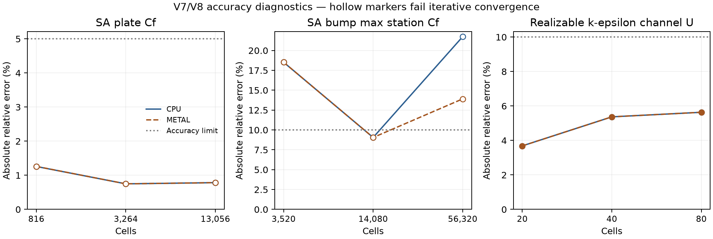

# V7 SA and V8 realizable k-epsilon results

**The requested Fluent model support is incomplete.** New library paths exist,
but SA fails required convergence gates and full automatic SA walls and
k-epsilon EWT are unavailable. The Fluent allowlist remains closed. Standard/RNG
were not implemented because their prerequisite acceptance is unmet. No Fluent
executable was run, and no Fluent same-mesh acceptance is claimed.

Numerical source commit: `b0e5aaba973971e623c9a51d7ecf3ceb460a1a19`, branch `t3/add-fluent-car-turbulence-models`.
Machine: Apple M4 Pro, 24 GiB, macOS 26.6.2, AppleClang 21 Release. CPU serial
oracle and actual Metal hardware ran. Docker used NVIDIA CUDA 13.0.2 /
Ubuntu 24.04 linux/amd64 for compile and CPU checks; no CUDA hardware ran.
`identity.json` pins the executable, sources, reference data, grids, commands
and external SST fixture hashes. SA V7 was measured on `7a24c46`; SA sources
and steady hooks are unchanged in the subsequent epsilon-floor fix. V8 and
current quick/CUDA checks are repeated on the floor-fix source. Later report
commits change no numerical code.

V7 retains **17 failed / 70 assertions**: 12 convergence checks and five
finest-bump accuracy checks. V8 passes **18 / 18 assertions** on the final
epsilon-floor fix. No failing gate was relaxed.

## Gate outcomes

| Gate | Status and measured evidence |
|---|---|
| SA-1 equations | PASS: independent double formulas, 3e-5 relative tolerance, including Fluent no-ft2 and explicit TMR standard ft2 variants |
| SA-2 backend parity | PASS: constitutive fields and deterministic repeats on CPU/Metal, 3e-5 relative tolerance; generated CUDA compiles |
| SA-3 BCs | PASS: direct nu-tilde, damped viscosity-ratio inversion, intensity/length, zero wall, inlet/backflow/outflow; hydraulic diameter converts to .07*Dh in the constructor. Case selector mapping remains unverified |
| SA-4 plate | PASS: finest Cf <=5%, Cd <=7%; per-backend values below |
| SA-5 bump | FAIL: each Cf <=10%, each Cp absolute error <=.03, Cd <=10%; station/drag numbers below |
| SA-6 trend | PASS: frozen maximum-error norm finest < coarsest, all four case/backend studies |
| SA-7 iterative | 0/12 pass: all u/v/nu-tilde/provisional-continuity <=1e-5 and last-100-step load change <=.1% required; no budget endpoint counted as convergence |
| SA-8 automatic walls | BLOCKED / UNIMPLEMENTED: TG gives calibrated asymptotes but not the full SA-specific blend; constructor throws |
| KE-1 formulation | PARTIAL: independent double equations and CPU/Metal parity at 3e-5; external code-to-code executable comparison remains UNVERIFIED |
| KE-2 wall treatment | Scalable wall-law/clipping/tangency checks PASS. EWT algebra/Kader helper checks PASS with explicitly chosen blend parameters; full EWT transport BLOCKED / UNIMPLEMENTED and throws |
| KE-3 channel | 6/6 converge; each profile error <=10% and shear error <=2%; all numbers below. These are DNS validation of the 1D reduction, not a 3D Fluent comparison |
| Quick tier | PASS: ctest -LE slow, 2/2 CTest entries. Focused model/compiled-GPU checks: 11 cases, 1427 assertions |
| SST regression | PASS: current production geometry + external Fluent 22.2 pair, CPU/Metal, 34204 assertions |
| CUDA compile/CPU | PASS: sm_75/86/89 and compute_120 build, 174 Linux CPU cases / 810115 assertions. Compiled-GPU presence test excluded only in this GPU-less container |
| CUDA runtime and Fluent same-mesh | UNVERIFIED; no device/executable/reference for the new models |

## V7 SA measurements

Standard TMR SA including ft2 is used for these comparisons. The default Fluent
no-ft2 variant has constitutive/oracle coverage, not a separately converged TMR
flow study. The frozen comparison uses finest CFL3D values; the independently
computed FUN3D zones are preserved in the fixtures. The engineering accuracy
allowances are V5-style limits, not the much smaller published TMR GCI bands.
Resolved walls use nu-tilde=0 and molecular stress. These runs do not
exercise Fluent automatic walls. V5 grid/BC/dimensionalization and budgets are
reused; the exact prior protocol is [PROTOCOL.md](PROTOCOL.md).

| Case | Backend | Cells | Steps | Solve s | Converged | Continuity | Max u/v defect | nu-tilde defect | Last-100 load change % | Max y+ |
|---|---|---:|---:|---:|---|---:|---:|---:|---:|---:|
| plate | cpu | 816 | 3000 | 5.57 | False | 0.0125832 | 2.74418e-05 | 0.00291075 | 0.00452799 | 1.18838 |
| plate | cpu | 3264 | 3000 | 31.37 | False | 0.00912909 | 8.22438e-08 | 8.38804e-06 | 4.5102e-06 | 0.64275 |
| plate | cpu | 13056 | 3000 | 179.88 | False | 0.0222903 | 7.89949e-08 | 6.52519e-06 | 0.000503269 | 0.370452 |
| plate | metal | 816 | 3000 | 36.69 | False | 0.012198 | 2.74442e-05 | 0.00291022 | 0.00221063 | 1.18839 |
| plate | metal | 3264 | 3000 | 62.56 | False | 0.0063805 | 9.30744e-08 | 8.3811e-06 | 4.5102e-06 | 0.642749 |
| plate | metal | 13056 | 3000 | 81.09 | False | 0.0251022 | 8.27607e-08 | 6.42864e-06 | 0.000568737 | 0.370452 |
| bump | cpu | 3520 | 3000 | 33.18 | False | 4.50814e-05 | 1.26874e-05 | 0.000752793 | 0.092285 | 0.766009 |
| bump | cpu | 14080 | 3000 | 184.24 | False | 0.000286564 | 4.93947e-06 | 0.000250187 | 0.0621572 | 0.442036 |
| bump | cpu | 56320 | 2500 | 602.78 | False | 0.000118703 | 3.58811e-06 | 0.000275799 | 1.63021 | 0.265483 |
| bump | metal | 3520 | 3000 | 62.95 | False | 8.30221e-05 | 1.20352e-05 | 0.000752788 | 0.116355 | 0.766125 |
| bump | metal | 14080 | 3000 | 85.52 | False | 0.000269129 | 5.27792e-06 | 0.000250187 | 0.0310148 | 0.442066 |
| bump | metal | 56320 | 3000 | 95.09 | False | 0.000249189 | 2.94931e-06 | 0.000235885 | 1.16325 | 0.265815 |

### Three-grid trend norms

The norm is the frozen maximum Cf/Cd relative error (plate), or maximum Cf/Cd relative error and Cp error/.03 (bump). It is not an order estimate.

| Case | Backend | Coarse | Medium | Fine |
|---|---|---:|---:|---:|
| plate | cpu | 0.0125826717 | 0.00749187048 | 0.0078424098 |
| plate | metal | 0.0126047947 | 0.00749186565 | 0.00784040835 |
| bump | cpu | 2.13024715 | 1.1589249 | 0.598678985 |
| bump | metal | 2.12846498 | 1.14842454 | 0.667888918 |

### Finest plate accuracy

| Backend | Cf | Cf relative error % | Cd | Cd relative error % |
|---|---:|---:|---:|---:|
| cpu | 0.002726840123 | +0.784241 | 0.002880468763 | +0.720872 |
| metal | 0.002726834708 | +0.784041 | 0.002880467716 | +0.720836 |

### Finest bump stations and drag

| Backend | Station x | Cf | Cf relative error % | Cp | Cp absolute error |
|---|---:|---:|---:|---:|---:|
| cpu | 0.6321975 | 0.00561094024 | +8.211150 | -0.2500467973 | 0.001080785 |
| cpu | 0.75 | 0.006950604615 | +13.029613 | -0.6532696486 | 0.01796037 |
| cpu | 0.8678025 | 0.003259937529 | +21.742067 | -0.2522190492 | 0.003680889 |
| cpu drag | - | Cd=0.004015261983 | +12.397330 | - | - |
| metal | 0.6321975 | 0.005486170516 | +5.804873 | -0.2493946717 | 0.001732911 |
| metal | 0.75 | 0.006795489106 | +10.507149 | -0.6511933506 | 0.02003667 |
| metal | 0.8678025 | 0.003050192435 | +13.909156 | -0.2507511616 | 0.002213001 |
| metal drag | - | Cd=0.003888997161 | +8.862858 | - | - |

The full surface reference and convergence zones are in the pinned `sa/`
fixtures. Every station assertion, including Cp, is retained in `slow.log`.
`measurements.json` contains all three stations and every grid endpoint.
No force/pressure result from an unconverged run is an accepted solution.

## V8 channel measurements

Fully developed 1D U/k/epsilon transport is solved on Device with delta=1,
rho=1, nu=1/587.19, dp/dx=-1, scalable walls, and no DNS profile seeding.
No pressure/convection equation is needed in this fully developed reduction.
This is not the full SteadySolver pressure path; quick tests separately exercise
coupled SteadySolver transport and wall forces. The DNS file is nominally
Re_tau=590 but actually 587.19; the rig uses the actual value.

| Backend | Cells | Steps | Solve s | Converged | Maximum equation defect | Last-100 U change | Wall tau (target 1) | Max U error %, y+>=30 |
|---|---:|---:|---:|---|---:|---:|---:|---:|
| cpu | 20 | 600 | 0.042 | True | 2.845261e-07 | 5.975909e-05 | 0.9999621511 | 3.684932 |
| cpu | 40 | 1900 | 0.216 | True | 6.738677e-07 | 7.342843e-05 | 0.9996756315 | 5.370042 |
| cpu | 80 | 5700 | 1.233 | True | 1.239402e-06 | 9.916956e-05 | 0.9978260696 | 5.635144 |
| metal | 20 | 600 | 15.586 | True | 3.246424e-07 | 5.954744e-05 | 0.9999619722 | 3.684932 |
| metal | 40 | 1900 | 76.489 | True | 6.615476e-07 | 7.318691e-05 | 0.9996754229 | 5.370032 |
| metal | 80 | 5700 | 157.399 | True | 1.259833e-06 | 9.916949e-05 | 0.9978268743 | 5.635201 |

The profile error increases with refinement (roughly 3.68% to 5.64%). This is
a measured discrepancy against DNS; model, wall-function and discretization
contributions have not been separated. It is not proof of matching Fluent or a
disappearing discretization error. The frozen <=10% bound is met
on every grid; no monotonic DNS-error trend is asserted for the wall-function
model. All six iterative gates pass.



## Formulation scope and missing evidence

Implemented formulas, constants, BC conversions, source units, wall row and
momentum contracts are in [car_models.md](../../../src/kutta/fv/turbulence/car_models.md).
Fluent documented SA vorticity/strain-vorticity production, damping, realizable
Cmu/epsilon and scalable constants are implemented and checked against double
formulas. NASA SA compares a separately selected standard-SA variant. MKM is
DNS validation; neither is a Fluent model execution. The scalable effective
distance in wall epsilon/production follows the TG instruction to replace y-star
in wall formulas, but that interpretation and multi-wall-face selection are not
established by a Fluent field fixture. Velocity rates use plain LSQ; exact WFGC
and isotropic turbulent stress remain outside the new paths.

Unfinished: complete SA automatic wall transport/blending; full EWT including
Fluent blend width and discrete epsilon coupling; strict SA convergence and bump
accuracy; a separate default-no-ft2 SA converged study; an external realizable
code-to-code run; real SA/KE case/data fixtures and selector/constant provenance;
Fluent adapter/app exposure; CUDA hardware; and car same-mesh forces. Standard/RNG
remain deferred as requested. These are acceptance gaps, not passed gates.

No app code, linalg/runtime code, credentials, remote resources, push, or release
was changed. Only new turbulence modules, generated kernel sources, bounded
steady-solver hooks, case intent parsing, tests, fixtures and reports are in scope.

## Epsilon-floor regression

The original wall epsilon target could be below the configured 1e-20 floor
(one probe returned 1.91493e-27), while transport clipped the solved field up to
the floor. The fixed row was therefore unattainable. The new regression fails
seven assertions on 7a24c46 and passes on CPU/Metal after clamping the wall
constraint to the same configured floor. This branch is inactive in the channel
measurements, whose full V8 study is nevertheless rerun on the fixed source.
`epsilon_floor_regression.log` retains the failing before result.

## Reproduction

```sh
cmake -S . -B build -G Ninja && cmake --build build -j 6
python3 tools/prepare_tmr.py
ctest --test-dir build -LE slow --output-on-failure
./build/kutta-tests --test-case='SA*,Realizable KE*,compiled GPU backends*'
./build/kutta-tests --test-suite=slow --test-case='V7*,V8*' > slow.log 2>&1
python3 tools/report_car_turbulence.py slow.log --out validation/results/car_turbulence
# For the two recorded source revisions, add --ke-log ke_slow.log
```

The last command requires matplotlib. Slow intentionally returns nonzero while
any frozen gate fails. The existing V1-V6 slow studies were not rerun in this
lane; their previously retained failures are not reclassified. The full current
quick tier and focused real SST fixture regression were run.

Raw final logs: `quick.log`, `models.log`, `slow.log`, `sst_regression.log`,
`ke_slow.log`, `cuda.log`. The original slow.log includes the first V8 run; the
report selects the separate V8 rerun on the epsilon-floor fix. The superseded
exploratory slow run and an exploratory CUDA build
invalidated by editing during generation are excluded. No timing is offered as
a performance comparison. Raw upstream fixtures retain their exact whitespace
and pinned hashes.
