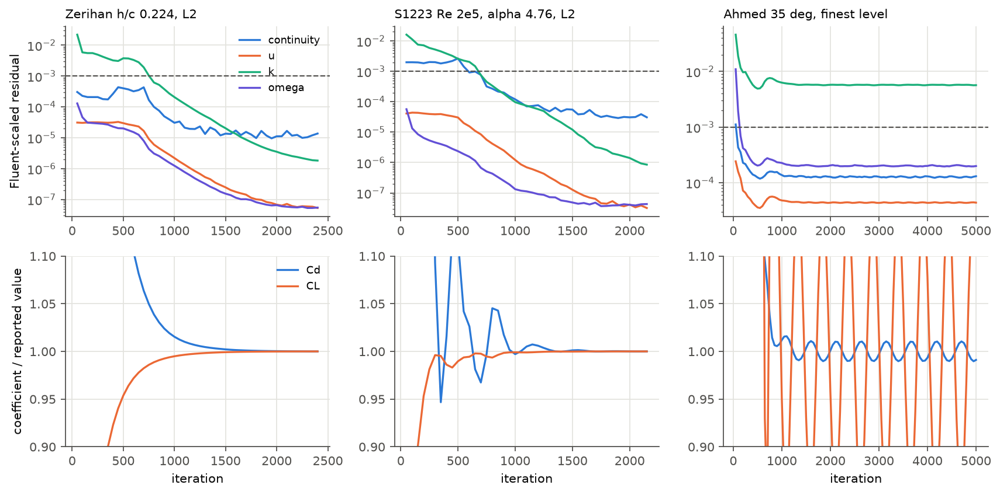
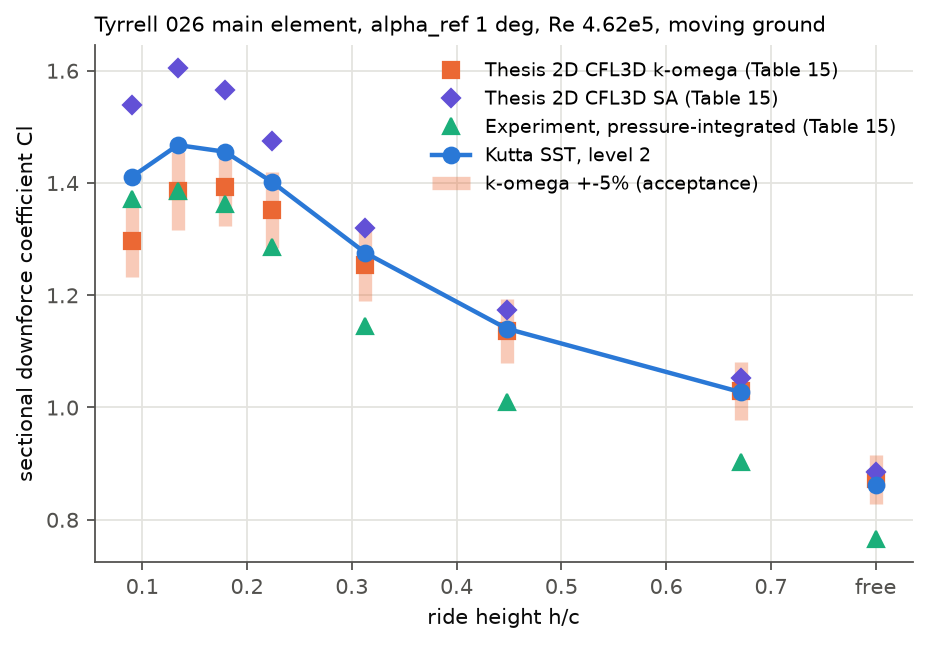
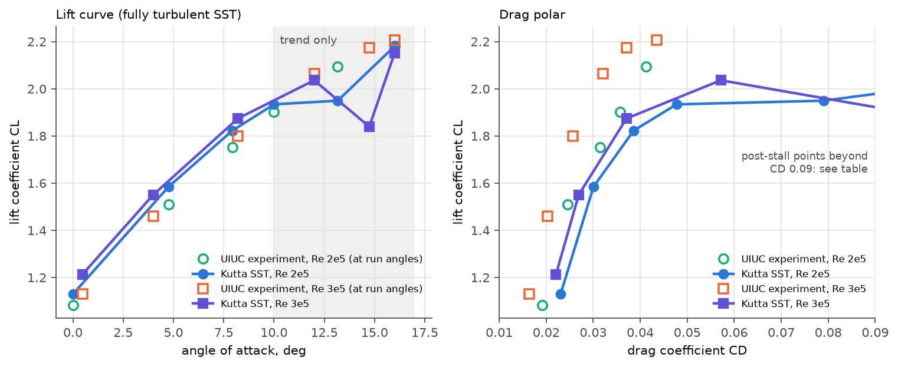
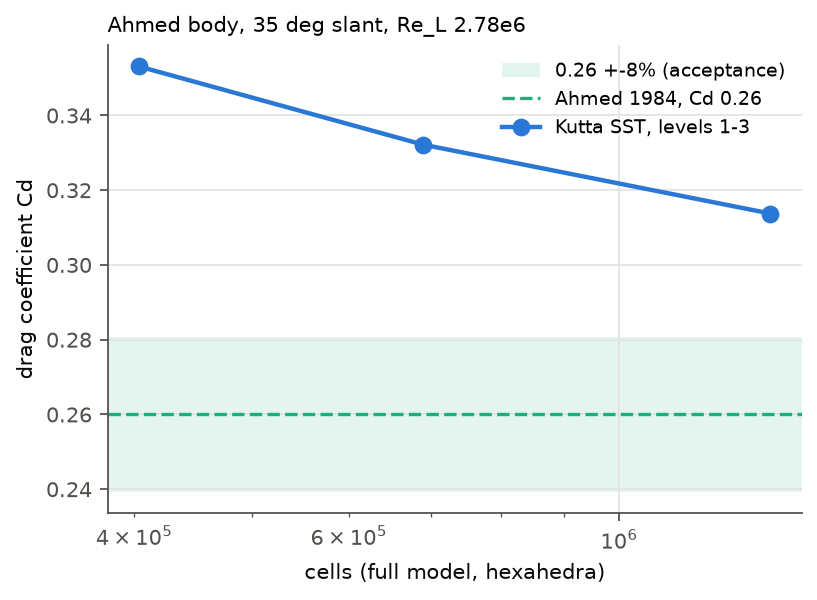

# FSAE external-aero validation: ground-effect wing, S1223, Ahmed body

Branch `t3/620d7176`, based on main `b08c714`. Apple M4 Pro (24 GB, shared
with another work lane), macOS 26.6.2, AppleClang 21.0.0, Release build. Metal
ran the sweeps and the serial CPU reference backend ran one parity point; CUDA
was not run (CI only). Every number below comes from a run directory under
[`runs/`](runs) (`result.json`, gzipped `history.csv` and solver log). The
generated tables, with every column, are in [`tables.md`](tables.md). No file
under `src/` changed.

## Result

| Case | Acceptance (docs/research/verification-cases.md) | Measured | Verdict |
| --- | --- | --- | --- |
| Tyrrell 026 2D sectional Cl at 8 ride heights | within 5% of the thesis CFL3D k-omega | -1.2% (freestream) to +4.5% (h/c 0.179); **+5.9% at h/c 0.134, +8.8% at 0.090** | **6 of 8 PASS.** Force-reduction trend reproduced, level too high below h/c 0.18 |
| Selig S1223, CL for alpha <= 10 deg | +-0.10 vs UIUC | +0.031 to +0.090 at all 7 gated angles | **PASS** (all on the high side) |
| Selig S1223, CD | +-25% vs UIUC | +21 to +23% at Re 2e5 up to 7.9 deg; +34% at 10 deg; **+32 to +44% at every Re 3e5 angle** | **3 of 11 PASS** (gated where UIUC has CD) |
| Selig S1223, CLmax / stall | trend only | stalls early: CL peaks at 2.04 (12 deg, Re 3e5) against UIUC 2.21 at 15.6 deg; post-stall unsteady | early-stall trend, reported only |
| Ahmed 35 deg, three-level study | Cd within 8% of 0.26 | Cd 0.353 / 0.332 / 0.314 on 0.40M / 0.69M / 1.33M cells; **+20.7% on the finest** | **FAIL**, falling with refinement but not mesh-converged |
| Ahmed 25 deg (cross-check) | wake topology vs CFX-5 SST; Cd not gated | Cd 0.321 (experiment 0.285); slant separated from x = -163 mm with no reattachment | **Same topology as CFX-5 SST**, which is also not the experiment's |

**In short.** Kutta's SST reproduces the code-to-code ground-effect lift
within 5% from freestream down to h/c 0.18, in under 8 minutes per point on
Metal. It over-predicts lift in the force-reduction region. For the S1223,
lift in the linear range is within the experimental gate. Drag is high by
20-45%, which is the expected bias of a fully turbulent model on a
laminar-bubble aerofoil. The Ahmed drag misses by 21% on the finest mesh this
machine could hold. That result is mesh-limited and the meshes are
solver-limited: the reference's y+ ~ 1 wall layer diverges in Kutta at the
body's sharp edges, a defect reported below.

## How the cases run

`kutta solve` accepts only Fluent cases, and none of these references ships
one. The cases therefore run through the library path, as the TMR cases do.
[`validation/cases/fsae_aero.hpp`](../../cases/fsae_aero.hpp) reads a Fluent
ASCII mesh (`read_fluent_msh`; 2D meshes are extruded one cell between
symmetry caps), maps zones to boundary conditions by name and runs
`fv::SteadySolver`. [`bench/bench_fsae_aero.cpp`](../../../bench/bench_fsae_aero.cpp)
is the command-line wrapper, and [`tools/fsae_aero/run.py`](../../../tools/fsae_aero/run.py)
drives the sweeps and generates any missing mesh first. To reproduce, using a
venv in `build-py/` with gmsh 4.15.2, numpy, scipy and matplotlib:

```sh
cmake --build build --target bench_fsae_aero
build-py/bin/python tools/fsae_aero/run.py zerihan --points free,0.671,0.448,0.313,0.224,0.179,0.134,0.090 --level 2
for L in 1 3; do build-py/bin/python tools/fsae_aero/run.py zerihan --points free,0.224,0.090 --level $L; done
build-py/bin/python tools/fsae_aero/run.py zerihan --points free --far 2 --tag _far2 --out runs/fsae_aero/results_far
build-py/bin/python tools/fsae_aero/run.py zerihan --points 0.224 --backend cpu --max-seconds 7000 --out runs/fsae_aero/results_cpu
build-py/bin/python tools/fsae_aero/run.py s1223 --re 2e5 --points 0.00,4.76,7.93,10.00,13.17,16.00
build-py/bin/python tools/fsae_aero/run.py s1223 --re 3e5 --points 0.48,4.00,8.21,12.00,14.74,16.00
for L in 1 2 3; do build-py/bin/python tools/fsae_aero/run.py ahmed --points 35 --level $L --iterations 5000 --max-seconds 5400 --out runs/fsae_aero/results_ahmed; done
build-py/bin/python tools/fsae_aero/run.py ahmed --points 25 --level 2 --iterations 5000 --max-seconds 5400 --out runs/fsae_aero/results_ahmed
build-py/bin/python tools/fsae_aero/report.py   # tables.md, plots, runs/
```

Meshes and full run directories go to `runs/fsae_aero/`, which is gitignored.
The mesh generators read the restricted geometry files under `validation/data`
at run time; no geometry, mesh or reference curve is committed. Plots show
only the reference values quoted in the tables. gmsh's meshing is not
bit-reproducible run to run (a regenerated Ahmed L1 differed by 36 of 403k
cells), so a regenerated mesh reproduces these numbers to solver tolerance,
not bitwise.

**Common setup.** Incompressible flow with U = rho = 1 and nu = length/Re.
SST with Kutta's defaults, which are Fluent's: production limiter,
strain-based limiter and correlation (y+-insensitive) wall omega. Second-order
upwind for all equations, least-squares gradients, SIMPLEC (momentum 0.7,
pressure 1.0, k and omega 0.75), uniform freestream initialisation. Velocity
inlet with intensity and viscosity ratio, static-pressure-0 outlet, slip
(symmetry) far boundaries.

**Convergence.** A run stops when every Fluent-scaled residual is below 1e-3
(Fluent's default criterion) **and** both force coefficients have changed by
less than 5e-4 (relative) over the last 500 iterations (1000 for Ahmed).
Otherwise it stops at 6000 iterations / 3600 s (5000 / 5400 s for Ahmed).
Some runs never settle: post-stall S1223, Ahmed L2 and L3, and the
coarsest h/c 0.090 mesh. These oscillate about a stationary mean, which is
typical of steady RANS with an unsteady wake. For them the tables report the
mean over the last 2000 iterations, marked `*` or stated, with the range.
[Convergence histories](convergence.png):



The Ahmed L3 lift coefficient is small (about 0.09), so its oscillation runs off
the +-10% scale; its range is in the Ahmed table.

**Timings** are wall-clock solve times from runs that often shared the GPU
with two or three other solves. Use them as upper bounds; the CPU/Metal ratio
below is the clean comparison.

**Coupled is not used.** On these meshes the Coupled solver diverged at once
(non-finite linear-solver input), while SIMPLEC from the same start converged.
That was not reduced further, because it sits in the pressure path another
lane is changing.

## Case 1: Tyrrell 026 wing in ground effect (Zerihan)

**Reference.** Zerihan's thesis, Table 15: 2D sectional Cl from his CFL3D runs
(k-omega and SA, 20-31k cells) and from integrating 45 centre-span pressure
taps. The documented acceptance is code-to-code against CFL3D k-omega. The
pressure-integrated experiment is shown but not gated, because the thesis calls
it "only an estimate": the taps miss the leading-edge suction peak.

**Geometry.** Thesis Table 2 coordinates at the reference incidence
alpha_ref = 1 deg, a true chord incidence of 3.45 deg. The table's x is the
horizontal projection, so the contour is scaled to unit true chord (factor
1/1.0018). The 0.73%c blunt trailing edge is kept. Ride height h is the gap
from the ground to the lowest suction-surface point with the wing rotated to
alpha_ref = 0 about c/4. Reading "zero incidence" as true zero incidence
instead moves that point by 0.0009c, which is 1% of h at h/c 0.090; no
verdict depends on it.

**Conditions.** Re 4.62e5 (the thesis CFD), inlet Tu 0.1% and nu_t/nu 1. The
ground is a no-slip wall translating at U (moving ground). Cl is the downforce
coefficient per unit span, on the chord.

**Mesh** ([`wing2d.py`](../../../tools/fsae_aero/wing2d.py)). A structured
quadrilateral O-block surrounds the section: 29 layers at level 2, first cell
2e-5c, growth 1.2, 0.02c thick, 246 wall faces, LE/TE spacing
0.0016c/0.0015c. Outside it, gmsh triangles run out to 30c upstream, 40c
downstream and 30c above, with refinement boxes along the wake and, in ground
effect, along the gap. Level 2 has 177k-252k cells depending on h/c. Each
level halves (L1) or doubles (L3) the wall-normal and surface resolution;
far-field triangles are capped at the same size, so cell counts grow about 3x
per level, not 4x. Wing y+: mean 0.24, max 0.56-0.64 at level 2. The ground
has no prismatic layer and is meshed by the gap-refined triangles, so ground
y+ is not resolved. Structured ground layers ended in slivers or abrupt size
jumps that made the solver diverge. With the ground moving at U, ground shear
is small except under the wing.

### Results (level 2)

| h/c | Kutta Cl | CFL3D k-omega | diff | 5% gate | CFL3D SA | expt (p-integrated) | Kutta Cd | iterations | max residual | solve s | peak GB |
| --- | ---: | ---: | ---: | --- | ---: | ---: | ---: | ---: | ---: | ---: | ---: |
| free | 0.8612 | 0.872 | -1.2% | PASS | 0.885 | 0.766 | 0.0161 | 1800 | 2.1e-5 | 166 | 1.01 |
| 0.671 | 1.0273 | 1.030 | -0.3% | PASS | 1.052 | 0.902 | 0.0191 | 2850 | 1.3e-5 | 328 | 1.41 |
| 0.448 | 1.1403 | 1.136 | +0.4% | PASS | 1.174 | 1.009 | 0.0215 | 2850 | 2.0e-5 | 327 | 1.25 |
| 0.313 | 1.2754 | 1.253 | +1.8% | PASS | 1.320 | 1.145 | 0.0250 | 2750 | 1.4e-5 | 248 | 1.17 |
| 0.224 | 1.4015 | 1.352 | +3.7% | PASS | 1.475 | 1.286 | 0.0305 | 2400 | 1.4e-5 | 243 | 1.05 |
| 0.179 | 1.4555 | 1.393 | +4.5% | PASS | 1.565 | 1.362 | 0.0360 | 1800 | 8.1e-6 | 228 | 1.03 |
| 0.134 | 1.4675 | 1.386 | **+5.9%** | **FAIL** | 1.604 | 1.385 | 0.0452 | 2000 | 1.1e-5 | 317 | 0.98 |
| 0.090 | 1.4107 | 1.297 | **+8.8%** | **FAIL** | 1.539 | 1.371 | 0.0590 | 2600 | 2.4e-5 | 450 | 0.97 |

Every point converged: residuals below 1e-3 and forces settled to 5e-4.



**Reading.** Kutta sits between the two thesis turbulence models at every
height. Above h/c 0.3 it matches k-omega within 2%. Below that it drifts
toward SA, and it crosses the 5% gate at h/c 0.134. It reproduces the
force-reduction trend: Cl peaks near h/c 0.134 and falls at 0.090, where the
experiment also peaks (1.385 at 0.134). CFL3D k-omega peaks earlier, at h/c
0.179. Like both thesis models, Kutta runs 12-14% above the
pressure-integrated experiment at large heights, the bias the thesis
attributes to the tap spacing.

The likely cause of the low-height misses (inferred, not isolated) is the
turbulence model. In the force-reduction region, Cl is governed by the
suction-side boundary layer separating ahead of the trailing edge, and SST,
Wilcox k-omega and SA differ most there. The thesis's own two models are 19%
apart at h/c 0.090. A ground-mesh effect is the other candidate, because the
ground layer is unresolved. The mesh study below moves Cl by about 1.5%,
well short of the 8.8% miss.

### Mesh study, far field, CPU parity

| h/c | level | cells | Kutta Cl | vs k-omega | Kutta Cd | stop |
| --- | --- | ---: | ---: | ---: | ---: | --- |
| free | L1 | 60,376 | 0.8647 | -0.8% | 0.0169 | converged |
| free | L2 | 185,964 | 0.8612 | -1.2% | 0.0161 | converged |
| free | L3 | 655,996 | 0.8526 | -2.2% | 0.0159 | converged |
| 0.224 | L1 | 56,463 | 1.3844 | +2.4% | 0.0324 | converged |
| 0.224 | L2 | 195,581 | 1.4015 | +3.7% | 0.0305 | converged |
| 0.224 | L3 | 732,898 | 1.3809 | +2.1% | 0.0302 | converged |
| 0.090 | L1 | 51,709 | 1.4618* | +12.7% | 0.0660* | oscillating, residual 7.7e-3 |
| 0.090 | L2 | 177,312 | 1.4107 | +8.8% | 0.0590 | converged |
| 0.090 | L3 | 660,776 | 1.4018 | +8.1% | 0.0583 | converged |

Cl is not monotonically mesh-converged: from L1 to L3 it varies by 1.4%
(freestream), 1.5% (h/c 0.224) and 0.6% (h/c 0.090, L2-L3), and L2 is not bracketed at 0.224. Take
about 1.5% as the discretisation uncertainty of the level-2 sweep. Every
verdict in the table above holds at L3 as well: freestream -2.2%, h/c 0.224
+2.1%, h/c 0.090 +8.1%. Cd falls monotonically with refinement and changes by about 1% between L2
and L3.

**Far field.** Doubling every far-boundary distance at level 2 (freestream)
changes Cl by +0.15% (0.8612 to 0.8626) and Cd by -1.4%.

**CPU vs Metal** (h/c 0.224, L2, same mesh): Cl 1.40147 on both, Cd 0.03051 on
both, 2400 iterations on both. Solve time was 2099 s on the serial CPU
reference against 243 s on Metal, with peak memory 0.92 / 1.05 GB.

## Case 2: Selig S1223

**Reference.** UIUC LSAT Vol. 1 clean drag polars at Re 200,400 (run
JG00136, 198,500 above 8 deg, run JG00588) and Re 299,100 (JG00597), and the
lift-curve sweeps for CLmax. The tables quote the UIUC value at each run
angle (linear interpolation between neighbouring measured angles where the
run angle is not a measured one). Acceptance: CL within +-0.10 in the linear
range, CD within +-25%, and CLmax/stall as a trend only. The "linear range" is
not defined numerically in the research doc. It was fixed **before** the runs
as alpha <= 10 deg, the range the doc uses for its Fluent CL/CD gate.

**Geometry and mesh.** The as-tested coordinates (`.dap`), rotated to alpha
about c/4. The as-tested trailing edge is open by more than 1e-3c, so it is
kept blunt. The mesh is the same generator and level as Zerihan, in free air:
about 184k cells, wall y+ mean 0.1-0.15 and max 0.24-0.73.

**Conditions.** Re 2e5 and 3e5, inlet Tu 0.1% and nu_t/nu 1, **fully
turbulent SST**. A laminar separation bubble dominates the S1223 at these
Reynolds numbers, and fully turbulent SST cannot represent it or the laminar
run ahead of it. A transition model (gamma or gamma-Re_theta) is the route to
anything tighter.

| Re | alpha | Kutta CL | UIUC CL | dCL | gate | Kutta CD | UIUC CD | dCD | gate | iterations | stop |
| --- | ---: | ---: | ---: | ---: | --- | ---: | ---: | ---: | --- | ---: | --- |
| 2e5 | 0.00 | 1.129 | 1.083 | +0.046 | PASS | 0.0231 | 0.0191 | +21% | PASS | 2100 | converged |
| 2e5 | 4.76 | 1.585 | 1.510 | +0.075 | PASS | 0.0301 | 0.0245 | +23% | PASS | 2150 | converged |
| 2e5 | 7.93 | 1.822 | 1.753 | +0.069 | PASS | 0.0386 | 0.0314 | +23% | PASS | 2100 | converged |
| 2e5 | 10.00 | 1.934 | 1.902 | +0.031 | PASS | 0.0477 | 0.0357 | **+34%** | **FAIL** | 2100 | converged |
| 2e5 | 13.17 | 1.949 | 2.094 | -0.145 | trend | 0.0791 | 0.0413 | **+91%** | **FAIL** | 3800 | converged |
| 2e5 | 16.00 | 2.180* | 2.181 | -0.001 | trend | 0.166* | n/a | n/a | n/a | 6000 | oscillating |
| 3e5 | 0.48 | 1.213 | 1.131 | +0.082 | PASS | 0.0221 | 0.0164 | **+35%** | **FAIL** | 2150 | converged |
| 3e5 | 4.00 | 1.551 | 1.461 | +0.090 | PASS | 0.0269 | 0.0203 | **+32%** | **FAIL** | 2150 | converged |
| 3e5 | 8.21 | 1.874 | 1.800 | +0.074 | PASS | 0.0371 | 0.0257 | **+44%** | **FAIL** | 2100 | converged |
| 3e5 | 12.00 | 2.036 | 2.064 | -0.028 | trend | 0.0572 | 0.0321 | **+78%** | **FAIL** | 2400 | converged |
| 3e5 | 14.74 | 1.839* | 2.175 | -0.336 | trend | 0.114* | 0.0371 | **+207%** | **FAIL** | 6000 | oscillating |
| 3e5 | 16.00 | 2.151* | 2.207 | -0.056 | trend | 0.145* | 0.0435 | **+233%** | **FAIL** | 6000 | oscillating |

`*` marks the mean of the last 2000 of 6000 iterations; those runs did not
settle (residual 5e-4 to 5e-3). At Re 2e5, 16 deg lies beyond the UIUC polar,
so its CL comes from the lift-curve sweep and there is no CD. UIUC CLmax is
2.188 at 16.9 deg (Re 1.98e5) and 2.212 at 15.6 deg (Re 3.02e5). Solve times
were 280-750 s per point, about 1.0 GB peak.



**Reading.** In the linear range Kutta's lift is 0.03-0.09 high and its lift
slope matches the experiment's. CD is high everywhere, by +21-23% at Re 2e5
and +32-44% at Re 3e5 below stall. That is the expected sign and size of
fully turbulent skin friction over a chord that is largely laminar in the
experiment. The miss grows with Re because the measured drag falls faster
with Re (bubble drag shrinks) than a fully turbulent solution does. Kutta
stalls earlier and lower than the experiment. Lift flattens from 10 deg at Re
2e5, and at Re 3e5 it peaks at 2.04 near 12 deg then drops. Separation sets
in from the trailing edge, where the experiment keeps attached turbulent flow
behind a reattached bubble. Above about 13 deg the steady solution
oscillates. The 16 deg CL that lands on the UIUC value is a mean over an
oscillating, separated solution, not agreement.

## Case 3: Ahmed body

**Reference.** Ahmed et al. (1984), drag balance at 60 m/s (Re_L 4.29e6):
Cd 0.26 at 35 deg, with front/slant/base pressure components 0.020 / 0.090 /
0.095 as cited by Liu & Moser (secondary source; SAE 840300 itself is
paywalled). Lienhart & Becker (2003, 40 m/s, Re_L 2.78e6) supply rear-surface
Cp and slant velocity profiles but no drag. The CFX-5 SST results of the
ERCOFTAC CFD11 workshop (Menter's group: 2.5M cells, half model, y+ about 1)
are at the same stations. The acceptance is Cd within 8% of 0.26 with a
three-level study, plus qualitative rear Cp and wake. 25 deg is a cross-check
against CFX-5 SST topology only.

**Geometry** ([`ahmed.py`](../../../tools/fsae_aero/ahmed.py)). L 1.044 m, W
0.389 m, H 0.288 m, 100 mm front radii, 222 mm slant, sharp rear edges, 50 mm
ground clearance. Stilts are omitted, as in CFD11. Full model (no symmetry
plane) in the CFD11 domain mirrored about y = 0: 3L upstream of the nose, 5L
behind the base, 0.9L to each side, 1.15L high. The ground is slip up to 2L
ahead of the nose and a stationary wall after that. The body occupies 5% of
the cross-section; side and top boundaries are slip.

**Conditions.** U = 1 and lengths in metres, Re_L 2.78e6 (Lienhart), Tu 1% and
nu_t/nu 1 (CFD11's inlet), reference area 0.112 m^2.

**Mesh.** gmsh surface triangles on the body, then 16 prism layers marched
along vertex normals: first height 50 um, growth 1.35, 17 mm thick. Gmsh
tetrahedra fill the space outside the layers. Every cell is then split into
hexahedra ([`subdivide.py`](../../../tools/fsae_aero/subdivide.py)): a tet
gives four hexes, and a prism gives three through its full height, which
keeps the wall spacing. Two solver defects force this mesh (next section).
Tetrahedra diverge in Kutta. A first layer at the reference's y+ ~ 1 (15 um)
diverges at the sharp rear edges, as does 25 um; 50 um is the thinnest that
runs. That gives body y+ mean 3, max 7 instead of about 1, with the
y+-insensitive wall treatment. The memory cost is about 5 KB per cell, so the
finest level, 1.33M cells (6.8 GB), is the largest that fits this machine's
10 GB per-run budget. A fourth level (~2.6M cells, ~13 GB) could not run.
For scale, CFX used 2.5M cells on a **half** model.

| level | body triangles | cells | Cd | Cd range, last 2000 it | vs 0.26 | friction Cd | front / slant / base pressure Cd | Kutta CL | stop | solve s | peak GB |
| --- | ---: | ---: | ---: | --- | ---: | ---: | --- | ---: | --- | ---: | ---: |
| L1 | 3,748 | 403,604 | 0.3531 | 0.3530-0.3532 | +35.8% | 0.047 | -0.004 / 0.182 / 0.129 | 0.209 | residuals 1.1e-5, lift drifting 0.15% | 715 | 2.16 |
| L2 | 5,696 | 690,104 | 0.3322 | 0.3269-0.3374 | +27.8% | 0.047 | -0.006 / 0.167 / 0.118 | 0.169 | oscillating, residual 6.8e-3 | 798 | 3.35 |
| L3 | 9,638 | 1,330,032 | 0.3137 | 0.3105-0.3170 | **+20.7%** | 0.048 | -0.008 / 0.151 / 0.120 | 0.094 | oscillating, residual 5.7e-3 | 1388 | 6.79 |

All levels ran 5000 iterations. L2 and L3 values are means over the last 2000
iterations. The component columns integrate wall pressure over three regions
at the final iteration: the first 100 mm (nose and radii), the slant, and the
base.



**Reading.** Cd falls by about 0.02 per level, and the step barely shrinks
(-0.021 then -0.018), so the series is not in its asymptotic range. No
extrapolated value is claimed. Friction (0.048) is close to what the
reference components imply (0.26 - 0.205 = 0.055). The excess is pressure
drag, mostly on the slant: 0.151 at L3 against 0.090, then the base at 0.120
against 0.095. The front nets slightly negative against +0.020, so the
suction peaks on the 100 mm radii are stronger than in the experiment. The
most likely causes are mesh resolution (the trend says so) and the y+ ~ 3
wall spacing. Steady SST at 35 deg typically lands within about 7% of 0.26
(Liu & Moser: 0.241), so the model is not expected to account for a 21% miss.

**Rear Cp** at the reference tap locations, from the nearest L3 wall face
(within 6 mm). Only region means and RMS differences are quoted:

| reference | region | taps | reference mean Cp | Kutta mean Cp | RMS(Kutta - reference) |
| --- | --- | ---: | ---: | ---: | ---: |
| Lienhart & Becker | slant | 188 | -0.266 | -0.316 | 0.123 |
| Lienhart & Becker | base | 99 | -0.220 | -0.227 | 0.070 |
| CFX-5 SST | slant | 1110 | -0.233 | -0.342 | 0.139 |
| CFX-5 SST | base | 1041 | -0.173 | -0.253 | 0.133 |

The base pressure agrees with the experiment. The slant suction is too strong,
which is where the extra drag comes from. Refinement moves it in the right
direction: the slant-mean RMS difference was 0.272 at L1.

**Wake topology on the centreline.** Near-wall flow direction from the wall
shear at the reference slant stations x = -163, -123, -83, -43, -3 mm (R =
reversed, A = attached):

| slant | experiment | CFX-5 SST | Kutta |
| --- | --- | --- | --- |
| 35 deg | R R R R R (separated) | R R R R R (separated) | L1 R R R R R; L2, L3 R R R R A; 84-89% of slant area reversed |
| 25 deg | R R A A A (separates, reattaches by -83) | R R R R R (separated) | L2 R R R R R; 62% of slant area reversed |

The reference columns come from the sign of the minimum streamwise velocity in
each reference profile. At 35 deg all three agree on a fully separated slant,
except Kutta's last station on L2/L3, 3 mm from the base edge.

At 25 deg Kutta matches CFX-5 SST: massive slant separation with no
reattachment. The experiment's separation bubble reattaches, which most
steady RANS models miss, as the ERCOFTAC evaluation found. Kutta's 25 deg
L2 converged fully (2850 iterations, residual 4.4e-6, 499 s, 3.3 GB) at
Cd 0.321, +12.6% against the experiment's 0.285. That Cd is not gated, since
the doc requires an identical Fluent case for a 25 deg gate and none exists.

## Solver defects found (reported, not fixed)

Update (2026-10-31): defect 2, and Coupled on the Ahmed and h/c 0.224 wing
meshes, are diagnosed and fixed in the
[external 3D robustness report](../external_3d_robustness/REPORT.md), which
also reruns the Ahmed study at 15 um.

Both sit in the gradient / Rhie-Chow / pressure path that another lane is
changing (tetrahedral robustness), so they are reproduced here and not
touched. CPU and Metal behave the same in both.

1. **Divergence on tetrahedral meshes.** Minimal reproduction:
   [`duct.py`](../../../tools/fsae_aero/duct.py), a 2 x 1 x 1 duct with
   velocity inlet, pressure outlet and walls, SST at Re 1e5, on the CPU
   backend:

   | mesh | cells | outcome at 300 iterations |
   | --- | ---: | --- |
   | gmsh tetrahedra (`duct.py tet`) | 9,729 | non-finite linear-solver input at iteration 60 |
   | transfinite hexahedra (`duct.py hex`) | 2,000 | max residual 2.1e-4, stable |
   | the tets split to hexes by gmsh (`duct.py split`) | 38,916 | max residual 2.9e-4, stable |

   ```sh
   build-py/bin/python tools/fsae_aero/duct.py tet --out /tmp/duct_tet.msh
   build/bench_fsae_aero --mesh /tmp/duct_tet.msh --re 1e5 --walls walls --backend cpu --iterations 300 --check 20
   ```

2. **Divergence with thin wall layers at sharp convex edges.** On the Ahmed L1
   mesh, a 15 um first layer (the reference's y+ ~ 1) blows up within 2-20
   iterations. Velocity reaches 150 U by iteration 2 in the first-layer cells
   along the base's lower edge, then grows without bound. The same happens on
   CPU and Metal, with hybrid initialisation, with momentum/pressure
   relaxation 0.5, and with a pseudo-time step of 0.002. 25 um diverges by
   iteration 50. 50, 100 and 300 um run stably. The mesh is valid (minimum
   oriented scaled Jacobian 0.04; the cells at that edge are about 0.2, with
   45 deg non-orthogonality and 0.7 skewness), so this is a solver robustness
   limit with first-layer aspect ratios around 2700 at a 90 deg edge, not a
   broken mesh.

   ```sh
   build-py/bin/python tools/fsae_aero/ahmed.py --level 1 --first 1.5e-5 --out /tmp/ahmed_thin.msh
   build/bench_fsae_aero --mesh /tmp/ahmed_thin.msh --re 2.78e6 --length 1.044 --area 0.112 --walls body --lift-z --tu 0.01 --iterations 50 --check 10
   ```

3. **Coupled diverges where SIMPLEC converges** on the 2D wing meshes, as
   noted above. Observed, not reduced.

## Tests

[`tests/fv/test_fsae_aero.cpp`](../../../tests/fv/test_fsae_aero.cpp) adds
three slow-tier test cases (five solves). Each runs on the first GPU backend present, and skips
with a message naming the generating command when its mesh or restricted
reference file is absent.

| test | gate |
| --- | --- |
| Tyrrell 026, freestream and h/c 0.224 (L2) | converged, and Cl within 5% of CFL3D k-omega (documented acceptance) |
| Tyrrell 026, h/c 0.090 (L2) | converged; **regression guard** Cl within 1% of the measured 1.4107. It misses the 5% gate. |
| S1223, Re 2e5, alpha 4.76 deg (L2) | converged; CL within 0.10 and CD within 25% of UIUC (documented acceptance) |
| Ahmed 35 deg, L1, 2000 iterations | residuals met; **regression guard** Cd within 2% of the measured 0.3531. It misses the 8% gate. |

Slow run on Metal: 3 test cases, 36 assertions, all pass in 17 min. The forces are bit-identical to the sweep runs (Cl 0.8612251479, 1.401466648, 1.410692171; S1223 CL 1.584706749; Ahmed L1 Cd 0.3531511002 at 2000 iterations). Quick tier on this branch: 250 test cases, 7,417,230
assertions, all pass (`./build/kutta-tests --test-suite-exclude=slow`, 190 s).
`python3 tools/lint_portability.py` passes. The V6 mixing-elbow parity check
was not rerun: no file under `src/` changed, so the solver binary path is
identical to main.

## Open items

- **Ahmed is mesh-limited.** Cd falls about 0.02 per level and needs more
  levels than 1.33M cells allow on this machine. Next steps: a CUDA/larger
  host run of L4/L5; a half model with a symmetry plane (half the cells for
  the same resolution); refining the slant and base edges selectively.
- **Fix the two solver defects** (tets; thin layers at sharp edges), then
  rerun Ahmed at the reference's y+ ~ 1 and on plain tet/prism meshes.
- **Ground-effect force-reduction region**: compare against the 3D
  digitised curve and isolate model versus ground-mesh effects. One way is a
  ground mesh with a resolved layer, once the solver tolerates it.
- **S1223 needs a transition model** to say anything about drag or stall.
  The Fluent gate in the research doc (same mesh and settings, CL 1% / CD 3%)
  also needs a Fluent case of this mesh, which does not exist.
- **Coupled divergence** on the 2D meshes is unexplained.
