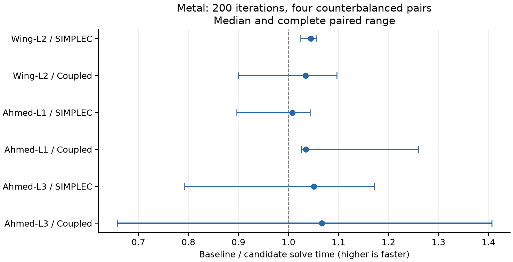
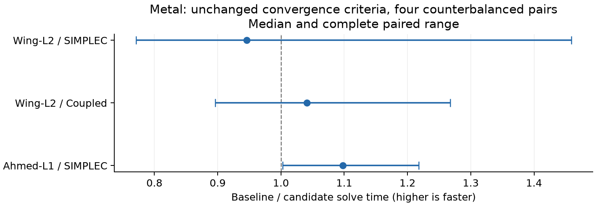
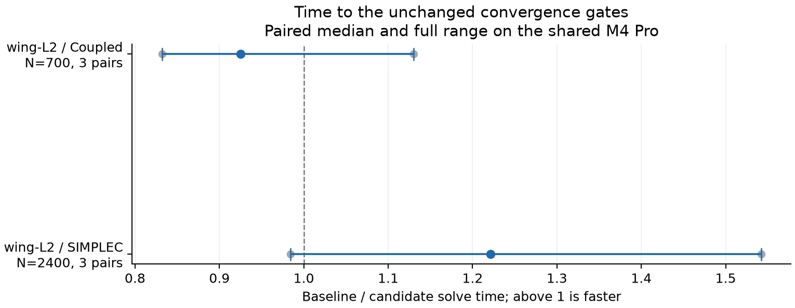
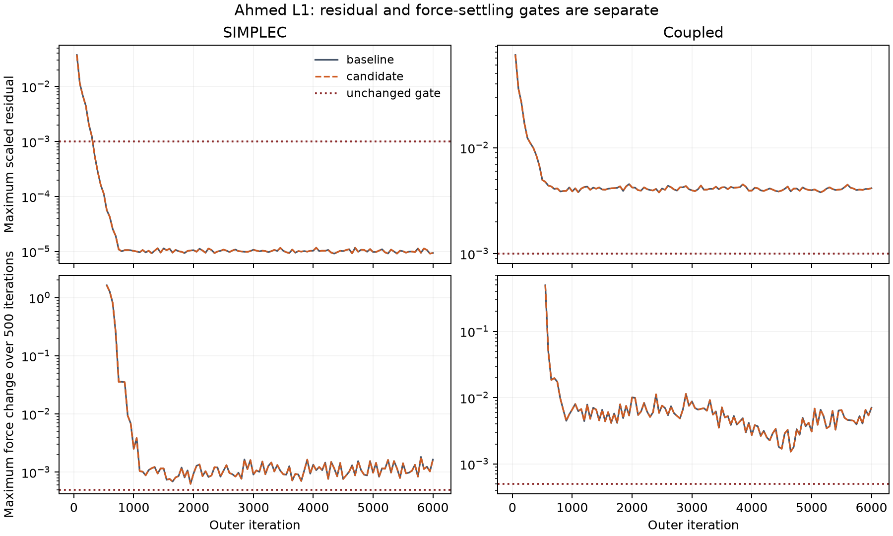

# FSAE time to solution on Metal

Latest round: [2026-11-03 follow-up](#2026-11-03-cached-face-jumps-and-setup)
compares current main `e014e36`. The opening results below remain the historical
`85c489b` round.

Ahmed L1 SIMPLEC reaches the same converged answer faster in all four paired
runs: solve speedup 1.098 [1.003, 1.218], or about 8.9% less solve time at the
paired median. Whole-process speedup is 1.090 [1.006, 1.208]. These are shared-GPU
observations, with a smallest solve gain of only 0.3%; they do not establish an
uncontended or universal speedup. Wing SIMPLEC has a slower paired median,
wing Coupled is mixed, and Ahmed Coupled does not converge within the existing
budget. The million-cell fixed-workload results are also too variable to claim
a consistent gain.

The solver is frozen at `7b817f3`. All requested CPU/Metal parity checks and the
quick tier pass. The full slow tier preserves main's exact assertion set and
values, including its 62 known failures.


Integration note: the measured commits were built on `85c489b`. On main the code
commits are `c8cc008` (1a89f69), `254afa2` (cc7366c), `5cf7aed` (ea3c058) and
`4fabc2d` (7b817f3). The comparator change `cd798e9` was superseded by main's
equivalent `971fbb3`. Timings and hashes below were measured on the original
commits; integrated parity was rechecked on CPU and Metal before merge.

## Builds and inputs

The unchanged baseline is `85c489bbbcd685933f30188272315f9a61702474`.
The candidate numerical source is `7b817f3b0e463a582593f2cba6427c9d29adf940`.
The comparison-tool fix is `cd798e9` and changes no solver code.

Both builds use Release, C++20, HDF5 and Metal on an Apple M4 Pro with 24 GB
unified memory. [Metadata](raw/metadata.json) records the compiler, platform and
binary SHA-256 values. Main was built before any edits, in `build-baseline`.
Frozen copies remain in `<checkout>/build-baseline/frozen`; candidate copies
are in `<checkout>/build/final-frozen`.

Generated Metal source is embedded in each executable and compiled by the
system Metal runtime with safe math and precise floating-point functions.
There is no external Kutta library or metallib to drift behind a frozen binary;
its SHA-256 binds both host code and embedded kernel source.

| Case | Cells | Input |
| --- | ---: | --- |
| Wing in ground effect, h/c 0.224, L2 | 195,581 | Existing generated fixture |
| Ahmed body, 35 degrees, L1 | 403,560 | Existing generated fixture |
| Ahmed body, 35 degrees, L3 | 1,329,048 | Generated locally with `ahmed.py --slant 35 --level 3` |

[Mesh hashes](raw/meshes.json) pin the exact inputs. The current Ahmed fixture
has 403,560 cells; the older coupled-plateau report names a different generation
with 403,604. Every baseline/candidate pair uses the same pinned file. The L3
mesh and all restricted data stay out of git.

The FSAE settings are unchanged. All cases use SST and the standard limiter.
The wing uses Re 462,000, downforce, moving ground, turbulence intensity 0.001
and viscosity ratio 1. The Ahmed cases use Re 2,780,000, length 1.044, reference
area 0.112, body-wall forces, z lift and turbulence intensity 0.01. SIMPLEC uses
momentum relaxation 0.7 and pressure relaxation 1. Coupled uses 0.5 and 0.5 with
flow CFL 200.

## Fixed iteration measurements

| Case | Cells | Scheme | Build | s/iteration | Solve seconds, 200 iterations | Process seconds | Peak GB |
| --- | ---: | --- | --- | --- | --- | --- | ---: |
| wing-L2 | 195,581 | SIMPLEC | baseline | 0.18956 [0.17827, 0.21553] | 37.912 [35.655, 43.107] | 40.03 [37.49, 44.87] | 0.703 |
| wing-L2 | 195,581 | SIMPLEC | candidate | 0.18233 [0.17107, 0.20583] | 36.466 [34.214, 41.165] | 38.55 [36.09, 42.94] | 0.703 |
| wing-L2 | 195,581 | Coupled | baseline | 0.18280 [0.15918, 0.18980] | 36.559 [31.837, 37.959] | 38.38 [33.76, 40.12] | 0.759 |
| wing-L2 | 195,581 | Coupled | candidate | 0.17514 [0.15469, 0.20174] | 35.028 [30.939, 40.347] | 36.98 [32.94, 42.12] | 0.786 |
| ahmed-L1 | 403,560 | SIMPLEC | baseline | 0.24755 [0.20526, 0.27254] | 49.510 [41.053, 54.508] | 60.08 [51.94, 64.77] | 1.234 |
| ahmed-L1 | 403,560 | SIMPLEC | candidate | 0.24621 [0.22889, 0.26128] | 49.243 [45.778, 52.257] | 60.08 [56.14, 63.72] | 1.234 |
| ahmed-L1 | 403,560 | Coupled | baseline | 0.27457 [0.18365, 0.31031] | 54.914 [36.729, 62.062] | 65.53 [48.65, 72.73] | 1.372 |
| ahmed-L1 | 403,560 | Coupled | candidate | 0.25161 [0.17904, 0.27379] | 50.322 [35.809, 54.759] | 61.47 [46.99, 65.20] | 1.437 |
| ahmed-L3 | 1,329,048 | SIMPLEC | baseline | 0.66469 [0.42008, 0.68065] | 132.938 [84.017, 136.131] | 166.97 [125.11, 171.13] | 3.762 |
| ahmed-L3 | 1,329,048 | SIMPLEC | candidate | 0.60133 [0.40600, 0.84041] | 120.267 [81.201, 168.083] | 152.56 [121.63, 201.54] | 3.762 |
| ahmed-L3 | 1,329,048 | Coupled | baseline | 0.76762 [0.65469, 1.20450] | 153.524 [130.938, 240.900] | 188.70 [169.33, 271.25] | 4.242 |
| ahmed-L3 | 1,329,048 | Coupled | candidate | 0.90147 [0.48809, 1.11295] | 180.294 [97.618, 222.590] | 213.26 [137.88, 255.95] | 4.445 |

Paired ratios are baseline time divided by candidate time. Each entry is the
median [min, max] of four pairs. A ratio above 1 favors the candidate.

| Case | Scheme | Solve speedup | Process speedup | Faster solve pairs |
| --- | --- | --- | --- | ---: |
| wing-L2 | SIMPLEC | 1.045 [1.024, 1.056] | 1.042 [1.023, 1.055] | 4/4 |
| wing-L2 | Coupled | 1.034 [0.900, 1.097] | 1.030 [0.903, 1.097] | 3/4 |
| ahmed-L1 | SIMPLEC | 1.007 [0.897, 1.043] | 0.995 [0.925, 1.031] | 2/4 |
| ahmed-L1 | Coupled | 1.035 [1.026, 1.260] | 1.041 [1.015, 1.192] | 4/4 |
| ahmed-L3 | SIMPLEC | 1.051 [0.792, 1.172] | 1.041 [0.849, 1.138] | 3/4 |
| ahmed-L3 | Coupled | 1.067 [0.658, 1.406] | 1.050 [0.731, 1.267] | 3/4 |



All four pairs favor the candidate for wing SIMPLEC and Ahmed L1 Coupled.
The other combinations have slower pairs, so no consistent gain is claimed.
The largest Coupled case has a slower unpaired candidate median despite a
paired median ratio above 1. Its wide range prevents a reliable speedup claim.
All 24 pairs have identical final reported numerical metrics.
Peak memory is the maximum of four runs, in decimal GB (1e9 bytes).

Each comparison alternates baseline and candidate, with four pairs per case
and scheme. Pair order is baseline/candidate, candidate/baseline,
baseline/candidate, candidate/baseline. The fixed workload is 200 iterations with the usual checks every
50. Both processes inherit `MallocSpaceEfficient=1`. Solve time includes the
benchmark's monitoring and force sampling. Process time also includes mesh
reading, setup and final wall-report construction. Peak memory is BSD time's peak process footprint,
which includes touched Metal buffers on this unified-memory machine.

Tables report medians and the complete min-to-max range. Speedups use the
median of the four paired baseline/candidate ratios. Earlier development runs
shared the GPU with the full test tiers and were stopped before a complete
measurement series. They do not establish a speedup. Their completed numeric
receipts are retained separately.

## Time to the unchanged convergence criterion

The criterion and stopping iteration are identical between builds. The three
converged combinations each have four counterbalanced pairs. Times are medians
[min, max]; N is the actual stopping iteration, not a reduced iteration budget.

| Case | Scheme | N | Build | Solve seconds | Process seconds |
| --- | --- | ---: | --- | --- | --- |
| wing-L2 | SIMPLEC | 2,400 | baseline | 457.09 [304.66, 750.12] | 458.75 [306.42, 751.76] |
| wing-L2 | SIMPLEC | 2,400 | candidate | 474.71 [395.18, 531.80] | 476.28 [397.05, 534.12] |
| wing-L2 | Coupled | 700 | baseline | 94.44 [62.90, 128.61] | 96.11 [64.47, 131.05] |
| wing-L2 | Coupled | 700 | candidate | 91.63 [57.84, 128.95] | 93.47 [59.49, 130.62] |
| ahmed-L1 | SIMPLEC | 1,100 | baseline | 216.47 [140.11, 233.16] | 225.81 [149.85, 241.75] |
| ahmed-L1 | SIMPLEC | 1,100 | candidate | 186.46 [139.70, 213.75] | 195.19 [148.96, 225.25] |

| Case | Scheme | Paired solve speedup | Paired process speedup | Faster solve pairs |
| --- | --- | --- | --- | ---: |
| wing-L2 | SIMPLEC | 0.946 [0.771, 1.459] | 0.946 [0.772, 1.458] | 1/4 |
| wing-L2 | Coupled | 1.041 [0.896, 1.268] | 1.041 [0.897, 1.262] | 3/4 |
| ahmed-L1 | SIMPLEC | 1.098 [1.003, 1.218] | 1.090 [1.006, 1.208] | 4/4 |



Wing SIMPLEC loses three of four convergence pairs despite winning all four
200-iteration pairs. Its full-trajectory paired median is 0.946, with a broad
0.771–1.459 range. Wing Coupled wins three of four. Only Ahmed SIMPLEC has a
favorable result in every convergence pair, including process time. None of
these observations isolates the effects of individual commits.

Ahmed L1 Coupled fails both residual and force-settling gates at 6,000 iterations
in both builds. Its single budget probe takes 843.32 baseline solve seconds and
883.15 candidate seconds (854.45 and 894.18 process seconds). It is not a
converged-answer speedup measurement and has no repeated median. The protocol
stops repeating a combination if either build fails its first convergence pair.

Every one of the 13 convergence pairs has the same stopping iteration, final
reported values and exact reported force/residual checkpoint strings. The checkpoint
histories are hashed in [the analysis](summary.json). The timestamps
and scalar results stay in [the run receipts](raw/convergence.jsonl).

The benchmark requires every applicable Fluent-scaled residual to be at most
1e-3 and both force coefficients to change by at most 5e-4 over 500 iterations.
The run limit is the benchmark's existing 6,000 iterations. No convergence
threshold, iteration budget or numerical acceptance test was changed.

## Profile before and after

Values below are GPU elapsed milliseconds per outer iteration, median [min,
max] of three profiles. They are timestamp spans, not exclusive GPU busy cycles;
shared GPU work can affect them. The groups are kernel families, not exact
physical-phase partitions. CSR/reductions and replay serve both AMG and Krylov;
transport assembly serves both momentum and turbulence.

**Wing L2, SIMPLEC**

| Kernel family | Baseline ms/iteration | Candidate ms/iteration |
| --- | --- | --- |
| Krylov/CSR/reductions | 19.04 [19.04, 22.80] | 19.09 [18.95, 22.31] |
| AMG smoothing, transfers and shared residuals | 9.51 [9.22, 10.92] | 9.43 [8.53, 9.56] |
| Small-operation replay (mixed) | 17.09 [16.68, 19.14] | 16.46 [15.79, 18.98] |
| Operator refresh and validation | 0.31 [0.31, 0.40] | 0.32 [0.31, 0.38] |
| Gradients, limiter and face reconstruction | 9.43 [8.76, 9.43] | 9.23 [8.84, 9.44] |
| Transport assembly (momentum and turbulence) | 2.02 [1.94, 2.17] | 2.02 [1.96, 2.18] |
| Momentum, pressure and flux coupling | 2.48 [2.33, 3.15] | 2.45 [2.42, 3.07] |
| SST closure | 3.11 [2.93, 3.87] | 3.15 [3.13, 3.88] |
| Other FV/runtime | 1.64 [1.34, 1.68] | 1.65 [1.40, 1.75] |

**Wing L2, Coupled**

| Kernel family | Baseline ms/iteration | Candidate ms/iteration |
| --- | --- | --- |
| Krylov/CSR/reductions | 18.61 [18.19, 20.75] | 17.77 [17.37, 20.25] |
| AMG smoothing, transfers and shared residuals | 30.76 [29.85, 32.40] | 28.59 [28.04, 30.05] |
| Small-operation replay (mixed) | 7.28 [6.94, 8.17] | 7.45 [6.95, 7.89] |
| Operator refresh and validation | 3.37 [3.25, 3.42] | 3.75 [3.65, 3.84] |
| Gradients, limiter and face reconstruction | 9.30 [8.91, 9.67] | 9.37 [9.00, 9.70] |
| Transport assembly (momentum and turbulence) | 2.09 [2.00, 2.22] | 2.04 [2.02, 2.15] |
| Momentum, pressure and flux coupling | 2.31 [2.29, 2.93] | 2.36 [2.33, 2.93] |
| SST closure | 3.08 [3.02, 3.79] | 3.15 [2.94, 3.74] |
| Other FV/runtime | 0.52 [0.48, 0.55] | 0.59 [0.53, 0.61] |

**Ahmed L1, SIMPLEC**

| Kernel family | Baseline ms/iteration | Candidate ms/iteration |
| --- | --- | --- |
| Krylov/CSR/reductions | 33.23 [32.78, 35.73] | 33.05 [32.31, 35.65] |
| AMG smoothing, transfers and shared residuals | 14.91 [14.82, 15.30] | 12.91 [12.46, 13.09] |
| Small-operation replay (mixed) | 26.52 [25.95, 28.79] | 25.07 [24.89, 28.35] |
| Operator refresh and validation | 0.94 [0.92, 1.11] | 1.03 [0.91, 1.04] |
| Gradients, limiter and face reconstruction | 26.68 [26.53, 28.12] | 27.87 [26.66, 28.08] |
| Transport assembly (momentum and turbulence) | 4.91 [4.79, 5.12] | 5.01 [4.88, 5.24] |
| Momentum, pressure and flux coupling | 4.17 [3.92, 4.78] | 4.03 [3.99, 4.53] |
| SST closure | 4.65 [4.54, 5.73] | 4.53 [4.40, 5.93] |
| Other FV/runtime | 1.91 [1.82, 2.25] | 2.02 [1.97, 2.23] |

**Ahmed L1, Coupled**

| Kernel family | Baseline ms/iteration | Candidate ms/iteration |
| --- | --- | --- |
| Krylov/CSR/reductions | 23.40 [22.65, 27.08] | 23.36 [21.25, 25.37] |
| AMG smoothing, transfers and shared residuals | 43.57 [42.79, 45.26] | 41.02 [39.34, 42.72] |
| Small-operation replay (mixed) | 9.81 [9.15, 12.43] | 9.50 [8.00, 11.84] |
| Operator refresh and validation | 12.54 [12.16, 14.13] | 14.70 [14.24, 14.85] |
| Gradients, limiter and face reconstruction | 27.80 [26.89, 28.58] | 28.27 [27.76, 28.78] |
| Transport assembly (momentum and turbulence) | 5.20 [4.97, 5.37] | 5.19 [5.19, 5.61] |
| Momentum, pressure and flux coupling | 3.91 [3.41, 4.12] | 3.98 [3.23, 4.33] |
| SST closure | 6.02 [4.86, 6.48] | 5.97 [4.16, 6.27] |
| Other FV/runtime | 1.05 [0.93, 1.13] | 1.16 [0.93, 1.36] |

Coupled moves work into operator refresh: Ahmed's refresh median rises from
12.54 to 14.70 ms/iteration while the smoothing/transfer/shared-residual group
falls from 43.57 to 41.02. Wing's corresponding groups move from 3.37 to 3.75
and 30.76 to 28.59. Those profile changes do not by themselves establish net
native wall-time gains. SIMPLEC's Ahmed smoothing group falls from 14.91 to
12.91; shared CSR/reduction work remains about 33 ms and gradients about 27–28 ms.

The following counts come from the separate native-batching probes. Counts
are identical in all three repetitions; wait milliseconds show the full range.
A nonempty sync is an API synchronization that actually has queued GPU work.
A buffer wait is one wait call inside that sync; one sync can wait on several
buffers. Neither is equivalent to the public `synchronize()` call count.

| Case | Scheme | Build | Nonempty syncs/iteration | Buffer waits/iteration | Host wait ms/iteration | Uploads/iteration |
| --- | --- | --- | ---: | ---: | --- | ---: |
| wing-L2 | SIMPLEC | baseline | 30.34 | 38.98 | 75.03 [70.02, 95.88] | 0.02 |
| wing-L2 | SIMPLEC | candidate | 24.58 | 33.22 | 73.41 [68.20, 94.83] | 0.02 |
| wing-L2 | Coupled | baseline | 25.80 | 25.80 | 87.26 [82.21, 103.82] | 1.02 |
| wing-L2 | Coupled | candidate | 23.88 | 23.88 | 83.63 [79.51, 101.23] | 0.02 |
| ahmed-L1 | SIMPLEC | baseline | 27.40 | 31.68 | 128.88 [128.15, 136.57] | 0.02 |
| ahmed-L1 | SIMPLEC | candidate | 21.98 | 26.26 | 125.29 [123.10, 135.07] | 0.02 |
| ahmed-L1 | Coupled | baseline | 17.10 | 17.10 | 137.98 [130.48, 151.92] | 1.02 |
| ahmed-L1 | Coupled | candidate | 15.28 | 15.28 | 136.15 [128.27, 149.73] | 0.02 |

The predictor removes 5.76 and 5.42 nonempty synchronizations per SIMPLEC
iteration on wing and Ahmed, and 1.92 and 1.82 on Coupled. Public sync-call
counts can rise when a norm and status are read together: the second call is
empty. Coupled's former scalar-limit upload also caused an empty sync, so its
removal must not be counted as an additional real round trip. Native
backpressure waits are zero in every measured window.

All builds perform seven public Device allocations per 50 measured iterations:
one force-mask upload plus six pressure/viscous-force output buffers in
`SteadySolver::forces()`. Their total requested bytes are 10,985,884 for wing
and 755,328 for Ahmed. There is one such sample per measured window; no other
public Device allocation churn is observed inside these iterations. Downloads
per iteration are unchanged: wing SIMPLEC 10.42, wing Coupled 15.86, Ahmed
SIMPLEC 7.52 and Ahmed Coupled 7.22. These counters do not inspect host malloc,
Metal driver allocation or transfer byte counts.

The instrumented binaries use command-buffer GPU start/end timestamps, splitting
buffers at kernel-family boundaries. These probes change dispatch submission,
so their elapsed wall times are not performance measurements. Profiles run
50 warmup iterations, then measure iterations 51 through 100 with the same
50-iteration reporting cadence.

Changing kernel names can also split more timestamped buffers. Family totals
locate expensive work; they do not establish isolated speedups. The setup row
means operator refresh and validation inside the iteration loop. AMG hierarchy
construction happens once during solver setup; its CPU cost is included in
setup and process time, without a finer CPU partition.

A separate count-only mode keeps native command-buffer batching. It records
nonempty synchronizations, backpressure waits, time inside buffer waits,
Device allocations and transfers. Wait time overlaps GPU time. The profile
counts public Device allocations, not host malloc or driver allocations.
[Profiler metadata](raw/profilers.json) binds each instrumented binary to its
numerical source and hash. No probes remain in solver source.

## Changes

| Commit | Change | Numerical contract |
| --- | --- | --- |
| `1a89f69` | Cache the five directed-edge coefficients of the Coupled fine operator once per outer solve. Initialize its scalar limits with the existing kernel. | Same coefficient expressions and face order; same 24 scalar values |
| `cc7366c` | Prepare each fine and coarse smoother block's three reciprocals, three H-times-inverse products and Schur denominator once per outer solve. | Same products and parenthesization |
| `ea3c058` | Skip matrix products in AMG's first Jacobi sweep after its iterate has been cleared to zero. | Finite matrix entries give residual b plus zero. A nonfinite RHS takes the original CSR path. Signed zeros are tested. |
| `7b817f3` | On larger Metal systems, compute the reliable residual when the recorded prior exit lies in the current batch. Reuse dead Krylov work vectors. | Same residual, norm, projection and verification; CPU and CUDA keep their existing policy. |
| `cd798e9` | Normalize CLI timing cells, temporary directory IDs and file-label pointer addresses in slow-assertion contexts. | Residual values, assertion outcomes and acceptance criteria remain unchanged. |

The Coupled caches trade memory for repeated work. The edge cache stores five
floats per directed cell-face entry. The block cache adds seven floats per fine
and coarse row. SIMPLEC needs no new buffers for the zero-start sweep.

The zero-start oracle compares every output bit against the ordinary CSR sweep
on CPU and Metal, with 513 and 2,053 rows. Its 15,396 checks cover signed zeros,
subnormals, large finite values, nonfinite RHS values and frozen solver states.

## Parity and verification

The CLI comparison uses 40 iterations for each case and backend. It compares
`fluxes.csv`, `forces.csv`, `loads.json` and `result.vtu` byte for byte. For
`residuals.csv`, it removes only lines beginning with `#` and the
`seconds_per_iteration` column, retaining every other byte and line ending.

| Case | CPU | Metal |
| --- | --- | --- |
| Mixing elbow, `--approximate wfgc` | Identical | Identical |
| Parameter elbow, `--approximate compressibility,ke-options` | Identical | Identical |
| Mixing elbow converted with the SIMPLEC override, then `--approximate wfgc` | Identical | Identical |

[Full hashes and source identities](raw/parity.jsonl) record all six comparisons.
The converted case uses exactly
`{"v":1,"overrides":{"methods/pressure-velocity-coupling":"simplec"}}`.
Full fields and converted meshes remain in ignored local runs.

All four `bench_overhead parity` hashes match main on each backend: eight
matching hashes in total. [The receipt](raw/overhead-parity.json) records the
source and binary identities. These hashes compare each backend with its own
baseline; CPU and Metal are not asserted to match one another.

The final quick tier passes 278 cases and 7,989,882 assertions, with zero
failures. The predictor oracle contributes 524,316 checks of output bits,
residual-stat bits and actual readback counts on CPU and Metal. Its baseline
policy fails only the two expected Metal wait-count checks; prediction passes
them. An additional 40-iteration wing L2 check compares all cell and wall
outputs byte for byte with main and finds zero field change.
The headline Ahmed L1 SIMPLEC case is also exported at its actual convergence
point: both builds stop at 1,100 iterations, and `cells.csv` and `walls.csv`
are byte-identical. [The converged-field receipt](raw/converged-field-parity.json)
records zero exported field change, input and executable hashes, and the
unchanged 6,000-iteration limit. These extra exports are parity checks, not
additional timing observations.

The baseline slow tier completed all 37 cases with 201,571 passed assertions and
62 failed assertions. Its six failing cases are V6 mixing elbow, 25; V12 fan,
1; V2 tet refinement, 8; V5 SST plate, 6; V5 SST bump, 8; and V7 SA, 14.
The final `7b817f3` candidate has exactly the same assertion set, outcomes and
expanded values: 201,633 assertions across all 37 cases, zero regressions, recoveries,
changed values, missing assertions or new assertions. The 62 existing failures
remain. [The comparison](raw/slow-comparison.json) agrees between the original
XML and compact receipts; both original XML hashes are recorded in the status
receipts. The full test process exits 1 for those known failures; the comparison
exits 0. No Fluent-reference or slow-tier acceptance criterion changed.

The slow comparison tool initially treated volatile CLI diagnostics as assertion
identities. Four regression checks now verify that timing, temporary paths and
pointer addresses can vary, physical residual changes remain distinguishable,
and a failed CLI assertion remains a regression. The original failure and
passing checks are retained in `raw/comparator-*.log`.

Complete doctest XML embeds generated meshes inside passing assertions. The
original XML stays local. Published compact receipts retain assertion identities,
outcomes and SHA-256 hashes of values. The original XML is compared before any
compaction, then the receipts are checked with the same comparator.

CUDA compile-only validation passes in the CUDA 13.0.2 development container for
architectures 75, 86 and 89 with `--fmad=false`. The generated CUDA file matches
the Mac build byte for byte. CUDA execution is unverified; this Mac has no
NVIDIA GPU. Portability lint passes.

## Trials not retained

The coefficient-layout and replay-threshold trials below used `cc7366c` as
their starting point, with three alternating pairs each. Times are solve seconds, median [min, max].
A paired speedup below 1 means the trial was slower. These runs had other test
jobs sharing the GPU and are separate from the final measurement series.

| Trial, Coupled | Case | Existing | Trial | Paired speedup |
| --- | --- | --- | --- | --- |
| 32-row coefficient tiles, 200 iterations | Wing L2 | 16.498 [13.532, 17.469] | 15.915 [13.224, 18.544] | 1.023 [0.890, 1.098] |
| 32-row coefficient tiles, 200 iterations | Ahmed L1 | 31.259 [25.680, 32.129] | 30.446 [28.320, 34.445] | 0.933 [0.843, 1.104] |
| Replay threshold 2,048 to 8,192, 100 iterations | Wing L2 | 8.532 [7.757, 9.666] | 9.331 [9.172, 11.116] | 0.870 [0.846, 0.914] |
| Replay threshold 2,048 to 8,192, 100 iterations | Ahmed L1 | 12.655 [12.480, 14.666] | 19.301 [18.800, 20.419] | 0.673 [0.647, 0.718] |

The tiled layout had mixed results and lost two of three Ahmed pairs. The larger
replay threshold lost every pair. Both were reverted. Dispatch widths 64, 128
and 512 were screened in 18 individual observations; that incomplete screening
does not establish a winner. The original dispatch widths remain.
[Trial receipts](raw/trials.json) retain the pairs and source basis.

A combined matrix-refresh/solve API was also tried and rejected. It combined
coefficient validation with the solve's entry norms, saving one readback per
scalar solve. Its 205,924 bitwise, guard and readback checks passed, as did all
six CLI comparisons. Three pairs did not establish a reliable wall-time gain:

| SIMPLEC, 200 iterations | Existing cached candidate | Combined refresh | Paired speedup |
| --- | --- | --- | --- |
| Wing L2 | 49.799 [49.534, 52.752] | 50.099 [48.012, 51.876] | 1.017 [0.994, 1.032] |
| Ahmed L1 | 71.701 [64.980, 79.296] | 71.461 [68.649, 78.884] | 1.044 [0.824, 1.110] |

The extra public API and split validation interface were removed. The existing
`refresh()` and `solve()` interfaces remain. [The pilot receipts](raw/refresh-pilot.jsonl)
retain every pair; prototype metadata records the source basis, patch hash and
binary hash. The emitted commit label is the prototype's configured basis.

## Remaining work by measured cost

1. Sparse linear algebra remains the largest measured GPU opportunity. On Ahmed
   SIMPLEC, CSR/reductions account for 33.05 ms/iteration and mixed replay for
   25.07. On Ahmed Coupled, the smoothing/transfer/shared-residual group is
   41.02 ms; fine smoothing alone is 16.54 and coarse smoothing 9.96. These
   categories overlap in purpose, so their costs must not be double-counted as
   separate predicted savings. Preserve operation order when removing passes.
2. Gradient and face reconstruction is still 27.87 ms/iteration for Ahmed
   SIMPLEC and 28.27 for Coupled. `fv_jump_gradient` is about 8 ms and
   `fv_moment_hop` about 7.4–7.5. Reusing an unchanged reconstruction or fusing
   compatible face passes is a better measured target than the roughly 5 ms
   transport assembly or 4.5–6 ms SST-closure group.
3. Native host round trips remain at 15.28–24.58 per iteration after prediction.
   Wait spans are 73–136 ms at the medians, overlapping GPU execution. Further
   batching needs to save real round trips without adding costly sparse work;
   the rejected refresh API shows that fewer waits alone is insufficient.
4. Resolve the missing converged answer for Ahmed Coupled: it consumes all
   6,000 iterations and 843–883 solve seconds without satisfying either gate.
   Also profile late wing SIMPLEC iterations before claiming that case improved.
   The present timestamp window covers iterations 51–100 and cannot explain its
   slower full-trajectory median. Any numerical change needs a separate commit
   and the unchanged reference/slow gates.

There is no measured payoff estimate for these unimplemented changes. Initial
AMG setup is not rebuilt every iteration, and the measured allocation churn is
periodic force reporting. Those are weaker targets than the costs above.
The million-cell case has memory headroom but no consistent timing gain; CUDA
runtime behavior and performance remain unverified.

## Reproduce

Configure the baseline and candidate source revisions in separate owned build
trees with the same options below. Keep those trees as well as the frozen
binaries: the tests invoke the CLI path compiled into each test binary.

```sh
cmake -S <checkout> -B <build> -DCMAKE_BUILD_TYPE=Release \
  -DKUTTA_BUILD_APP=OFF -DKUTTA_BUILD_TESTS=ON \
  -DKUTTA_ENABLE_METAL=ON -DKUTTA_ENABLE_CUDA=OFF \
  -DKUTTA_ENABLE_HDF5=ON -DKUTTA_REQUIRE_HDF5=ON
cmake --build <build> --parallel 4
```

Run the comparisons from `<checkout>`. Point `KUTTA_FLUENT_EXAMPLES` and
`KUTTA_RUNS` at the read-only fixture checkout. Keep the two frozen binaries
separate. The commands below use the retained build names from this run.

```sh
python3 validation/results/fsae_time_to_solution/reproduce.py \
  --baseline build-baseline/frozen/bench_fsae_aero \
  --candidate build/final-frozen/bench_fsae_aero --out runs/fsae-recheck
python3 validation/results/fsae_time_to_solution/reproduce.py \
  --baseline build-baseline/frozen/bench_fsae_aero \
  --candidate build/final-frozen/bench_fsae_aero --convergence \
  --cases wing-L2 ahmed-L1 --out runs/fsae-convergence-recheck
python3 validation/results/fsae_time_to_solution/parity.py \
  --baseline build-baseline/frozen/kutta --candidate build/final-frozen/kutta \
  --out runs/fsae-parity-recheck
build/final-frozen/kutta-tests --test-suite-exclude=slow
build/final-frozen/kutta-tests -ts=slow -r=xml --success > runs/slow-recheck.xml
python3 tools/forensics/compare_slow_assertions.py BEFORE.xml AFTER.xml
python3 tools/forensics/test_compare_slow_assertions.py
python3 tools/lint_portability.py
python3 validation/results/fsae_time_to_solution/analyze.py
uv run --with matplotlib==3.11.2 python validation/results/fsae_time_to_solution/plot.py
```

## 2026-11-03: Cached face jumps and setup

Two byte-identical changes reduce reconstruction and setup work. **A consistent
whole-case time-to-convergence win is not established.** The wing reaches the
same gates at the same iterations; its paired timings remain mixed. On current
main `e014e36`, Ahmed SIMPLEC reaches the residual gate but fails the lift-settling
gate at 6,000 iterations. Ahmed Coupled fails both. Both candidate trajectories
match their baseline's reported numerical histories exactly. The earlier report's
Ahmed SIMPLEC convergence result used `85c489b`; it is not current-main acceptance.
No cause for this baseline difference was isolated in this round.

### Source, artifacts and measurement

The baseline is main `e014e36c46cd63bd2b9fc52b24247b1e40939f85`.
The source commits are `17d65a6` (directed face jumps) and `3de2c43` (pivot scan).
[Metadata](2026-11-03/metadata.json) pins input meshes, frozen executable hashes
and the complete [numerical source patch](2026-11-03/numerical-source.patch.gz).
The frozen candidates were built before committing: their embedded version
string remains `e014e36`, but their numerical-source patch matches
`e014e36..3de2c43` byte for byte. Kernels are embedded in each executable.

All runs use Release, C++20, HDF5 and Metal on the shared 24 GB M4 Pro. Inputs are
the existing 403,560-cell Ahmed L1 and 195,581-cell wing L2, h/c 0.224. Re,
reference dimensions, inlet turbulence, moving ground, SST, limiter, relaxation,
CFL and pressure interpolation are unchanged. The existing runner retains its
6,000-iteration cap, checks every 50 iterations, residual limit `1e-3` and relative
change limit `5e-4` for **both** forces over 500 iterations. Each measurement is a
fresh process with `MallocSpaceEfficient=1`. One owned heavy solve runs at a time.
Other agents' CPU/GPU load is uncontrolled.

Native convergence pairs alternate BC, CB, BC. The existing runner stops an
unconverged combination after its first complete budget pair. Solve time includes
monitoring and force samples; process time additionally includes input, setup and
final wall-report construction. A speedup is baseline time divided by candidate
time **within each pair**; its median need not equal the ratio of the two marginal
medians. Brackets below are full observed ranges, not confidence intervals.

### Changes and isolated effects

The old strain jump correction evaluates each internal face's two traces again
for each adjacent cell. A new portable face pass evaluates them once, stores
both subtraction directions explicitly, then a cell pass gathers them in the
original order. Storing both directions preserves signed zeros. Trace arithmetic,
fit weights, sum order and final derivatives are unchanged. Scratch is allocated
during setup and reused between components. This adds one dispatch per correction
and 4 bytes per cell-face incidence: **9,685,440 bytes on Ahmed; 3,940,156 on the
wing**. This is common `.kern.h` code generated for CPU, Metal and CUDA.

Five alternating component pairs on the actual RCM-renumbered meshes compare
old/new outputs, then time 200 corrections with the same allocations and native
command batching. These are component measurements, not converged CFD timings.

| Component | Before ms, median [range] | After ms, median [range] | Paired speedup [range] | Faster pairs |
| --- | ---: | ---: | ---: | ---: |
| Jump correction, ahmed-L1 | 1.529 [1.524, 1.574] | 0.944 [0.901, 0.968] | 1.667 [1.608, 1.694] | 5/5 |
| Jump correction, wing-L2 | 0.507 [0.468, 0.521] | 0.451 [0.381, 0.488] | 1.154 [0.959, 1.322] | 4/5 |

The CPU setup change caches the winning absolute matrix entry beside its pivot
indices during the 10-by-10 Jacobi eigen scan. The matrix does not change during
the scan; strict comparison order, ties, rotations and inverse accumulation are
unchanged. A microbenchmark compares all 100 doubles in 512 inverse matrices,
then consumes every entry through a volatile function pointer during timing.
Five alternating pairs of three batches give 73.60 [63.38, 159.43] → 31.23 [25.30, 38.92] ms,
paired speedup 2.479 [1.629, 5.106]. The earlier single-output pilot is excluded.
[Micro summaries](2026-11-03/micro-summary.json), logs and exact sources are retained.

The real setup ablation compares the frozen face-jump-only candidate against the
final candidate, so the pivot scan is the only difference. Three alternating
pairs use a one-iteration diagnostic, measuring `setup_s` only; the convergence
budget above is unchanged. All reported numerical values match within each pair.

| Setup only | Before s, median [range] | After s, median [range] | Paired speedup [range] |
| --- | ---: | ---: | ---: |
| ahmed-L1 | 9.604 [9.337, 10.341] | 7.856 [7.540, 10.992] | 1.223 [0.941, 1.238] |
| wing-L2 | 1.733 [1.725, 2.074] | 1.655 [1.585, 1.972] | 1.052 [1.047, 1.088] |

Ahmed's setup pair includes one slowdown; the small wing setup gain is consistent
in these three pairs. These observations do not imply an iteration-time gain.
[Setup receipts](2026-11-03/setup-receipts.jsonl) preserve ordering and hashes.

### Metal kernel and phase breakdown

Two alternating profile pairs per case/scheme warm 50 iterations and measure
iterations 51–100, including that window's force sample and monitor. Scratch
instrumentation splits command buffers at every **actual native dispatch** and
uses Metal `GPUStartTime`/`GPUEndTime`. It was removed from production source after
building frozen profiling binaries. The [profiling patch](2026-11-03/profiling.patch.gz)
and [receipts](2026-11-03/profile-receipts.jsonl) make the experiment reproducible.

These spans include shared-GPU scheduling effects and change native batching;
**they are not exclusive GPU busy time or native wall-clock speedups**. Phase rows
are disjoint kernel families, not separately timed physical solves. Shared CSR
and residual kernels cannot be assigned uniquely to momentum or pressure.
`runtime_sequence` is one real GPU kernel replaying mixed small operations; it
is measured once, without double-counting its logical suboperations.

Only the public `timestamp:GPUTimestamp` counter is exposed. The bandwidth column
is **whole buffer argument footprint / timestamp span**, including duplicate
arguments and guarded calls. It is not measured DRAM traffic, an achieved DRAM
bandwidth, or a traffic bound. Values above the nominal 270 GB/s are possible and
must not be read as utilization. Actual DRAM bandwidth remains unverified.
Replay argument traffic is not modeled. Guarded dispatch counts are not active
Krylov iteration counts. The full per-kernel counts, medians,
ranges and footprint rates are in [kernels.csv](2026-11-03/kernels.csv);
[phases.csv](2026-11-03/phases.csv) retains every family range.

Each cell below is **before → after median ms per outer iteration**. Tables cover
all timestamped work; the sums and ranges follow separately.

| ahmed-L1: kernel family | SIMPLEC ms | Coupled ms |
| --- | ---: | ---: |
| AMG smoothing, transfers and shared residuals | 16.44 → 16.42 | 48.46 → 55.10 |
| Gradients, limiter and face reconstruction | 33.45 → 28.69 | 33.06 → 31.43 |
| Krylov/CSR/reductions | 44.98 → 44.50 | 29.36 → 31.80 |
| Momentum, pressure and flux coupling | 5.19 → 5.18 | 4.65 → 4.90 |
| Operator refresh and validation | 1.29 → 1.41 | 20.99 → 25.23 |
| Other FV/runtime | 2.68 → 2.70 | 1.75 → 1.55 |
| SST closure | 5.93 → 5.72 | 6.23 → 6.08 |
| Small-operation replay (mixed) | 36.74 → 37.85 | 10.75 → 12.26 |
| Transport assembly (momentum and turbulence) | 6.04 → 5.94 | 6.01 → 6.83 |

| wing-L2: kernel family | SIMPLEC ms | Coupled ms |
| --- | ---: | ---: |
| AMG smoothing, transfers and shared residuals | 11.98 → 14.95 | 37.15 → 33.76 |
| Gradients, limiter and face reconstruction | 9.70 → 11.70 | 12.21 → 10.48 |
| Krylov/CSR/reductions | 28.56 → 36.04 | 30.41 → 28.21 |
| Momentum, pressure and flux coupling | 3.07 → 3.73 | 3.80 → 3.65 |
| Operator refresh and validation | 0.52 → 0.60 | 5.70 → 4.54 |
| Other FV/runtime | 2.35 → 3.59 | 0.99 → 0.94 |
| SST closure | 3.95 → 5.30 | 5.03 → 5.13 |
| Small-operation replay (mixed) | 21.43 → 26.21 | 11.38 → 10.42 |
| Transport assembly (momentum and turbulence) | 2.38 → 2.71 | 2.86 → 2.43 |

| Timestamp total per outer iteration | Before ms, median [range] | After ms, median [range] |
| --- | ---: | ---: |
| ahmed-L1, simplec | 152.73 [152.13, 153.34] | 148.40 [146.84, 149.96] |
| ahmed-L1, coupled | 161.27 [155.42, 167.12] | 175.17 [170.89, 179.46] |
| wing-L2, simplec | 83.95 [82.01, 85.90] | 104.83 [85.48, 124.19] |
| wing-L2, coupled | 109.53 [98.78, 120.29] | 99.55 [98.26, 100.84] |

The dominant baseline kernels below illustrate the sparse/gradient split. Time
is median ms per outer iteration. Rate is median argument-footprint GB/s, with
the nominal 270 GB/s comparison in parentheses; full ranges are in the CSV.

| Case / scheme | Kernel | Time before → after ms | Footprint rate before → after GB/s (% of 270) |
| --- | --- | ---: | ---: |
| ahmed-L1 / simplec | `runtime_sequence` | 36.74 → 37.85 | unmodeled → unmodeled |
| ahmed-L1 / simplec | `runtime_reduce` | 12.85 → 12.64 | 73 (27%) → 74 (27%) |
| ahmed-L1 / simplec | `amg_smooth` | 12.49 → 12.48 | 162 (60%) → 162 (60%) |
| ahmed-L1 / simplec | `csr_spmv_guarded` | 12.14 → 12.02 | 195 (72%) → 197 (73%) |
| ahmed-L1 / simplec | `fv_moment_hop` | 9.07 → 9.17 | 138 (51%) → 137 (51%) |
| ahmed-L1 / simplec | `fv_jump_gradient → face + gather` | 9.81 → 5.47 | 90 (33%) → face 142 (53%); gather 165 (61%) |
| ahmed-L1 / coupled | `coupled_fine_smooth` | 19.96 → 22.99 | 234 (87%) → 202 (75%) |
| ahmed-L1 / coupled | `coupled_coarse_smooth` | 11.42 → 12.49 | 83 (31%) → 76 (28%) |
| ahmed-L1 / coupled | `coupled_galerkin_fine` | 11.17 → 13.70 | 16 (6%) → 13 (5%) |
| ahmed-L1 / coupled | `coupled_fine_residual` | 8.90 → 9.91 | 190 (70%) → 172 (64%) |
| ahmed-L1 / coupled | `fv_moment_hop` | 8.71 → 10.14 | 143 (53%) → 124 (46%) |
| ahmed-L1 / coupled | `fv_jump_gradient → face + gather` | 9.66 → 5.67 | 92 (34%) → face 137 (51%); gather 155 (57%) |
| wing-L2 / simplec | `runtime_sequence` | 21.43 → 26.21 | unmodeled → unmodeled |
| wing-L2 / simplec | `runtime_reduce` | 11.03 → 13.96 | 49 (18%) → 41 (15%) |
| wing-L2 / simplec | `amg_smooth` | 7.95 → 9.81 | 165 (61%) → 142 (53%) |
| wing-L2 / simplec | `csr_spmv_guarded` | 4.10 → 5.01 | 224 (83%) → 193 (71%) |
| wing-L2 / simplec | `fv_jump_gradient → face + gather` | 2.15 → 2.69 | 172 (64%) → face 111 (41%); gather 159 (59%) |
| wing-L2 / coupled | `coupled_fine_smooth` | 18.36 → 15.92 | 294 (109%) → 338 (125%) |
| wing-L2 / coupled | `runtime_reduce` | 9.73 → 9.32 | 73 (27%) → 74 (27%) |
| wing-L2 / coupled | `coupled_fine_spmv` | 7.14 → 5.95 | 241 (89%) → 288 (107%) |
| wing-L2 / coupled | `fv_moment_hop` | 3.04 → 2.63 | 192 (71%) → 223 (82%) |
| wing-L2 / coupled | `fv_jump_gradient → face + gather` | 2.72 → 2.27 | 136 (50%) → face 134 (50%); gather 183 (68%) |

Ahmed jump spans fall from about 9.8 to 5.5 ms (SIMPLEC) and 9.7 to 5.7 ms
(Coupled). The intrusive wing SIMPLEC jump span is worse, despite the native
component median improving; the profile and native whole-case series must be
read separately. Other kernels' timing changes are not attributed to the source
changes: shared load and profiler dispatch splitting were not isolated.

A single additional wing SIMPLEC profile pair measures iterations 2351–2400,
near its actual stopping point. Baseline → candidate total timestamp span is
113.09 → 122.09 ms/outer; Krylov/CSR/reductions are 68.72 → 72.77 ms and
reconstruction 9.73 → 10.23 ms. On the baseline, the Krylov family grows from
34% of early spans to 61% late. This diagnostic locates remaining work; it is
neither a repeated native timing result nor a measured regression cause.
[Late kernel breakdown](2026-11-03/late-kernels.csv) retains all dispatches.

### Time to the unchanged convergence gates

All 16 completed native runs are retained in [convergence receipts](2026-11-03/convergence.jsonl)
and the [paired summary](2026-11-03/convergence-summary.json). Every pair has the
same stopping iteration, byte-identical **printed** checkpoint history, and
identical final reported physical values. This is full-trajectory reporting
parity, not a full-field export at every checkpoint. Full-field parity is checked
separately at 40 iterations below.

| Converged wing case | Iterations before → after, all pairs | Solve s before, median [range] | Solve s after, median [range] | Paired solve speedup [range] | Faster pairs |
| --- | ---: | ---: | ---: | ---: | ---: |
| coupled | 700 → 700 | 101.98 [51.14, 115.47] | 122.59 [45.26, 124.83] | 0.925 [0.832, 1.130] | 1/3 |
| simplec | 2400 → 2400 | 333.68 [214.26, 556.39] | 339.06 [175.44, 360.82] | 1.221 [0.984, 1.542] | 2/3 |

Wing SIMPLEC's paired median is favorable, but its candidate marginal median is
slightly slower and one pair loses. Coupled's paired median loses. Neither is a
consistent whole-case win. Whole-process paired speedups are
coupled: 0.932 [0.837, 1.133]; simplec: 1.219 [0.970, 1.542].



Ahmed results below are **single unconverged budget pairs**, not speedup medians
or times to a converged answer. Repeating failed budget runs would not establish
the requested converged-answer target.

| Ahmed L1 | Iterations, both | Solve s before → after | Process s before → after | Final max residual | Lift change / drag change over 500 |
| --- | ---: | ---: | ---: | ---: | ---: |
| simplec | 6,000 | 1353.35 → 1784.49 | 1366.10 → 1791.97 | 9.410969e-06 | 0.001642851 / 0.0001655641 |
| coupled | 6,000 | 1240.55 → 1022.04 | 1264.99 → 1033.22 | 0.004148628 | 0.007046151 / 0.0006944255 |

SIMPLEC passes residuals and drag settling but lift change is 0.00164285, above
0.0005. Coupled's residual is 0.00414863, above 0.001, and neither force settles.
The candidate does not fix these current-main convergence limitations. No
acceptance criterion was weakened. The existing Ahmed slow test checks residuals
and drag, but does not assert the benchmark's force-settling gate.



### Parity, checks and memory

All six 40-iteration CLI comparisons pass: V6 mixing elbow with
`--approximate wfgc`, parameter elbow with
`--approximate compressibility,ke-options`, and the converted SIMPLEC mixing
elbow, each on CPU and Metal. `cmp` matches `fluxes.csv`, `forces.csv`, `loads.json`
and `result.vtu`. Residual checks remove comments and compare columns 1–7;
additionally every column except `seconds_per_iteration` matches. Each summary
confirms 40 iterations and matching case/setup/mesh/data identities.
[CLI receipts](2026-11-03/parity-cli.jsonl) pin both binaries and the comparisons.
The target wing's 40-iteration `cells.csv` and `walls.csv` also match byte for byte
on CPU and Metal ([target receipts](2026-11-03/parity-wing.jsonl)).

The direct old/new jump oracle passes 6,120 bit assertions on CPU/Metal, including
warped hex/tet geometry, both zero signs, subnormals, large finite fields and
scratch reuse. The full quick tier passes **308 cases, 7,996,274 assertions,
zero failures**; 37 existing slow cases are excluded. Portability lint and fresh
Metal/CUDA kernel generation pass. Four additional fixed-workload solver-state
hashes match for each backend (CPU and Metal), covering realizable k-epsilon,
SST tet and two laminar sizes.
Two selected V8 slow cases also pass on CPU/Metal: the realizable k-epsilon
channel at three resolutions and the Darcy–Forchheimer pressure-drop/direction
case, totaling **2 cases and 42 assertions**.
[Verification receipts](2026-11-03/verification.json) record hashes and exact
scope; the selected cases are not a full slow-tier comparison.

The full slow tier was **not run** for these byte-identical changes. There is no
expanded slow-assertion comparison, and no measured count of slow-tier
regressions, recoveries or changed values is claimed. No numerical settings or
arithmetic order changed. The requested CPU/Metal file parity, direct bit oracle,
quick tier, additional solver hashes and matched target trajectories support
that narrower contract. No full slow XML or restricted reference data is committed.

Maximum observed process footprint was **1,708,755,032 bytes (1.709 GB)** in the
quick tier. The heaviest native convergence run was candidate Ahmed Coupled at
**1,460,340,296 bytes (1.460 GB)**; the largest instrumented profile was 1.465 GB.
The face-jump cache costs 9.69 MB on Ahmed and 3.94 MB on the wing; native Coupled
peak rose from 1.451 to 1.460 GB. These are process footprints on unified memory,
not isolated GPU allocation totals. All owned fixture symlinks were removed;
no fixture checkout was modified. No owned solves remain running.

CUDA and Metal wrappers regenerate from the same portable kernel sources.
CUDA compilation, RTX runtime parity/performance, actual DRAM bandwidth and
uncontended performance remain unverified. This round does not establish
"same answer as Fluent, much faster": it preserves the observed baseline answers
and identifies remaining convergence and linear-solver work.

### What did not work and what remains

A backward dependency filter for walk moments was prototyped and removed.
Ahmed's corrected faces require 403,513 of 403,560 final moment rows, and the
first backward halo reaches all cells. The wing requires 159,729 final rows
and 166,079 seed rows out of 195,581. This trial was not timing-qualified;
there was no useful Ahmed work reduction to retain.

The retained reconstruction change does not produce a consistent native wing
win. It adds a dispatch and scratch traffic while saving duplicate trace work;
these are structural facts, not an isolated explanation of the timing losses.
Do not infer a universal 1.667x solver speedup from the Ahmed component result.

On these paths, AMG hierarchy construction already occurs during setup;
outer iterations refresh coefficients. Reusing hierarchy setup alone will not
remove those refresh kernels. Coupled fine Galerkin refresh still searches a
coarse row for each fine neighbour. Caching that static entry mapping is a
concrete next experiment; its payoff is unmeasured. The early Coupled profile
shows substantial smoother/refresh cost, while the late wing SIMPLEC profile
points to Krylov/reduction work.

Further reconstruction fusion, fewer host waits, alternative layouts and static
mapping caches need native paired measurements and byte parity. Cheaper
smoothers, V-cycle changes, tolerance changes and mixed precision remain
numerical experiments: they require the full unchanged slow tier, zero
regressions, matching converged forces and a total-time-to-converged win.
Ahmed's current-main residual/force-settling limitations must also be resolved
before its budget timings can support a converged-answer pitch.
