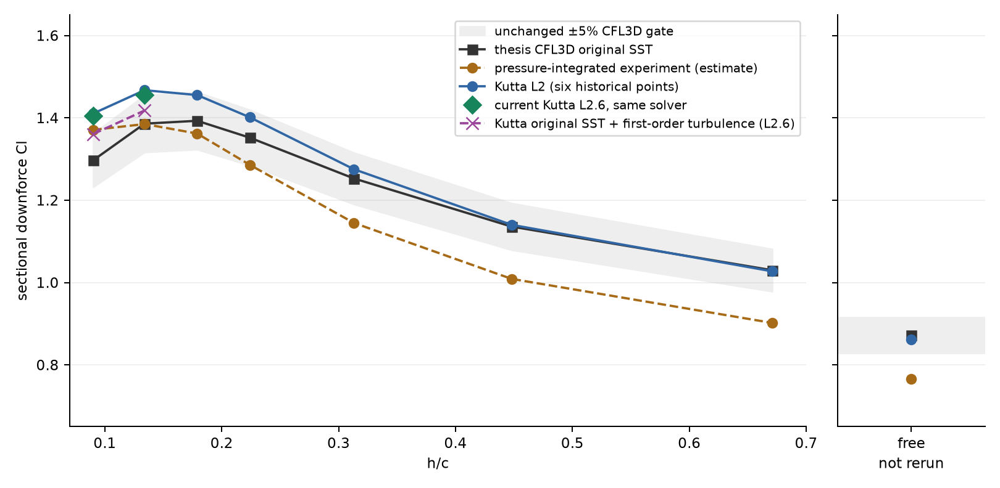
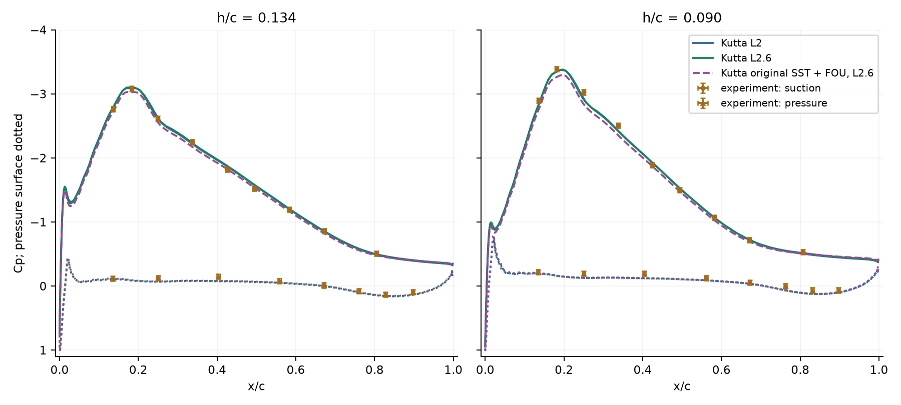
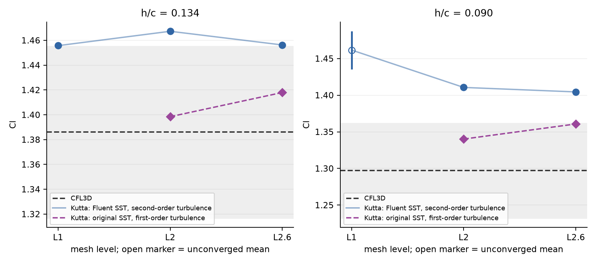

# Tyrrell 026 wing at low ride height

Investigation, 2026-11-01 to 2026-11-02. Worktree based on main `8866cc0`;
final validation code `6340e3c`.
Apple M4 Pro, Release build, Metal backend.
One heavy solve at a time, with convergence measured in iterations. No
wall-clock performance conclusions are drawn. The 5% sectional Cl gate
against Zerihan's CFL3D k-omega remains unchanged. No solver implementation,
default numerical setting, reference value or convergence criterion changed.

## Result

The default Fluent-SST/second-order misses survive fresh mesh refinement.
At h/c 0.134, Cl falls from 1.467294 to 1.456269: +5.87% to +5.07%
against CFL3D. At 0.090 it falls from 1.410583 to 1.404462: +8.76% to
+8.29%. Both still fail the unchanged 5% gate.

The largest isolated L2 effect is turbulence advection order. Changing only
k/omega advection to first order gives Cl=1.347315 at 0.090 (+3.88%);
original-SST transport choices then give 1.340128 (+3.33%). The thesis cites
the CFL3D v5 manual, whose turbulence method is first order. The starting
comparison mixed that published method with Kutta's Fluent-SST/second-order
configuration. No solver arithmetic defect causing the excess lift was
isolated.

Using the published transport choices, first-order turbulence, prescribed
ground, resolved local ground layers, compact domain and native second-order
pressure gives Cl=1.409607 at 0.134 (+1.703%) and 1.357307 at 0.090
(+4.650%): both pass on those L2 meshes. These are existing options, kept
opt-in. Standard pressure on the same combined 0.090 setup gives +5.093%
and fails, so the nominal recovery is numerically sensitive.

This is not a certified CFL3D reproduction or a mesh-independent solver
repair. The updated input deck is missing, wing-wall and top-boundary
treatments still differ, and the combined family has not been refined.
The selected experimental suction pressures are closer to the default fine
solution. Solver defaults and the acceptance gate remain unchanged.

| h/c | CFL3D SST | Experimental estimate | Kutta L2 before | Kutta L2.6 after refinement | Error vs CFL3D, before → refined | Error vs experiment, before → refined |
| --- | ---: | ---: | ---: | ---: | --- | --- |
| free | 0.872 | 0.766 | 0.861200 | — | -1.24% | +12.43% |
| 0.671 | 1.030 | 0.902 | 1.027300 | — | -0.26% | +13.89% |
| 0.448 | 1.136 | 1.009 | 1.140300 | — | +0.38% | +13.01% |
| 0.313 | 1.253 | 1.145 | 1.275400 | — | +1.79% | +11.39% |
| 0.224 | 1.352 | 1.286 | 1.401500 | — | +3.66% | +8.98% |
| 0.179 | 1.393 | 1.362 | 1.455500 | — | +4.49% | +6.86% |
| 0.134 | 1.386 | 1.385 | 1.467294 | 1.456269 | +5.87% → +5.07% | +5.94% → +5.15% |
| 0.090 | 1.297 | 1.371 | 1.410583 | 1.404462 | +8.76% → +8.29% | +2.89% → +2.44% |

The first six Kutta values are the historical sweep in
[the original report](../fsae_aero/REPORT.md), not fresh reruns. Both failing
heights were rerun here. Default behaviour remains unchanged; the after
column describes refinement of that same solver. The experimental column
is a pressure-tap estimate, not the 3D balance coefficient and not a replacement gate.



## What the reference actually ran

The original report's attribution to Wilcox k-omega was incorrect. Zerihan
names **Menter k-omega**, citing AIAA 93-2906 (thesis section 9.2.2, p.157).
The [CFL3D manual, appendix H.4.4](https://nasa.github.io/CFL3D/Cfl3dv6/V5Manual/TurbEq.pdf)
identifies that model as original **SST**, `ivisc=7`. Its viscosity limiter
uses vorticity, and its production uses vorticity squared (H-78 through
H-80). Kutta uses Fluent's SST defaults: strain for both, with Fluent's
production limiter and y+-insensitive wall treatment. This is a comparison
between SST formulations, not SST versus Wilcox. The thesis does not supply
its input deck or exact CFL3D revision, so an exact option match cannot be
certified.

Primary source: J. Zerihan, *An Investigation into the Aerodynamics of Wings
in Ground Effect*, 2001, [thesis](https://eprints.soton.ac.uk/426058/1/00192634.pdf).
The downloaded PDF matches the restricted SOURCE.md SHA-256
`93a3dd52252c3f5152a2cfba1f8ce7496c98592b4648da2172d9b44ab3c8f6ab`.
Printed page numbers below are 18 less than PDF page numbers.

Geometry and incidence were retained. Table 2 is already at reference
incidence 1 degree, corresponding to true chord incidence 3.45 degrees;
its contour is scaled by 1/1.0018 to unit true chord. The reference-zero
ride-height datum uses a -1 degree rotation about c/4. Neither incidence
nor the height datum was adjusted to reduce the lift discrepancy.

| Item | Thesis | Existing Kutta validation |
| --- | --- | --- |
| Re, Mach | CFD Re 462000, M 0.0874 (9.2.4) | Re 462000, incompressible |
| Tunnel turbulence | Streamwise Tu 0.2% at 30 m/s (2.5) | Inlet intensity 0.1%, viscosity ratio 1 |
| CFD inlet turbulence | Not specified in thesis | The inlet values above are assumptions, not thesis data |
| Transition | Measurements free transition; CFD documents SST/SA without a transition equation or trip prescription | Fully turbulent SST |
| Experimental Re | 430000-462000, temperature/pressure dependent (2.6) | At upper end of the experimental range |
| Ground velocity | Prescribed streamwise velocity matching freestream (9.2.4) | Moving wall at U, zero normal flow |
| Ground turbulence | Prescribed quantities zero; high/low trials reported insensitive (9.2.4) | Fluent wall omega and production, zero k diffusion flux |
| Domain | Text: 8c upstream/downstream, top y=7c; Fig.73 instead labels 10c upstream/downstream | x/c -30 to 40, top 30; slip top versus thesis extrapolation |
| Ground grid | y+ about 1 required; 185x25 ground block at h/c 0.134 and 0.090 (9.2.5, Table 14) | Unstructured triangles, no ground layers; h/c 0.090 u*-based wall units max 48.3, mean 25.7 under wing |
| Wing/wake grid | C block 289x65 at h/c 0.134, 289x49 at 0.090; wake H block 41x41; 30592/25984 total cells | L2: 246 wall faces, 29 wing layers, first height 2e-5c, near-wake target size 0.008c |

CFL3D used a steady run followed by time-accurate runs to obtain a steady
result, according to section 9.2.6. Kutta uses steady SIMPLEC. The thesis
does not supply its final time steps or convergence histories.

The thesis cites the CFL3D v5.0 user manual as reference 82 and describes
second-order upwind flux splitting in section 9.2.3.
The [CFL3D v5 manual, appendix H.8](https://nasa.github.io/CFL3D/Cfl3dv6/V5Manual/TurbEq.pdf)
separately specifies first-order advection for its decoupled turbulence
equations. The later [CFL3D keyword documentation](https://nasa.github.io/CFL3D/Cfl3dv6/cfl3dv6_new.html)
also gives first-order turbulence advection as the default. Thus a general
second-order mean-flow description does not establish second-order k/omega
transport. The published thesis-era method supports a first-order comparison;
the exact input deck and revision remain unknown. The [NASA TMR model definition](https://tmbwg.github.io/turbmodels/sst.html)
distinguishes original SST's k-only production cap of 20 and F1 cross-diffusion
floor 1e-20 from the later cap of 10 in both equations and floor 1e-10.
The additional transport comparison uses these published original choices,
with vorticity production and viscosity limiting. Fluent's wall closure
remains unchanged and is explicitly a remaining difference.
The benchmark preset also disables the signed cross-diffusion clip and uses
the documented CFL3D viscosity-ratio cap 1e10. Computed-1994 gamma remains
selected. The complete mapping is in the
[benchmark](../../../bench/bench_fsae_aero.cpp).

The first-point/cell-centre convention differs between structured codes and
Kutta; comparisons use measured y+ rather than nominal first spacing alone.
CFL3D's wing wall conditions also differ: appendix H.7.2 gives wall k=0 and
wall omega=60nu/(beta*d1^2) with ghost reflection. Kutta's correlation wall
treatment is documented in Fluent Theory Guide (2024 R2)
[4.18.3, *y+-Insensitive Near-Wall Treatment for omega-based Turbulence Models*](https://ansyshelp.ansys.com/public/Views/Secured/corp/v242/en/flu_th/section_kbf_dl4_vvb.html),
and its SST options in
[4.4.3](https://ansyshelp.ansys.com/public/Views/Secured/corp/v242/en/flu_th/flu_th_sec_turb_kw_sst.html). Neither wall treatment should be relabelled as the
other.

The strain limiter and near-wall formulas have the Theory Guide sources
above. Kutta's omega-production clipping and signed cross-diffusion clip
remain Fluent-forensics **inferences**, as marked in `SstOptions` and the
SST README. They are implementation defaults, not newly verified Fluent
behaviour in this wing investigation. The original-transport control turns
those two clips off according to the published original model.

The [CFL3D boundary-condition documentation](https://nasa.github.io/CFL3D/Cfl3dv6/cfl3dv6_new.html#bc2008)
describes old BC2008 as prescribed velocity and two turbulence quantities.
That matches the thesis's description, but the boundary number and its
wall-distance classification are **inferred**, not documented by Zerihan.
The diagnostic prescribed-ground option uses the existing SST floors
1e-14 for k and 1e-20 for omega to represent zero, and excludes the ground
from SST wall treatment and distance. It is not claimed to reproduce a
missing CFL3D input deck.

## Experimental comparison

Table 15 (p.179) gives the sectional lift estimated from 45 centre-span
pressure taps. It misses the leading-edge suction spike; Zerihan treats it
as an estimate for trends. Figure 79 (p.172) gives surface pressures at both
failing heights. Nine suction-side and eight pressure-side markers per height were read
from a rendered copy, with estimated uncertainty +/-0.04 Cp and +/-0.004 x/c. Their raw
coordinates remain in the ignored investigation directory.

A visual overlay on Figure 79 puts default Kutta L2 suction between the
published CFL3D SST and SA curves over much of the front half of the wing.
The SST curve has weaker suction than Kutta and the measured markers there,
especially at 0.090. This CFL3D pressure comparison is qualitative; only the
selected experimental markers were digitized for the numerical comparisons
below. The thesis figure and overlay remain uncommitted.

Linear interpolation of Kutta's wall-face Cp to those marker locations gives
the following differences, Kutta minus experiment. The digitization
uncertainty matters: hundredths of Cp are not a resolved experimental bias.

| h/c | Mesh | Surface | Samples | Mean absolute Cp difference | Difference range |
| --- | --- | --- | ---: | ---: | --- |
| 0.134 | L2 | suction | 9 | 0.025 | -0.060 to +0.012 |
| 0.134 | L2.6 | suction | 9 | 0.020 | -0.052 to +0.026 |
| 0.134 | L2 | pressure | 8 | 0.035 | +0.013 to +0.075 |
| 0.134 | L2.6 | pressure | 8 | 0.034 | +0.011 to +0.073 |
| 0.134 | L2, original SST + first-order turbulence | suction | 9 | 0.055 | +0.009 to +0.097 |
| 0.134 | L2, original SST + first-order turbulence | pressure | 8 | 0.027 | +0.000 to +0.068 |
| 0.134 | L2.6, original SST + first-order turbulence | suction | 9 | 0.038 | -0.014 to +0.073 |
| 0.134 | L2.6, original SST + first-order turbulence | pressure | 8 | 0.029 | +0.003 to +0.069 |
| 0.090 | L2 | suction | 9 | 0.042 | -0.041 to +0.096 |
| 0.090 | L2 | pressure | 8 | 0.048 | +0.021 to +0.073 |
| 0.090 | L2.6 | suction | 9 | 0.047 | -0.040 to +0.112 |
| 0.090 | L2.6 | pressure | 8 | 0.048 | +0.020 to +0.072 |
| 0.090 | L2, Fluent SST + first-order turbulence | suction | 9 | 0.100 | +0.007 to +0.206 |
| 0.090 | L2, Fluent SST + first-order turbulence | pressure | 8 | 0.041 | +0.011 to +0.067 |
| 0.090 | L2, original SST + first-order turbulence | suction | 9 | 0.108 | +0.009 to +0.216 |
| 0.090 | L2, original SST + first-order turbulence | pressure | 8 | 0.040 | +0.010 to +0.067 |
| 0.090 | L2.6, original SST + first-order turbulence | suction | 9 | 0.083 | +0.016 to +0.186 |
| 0.090 | L2.6, original SST + first-order turbulence | pressure | 8 | 0.042 | +0.012 to +0.068 |



The plotted original-SST/first-order curves use the original ground-wall
mesh family. The combined setup with second-order pressure, reported later,
has suction/pressure Cp mean absolute differences of 0.049/0.029 at 0.134
and 0.090/0.042 at 0.090. Its selected suction pressures are also farther
from experiment than the default fine solution, despite its improved Cl
agreement with CFL3D.

The 3D balance measurements are a different observable. Figure 7 has
CL=1.615 at h/c approximately 0.133 and 1.718 at approximately 0.089, peaking
at 1.722 near 0.082. Endplates and spanwise flow contribute to those forces;
they cannot replace the 2D sectional reference or its acceptance gate.

Zerihan's discussion (9.4-9.5, pp.164-165) attributes the low-height CFL3D
k-omega behaviour to an excessively thick **ground** boundary layer and
reduced gap velocity. His k-omega Cl at h/c 0.090 is 5.4% below the
pressure-integrated experiment. That is reference-model evidence, not an
isolating experiment on Kutta.

The height dependence matters as well as the lift level. From h/c 0.134
to 0.090, CFL3D loses 0.089 Cl. The default fine Kutta runs lose 0.051808,
and the fine original-SST/first-order controls lose 0.057228. The experimental
pressure-integrated estimate loses only 0.014. The growing code-to-code
miss therefore includes a stronger force-reduction trend in the CFL3D
reference. Moving two values into its 5% band does not establish that this
trend or the experimental pressures are reproduced equally well.

## Reproduction and current evidence

Baseline h/c 0.090: Cl=1.410583, Cd=0.059058, 2300 iterations, maximum scaled
residual 4.16e-6, forces settled. This reproduces the reported +8.8% miss.
Legacy u*-based wall units, wing max/mean: 0.558/0.242; ground max/mean for -0.1<x/c<1.1:
48.3/25.7. Friction-velocity y+ on that same ground interval is 48.6/21.1;
it is plainly unresolved under either definition. The new generator with all defaults produces the exact same
L2 mesh SHA-256 as the main fixture:
`26909ad68c551c2a172edf12dfdd5e10987e39e4dd34fc27ad9cf47811a71bcd`.

Results below are populated only from completed solves. A failed run has no
accepted Cl, even when its last finite iterate exists.


## Fresh mesh refinement

All six mesh-study runs use the original default SST, ground wall, domain
and convergence criteria. A passing residual alone is insufficient: forces
must also settle. No time averages are accepted as converged lift.

| h/c | Level | Cl | Error against CFL3D | Iterations | Maximum scaled residual | Peak GB | Status |
| --- | --- | ---: | ---: | ---: | ---: | ---: | --- |
| 0.134 | L1 | 1.455715 | +5.030% | 1300 | 2.08e-6 | 0.361 | converged, FAIL |
| 0.134 | L2 | 1.467294 | +5.865% | 2000 | 4.76e-6 | 0.914 | converged, FAIL |
| 0.134 | L2.6 | 1.456269 | +5.070% | 2850 | 1.12e-5 | 1.749 | converged, FAIL |
| 0.090 | L1 | no accepted Cl | — | 6000 | 7.63e-3 | 0.372 | unconverged |
| 0.090 | L2 | 1.410583 | +8.757% | 2300 | 4.16e-6 | 0.934 | converged, FAIL |
| 0.090 | L2.6 | 1.404462 | +8.285% | 3650 | 8.28e-6 | 1.841 | converged, FAIL |



The unconverged h/c 0.090 L1 run has a last-2000-iteration mean of 1.461582,
range 1.435252-1.487220. Its last iterate is 1.487011; none of these is a
converged result. Diagnostic means and ranges use the 50-iteration history
samples. The h/c 0.134 sequence is nonmonotonic. L2.6 is still
0.000969 above the unchanged upper acceptance bound 1.455300; rounding
that result to 5% would incorrectly turn a failure into a pass.

### Original-SST/first-order refinement control

This family reuses the exact meshes above, changing only the published
original-SST transport choices and k/omega convection order. Momentum
convection, ground wall, inlet, domain and convergence rules are unchanged.

| h/c | Level | Cl | Error vs CFL3D | Error vs experimental estimate | Iterations | Maximum residual | Peak GB |
| --- | --- | ---: | ---: | ---: | ---: | ---: | ---: |
| 0.134 | L2 | 1.398477 | +0.900% | +0.973% | 1950 | 7.89e-6 | 0.943 |
| 0.134 | L2.6 | 1.417962 | +2.306% | +2.380% | 2800 | 1.80e-5 | 1.799 |
| 0.090 | L2 | 1.340128 | +3.325% | -2.252% | 2350 | 5.51e-6 | 0.933 |
| 0.090 | L2.6 | 1.360734 | +4.914% | -0.749% | 3700 | 1.30e-5 | 1.885 |

All four runs meet the existing residual and force-settling criteria and
fall inside the unchanged 5% band. Refinement raises Cl by 1.39% at 0.134
and 1.54% at 0.090, moving both **away** from CFL3D. The fine 0.090 result
is only 0.001116 below the upper bound 1.361850. Thus the L2 agreement
contains a discretization contribution, and this is not a mesh-independent
match. These wall meshes still leave the ground unresolved: physical
maximum ground y+ is 34.7 and 32.0 on the two fine original-SST controls.

Against the selected experimental suction markers, original-SST/first-order
refinement improves its mean absolute Cp differences from 0.055 to 0.038
at 0.134 and from 0.108 to 0.083 at 0.090. The default fine formulation
is closer at those locations, at 0.020 and 0.047 respectively. Reducing
Cl error against CFL3D does not establish improved experimental pressure
accuracy.

## Controlled formulation and ground checks

All controls use Re=462000 and the original 6000-iteration limit. The
vorticity tests retain Fluent's wall treatment and production limiter; they
are not claimed to be a complete CFL3D model reproduction.

| h/c 0.090 configuration | Cl | Difference from CFL3D | Iterations | Maximum residual | Status |
| --- | ---: | ---: | ---: | ---: | --- |
| Original mesh, default SST | 1.410583 | +8.76% | 2300 | 4.16e-6 | converged |
| Fluent SST, first-order turbulence advection only | 1.347315 | +3.88% | 2350 | 4.38e-6 | converged, within band |
| Vorticity viscosity limiter only | 1.420499 | +9.52% | 2300 | 1.23e-5 | converged |
| Vorticity viscosity and production | 1.399512 | +7.90% | 2250 | 1.48e-5 | converged |
| Inlet Tu 0.2%, viscosity ratio 1 | 1.405695 | +8.38% | 2200 | 4.53e-6 | converged |
| CFL3D manual default inlet | 1.417789 | +9.31% | 2300 | 3.27e-6 | converged |
| Prescribed ground k/omega at floors, Fluent transport | 1.413619 | +8.99% | 2250 | 1.03e-5 | converged |
| Original-SST transport options, second-order turbulence advection | no accepted Cl | — | before first monitor | non-finite input | failed |
| Original-SST transport options, first-order turbulence advection | 1.340128 | +3.33% | 2350 | 5.51e-6 | converged, within band |
| Same original-SST/first-order settings, prescribed ground | 1.341286 | +3.41% | 2350 | 2.75e-5 | converged, within band |

Changing only the viscosity limiter moves lift away from the reference.
Changing production as well reduces lift. The net change from both choices
accounts for 0.85 percentage points of the original 8.76% discrepancy.
With standard pressure held fixed, the resolved-ground mesh raises Cl from
1.415917 to 1.417453, a change of +0.001536 (+0.109%). The local ground
resolution control does not remove the excess lift. Second-order pressure
on that resolved mesh remains unconverged, so it has no accepted comparison
at that pressure setting.

The converged resolved-ground case has physical ground y+ max/mean
0.284/0.140 under the wing. These values were independently computed from
its exported shear and the 1e-5c first-cell centre distance, because that
earlier wrapper exported only the legacy metric. Thus the failure to reduce
lift in this run cannot be dismissed as leaving the local ground wall units
coarse. Its far-upstream strip deliberately grows coarser, tested separately
by the full-domain thin-strip control below.

The new wall CSV column `yplus_utau` uses friction velocity. The legacy
`yplus` column and Result metrics retain their u*-based definition. This
adds a diagnostic without changing the solution or the existing guards.

Under original-SST/first-order settings, the prescribed-ground package
changes Cl by +0.086%, from 1.340128 to 1.341286. Wing Cd changes from
0.060224 to 0.068196 (+13.2%). This reinforces the need to distinguish
lift agreement from complete boundary equivalence. It does not prove
the ground is irrelevant on every mesh or with the missing thesis deck.

The isolated advection-order control is the largest completed shift.
Changing only k/omega advection from second to first order reduces Cl
by 0.063268, taking the CFL3D error from +8.76% to +3.88%. Momentum
advection, mesh, inlet and wall conditions are identical. On that same
first-order configuration, switching the transport-formulation package
reduces Cl by a further 0.007188, taking the error to +3.33%. Those are
measured effects in Kutta. Assigning them to the thesis requires its actual
advection order; the missing deck prevents that stronger conclusion.

The same order-only experiment lowers the exported streamwise velocity
in an unchanged mid-gap cell at (x/c,y/c)=(0.249281,-0.121440) by 1.43%. The local states
below show that this is a flow-field change, alongside the weaker suction
in the Cp comparison, rather than a force-postprocessing change.

| L2 h/c 0.090 setting | u/U | k/U² | omega c/U | mu_t/mu |
| --- | ---: | ---: | ---: | ---: |
| Fluent SST, second-order turbulence | 1.941774 | 1.434e-6 | 0.752158 | 0.158644 |
| Fluent SST, first-order turbulence | 1.913984 | 1.760e-6 | 2.698168 | 0.301337 |
| Original-SST transport, first-order turbulence | 1.912061 | 1.523e-6 | 1.627256 | 0.432303 |

### Ground resolution and domain extent

All rows below use Fluent SST, second-order convection and standard pressure.
The resolved strips use the same local spacing recipe. Changing the domain
regenerates the surrounding triangles; this is not an identical interior
mesh with only a boundary moved. Ground y+ below is the physical maximum
on -0.1<x/c<1.1.

| h/c | Ground grid | Domain (x_in, x_out, y_top)/c | Cl | Error vs CFL3D | Iterations | Maximum residual | Ground y+ max |
| --- | --- | --- | ---: | ---: | ---: | ---: | ---: |
| 0.090 | triangles | (-30, 40, 30) | 1.415917 | +9.169% | 2300 | 4.83e-06 | 45.990 |
| 0.090 | local layers | (-30, 40, 30) | 1.417453 | +9.287% | 2200 | 2.06e-05 | 0.284 |
| 0.090 | local layers | (-8, 9, 7) | 1.425617 | +9.916% | 2000 | 3.43e-06 | 0.285 |
| 0.090 | local layers | (-10, 11, 7) | 1.427278 | +10.045% | 1950 | 4.53e-06 | 0.285 |
| 0.134 | local layers | (-8, 9, 7) | 1.474828 | +6.409% | 1900 | 3.65e-06 | 0.244 |

All five converge and all five miss the unchanged gate. At 0.090, changing
from the long resolved domain to the 8c domain raises Cl by 0.008164
(+0.576%). Changing the compact domain from 8c to 10c raises it a further
0.001661 (+0.116%). Neither interpretation of the thesis domain reduces
the discrepancy in this configuration. The 0.134 compact-domain point has
no paired long-domain/standard-pressure run; its change is not assigned to
domain extent alone.

### Combined setup control

The combined setup uses original-SST transport, first-order k/omega
advection, prescribed ground k/omega at the floors, resolved local ground
layers and domain (-8,9,7)c. Wing resolution remains L2. The pressure
choices below hold the remaining settings fixed. The wing wall remains
Fluent's and the top remains slip; this control does not reconstruct the
missing CFL3D deck.

| h/c | Pressure | Cl | Error vs CFL3D | Error vs experimental estimate | Iterations | Maximum residual | 5% gate |
| --- | --- | ---: | ---: | ---: | ---: | ---: | --- |
| 0.134 | standard | 1.414738 | +2.073% | +2.147% | 1850 | 4.75e-06 | PASS |
| 0.134 | second-order, native fallback | 1.409607 | +1.703% | +1.777% | 1850 | 7.62e-06 | PASS |
| 0.090 | standard | 1.363050 | +5.093% | -0.580% | 2100 | 1.27e-06 | FAIL |
| 0.090 | second-order, native fallback | 1.357307 | +4.650% | -0.999% | 2100 | 1.72e-06 | PASS |

The standard-pressure runs are iteratively converged, but the 0.090
value is 0.001200 above the unchanged upper bound 1.361850. On that exact
setup, changing only pressure interpolation to second order gives
Cl=1.357307 (+4.650%), an iteratively converged PASS. Binary and mesh
hashes are identical; commands differ only in pressure choice and output
path. The Cl shift is -0.005743. The gate flip is a measured numerical
configuration effect, not evidence of a solver arithmetic repair. This
combined mesh family has not been refined.

Second-order pressure activates the existing low-quality-cell fallback in
102 of 163623 cells at 0.090 and 103 of 162054 at 0.134, with the unchanged
quality threshold 0.05.
The standard-pressure run does not compute this counter; its zero must
not be read as a mesh-quality measurement. This is the native pressure
option, including its existing fallback, rather than a uniform formal
second-order stencil on every cell.

### Mesh attempts that did not converge

The first full-domain thin ground strips had 200059 cells at h/c 0.090
and 201073 at 0.134. Both produced non-finite input before the first
50-iteration monitor with second-order pressure. A diagnostic check-every-1
run at 0.090 failed after seven iterations; its maximum velocity had grown
to 6.67e8 U. Reducing momentum and pressure relaxation to 0.3 also failed
before the first monitor. No lift from these attempts is accepted. The
full-domain thin strip at 0.090 also fails before the first monitor with standard pressure (1.031 GB
peak), so changing pressure interpolation alone does not recover it.

Relaxing the far-field vertical distribution while retaining a constant
roughly 0.02c strip thickness also failed before the first monitor. The
final recipe instead grows the far strip to 1c thickness beyond x/c=-4
and 7, while retaining the thin first layer through x/c=-1 to 4. That
mesh runs but oscillates with second-order pressure. At 6000 iterations,
maximum residual is 2.51e-2 and forces are unsettled. Its last-2000 mean
Cl=1.412318, range 1.410871-1.413929, is a diagnostic, not a recovered result. Standard pressure
converges on the same mesh, with Cl=1.417453. These are observed robustness
limits; the experiments do not isolate a defect in a particular pressure
kernel. No solver workaround or relaxation change was made the default.


## Pressure data and mesh sampling checks

Independent integration of the exported wall pressures and shear reproduces
the solver's Cl and Cd across 25 converged campaign records. The largest
absolute mismatch is 1.144e-8 at the exported CSV precision. The plotted
Cp and integrated loads use consistent pressure data and signs.

The mesh counts below intersect the actual mesh with vertical lines. The
sum of the intersected cell lengths reproduces the entire gap to 1e-9c.
The wake count covers y/c=-0.0396 to 0.1604 at x/c=1.501234, a 0.2c band
around the trailing-edge height. These counts supplement the wall spacing;
they do not make a coarse first ground cell resolved.

| h/c | Level | Cells | Cells across gap at x/c=0.251234 | At x/c=0.751234 | Wake-band cells |
| --- | --- | ---: | ---: | ---: | ---: |
| 0.134 | L1 | 52034 | 37 | 44 | 27 |
| 0.134 | L2 | 179126 | 67 | 84 | 57 |
| 0.134 | L2.6 | 391877 | 99 | 128 | 87 |
| 0.090 | L1 | 51709 | 30 | 40 | 31 |
| 0.090 | L2 | 177312 | 55 | 74 | 59 |
| 0.090 | L2.6 | 389135 | 80 | 113 | 91 |

The L2 ground-layer mesh has 77/100 gap cells at the same two locations,
compared with 55/74 for the original h/c 0.090 mesh. Its first ground layer
is 2e-5c high, versus unstructured ground triangles in the original.

The refinement ratio from L2 to L2.6 is 2^0.6=1.516. First wing-layer
height falls from 2e-5c to 1.32e-5c, and wing faces increase from 246 to
373. The near-wake target spacing falls from 0.008c to 0.00528c. Far-field
triangles retain their 2c size cap. These are independently generated,
locally refined meshes, not a nested uniform family; a formal Richardson
extrapolation or grid-convergence index is not justified by them.

## Changes and verification

Only the validation case, benchmark wrapper, mesh generator and sweep
driver changed. Existing `SolverSettings` and `SstOptions` choices are
exposed for reproducible diagnostic runs. The ground strip and compact
domain are opt-in. `run.py` now returns failure when its subprocess fails
or supplies no RESULT; previously such a failed invocation could return
success. This was reproduced with a missing executable and verified after
the fix with an invalid backend. Neither process success nor a last finite
iterate is treated as CFD convergence in this report.

The final benchmark binary (6340e3c) repeated the default L2 h/c 0.090
solve. All 15 non-timing result fields and all 46 monitor checkpoints match
the baseline exactly, including Cl=1.410583137 at 2300 iterations. Its mesh
is also byte-identical. The SST moving-wall microtest passed 44 assertions
across CPU and Metal. That checks the moving-wall implementation locally;
it does not establish agreement with the thesis boundary treatment.

The final Release build and full quick tier passed: **277 cases,
7,457,592 assertions, zero failures**. The command excluded the 37 slow
cases as requested; no new skip was introduced. Portability lint and Python
syntax compilation passed. Invalid non-finite mesh levels and invalid
compact-domain bounds were rejected before meshing. The three scientific
figures were rendered and visually inspected.

The full slow tier was **not run**: there is no solver or default numerical
change to compare. Slow-tier regressions, recoveries and changed assertion
values are therefore **unverified**, not zero. The historical baseline in
`src/kutta/fv/VERIFICATION.md` is not fresh branch evidence. No acceptance
gate, iteration budget, expected-failure marker or skip was added or changed.

## Reproduction

Link the restricted Tyrrell data directory read-only from the main checkout,
and retain the usage restrictions in SOURCE.md. No reference geometry, raw digitization,
thesis page, generated mesh or slow-tier XML is committed here. Use a Python
environment with gmsh 4.15.2, NumPy, SciPy and Matplotlib. Run from
`<checkout>`:

```sh
cmake -S . -B build -G Ninja -DCMAKE_BUILD_TYPE=Release
cmake --build build
python tools/fsae_aero/wing2d.py zerihan --hc 0.090 --level 2.6 \
  --out runs/ground_effect_wing/h0.090_L2.6.msh
build/bench_fsae_aero --mesh runs/ground_effect_wing/h0.090_L2.6.msh \
  --re 462000 --moving-ground --downforce --cells \
  --out runs/ground_effect_wing/reproduce
```

Repeat with h/c 0.134 and levels 1 and 2. For the compact resolved-ground
case, add `--ground-layers --domain -8 9 7` to the generator and
`--pressure-scheme standard` to the benchmark for the standard-pressure control.
The stable original-transport comparison uses `--sst-transport cfl3d`
together with `--turbulence-convection first-order`. The combined passing
L2 controls also use `--ground prescribed-zero` and native second-order
pressure:

```sh
python tools/fsae_aero/wing2d.py zerihan --hc 0.090 --level 2 \
  --ground-layers --domain -8 9 7 --out runs/ground_effect_wing/ref_h0.090.msh
build/bench_fsae_aero --mesh runs/ground_effect_wing/ref_h0.090.msh \
  --re 462000 --moving-ground --downforce --cells \
  --sst-transport cfl3d --turbulence-convection first-order \
  --ground prescribed-zero --pressure-scheme second-order \
  --out runs/ground_effect_wing/ref_h0.090
```

Repeat with h/c 0.134 and a distinct output directory. The 10c domain
control uses `--domain -10 11 7`. These are explicit diagnostic configurations;
the default acceptance setup remains unchanged.

The final quick-tier command used the read-only main-checkout fixtures:

```sh
KUTTA_FLUENT_EXAMPLES="<main-checkout>/validation/fluent_examples" \
KUTTA_RUNS="<main-checkout>/runs" \
  build/kutta-tests --test-suite-exclude=slow --no-colors
python3 tools/lint_portability.py
```

Raw logs, histories, wall/cell exports, commands, mesh hashes and metadata
remain under the ignored `runs/ground_effect_wing/` directory. Numerical
solver source is main `8866cc0` throughout. Each configuration selects
existing runtime options. The records identify the benchmark revision and
command; later controls use benchmark `6340e3c` and binary SHA-256
`a34790bc476ac354ba2d22a5d26f206f8f7206cc75c2f7144ed593fdf9ff16a1`.


## Limits of the attribution

The controls isolate changes within Kutta. They do not reconstruct an absent
CFL3D deck. In particular, the wing wall treatment still differs, the thesis
CFD inlet turbulence and advection order are unspecified, and its stated
8c domain conflicts with its 10c drawing. Its finite-Mach calculation and
extrapolating upper boundary also differ from this incompressible, slip-top
setup. Free-transition tunnel measurements are not an exact fully turbulent
SST target. No compressibility or transition effect is quantified here.

An initially suspicious upstream omega profile was checked against the
actual wall-cell constraint. At a first ground-cell distance 0.436717c,
exported omega was 0.0117483903 U/c; the imposed correlation gives
0.0117483903 U/c. At distances 0.229194c and 0.0868223c, the same check gives
0.02257225 and 0.06431928 U/c, matching the exports. Those low values are
consistent with the coarse wall treatment. They are not evidence of a
failed linear solve. An unused tolerance probe was removed, and no run
changed the inner turbulence tolerance or its iteration budget.

The inlet is also not a measurement of the turbulence reaching the wing.
At the sampled cell (x/c,y/c)=(-0.9521,0.9973), the default inlet's 0.1% Tu
has become 0.0868%, with local viscosity ratio 6.62. Setting inlet Tu to the
tunnel's 0.2% produces 0.1434% there and ratio 10.27. The inlet sensitivity
is measurable; calling that diagnostic an exact tunnel match would be
incorrect.

## What remains

- The default Fluent-SST/second-order setup still fails both low-height Cl
  gates. No solver arithmetic defect causing that discrepancy was isolated.
  The comparison settings remain explicit case options.
- Exact CFL3D equivalence remains unverified: the updated revision and inlet
  turbulence are absent, wing-wall closures differ, and the top boundary and
  finite-Mach treatment differ. The documented v5 turbulence advection is
  first order; that is a supported comparison choice, not proof of every
  setting in the missing deck.
- Mesh independence is unproven. The default sequence is nonmonotonic at
  0.134; original-SST/first-order lift rises with refinement; the combined
  resolved-ground family has only L2. Full-domain thin strips fail, and the
  locally resolved Fluent-wall case does not converge with second-order
  pressure at the existing budget. Those robustness limits remain open.
- Full-wing CPU and CUDA runs were not performed. The target evidence is
  Metal; the CPU/Metal moving-wall microtest has narrower scope. Full
  slow-tier regression and recovery counts remain unverified.

The measured advection-order effect and the published CFL3D method explain
why this was not established as a comparison of equivalent discretizations.
They do not justify replacing the global Fluent-oriented defaults with a
more diffusive scheme. The selected experimental suction pressures are
closer to the default fine solution.
