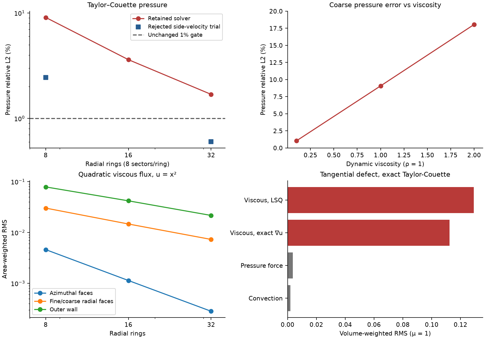

> Active investigation: the analytic Taylor–Couette solution is the reference.
> The user has authorized standard second-order-consistent treatments where
> Fluent does not publish a complete discrete formula. The earlier conclusions
> and verification below are being superseded by per-operator hex/poly studies
> and new reconstruction trials; no Fluent installation or external run is needed.

# Polyhedral pressure and viscous-flux investigation

No numerical correction met every unchanged acceptance gate. This lane changes
no solver, kernel or adapter source from `fb827e0d416746030eaf156f9f42fca87b712a31`.
Native rotating walls remain rejected. The local changes add manufactured
checks, reproducible probes and an assertion comparator, and correct a stale
pressure-LSQ paragraph in the finite-volume README.

The strongest result is a rejected one. Momentum-weighted side velocity
reconstruction passes the original V7.2 test on CPU and Metal, including all
6,668 assertions, with polyhedral pressure error 0.600827%. It adds V2 failures,
and its unchanged V6 seeded solve stalls. Retaining it would violate the
requested regression boundary.

## Source and runtime

- Branch `pressure-poly-consistency`, worktree `t3-2a096bd1`, starting at `fb827e0`.
- Rebased with `git rebase --onto main fb827e0` onto
  `195f56b87ae13ea7b5875978af923e083acd147c`. Main changes setup error/report
  handling and device inventory, but changes no finite-volume or kernel source
  used by these solves. The complete slow before/after comparison was launched
  before rebasing; fresh V6, V7.2, native quick and CUDA checks cover the rebased
  tree separately.
- Apple M4 Pro, macOS 26.6.2, AppleClang 21.0.0.21000101, C++20 Release.
- CPU serial oracle and native Metal. Float fields and geometry, existing
  compensated/double reductions. CUDA 13.0.2 compile checks use the CI targets
  `75-real;86-real;89-real;120`; no NVIDIA device was available.
- The V6 case/data SHA256 values are
  `8145813f50f989a521ed8d1b02c891c7ca22ccc5fafa35a4eeba011949f19cbc` and
  `863a813227cf4274a9ca24fdad43e6c1f9f132dd62fcabc39a3be8cf493cff42`.
- `metadata.json` records source and executable hashes. Other agents ran tests
  concurrently. Timings and time-budget endpoints are not performance evidence.

## What the pressure error contains

The unchanged V7.2 result reproduces on both backends:

| Mesh | Cells | Velocity L2 | Pressure relative L2 | Momentum defect |
| --- | ---: | ---: | ---: | ---: |
| Hex, 8 rings / 64 sectors | 512 | .00452144 | .00309582 | 6.57222e-8 |
| Poly, 32 rings / 256 sectors | 6,144 | .000324131 | .0169127 | 9.26867e-8 |

Pressure L2 removes a volume-weighted constant gauge and divides by the
analytic radial pressure range. The finer result still fails the 1% bound.
The retained polyhedral refinement sequence is 384 / 1,536 / 6,144 cells:
pressure errors `.09076386154 / .03607781113 / .0169127`, giving orders
**1.33101 / 1.09300**. Velocity errors are
`.005230776072 / .001292472365 / .000324131`.

Most of the pressure error is an azimuthally alternating mode in the fine-cell
rings, rather than a radial mean error. On the 384-cell mesh, the inner fine
ring has pressure error range `[-.0339574, .0324573] Pa` after removing the
constant gauge, but ring mean `-.0007561 Pa`. The next coarse ring's range is
only `[.00155434, .00156860] Pa`. The pattern repeats through the alternating
fine/coarse rings. `rings_baseline8.log` retains every ring's mean and extrema.

At fixed coarse mesh and wall speed, viscosity `.1 / 1 / 2` gives pressure
errors **1.04337% / 9.07639% / 18.05425%**. Velocity error remains near `.0053`.
These seeded runs use 600 / 1,200 / 600 steps and have momentum defects below
`2e-7`. Solid-body rotation, whose velocity is linear and pressure quadratic,
has only `.150427%` pressure error on the same coarse poly mesh after 400
steps. A centrifugal-pressure explanation alone does not account for these
observations.



## Manufactured pressure checks

`FV poly annulus manufactured pressure reconstruction` uses the actual V7.2
poly mesh sequence with `p=.7x-.3y` and `p=(x²+y²)/2`. It calls the production
LSQ and pressure-face kernels. It separates wall cells from interior cells,
and exact boundary observations from the solver's omitted pressure rows.

| Quadratic pressure, omitted boundary rows | 8 rings | 16 rings | 32 rings | Finest order |
| --- | ---: | ---: | ---: | ---: |
| Interior LSQ vector L2 | .0239612 | .0110889 | .00539653 | 1.039 |
| Wall-cell LSQ vector L2 | .104679 | .0497555 | .0240487 | 1.049 |
| Azimuthal face-pressure RMS | .00778755 | .00193221 | .000479249 | 2.011 |
| Fine/coarse radial face-pressure RMS | .00283494 | .000799340 | .000209684 | 1.931 |
| Inner-wall face-pressure RMS | .00632298 | .00160486 | .000402956 | 1.994 |
| Outer-wall face-pressure RMS | .0141242 | .00342378 | .000838263 | 2.030 |

Wall and symmetry-cap values use the production boundary-pressure extrapolation
kernel, rather than prescribed analytic face pressures. Cap errors remain below
`3.3e-8`. The boundary-observation switch changes the LSQ fit; both variants use
the same extrapolation when measuring boundary-face error.

The linear gradient is exact to float precision, with maximum error below
`2e-5`; linear face values and Rhie-Chow jumps are below `2e-6`. CPU and Metal
agree to the printed digits. Exact boundary values reduce the quadratic wall
LSQ error to `.0430934 / .0184634 / .00837724`, but do not make the interior
linear LSQ fit quadratic-exact.

The recently added Rhie-Chow extrapolation bound is inactive on every annular
face: maximum `|skew|/|link|` is `.310053 / .309489 / .309172`, and no face
exceeds one. Removing the skew term everywhere changes fine pressure error
only from 1.69127% to 1.64044%. It cannot explain the V7.2 failure.

## Exact-state momentum and quadratic viscous flux

`bench_poly_momentum` freezes analytic Taylor-Couette cell values, then isolates
pressure, convection and the scalar viscous Laplacian without taking an outer
iteration. The viscosity is one. It uses exact radial-wall values and zero
cap-normal flux. Pressure boundary values are exact in this operator diagnostic;
this deliberately excludes pressure-boundary extrapolation from that comparison.

At 32 rings, volume-weighted RMS tangential defects are:

| Term | Defect |
| --- | ---: |
| Viscous Laplacian, production LSQ gradients | .129138 |
| Viscous Laplacian, analytic exact velocity gradients | .112376 |
| Viscous Laplacian, Gauss gradients of second-order faces | .129065 |
| Momentum pressure force, LSQ second-order faces | .00364665 |
| Momentum pressure force, exact pressure gradients in the face reconstruction | 1.07210e-6 |
| Convection, production LSQ gradients | .00189616 |
| Convection, exact velocity gradients | 3.58484e-6 |

The viscous defect is about 35 times the pressure-force defect. Exact velocity
gradients remove only 13% of it. This identifies a large viscous face-placement
and boundary truncation contribution, with coupling to mass interpolation;
it does not establish a complete causal decomposition of the converged error.
The pressure source itself applies the expected conservative Gauss sum.

The second manufactured check uses divergence-free quadratic velocity
`u=x²`, `v=-2xy`, exact boundary values, and either LSQ or exact gradients.
It evaluates the actual transport face correction and implicit link flux.
The independent host-double oracle evaluates the documented primary/secondary
split using the same float observations and Kutta's geometric gradient mean:

```text
alpha = (S.S)/(S.d)
F = mu * [alpha*(qN-qP) + Gmean.(S-alpha*d)]
```

The kernel/oracle discrepancy in normal derivative is below `7e-7` across
both components, every face type and both backends. There is no missing
secondary term or reversed sign in that implementation. Fluent describes an
adjacent-cell gradient average; Kutta uses a face-normal-distance-weighted
mean. The separate arithmetic-mean trial does not resolve V7.2.

For `u=x²`, area-weighted RMS normal-derivative errors are:

| Face type, production LSQ | 8 rings | 16 rings | 32 rings | Finest order |
| --- | ---: | ---: | ---: | ---: |
| Azimuthal | .00460667 | .00113608 | .000281935 | 2.01063 |
| Fine/coarse radial | .0302109 | .0146998 | .00730891 | 1.00807 |
| Inner wall | .0389767 | .0193241 | .00961636 | 1.00684 |
| Outer wall | .0788584 | .0419988 | .0216599 | .95532 |
| Symmetry cap | below 2e-15 | below 2e-15 | below 2e-15 | roundoff |

Exact gradients leave the fine/coarse radial error at `.0270864 / .0136319 /
.00683831`, still first order. These are errors in flux divided by face area.
An integrated flux error has an additional factor of face size on the refined
vertical faces; it must not be reported as the order of the normal derivative.

## Rejected numerical candidates

No threshold, mesh, stopping criterion or source was changed for V2 or V7.2.
These are exploratory alternatives, not accepted implementations.

| Change from baseline | Coarse/fine poly pressure % | Reason rejected |
| --- | --- | --- |
| Shared-link Rhie-Chow jump on all faces | 8.83201 / 1.64044 | V7.2 still fails |
| Gauss momentum pressure gradient in bounded Rhie-Chow | 8.02250 / 1.47780 | V7.2 still fails |
| Arithmetic secondary-gradient mean | 9.07190 / 1.69120 | V7.2 still fails |
| Additional gradient-jump/skew correction to viscous flux | 8.93444 / 1.67718 | V7.2 fails; no published Fluent formula was established for this extra term |
| Laminar interior transpose stress alone | 9.14365 / not run | Coarse velocity error rises to .0100248; no improvement |
| Momentum-weighted side velocity reconstructions | 2.45271 / .600827 | Original V7.2 passes, but V2 adds hex velocity, pressure and load failures; V6 seeded convergence stalls |

The side-velocity trial follows the interpolation favored by the existing
[Fluent flux forensics](../../../docs/research/fluent-flux-gradient-forensics.md).
`rejected_side_velocity.patch` records its three formula substitutions against
`fb827e0`; it is an exploratory patch, excluded from the retained solver.
Its pressure scheme and bounded LSQ Rhie-Chow jump are unchanged. This is a
partial formula substitution, not a complete Fluent high-order-flux implementation.
The unchanged V7.2 side-reconstruction test gives hex pressure `.596663%`,
poly pressure `.600827%`, poly velocity `.000322576` and momentum defect
`4.0209e-8`, on both backends. Its full 6,668 assertions pass. The same trial's
V2 hex finest velocity/pressure orders are `1.82292 / 1.57075`, against
`1.9 / 1.8`. Its V6 seeded CPU run was stopped after 3,050 steps with
continuity near `1.28e-4` and omega defect near `6.99e-5`. No converged field
error is claimed for that rejected trial.

A second set of trials combined side velocities with laminar tangential wall
shear and omitted normal wall traction, then added interior transpose stress,
a Gauss Rhie-Chow gradient, or the documented `-2/3 mu div(u) I` stress term.
They recover some wall-load orders but retain new V2 failures. Representative
finest orders are:

| Trial | Hex velocity / pressure | Tet velocity / pressure |
| --- | --- | --- |
| Tangential laminar wall shear, original interior Laplacian | 1.88393 / 1.80872 | 2.04973 / .863289 |
| Plus interior transpose stress | 1.90477 / 1.70540 | 2.05346 / .938831 |
| Tangential wall shear plus Gauss Rhie-Chow | 1.88466 / 1.80980 | see raw log |
| Full stress with dilation and Gauss Rhie-Chow | 1.89239 / 1.77999 | 1.98487 / .796726 |

Replacing the wall diagonal with its projected tangential tensor in the last
combination destabilizes V2. `rejected_wall_tensor_partial.patch` retains only
the tracked-file part of that trial; its added wall-flux helper was not captured,
so this artifact cannot reproduce a complete build. Its run and the rejected V6 runs were
terminated; their incomplete logs are labelled by their trial names. They are
not successful field comparisons or complete assertion inventories.

## Retained results and verification

The retained numerical code and native rotating-wall rejection are unchanged.
Before/after V7.2 remains 1.69127% poly pressure error, with exactly its two
CPU/Metal pressure failures. No accepted improvement is claimed for V6.

- Rebased native quick tier passes **218 cases / 7,403,793 assertions**, including
  compiled Metal presence, the real poly-box gradient check, all twelve curated
  Ansys mesh/data fixtures, and the static-mixer CFF/legacy comparison. CTest and
  portability lint pass 2/2. `rebased_quick.log` and `rebased_ctest.log` record it.
- Every post-integration check uses `KUTTA_FLUENT_EXAMPLES`. Two older tests
  ignore that variable, so the available pinned fixtures were also linked into
  the ignored worktree fixture directory. All 13 available ledger files have
  verified SHA-256s; 119 optional research-download files remain absent. The
  missing-file messages in the mesh inventory concern those research files.
  `fixture_inventory.json` records the distinction. TMR grids were expanded
  with `tools/prepare_tmr.py` and are hashed in `metadata.json`.
- The external saved-elbow SST check passes 34,204 assertions before rebasing;
  the rebased full quick tier includes it again.
- Before rebasing, the external quick tier had two static-mixer `viscous`
  metadata equality failures, independently reproduced on `fb827e0`.
  Main's `195f56b` parser change fixes them. This lane does not claim that fix.
- Rebased CUDA configuration/build passes all CI architecture targets, and its
  CPU-oracle quick tier passes **217 cases / 3,746,357 assertions** with the same
  external fixtures mounted. CUDA device execution remains unverified here.
- The complete V1-V6 plus Couette slow comparison is recorded below after both
  runs finish. SA, realizable-KE, native fan and unrelated research-download
  slow cases are outside that comparison. No claim is made about all 24 slow
  cases in the integrated repository.

The complete V6 seeded/hybrid runs, including the fresh post-rebase run,
reproduce every printed velocity and pressure error exactly. The post-rebase
comparison covers all 2,601 assertions with the same 29 failures and no missing
or newly failed assertions (`rebased_v6_comparison.json`). Pressure fields are
compared directly to Fluent source cells,
with the same gauge and no resampling.

| Backend/start | Steps before / after | Velocity L2 %, before = after | Pressure L2 %, before = after |
| --- | ---: | ---: | ---: |
| CPU seeded | 350 / 350 | 3.601602396 | 2.962540070 |
| CPU hybrid | 550 / 550 | 3.601460363 | 2.961664678 |
| Metal seeded | 350 / 350 | 3.601603208 | 2.962295937 |
| Metal hybrid | 550 / 550 | 3.601459710 | 2.961920831 |

<!-- SLOW_RESULTS -->

The V1-V6 plus Couette subset covers all **3,563 assertions** in ten cases:
3,512 pass and the same 51 fail, with no missing or newly failed assertions.
`comparison_v1_v6.json` records every outcome and every changed expansion.
Its seven changed expansions all belong to the CPU fine-bump time-budget
endpoint; one is the iteration count and six are station errors.

| V5 fine bump | Baseline CPU | Retained CPU | Baseline Metal | Retained Metal |
| --- | ---: | ---: | ---: | ---: |
| Steps | 2,100 | 2,200 | 3,000 | 3,000 |
| Solve seconds | 631.476 | 621.015 | 171.368 | 171.075 |
| Stopped for time budget | yes | yes | no | no |
| Reported combined error metric | .479371710459 | .507168336550 | .635379914284 | .635379914284 |

The CPU combined metric worsens at the later endpoint. At station x=.75,
absolute pressure-coefficient error rises from .0143812 to .0152151, while
remaining below its .03 assertion bound. The station's skin-friction relative
error falls from .156962 to .147388 and still fails its .1 bound. All **351
shared TMR progress samples match exactly** (`tmr_trajectory_comparison.json`);
the CPU endpoint difference comes from reaching another 100 steps before the
clock budget. These studies remain unconverged. Unchanged assertion outcomes
are not a claim that every time-limited endpoint metric improves.

## Documentation and remaining work

[Fluent Theory Guide 23.4.1](https://ansyshelp.ansys.com/public/Views/Secured/corp/v242/en/flu_th/flu_th_sec_solver_pb_mom_eq.html)
gives the existing two-side second-order pressure reconstruction. Its body-force
weighted scheme concerns a known force/pressure-gradient balance. V7.2 runs in
the inertial frame with no prescribed body force; its centrifugal balance comes
from convection. The side-velocity trial already reaches .600827% with the
existing Second Order pressure scheme. Thus this failure does not establish a
need for body-force-weighted pressure at the required resolution. It also does
not prove what Fluent itself would achieve on this mesh. No body-force-weighted
scheme was substituted into the unchanged test.

[Fluent Customization Manual 3.2.5](https://ansyshelp.ansys.com/public/views/secured/corp/v252/en/flu_udf/flu_udf_DataAccessMacros.html)
gives the primary/secondary diffusion split used by the oracle.
[Fluent User's Guide 8.4.15.14.1](https://ansyshelp.ansys.com/public/Views/Secured/corp/v261/en/flu_ug/flu_ug_bcs_sec_bound_cond.html)
defines laminar wall shear from the normal derivative of tangential velocity.
The tested wall changes are interpretations of that law in the coupled
operator, not proof of Fluent's complete discrete boundary implementation.
The extra viscous skew term tested above is not presented as a Fluent algorithm.

[Fluent's WFGC guidance](https://ansyshelp.ansys.com/public/Views/Secured/corp/v242/en/flu_ug/flu_ug_sec_solve_conv_stab.html)
also recommends it for large adjacent-cell volume differences and hanging-node
hex interfaces. Planar faces alone therefore do not rule out its relevance to
the alternating-ring annulus. A controlled WFGC comparison would test that
possibility; the public manual does not give its algorithm.

The next useful evidence is a Fluent solution on these exact generated annular
meshes, preferably with saved face fluxes and cell derivative/reconstruction
gradients, with WFGC explicitly controlled. That would distinguish Fluent's
viscous face-gradient and wall implementation from an accuracy limitation of
this synthetic alternating mesh. A WFGC-off elbow reference would also separate
that known setup mismatch from the remaining V6 discrepancy. Neither reference
nor a Fluent executable was available in this checkout. More tuning against
V7.2 alone would not meet the requested Fluent-matching requirement.

Native rotating-wall acceptance, a regression-safe numerical repair and Fluent
same-mesh agreement remain unresolved. No adapter gate was opened, no app code
was edited, and no commit was pushed.

## Reproduction

```sh
export KUTTA_FLUENT_EXAMPLES=/path/to/Kutta/validation/fluent_examples
python3 tools/prepare_tmr.py
cmake -S . -B build-pressure -G Ninja -DCMAKE_BUILD_TYPE=Release
cmake --build build-pressure -j 6
./build-pressure/kutta-tests --test-case='FV poly*'
./build-pressure/bench_poly_momentum
./build-pressure/bench_poly_pressure 8 0 1200 1
./build-pressure/bench_poly_pressure 16 0 1200 1
./build-pressure/bench_poly_pressure 32 0 1200 1
./build-pressure/kutta-tests --test-case='FSAE V7.2*'  # retains its real nonzero exit
ctest --test-dir build-pressure -LE slow --output-on-failure
./build-pressure/kutta-tests --test-suite=slow \
  --test-case-exclude='FSAE*,V7*,V8*,Fluent research*' --success --reporters=xml --out=slow.xml
python3 tools/forensics/compare_slow_assertions.py baseline_slow.xml.gz final_slow.xml.gz
python3 tools/forensics/plot_poly_pressure.py validation/results/poly_pressure
```

The plot script needs matplotlib; the assertion comparator uses only Python's
standard library. The baseline executable was built before any source change
and preserved separately. Raw logs retain failed gates and interrupted trials.
For older tests that use the worktree fixture path directly, populate the twelve
curated files listed in `validation/fluent_examples/SOURCE.md` there as well.
