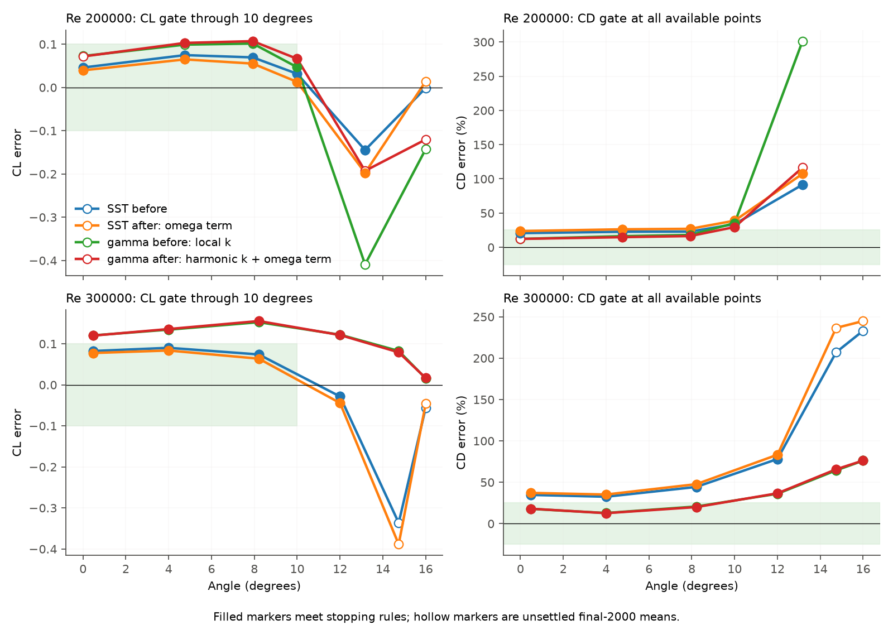
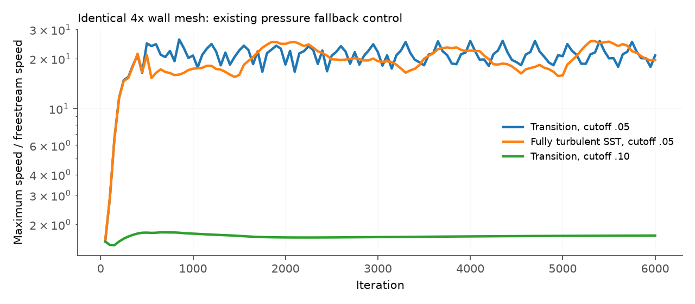
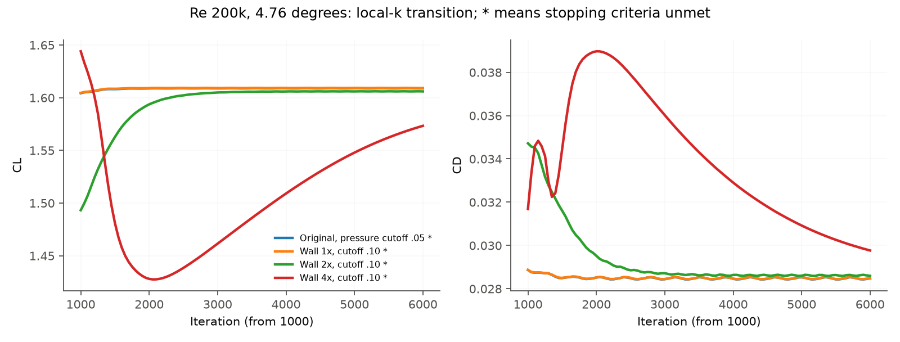

# S1223 against UIUC: transition-model investigation

The target is not met. On identical original meshes, the documented model options change transition CL counts within the band from 3/7 to 2/7 and CD counts from 6/11 to 6/11. Runs meeting the stopping rules increase from 7/12 to 9/12. None of the seven linear-range points meets both coefficient bands and the stopping rules after the change.

The molecular denominator also changes the fully turbulent SST CD count from 3/11 to 1/11. Both model additions remain opt-in. No solver default or acceptance criterion changed. A separate refined-tail sweep reduces some lift errors but fails numerically at three points and loses SST drag gates.

## What was compared

The main comparison is 48 fresh solves: SST and intermittency at all twelve angles, before and after. Each before/after pair uses the same mesh SHA-256. Before is main `8866cc0e16df5b0642b2243611099ddccd7f3cd3`. After uses numerical source `51d8a4ddd53ea7cd92eca5303ee824f45fd20159`. Later commits change only analysis and documentation. All aerofoil solves use Metal. CPU/Metal kernel and case checks support the implementation; CUDA compilation/runtime and active Fluent intermittency output were unavailable.

H means harmonic k in Tu_L. R means the molecular omega-production denominator ratio 0.001. SST after uses R; transition after uses H+R. Production remains the original SST option for the main matrix. The original as-tested polygon, inlet Tu 0.1%, viscosity ratio one, domain, initialization and numerics stay fixed. The setup is incompressible with U_infinity = rho = reference chord = 1 and nu = 1/Re. Forces are per unit depth in the freestream lift/drag directions; the 2D mesh has one cell between symmetry caps. The as-tested blunt trailing edge is retained. No coefficient or geometry was fitted.

The gates remain CL absolute error <= 0.10 through 10 degrees and CD relative error <= 25% wherever UIUC CD exists. Higher-angle CL is trend only. Every run retains the 6000-iteration maximum, checks every 50 iterations, residual limit 1e-3 and relative force settling limit 5e-4 over 500 iterations. A large wall-clock cap prevents shared GPU load from cutting the iteration budget. No timing performance claim is made.

`*` denotes unmet stopping criteria. Such a coefficient is the mean of samples strictly inside the final 2000 iterations, following the existing report convention. It is a comparison value, not an accepted converged solution. Failed solves have no accuracy coefficient. One user-interrupted source run at 2000 iterations was preserved separately and excluded; only that unfinished point restarted, with the same budget.

UIUC values use the unchanged interpolation in `tools/fsae_aero/report.py`. [reference_hashes.json](reference_hashes.json) pins the three restricted inputs and matches the initial source audit. Nominal 200k uses the frozen 200400/198500 polars and 198100 lift curve; nominal 300k uses the 299100 polar and 302200 lift curve. The initial 32-44% SST drag description applies to the low-angle 300k points. The earlier detailed table, and these fresh runs, show larger errors at higher angles.

| Model | CL within band | CD within band | Stopping rules met | Linear points with both bands and stopping rules |
|---|---:|---:|---:|---:|
| SST before | 7/7 | 3/11 | 9/12 | 3/7 |
| SST after R | 7/7 | 1/11 | 9/12 | 1/7 |
| Gamma before | 3/7 | 6/11 | 7/12 | 0/7 |
| Gamma after H+R | 2/7 | 6/11 | 9/12 | 0/7 |



## Every gated point, before and after

Band results below use unrounded values. Coefficients marked `*` remain unsettled even when their numerical error is inside a band. Full values, mesh and binary hashes are in [summary.json](summary.json); individual receipts and force histories are under [runs](runs).

### Fully turbulent SST, CL

| Re | alpha | UIUC CL | Before | After | Error before | Error after | Band before / after |
|---|---:|---:|---:|---:|---:|---:|---|
| 200000 | 0 | 1.0830 | 1.1289 | 1.1224 | +0.045928 | +0.039448 | PASS / PASS |
| 200000 | 4.76 | 1.5100 | 1.5847 | 1.5748 | +0.074703 | +0.064780 | PASS / PASS |
| 200000 | 7.93 | 1.7530 | 1.8224 | 1.8081 | +0.069419 | +0.055073 | PASS / PASS |
| 200000 | 10 | 1.9022 | 1.9337 | 1.9149 | +0.031483 | +0.012681 | PASS / PASS |
| 200000 | 13.17 | 2.0940 | 1.9493 | 1.8965 | -0.144750 | -0.197464 | trend / trend |
| 200000 | 16 | 2.1814 | 2.1802* | 2.1954* | -0.001247 | +0.013972 | trend / trend |
| 300000 | 0.48 | 1.1310 | 1.2133 | 1.2084 | +0.082279 | +0.077438 | PASS / PASS |
| 300000 | 4 | 1.4607 | 1.5508 | 1.5443 | +0.090086 | +0.083545 | PASS / PASS |
| 300000 | 8.21 | 1.8000 | 1.8739 | 1.8636 | +0.073905 | +0.063594 | PASS / PASS |
| 300000 | 12 | 2.0641 | 2.0357 | 2.0198 | -0.028443 | -0.044357 | trend / trend |
| 300000 | 14.74 | 2.1750 | 1.8386* | 1.7863* | -0.336405 | -0.388723 | trend / trend |
| 300000 | 16 | 2.2073 | 2.1512* | 2.1614* | -0.056057 | -0.045879 | trend / trend |

### Fully turbulent SST, CD

| Re | alpha | UIUC CD | Before | After | Error before | Error after | Band before / after |
|---|---:|---:|---:|---:|---:|---:|---|
| 200000 | 0 | 0.01910 | 0.02305 | 0.02362 | +20.69% | +23.69% | PASS / PASS |
| 200000 | 4.76 | 0.02450 | 0.03007 | 0.03095 | +22.73% | +26.31% | PASS / FAIL |
| 200000 | 7.93 | 0.03140 | 0.03861 | 0.03988 | +22.95% | +27.01% | PASS / FAIL |
| 200000 | 10 | 0.03568 | 0.04774 | 0.04955 | +33.79% | +38.87% | FAIL / FAIL |
| 200000 | 13.17 | 0.04130 | 0.07907 | 0.08563 | +91.45% | +107.33% | FAIL / FAIL |
| 200000 | 16 | n/a | 0.16587* | 0.17264* | n/a | n/a | n/a / n/a |
| 300000 | 0.48 | 0.01640 | 0.02209 | 0.02249 | +34.68% | +37.12% | FAIL / FAIL |
| 300000 | 4 | 0.02032 | 0.02692 | 0.02746 | +32.49% | +35.16% | FAIL / FAIL |
| 300000 | 8.21 | 0.02570 | 0.03709 | 0.03795 | +44.32% | +47.68% | FAIL / FAIL |
| 300000 | 12 | 0.03210 | 0.05715 | 0.05881 | +78.06% | +83.24% | FAIL / FAIL |
| 300000 | 14.74 | 0.03710 | 0.11393* | 0.12485* | +207.08% | +236.51% | FAIL / FAIL |
| 300000 | 16 | 0.04348 | 0.14482* | 0.14991* | +233.10% | +244.81% | FAIL / FAIL |

### Intermittency transition, CL

| Re | alpha | UIUC CL | Before | After | Error before | Error after | Band before / after |
|---|---:|---:|---:|---:|---:|---:|---|
| 200000 | 0 | 1.0830 | 1.1556* | 1.1545* | +0.072594 | +0.071454 | PASS / PASS |
| 200000 | 4.76 | 1.5100 | 1.6089* | 1.6129 | +0.098886 | +0.102918 | PASS / FAIL |
| 200000 | 7.93 | 1.7530 | 1.8544 | 1.8600 | +0.101443 | +0.106977 | FAIL / FAIL |
| 200000 | 10 | 1.9022 | 1.9489 | 1.9684 | +0.046691 | +0.066151 | PASS / PASS |
| 200000 | 13.17 | 2.0940 | 1.6848* | 1.9011* | -0.409162 | -0.192874 | trend / trend |
| 200000 | 16 | 2.1814 | 2.0387* | 2.0611* | -0.142752 | -0.120362 | trend / trend |
| 300000 | 0.48 | 1.1310 | 1.2514* | 1.2509 | +0.120369 | +0.119857 | FAIL / FAIL |
| 300000 | 4 | 1.4607 | 1.5951 | 1.5966 | +0.134355 | +0.135829 | FAIL / FAIL |
| 300000 | 8.21 | 1.8000 | 1.9525 | 1.9553 | +0.152517 | +0.155321 | FAIL / FAIL |
| 300000 | 12 | 2.0641 | 2.1861 | 2.1854 | +0.122001 | +0.121259 | trend / trend |
| 300000 | 14.74 | 2.1750 | 2.2575 | 2.2541 | +0.082454 | +0.079078 | trend / trend |
| 300000 | 16 | 2.2073 | 2.2229 | 2.2237 | +0.015589 | +0.016473 | trend / trend |

### Intermittency transition, CD

| Re | alpha | UIUC CD | Before | After | Error before | Error after | Band before / after |
|---|---:|---:|---:|---:|---:|---:|---|
| 200000 | 0 | 0.01910 | 0.02144* | 0.02143* | +12.23% | +12.22% | PASS / PASS |
| 200000 | 4.76 | 0.02450 | 0.02848* | 0.02812 | +16.23% | +14.79% | PASS / PASS |
| 200000 | 7.93 | 0.03140 | 0.03705 | 0.03656 | +18.00% | +16.42% | PASS / PASS |
| 200000 | 10 | 0.03568 | 0.04828 | 0.04623 | +35.30% | +29.56% | FAIL / FAIL |
| 200000 | 13.17 | 0.04130 | 0.16569* | 0.08937* | +301.19% | +116.38% | FAIL / FAIL |
| 200000 | 16 | n/a | 0.13634* | 0.13290* | n/a | n/a | n/a / n/a |
| 300000 | 0.48 | 0.01640 | 0.01932* | 0.01935 | +17.81% | +18.00% | PASS / PASS |
| 300000 | 4 | 0.02032 | 0.02292 | 0.02288 | +12.81% | +12.61% | PASS / PASS |
| 300000 | 8.21 | 0.02570 | 0.03101 | 0.03083 | +20.65% | +19.98% | PASS / PASS |
| 300000 | 12 | 0.03210 | 0.04367 | 0.04386 | +36.07% | +36.64% | FAIL / FAIL |
| 300000 | 14.74 | 0.03710 | 0.06098 | 0.06145 | +64.36% | +65.62% | FAIL / FAIL |
| 300000 | 16 | 0.04348 | 0.07655 | 0.07662 | +76.08% | +76.23% | FAIL / FAIL |

## Stopping iterations and convergence

`*` means the unchanged residual/force stopping criteria were unmet.

| Re | alpha | SST iterations before / after | gamma iterations before / after | gamma after maximum residual | gamma after CL / CD settling |
|---|---:|---:|---:|---:|---:|
| 200000 | 0 | 2100 / 2100 | 6000* / 6000* | 0.000268 | 0.000151 / 0.00172 |
| 200000 | 4.76 | 2150 / 2150 | 6000* / 2350 | 1.41e-05 | 4.69e-05 / 0.000307 |
| 200000 | 7.93 | 2100 / 2100 | 2450 / 2400 | 1.5e-05 | 7.37e-05 / 0.000483 |
| 200000 | 10 | 2100 / 2250 | 2350 / 2450 | 1.11e-05 | 7.08e-05 / 0.000276 |
| 200000 | 13.17 | 3800 / 5000 | 6000* / 6000* | 0.00105 | 0.00517 / 0.0592 |
| 200000 | 16 | 6000* / 6000* | 6000* / 6000* | 0.00346 | 0.00408 / 0.0305 |
| 300000 | 0.48 | 2150 / 2150 | 6000* / 2300 | 9.36e-05 | 0.000133 / 0.000491 |
| 300000 | 4 | 2150 / 2150 | 2450 / 2450 | 6.18e-06 | 4.97e-05 / 0.00048 |
| 300000 | 8.21 | 2100 / 2100 | 2400 / 2400 | 1.36e-05 | 4.05e-05 / 0.000477 |
| 300000 | 12 | 2400 / 2650 | 2450 / 2500 | 6.87e-06 | 6.53e-05 / 0.000285 |
| 300000 | 14.74 | 6000* / 6000* | 3250 / 3150 | 1.21e-05 | 2.67e-05 / 0.000393 |
| 300000 | 16 | 6000* / 6000* | 5950 / 5750 | 1.52e-05 | 0.000158 / 0.000341 |


## Lift maximum is not an accepted result

At 300k the greatest settled SST-before sample is CL 2.035705 at 12 degrees. Transition extends the settled high-lift branch to 14.74 degrees, where CL is 2.257454 before and 2.254078 after, against the measured lift-curve maximum 2.212 at 15.62 degrees. Its drag at 14.74 degrees remains about 66% high. This is a better sampled lift trend, not reproduction of the polar. Sparse angles and the unsettled higher-angle values do not establish the true CLmax or stall angle. In particular, the unsettled SST 16-degree mean is higher than the settled 12-degree value; the earlier CLmax headline must not be read as a measured global maximum. At 200k, UIUC reaches 2.188 at 16.93 degrees, while both transition runs at 13.17 and 16 degrees remain unsettled. They provide no accepted CLmax estimate.

## Separate refined-tail mesh sweep

This secondary comparison uses eightfold face splitting aft of x/c 0.85, including the blunt base. It preserves the polygon and body/wall-normal spacing, while regenerating the outer triangles. It uses the same H/R model options as the after cases, not a solver-default change. Both models fail at zero degrees; SST also fails at 200k/13.17 degrees. Partial force values from these failures are excluded. At 4.76 degrees, H+R plus this mesh settles at 2300 iterations with CL 1.595755 and CD 0.02787882, but SST drag rises to 0.03065153 and loses its gate. SST also loses the 7.93-degree drag gate. This is not a general mesh remedy.

| Re | alpha | SST CL | SST CD | gamma CL | gamma CD | gamma dCL | gamma dCD | SST / gamma iterations |
|---|---:|---:|---:|---:|---:|---:|---:|---|
| 200000 | 0 | failed | failed | failed | failed | failed | failed | 1050 failed / 1150 failed |
| 200000 | 4.76 | 1.5571 | 0.03065 | 1.5958 | 0.02788 | +0.0858 | +13.8% | 2650 / 2300 |
| 200000 | 7.93 | 1.7936 | 0.03963 | 1.8450 | 0.03632 | +0.0920 | +15.7% | 2800 / 2600 |
| 200000 | 10 | 1.8947 | 0.04969 | 1.9509 | 0.04621 | +0.0487 | +29.5% | 3250 / 2350 |
| 200000 | 13.17 | failed | failed | 1.8707* | 0.09167* | -0.2233 | +122.0% | 1050 failed / 6000* |
| 200000 | 16 | 2.1383* | 0.17166* | 2.1088* | 0.13262* | -0.0726 | n/a | 6000* / 6000* |
| 300000 | 0.48 | 1.1879 | 0.02223 | 1.2289* | 0.01909* | +0.0979 | +16.4% | 1850 / 6000* |
| 300000 | 4 | 1.5256 | 0.02717 | 1.5774 | 0.02260 | +0.1167 | +11.2% | 2300 / 2150 |
| 300000 | 8.21 | 1.8513 | 0.03766 | 1.9415 | 0.03055 | +0.1415 | +18.9% | 2850 / 2950 |
| 300000 | 12 | 2.0063 | 0.05849 | 2.1718 | 0.04354 | +0.1077 | +35.6% | 4250 / 4000 |
| 300000 | 14.74 | 1.8167* | 0.11995* | 2.2407 | 0.06070 | +0.0657 | +63.6% | 6000* / 3050 |
| 300000 | 16 | 2.0976* | 0.14628* | 2.2086* | 0.07711* | +0.0013 | +77.4% | 6000* / 6000* |

## Does the model match Fluent?

The original implementation matches the printed local-k equations audited in
[the transition verification report](../transition_verification/REPORT.md).
It does not include every detail documented for modern Fluent. I added two
independent, opt-in settings:

| Setting | Original/default | Added option | Effect |
|---|---:|---:|---|
| `sst->transition->harmonic_kinetic_energy` | false | true | Harmonic mean of k in the cell and its face-connected fluid neighbours, used only in Tu_L |
| `sst->model.omega_production_molecular_ratio` | 0 | 0.001 | Omega production divides by `mu_t + 0.001 mu` |

Fluent's 2021 R2 release notes describe harmonic averaging to reduce transition
hysteresis. Menter et al. 2022, section 2.3 and Eq. 12, gives the cell stencil
and explicitly says it also applies to Fluent's one-equation model. Its Eq. 6
states the molecular contribution in Fluent's SST omega-production denominator.
Neither addition changes a correlation constant. The harmonic field does not
replace transported k or the local k used in R_T. Negative boundary indices
add no cell to the stencil, so the two symmetry caps do not duplicate the
current cell in an extruded 2D mesh.

Kutta now reads the saved Boolean
`turbulence/trans/harmonic-averaged-tke-for-tu?` when intermittency is active.
An explicit true enables averaging; false or an absent setting preserves the
local-k implementation. A real, inactive setting in the Fluent corpus proves
the saved field name. A synthetic active case tests the adapter and CPU/Metal
solve path. It is not an independent Fluent transition result. The molecular
denominator remains an explicit SolverSettings option because this audit did
not establish an authoritative saved-case switch for it.

The gamma transport, source coupling, onset constants and pressure-gradient
correlation match the printed equations. In particular,
`Re_theta_c = CTU1 + CTU2 exp(-CTU3 Tu_L F_PG)`; the positive and negative
pressure-gradient branches match Fluent's equation images. The audit found no
sign or exponential-placement error there. The F3 exponent remains eight,
as in the one-equation model. The different exponent and bubble correction
printed for the later algebraic model were not transplanted into this model.

One production choice remains unresolved. The NASA restatement of Menter
2015 uses Kato-Launder production. Fluent's coupling documentation refers to
the underlying SST production term without identifying which production
option an active one-equation case selects. Kutta follows the case's saved
SST production setting. The existing flat-plate and channel checks have
dominant shear, where S and Omega are similar, so they cannot settle this
choice. The Kato-Launder aerofoil experiment below does not fix the bias.
Kutta also interprets saved wall-normal method 1 as the NASA nearest-wall
normal construction. Its equivalence to Fluent on this curved aerofoil has
not been verified against an active Fluent solution.

Sources read for this audit:

- [Fluent Theory Guide 2026 R1, section 4.8.2](https://ansyshelp.ansys.com/public/Views/Secured/corp/v261/en/flu_th/flu_th_sec_turb_intermittency_trans.html) gives the one-equation model and its correlations.
- [Section 4.8.3](https://ansyshelp.ansys.com/public/Views/Secured/corp/v261/en/flu_th/flu_th_sec_turb_intermittency_coup.html) specifies the SST coupling, referring to [section 4.7.2.2, Eqs. 4-205 through 4-207](https://ansyshelp.ansys.com/public/Views/Secured/corp/v261/en/flu_th/flu_th_sec_turb_sst_add_eq.html).
- [Fluent 2021 R2 release notes, code-behaviour changes, Turbulence](https://storage.ansys.com/doc_assets/release_notes/v212/Release_Notes_2021_R2.pdf) documents harmonic averaging.
- [Menter et al. 2022, author-uploaded full text](https://www.researchgate.net/publication/362198958_An_Algebraic_LCTM_Model_for_Laminar-Turbulent_Transition_Prediction) states the harmonic stencil and molecular denominator. Only the details explicitly attributed to SST or the one-equation model were used.
- [NASA/TMBWG's Menter 2015 restatement](https://tmbwg.github.io/turbmodels/menter_gamma_3eqn.html) supplies an independent statement of the one-equation formulas. The closed 2015 paper itself was not obtained.

This establishes specific documented differences. Full agreement with an
active Fluent intermittency solution remains unverified. The earlier T3A
verification remains evidence for the original local-k formulation, not a
claim about these two added options.

## Freestream turbulence

For homogeneous freestream flow with U = 1, SST gives
`f = 1 + 0.0828 omega0 (x - x_inlet)`,
`omega = omega0 / f`, and `k = k0 f^(-0.09/0.0828)`.
The inlet values are `k0 = 1.5 Tu_in^2` and
`omega0 = k0 Re / viscosity_ratio`.

The original inlet is 30 chords upstream. With inlet Tu 0.1% and viscosity
ratio one, the homogeneous leading-edge Tu is 0.073886% at Re 200k and
0.066510% at Re 300k. Calling the inlet value the leading-edge value would
be wrong. The exported upstream fields follow this decay; the actual cell
samples and their analytic ratios are in `freestream.json`.

At Re 200k the original calculation gives Tu 0.088128% near x/c -19.42 and
0.080546% near -10.17. At the latter sample k and omega are 1.002672 and
1.000165 times the analytic values. Near the leading edge, at
x/c -0.105, y/c 0.198, Tu is 0.081822% and the speed is 1.136 U_infinity.
At Re 300k and 8.21 degrees, the fresh field gives Tu 0.074065% near
x/c -10.03, with k and omega ratios 1.004202 and 1.000268. Near
x/c -0.103, y/c 0.198, Tu is 0.075586%. The near-body strain, acceleration
and diffusion invalidate a homogeneous, constant-speed comparison there. These Tu values use U_infinity, not local
speed; the model's Tu_L indicator is a separate quantity involving omega d.

Changing the inlet viscosity ratio from one to ten raises the homogeneous
leading-edge Tu to 0.096169% at Re 200k. The near-body sample rises from
0.081822% to 0.101082%. Yet CL changes by only +0.000137 and CD by
-0.000000130 at 4.76 degrees. That run also fails force settling. This
does not explain the bias at the tested point.

The [original S1223 paper, Selig and Guglielmo 1997, section II.A](https://m-selig.ae.illinois.edu/pubs/GuglielmoSelig-1997-JofAC-S1223.pdf)
reports turbulence below 0.1%, wake-survey drag and corrections for blockage,
streamline curvature and splitter-plate circulation. It does not supply a
unique inlet k/omega pair for this domain. The
[UIUC 2012 thesis, section 3.4.1](https://m-selig.ae.illinois.edu/uiuc_lsat/Williamson-2012-UIUC-MS-Thesis.pdf)
also distinguishes empty-tunnel turbulence below 0.1% from apparatus-induced
low-frequency fluctuations. The exact disturbance spectrum for these frozen
polars is unknown. I did not fit an inlet ratio to the measured drag.

## Bubble, trailing edge and iterative convergence

At Re 200k and 4.76 degrees the original final field has reversed suction-side
wall shear from x/c 0.28066 to 0.43051. Only ten wall faces span it; the largest
streamwise spacing is 0.01744c. Trailing-edge separation spans 0.93592 to
0.99847c. The maximum y+ is 0.244 on the original mesh and 0.122
on the twofold wall mesh. Low y+ alone does not resolve the bubble. These
are computed final-field spans, not measured transition or bubble locations. The experiment's design ramp near 0.20c is not a measured
separation coordinate for this angle.

Surface and wall-normal refinement by two gives 20 faces across the bubble
and maximum spacing 0.00874c. Fourfold refinement with the pressure fallback
gives 41 faces and 0.00438c. Those runs do not demonstrate a mesh-converged
bubble. Their forces still drift at 6000 iterations. In the fourfold local-k
case with pressure cutoff 0.10, final CL/CD are 1.57326/0.0297666, while
the required last-2000 mean is 1.54635/0.0310194. Selecting the final value
would hide the drift and move CD from outside to inside its error gate.

The default fourfold wall mesh develops nonphysical velocity spikes near the
trailing edge in both transition and fully turbulent SST. The transition run
has maximum speed between 17.85 and 25.64 U_infinity in the final window;
the SST control reaches a similar range. Its signed CD samples even become
negative. Adding the documented model terms does not cure the instability.
These averages are recorded for diagnosis and are invalid accuracy results.

Changing only the existing `SolverSettings::poor_cell_quality` pressure
fallback cutoff from 0.05 to 0.10 suppresses those spikes on the same mesh.
Nineteen cells are flagged in that fourfold run. The final maximum
speed is 1.715 U_infinity, but the CL/CD settling measures are still
0.00702/0.01653, above the unchanged 0.0005 limit. The H+R pair repeats
this control with identical executable and mesh hashes.
At cutoff 0.05 it has velocity spikes and residual 0.01224; at 0.10 the
residual is 0.0001195 and force settling is still unmet. That pair isolates
a pressure-discretization contribution to the instability. It does not prove
a physically converged fine-mesh answer. On the original mesh it changes
CL by only +0.000281 and CD by +0.00000863.





Refining just the trailing-edge polygon faces preserves the geometry and
keeps the original level-2 body spacing and wall-normal resolution. At the
critical point, the local-k model changes from CL 1.608886/CD 0.02847665 on the original mesh
to 1.596306/0.02825755 at fourfold tail refinement, then
1.593053/0.02818853 at eightfold refinement. The eightfold case settles at
2400 iterations. The CL error falls from +0.098886 to +0.083053; the CD
error falls from +16.23% to +15.06%. This tail-focused mesh change reduces
the CL bias. The outer triangles are also regenerated, so the change does not isolate the tail cells alone
or prove global mesh independence. A separate twelve-point paired mesh
sweep uses this eightfold tail refinement
and the documented model options. The main before/after comparison uses the
original meshes throughout. The mesh-sweep change cannot be attributed solely
to the model terms, and the zero-degree refined-tail point fails numerically.

A broader, symmetric wake refinement to x/c approximately four settles at
3000 iterations and gives 1.605902/0.02842687. Its change is smaller than
the tail refinement at this point. The original narrow wake box misses the
downward-deflected wake farther downstream. This experiment covers that wake
without changing the body grid, but it does remesh the outer field.

The source-only original-mesh ablations do not fix the 4.76-degree point.
Harmonic averaging alone gives CL 1.610887, the molecular term alone gives
1.612809, and both give 1.612918. All three settle, but all exceed the
CL gate. Their CD errors improve to +15.15%, +14.96% and +14.79%.
The documented differences therefore do not explain or fix this lift bias.
The fully turbulent control already has a positive CL bias before gamma is
enabled. The bias is not exclusive to runs with gamma enabled; its physical cause
remains unresolved.

## Domain sensitivity

The original domain is x/c -30 to 40 and y/c +/-30. The larger domain is
-60 to 80 and +/-60. The larger-domain inlet uses Tu fraction 0.0021024114
and viscosity ratio 1.1262501. Analytic decay over the extra 30 chords brings
it back to the original inlet state. Its `--time-scale` factor 0.6299580449
also compensates for automatic pseudo-time scaling with the cube root of
fluid volume. Both controls prevent a domain-size test from silently changing
the inlet turbulence history or iterative time scale.

At Re 200k and 4.76 degrees, the larger domain gives CL 1.606351 and
CD 0.02788755. Relative to the original run, the changes are -0.002535
and -0.00058910, or about -2.07% of computed drag. Near-body Tu is
0.081954%, close to the original 0.081822%. This is a small CL sensitivity
and a measurable CD sensitivity. Both runs fail force settling, and changing
the domain remeshes the outer field. This one experiment cannot separate
boundary placement from outer-grid error or prove domain independence over
the sweep. It does not support domain size as the main CL-bias explanation.
Free-air boundaries are consistent with the paper's corrected coefficients.

## Other attempts and unresolved work

The experiment table below records every diagnostic, including failures.
`*` means the stopping rules were unmet and the coefficients are final-2000
means. `invalid` means numerical spikes prevent an accuracy interpretation.
All cases retain the same 6000-iteration maximum. H means harmonic k; R means
the molecular omega-production ratio 0.001. Unlabelled transition runs use
the original local-k model. The 300k controls use H+R.

Lowering gamma relaxation to 0.4, changing to hybrid flow initialization,
raising the inlet viscosity ratio and selecting Kato-Launder production do
not remove the bias at the critical point. Combining Kato-Launder with H+R
also fails. Its 6000-iteration mean is CL 1.617468 and CD 0.02795090,
with CL error +0.107468 and CD error +14.09%. Its drag settling measure
is 0.017576, above the unchanged 0.0005 limit. Hybrid initialization changes the
residual normalization, which depends on early iterations, so its larger
scaled continuity residual is not proof of a larger raw mass imbalance.
This tests one flow-initialization alternative, not every possible laminar
or turbulent initial gamma state.

The main remaining problem is a force-converged, body-mesh-converged solution
at the relevant low turbulence level. The fourfold mesh cannot provide one
within the existing budget. The higher-Re 8.21-degree fine-body run with H+R
and pressure fallback still drifts at 6000 iterations. Its mean CL 1.881860
falls inside the CL band, but CD 0.03511481 is +36.63% high; neither the mean
nor the final transient establishes a recovery. The exact tunnel turbulence
and an active Fluent comparison also remain unresolved. CUDA was not compiled or run. No default model change is recommended from this
evidence.


### Diagnostic run values

| Re / alpha | Control | Cells | Iterations | CL | CD | CL error | CD error | State |
|---|---|---:|---:|---:|---:|---:|---:|---|
| 200000 / 4.76 | All-grid L2.5 | 344180 | 6000 | 1.597978* | 0.02856817* | +0.087978 | +16.60% | unsettled |
| 200000 / 4.76 | Doubled domain, matched inlet decay | 191920 | 6000 | 1.606351* | 0.02788755* | +0.096351 | +13.83% | unsettled |
| 200000 / 4.76 | Gamma relaxation 0.4 | 184470 | 6000 | 1.608957* | 0.02846909* | +0.098957 | +16.20% | unsettled |
| 200000 / 4.76 | H+R, original mesh | 184470 | 2350 | 1.612918 | 0.02812331 | +0.102918 | +14.79% | settled |
| 200000 / 4.76 | H+R and Kato-Launder | 184470 | 6000 | 1.617468* | 0.02795090* | +0.107468 | +14.09% | unsettled |
| 200000 / 4.76 | Hybrid flow initialization | 184470 | 6000 | 1.608886* | 0.02847863* | +0.098886 | +16.24% | unsettled |
| 200000 / 4.76 | Kato-Launder alone | 184470 | 6000 | 1.612682* | 0.02839573* | +0.102682 | +15.90% | unsettled |
| 200000 / 4.76 | R alone | 184470 | 2300 | 1.612809 | 0.02816599 | +0.102809 | +14.96% | settled |
| 200000 / 4.76 | Pressure fallback 0.10 | 184470 | 6000 | 1.609167* | 0.02848527* | +0.099167 | +16.27% | unsettled |
| 200000 / 4.76 | Inlet viscosity ratio 10 | 184470 | 6000 | 1.609023* | 0.02847652* | +0.099023 | +16.23% | unsettled |
| 200000 / 4.76 | Tail faces 4x | 191780 | 6000 | 1.596306* | 0.02825755* | +0.086306 | +15.34% | unsettled |
| 200000 / 4.76 | Tail faces 8x | 200472 | 2400 | 1.593053 | 0.02818853 | +0.083053 | +15.06% | settled |
| 200000 / 4.76 | Symmetric wake refinement 1.5x | 344932 | 3000 | 1.605902 | 0.02842687 | +0.095902 | +16.03% | settled |
| 200000 / 4.76 | Wall mesh 2x | 206256 | 6000 | 1.605649* | 0.02860663* | +0.095649 | +16.76% | unsettled |
| 200000 / 4.76 | Wall 2x, pressure 0.10 | 206256 | 6000 | 1.605969* | 0.02861642* | +0.095969 | +16.80% | unsettled |
| 200000 / 4.76 | Wall mesh 4x | 289776 | 6000 | 1.527797* | 0.03387801* | invalid | invalid | invalid spikes |
| 200000 / 4.76 | Wall 4x, H+R | 289776 | 6000 | 1.532719* | 0.03638857* | invalid | invalid | invalid spikes |
| 200000 / 4.76 | Wall 4x, H+R, pressure 0.10 | 289776 | 6000 | 1.548980* | 0.03089523* | +0.038980 | +26.10% | unsettled |
| 200000 / 4.76 | Wall 4x, pressure 0.10 | 289776 | 6000 | 1.546353* | 0.03101944* | +0.036353 | +26.61% | unsettled |
| 200000 / 4.76 | Wall 4x, fully turbulent SST | 289776 | 6000 | 1.592174* | 0.07812056* | invalid | invalid | invalid spikes |
| 300000 / 8.21 | Pressure fallback 0.10; H+R | 184216 | 2400 | 1.955539 | 0.03084290 | +0.155539 | +20.01% | settled |
| 300000 / 8.21 | Tail 4x, H+R | 191160 | 2500 | 1.946046 | 0.03063931 | +0.146046 | +19.22% | settled |
| 300000 / 8.21 | Wall 4x, pressure 0.10; H+R | 289670 | 6000 | 1.881860* | 0.03511481* | +0.081860 | +36.63% | unsettled |

Invalid rows retain their numerical means only to document the failed attempt. They do not enter an accuracy count. The archived histories show the signed drag and velocity spikes. [diagnostics.json](diagnostics.json) includes the final-window ranges and final-cell diagnostics.

The two harmonic-only controls are separate from that table. At 4.76 degrees they settle at 2400 iterations, CL 1.610886617 and CD 0.02821282280, exceeding the CL error limit by 0.000886617. At zero degrees the last-2000 mean is CL 1.153898162 and CD 0.02144409193 at 6000 iterations, with stopping criteria unmet.

### Critical-point drag components

These use the same final-or-mean selection as the coefficient tables. UIUC supplies total wake-survey drag here; it does not supply a matching pressure/viscous split.

| Model | Pressure CD | Viscous CD | Total CD |
|---|---:|---:|---:|
| SST before | 0.01921655 | 0.01085164 | 0.03006820 |
| SST after R | 0.01979786 | 0.01114739 | 0.03094525 |
| Gamma before* | 0.02131867 | 0.00715797 | 0.02847665 |
| Gamma after H+R | 0.02084672 | 0.00727659 | 0.02812331 |

## Full regression comparison

The [quick tier](quick_summary.json) passed all 279 cases and 7457630 assertions. The full slow tier completed on the same numerical source with the required fixture environment: 37 cases, 31 passing and six failing, 201571 passing assertions and 62 failed assertions. All 62 failures remain failures. No threshold, reference, budget, skip or expected-failure marker changed.

The required `compare_slow_assertions.py` command reports zero regressions, zero recoveries and zero changed expanded values. Its raw exit is 1 because 266 assertions in two CLI cases have different INFO identities: string-literal addresses, MeshTemp paths and wall-clock log fields. A separate [scoped audit](../../../tools/forensics/audit_slow_cli_info.py) normalizes only those INFO fields. It matches every assertion with zero missing/new identities and still zero regressions, recoveries or changed expanded values. Expressions, source locations, outcomes, residuals in the INFO logs and all expanded values remain exact. Three local unit tests verify that the audit still detects physical-value changes, failure changes and pointer-alias changes.

| Existing failing case | Failures before / after |
|---|---:|
| FV V6 Fluent mixing elbow fixed point and cold start | 25 / 25 |
| FSAE V12 native Fluent polynomial fan import acceptance | 1 / 1 |
| FV V2 manufactured Navier Stokes tet refinement | 8 / 8 |
| V5 TMR flat plate SST accuracy and three-grid trend | 6 / 6 |
| V5 TMR bump SST station accuracy and three-grid trend | 8 / 8 |
| V7 SA TMR flat plate and bump accuracy convergence and three-grid trend | 14 / 14 |

The [slow summary](slow_summary.json) records all 37 cases and both raw and audited counts; [the INFO audit](slow_identity_audit.json) records its scope. Raw XML and expanded restricted reference values remain outside git. The main baseline DONE marker was observed before reading its XML. Baseline XML SHA-256 is `9e60b5b5c8795f5aaacd4465e94cc67ee7bcccce12f0bf1f848bc70e164ce26a`; branch XML SHA-256 is `634a87e65f6bdeea75d038f47492e29e2ad12b96f57fe72252bc90cad0421423`.

## Reproduction and evidence boundaries

Build used Release C++20 with AppleClang 21.0.0 on an Apple M4 Pro with 24 GiB unified memory, macOS 26.6.2. Mesh tooling used Python 3.14.7, Gmsh 4.15.2, NumPy 2.5.4 and SciPy 1.18.1. Runs were serial within this lane. [environment.json](environment.json) and [builds.json](builds.json) pin the environment and executable hashes. Metal kernel source is embedded in each executable, then compiled with precise math, so the frozen base executable does not load the later worktree kernel sources.

The primary base executable SHA-256 is `51a04472febcdbb1816afecab0a340a4617705415abc1d7a9c7c6f459737aaf0`; the after executable is `e98376491b4cf841678e7669b82530bf5bfbd88fff4d478c0afef83025427bbb`. The earlier harmonic-only binary was built from the H overlay before its commit and embeds the base commit ID. Its exact binary hash, overlay commit and receipt are retained; it is not the primary after executable.

The [evidence manifest](evidence_manifest.json) lists 97 recorded run attempts: 48 source-only before/after runs, 24 paired tail-mesh attempts, 23 diagnostics and two harmonic-only controls. Failed attempts remain explicitly failed. Receipts, compressed force histories and logs are retained. Restricted curves, coordinates, cell/wall fields, meshes, executable files and slow XML are excluded. All 140 owned fixture symlinks were removed; [cleanup_summary.json](cleanup_summary.json) records the cleanup. Source/diff context in a receipt is not a claim that a separately selected executable was compiled from the current tree. Largest recorded solve footprint was 1.756 GB; 0 attempts lack a footprint measurement.

Representative commands, with fixtures restored read-only and paths resolved in the checkout:

```sh
cmake -S . -B build -G Ninja -DCMAKE_BUILD_TYPE=Release
cmake --build build -j2
build-py/bin/python tools/fsae_aero/run.py s1223 --re 2e5 --points 4.76 --iterations 6000 --max-seconds 1000000000 --extra="--transition --transition-harmonic --omega-production-molecular-ratio 0.001 --cells" --out runs/s1223_wind_tunnel/after_model
build-py/bin/python tools/transition/s1223_wind_tunnel.py
build-py/bin/python tools/transition/s1223_wind_tunnel.py --tail-only
KUTTA_FLUENT_EXAMPLES=<main-checkout>/validation/fluent_examples KUTTA_RUNS=<main-checkout>/runs build/kutta-tests -ts=slow -r=xml --success > branch.xml
python3 tools/forensics/compare_slow_assertions.py <baseline-dir>/slow.xml branch.xml
python3 tools/forensics/audit_slow_cli_info.py <baseline-dir>/slow.xml branch.xml
build/kutta-tests --test-suite-exclude=slow
python3 tools/lint_portability.py
```

The per-run commands record both full angle lists and exact mesh hashes. A newly regenerated Gmsh mesh need not be bit-identical; use the recorded mesh to reproduce a solver comparison. The S1223 sweep has not met the unchanged gates. Body-mesh convergence, the exact tunnel turbulence and complete active-Fluent parity remain unverified. The evidence supports opt-in model-version controls and identifies convergence/discretization problems; it does not support claiming a wind-tunnel fix.
