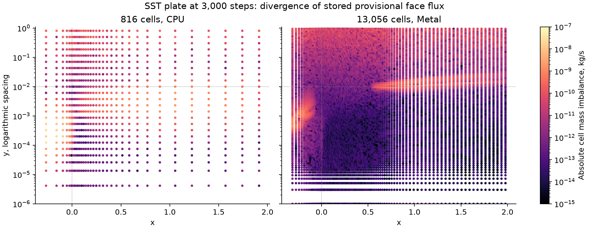
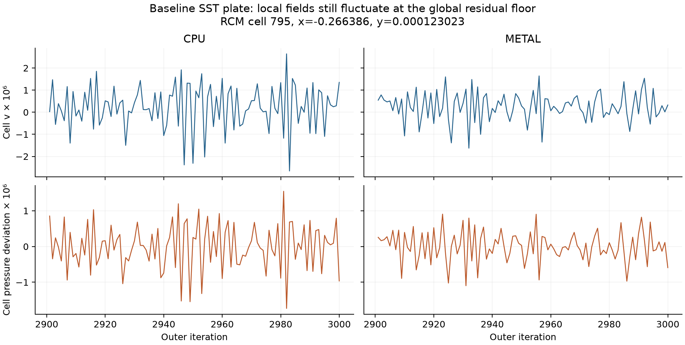
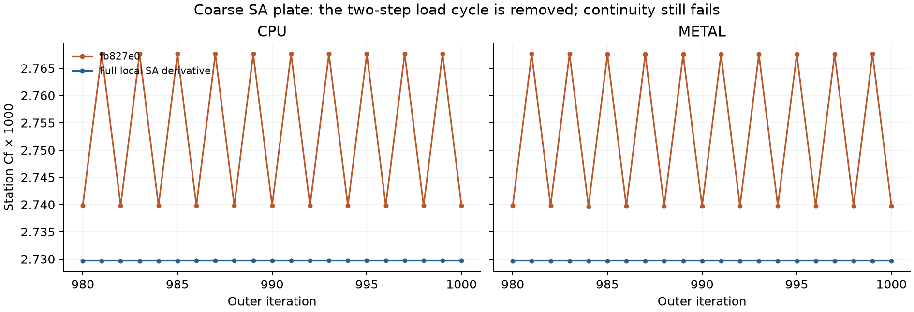

# Steady convergence investigation — 2026-10-30

**The requested convergence acceptance is not achieved.** The SST and SA TMR
continuity gates still fail, the bump still needs too many iterations, and the
983,040-cell channel still diverges on Metal. No Coupled solver is implemented.
No residual threshold, normalization factor, validation assertion or pressure
interpolation scheme was changed.

The retained numerical change removes a real SA source-linearization instability.
The other retained fix keeps inactive model flags out of typed viscous settings,
while preserving their raw values and informational provenance. That fixes the
static-mixer CFF/legacy quick-test discrepancy. The independent
[`bench_convergence.cpp`](../../../bench/bench_convergence.cpp) runner supports
bounded parameter experiments without editing the frozen verification rigs.

## Checkout and proof boundaries

The branch started with `git checkout -b steady-convergence-fb827e0 fb827e0`.
The native baseline was built from clean `fb827e0d416746030eaf156f9f42fca87b712a31`.
The implementation was subsequently rebased with `git rebase --onto main fb827e0`
onto `195f56b87ae13ea7b5875978af923e083acd147c`. Main already had a narrower
inactive-SA parsing fix; the integrated version retains informational issues as
well as the raw setting. No app files were edited by this lane.
Main subsequently advanced with the Qt workbench stack, so the branch was
rebased again onto `e55b806`. Those additional commits change the app and view
export path, with no changes to FV, mesh, kernels or linear algebra.
A final rebase includes `00a01cb`, which changes only the Windows Qt CI install
step; runtime sources and build files are identical to the checked `e55b806` tree.

The full slow comparison uses captured pre-rebase binaries: baseline `fb827e0`
versus that base plus the retained SA and parser changes. Fresh native quick
checks and CUDA compilation cover the latest rebased integration; the separate
V6 rerun covers the initial rebase. Main's intervening
changes add runtime inventory and setup error/report interfaces; the existing
steady solver, transport, pressure kernels and V1–V6 rigs are unchanged. Source
and executable hashes are in [`metadata.json`](metadata.json). A benchmark's
embedded `source=fb827e0` is the configured Git revision, and does **not** identify
uncommitted implementation content; use the recorded source/artifact hashes.

Machine: Apple M4 Pro, macOS 26.6.2, Apple clang 21.0.0, Release C++20, serial CPU
and actual Metal. Native checks load the external Fluent fixtures through
`KUTTA_FLUENT_EXAMPLES=FLUENT_EXAMPLES`.
`python3 tools/prepare_tmr.py` expanded the fine TMR grids before V5/V7.
Several older checks ignore that environment variable and read the checkout's
fixture directory directly. Ten gitignored file symlinks now point to the exact
external fixtures; the three existing fixture files were verified byte-identical.
The CUDA container mounts the same external directory both at its original path
and over `/src/validation/fluent_examples`. All ten curated mesh examples execute,
including the 86,803-cell polyhedral box and 114,219-cell wing. The available
external directory contains 13 data files; optional research files beyond those
still report missing. See [`raw/fixture-links.json`](raw/fixture-links.json).

**Timing limitation:** the long runs overlap one another and other local work.
Durations are observations under contention, not isolated speed measurements.
An unaccepted run has a stop point, not a time to convergence. No Fluent
executable was available here, so there is no measured Kutta/Fluent speed ratio.

## Continuity: what was established

Fluent's [User's Guide §37.16.1.1, equations 37-30 and 37-32](https://ansyshelp.ansys.com/public/Views/Secured/corp/v252/en/flu_ug/flu_ug_sec_solve_monitor.html)
defines unscaled continuity as the sum of absolute cell mass creation and global
scaling by the maximum continuity residual in the first five iterations. Kutta
already uses that global scaling. The provisional Rhie–Chow flux is both the
input to `fv_continuity` and the flux entering the pressure-correction RHS.
There is no second, differently reconstructed provisional flux in that path.

Fluent's [Theory Guide §23.4.3.1, equations 23-53–23-56](https://ansyshelp.ansys.com/public/Views/Secured/corp/v252/en/flu_th/flu_th_sec_uns_solve_pv.html)
also explains that the corrected face flux satisfies continuity during each
pressure correction. Substituting the corrected-flux monitor for the outer
provisional defect would hide the remaining pressure/velocity iteration error.
These documents do not justify changing the frozen stopping criterion.

At iteration 3,000 of the baseline SST plate:

| Quantity | 816 cells, CPU | 13,056 cells, Metal |
| --- | ---: | ---: |
| Provisional L1 continuity, kg/s | 3.17990473e-7 | 1.57661227e-7 |
| First-five maximum, kg/s | 1.83138365e-4 | 4.37331196e-6 |
| Globally scaled continuity | 0.00173634 | 0.0360508 |
| L1 recomputed in double from stored face fluxes | 3.17803520e-7 | 1.56019767e-7 |
| Corrected L1 continuity, kg/s | 9.88571561e-9 | 5.01419354e-8 |

The double re-sum preserves the floor. Thus the final cell/reduction summation
does not explain it. Every impermeable wall, symmetry and extrusion face has
exactly zero flux. On the coarse grid, 93.6% of the L1 imbalance is below
`y=.01`, and 71.8% is upstream of the leading edge in that strip. On the fine
grid, 61.5% is in the outer plate region (`x>=0`, `y>=.01`). It is not confined
to the leading-edge singularity.

Re-evaluating the pressure reconstruction in double at the **same stored cell
pressures** changes the coarse cell imbalance vector by only `4.53813e-10` L1.
Evaluating the final face-flux expression in double from the **same stored face
velocities and physical coefficients** changes that vector by `1.32759e-8` L1.
Applying both changes leaves L1 at `3.17120e-7`, versus `3.17804e-7` from the
stored fluxes. Final flux arithmetic/storage alone therefore cannot explain
this floor. This comparison does not test cell-field storage precision or its
effect on the outer iteration. The calculation and its scope are retained in
[`experiments/pressure-response/pressure-arithmetic.json`](experiments/pressure-response/pressure-arithmetic.json).



The worst coarse cell is owned RCM cell 795 at `(-.2663859601, .0001230229281)`;
its signed imbalance is `3.52651615e-8 kg/s`, 11.1% of the total L1. Its signed
outward face contributions are:

| Owned face | Contribution, kg/s | Kind |
| --- | ---: | --- |
| 1532 | +4.17023642e-8 | internal, upper y face |
| 1533 | +5.94077733e-7 | internal, downstream x face |
| 1544 | -6.28702246e-9 | internal, lower y face |
| 3224 | -5.94227913e-7 | prescribed inlet |
| 2369, 3185 | 0 | front/back symmetry |

The coarse patch totals are inlet `-.0099999998144`, outlet
`+.0099729109647`, and open top `+.0000270892464 kg/s`. These net totals are
small compared with the sum of absolute local imbalances; local cancellation
must not be mistaken for convergence. All cell coordinates, per-face fluxes,
Rhie–Chow jumps, correction coefficients and face velocities are retained in
[`raw/`](raw/). IDs are after the solver's RCM permutation, not original mesh IDs.
[`analyze.py`](analyze.py) independently gathers signed face contributions in
double; [`raw/capture-only.patch`](raw/capture-only.patch.gz) reproduces the bounded
snapshot instrumentation on the baseline. It is not installed in the solver.

Compensating pressure and face-flux storage together with conservative transport
defect assembly reduced the coarse provisional L1 to `1.71916e-8` and corrected
L1 to `3.40054e-11 kg/s` at 1,000 steps. The unchanged scaled gate still failed
at `9.40008e-5`. This shows a material arithmetic contribution, but does not prove
that arithmetic is the only cause. The prototype was removed. Because it changes
the arithmetic of the entire iteration and transport solve, this trajectory
change does not isolate a single rounding operation as the cause.

An offline pressure-only linear response at the captured coarse state has eight
modes outside the unit disk and spectral radius `1.0279772`, even when evaluated
in host double using the stored geometry/LSQ coefficients. Its action agrees
with the generated CPU kernels to `5.92e-8` relative L2. This is the response with
**velocity, momentum diagonal and turbulence frozen**, not the full flow
iteration Jacobian. It explains why iterating pressure alone is not a supported
remedy; it neither identifies the full continuity root cause nor proves that a
particular Coupled implementation will converge. See
[`pressure_response.cpp`](pressure_response.cpp),
[`pressure_response.py`](pressure_response.py), and
[`experiments/pressure-response/`](experiments/pressure-response/).

The actual persistent-imbalance cause is therefore **not fully isolated or
fixed**. The evidence rules out the denominator, final reduction and a nonzero
impermeable-boundary flux as sufficient explanations.

The small global momentum defects also do not imply stationary local fields.
A public-field trace reproduces the coarse CPU V5 residual exactly at iteration
3,000 (`3.17990472775e-7` raw, `u=9.76763e-8`, `v=3.92993e-8` scaled), while
preserving the frozen 100-iteration monitor cadence. During iterations
2,901–3,000, the same upstream cell 795 has peak-to-peak changes of
`1.02520e-5` in u, `5.30055e-6` in v, and `3.27732e-6` in pressure. Across the
whole mesh, the largest adjacent-step changes reach `9.95398e-6`,
`1.13010e-5` and `3.46219e-6`, respectively. These are substantial local
pressure/velocity fluctuations compared with their float ulps. The pressure RHS
L2 varies from `6.55042e-9` to `2.10331e-7`; the remaining outer iteration is
not a fixed local state with an incorrectly reported continuity value.
This still does not isolate which part of the coupled response sustains or
amplifies the fluctuation. [`plate_trace.cpp`](plate_trace.cpp) uses only public
solver fields and leaves production code unchanged.
The Metal trace also reproduces its baseline residual exactly and has
`3.26874e-6` peak-to-peak v and `2.00351e-6` peak-to-peak pressure in that same
cell. Its largest adjacent-step v change anywhere reaches `7.40838e-6`.
The CSV histories and [`raw/plate-trace-summary.json`](raw/plate-trace-summary.json)
retain both backends.



## SA source linearization

At the existing `.75` turbulence relaxation, the coarse SA plate alternated
between two wall-load states. Sampling only the endpoints 100 iterations apart
masked the alternating component. The diagnostic below samples every iteration
on both implementations, with the same monitor cadence and settings.

The source split previously treated the reaction as a frozen coefficient times
`nu_tilde`. The retained implementation differentiates the complete local
reaction through `fv2`, modified strain, bounded `r`, `fw`, and `ft2`. It uses
`max(0, -growth, -dQ/dnu_tilde)` as the implicit sink and adds its matching term
to the explicit source. `source - sink*nu_tilde` remains the same physical SA
source at the assembly state. Two private derivative buffers add eight bytes
per cell; the solve remains Device/generated-kernel native.

| Diagnostic, iterations 900–1,000 | CPU before | CPU after | Metal before | Metal after |
| --- | ---: | ---: | ---: | ---: |
| Maximum adjacent-step relative load change | 1.03898e-2 | 3.80012e-7 | 1.03897e-2 | 2.48252e-7 |



The reported transport and last-100 load criteria first hold at iteration 257
(1.00848 s CPU, 16.01690 s Metal in these contended diagnostics). Continuity is
still `7.78709e-4` CPU and `9.98146e-4` Metal at that step, so **neither run is
accepted**. The new implicit sink also changes the diagonal used in the SA
transport residual normalization. Transport-only residual improvements are not
independent proof of physical convergence; removal of the wall-load cycle is.

The coefficient/source test uses an independent double finite-difference local
reaction derivative. Linked to the old implementation, it fails 16 of 306
assertions. The retained SA tests pass all 403 assertions on CPU and Metal.

## Other experiments and remaining work

None of these bounded experiments passed the unchanged convergence gates. They
are archived as rejected diagnostics in [`experiments/`](experiments/), not
retained solver options or production code:

| Approach | Observed outcome |
| --- | --- |
| Tighter momentum, turbulence and pressure solves | Coarse plate at 1,000 steps: scaled continuity 4.67941e-4, despite 68 momentum and 40 pressure iterations at the last checkpoint |
| Lower pressure relaxation | Raw imbalance falls, but the first-five scale also falls; scaled continuity 2.30921e-2 at 1,000 |
| Conservative transport defect alone | Scaled continuity 1.75146e-3 at 1,000 |
| Compensated pressure alone | Scaled continuity 1.11431e-3 at 1,000 |
| Combined pressure/flux compensation and conservative transport | Scaled continuity 9.40008e-5 at 1,000; still fails |
| Four pressure corrections per momentum update | Raw 9.78113e-9 but scaled 1.49560e-3 at 1,000; more work and smaller startup denominator |
| Frozen velocity, repeated pressure updates | Diverges; scaled continuity 335.209 at 1,500 |
| Flux-memory/relaxed Rhie–Chow prototypes | Unstable without pressure damping; with damping, continuity still floors and channel still diverges |
| SA source derivative with frozen `fw` | Does not remove the coarse-plate cycle |
| Small-channel `dt=.001` or turbulence relaxation `.1` | Both still diverge; these are not million-cell convergence results |

The million-cell channel uses `128×32×40` Freudenthal tetrahedra (983,040 cells),
`Re_H=10000`, the existing speed-lane initialization and SOU momentum/FOU SST,
`dt=.01`, momentum/pressure/turbulence relaxation `.3/.05/.75`. SA is inactive.
Every common before/after numerical checkpoint is identical. Metal reaches
3,000 iterations in 339.50 s before and 342.85 s after; final scaled continuity
is `1.27095112e7`, so these are divergence timings. CPU stops for the 600 s
budget at 160 iterations / 603.36 s before and 200 / 649.26 s after. Different
stop iterations under contention are not evidence of a speedup.

The remaining solver work is substantial: isolate the full pressure/velocity
fixed-point response and implement a consistent stable correction, or a block
Coupled solve including the implicit Rhie–Chow terms described by Fluent's
[Theory Guide §23.4.3.2](https://ansyshelp.ansys.com/public/Views/Secured/corp/v252/en/flu_th/flu_th_sec_uns_solve_pv.html).
A Coupled implementation would also need case-setting selection and measured
wall-time evidence; neither is present in this change. V6 still exercises the
existing segregated implementation with the explicitly allowed WFGC diagnostic
approximation, despite the Fluent case requesting Coupled. This investigation
does not close V6's physical-accuracy gates.

## Recorded stopping points

These are **observed iterations / seconds**, not accepted convergence times for
the rows marked No. The TMR rows below use each case's finest tested grid;
[`timings.csv`](timings.csv) records all three grids and all 60 before/after
observations. V6 reaches its residual criterion but still fails accuracy.
All durations have the contention limitation described above.

| Case | Backend | Baseline iterations / s | After iterations / s | Converged? |
| --- | --- | ---: | ---: | --- |
| SST plate | CPU | 3,000 / 191.95 | 3,000 / 202.82 | No |
| SST plate | Metal | 3,000 / 118.41 | 3,000 / 113.83 | No |
| SST bump | CPU | 2,000 / 604.14 | 2,300 / 623.82 | No |
| SST bump | Metal | 3,000 / 151.54 | 3,000 / 133.23 | No |
| SA plate | CPU | 3,000 / 180.58 | 3,000 / 175.83 | No |
| SA plate | Metal | 3,000 / 80.80 | 3,000 / 100.03 | No |
| SA bump | CPU | 2,500 / 623.76 | 2,700 / 607.93 | No |
| SA bump | Metal | 3,000 / 98.05 | 3,000 / 96.84 | No |
| V6 seeded | CPU | 350 / 37.10 | 350 / 36.64 | Residual only |
| V6 seeded | Metal | 350 / 9.44 | 350 / 10.12 | Residual only |
| V6 cold-hybrid | CPU | 550 / 57.92 | 550 / 55.81 | Residual only |
| V6 cold-hybrid | Metal | 550 / 13.44 | 550 / 14.29 | Residual only |
| 983k channel | CPU | 160 / 603.36 | 200 / 649.26 | No |
| 983k channel | Metal | 3,000 / 339.50 | 3,000 / 342.85 | No |

## Verification and reproduction

The full slow assertion comparison and per-case stop/convergence observations
are in [`measurements.json`](measurements.json), [`assertions.csv`](assertions.csv)
and [`timings.csv`](timings.csv). An empty convergence-time field means the gate
was not reached. All original failing gates remain visible in the raw XML.

V1–V6 contains ten cases and **3,563 assertions**. There are **no new failures**:
51 baseline failures versus 50 afterward. The only pass/fail change is the
finest CPU bump's first station Cf error, `0.124519 → 0.0992376` against the
unchanged `.1` limit. That run reached 2,300 iterations in 623.82 s before its
600 s budget check, versus 2,000 in 604.14 s on the baseline. SST numerical code
is identical, so this is a different transient endpoint under contention, not
an implementation accuracy improvement. The other 3,562 assertion outcomes
match. [`raw/v1-v6-comparison.json`](raw/v1-v6-comparison.json) records the change.

The **complete slow tier** has 24 cases: 17 pass and seven fail in both runs.
There are **zero new failing assertions and zero missing baseline assertions**.
Baseline: 10,864 assertions / 71 failures. After: 10,884 / 70 failures. The 20
additional passing assertions come from the ten newly available ignored fixture
files in the optional size/hash inventory. A supplemental inventory run with all
available fixtures passes the same 26 assertions on baseline and integration.

| Retained failing case | Baseline failures | After failures |
| --- | ---: | ---: |
| V2 tet wall-force order | 6 | 6 |
| V6 elbow accuracy | 29 | 29 |
| V5 SST plate convergence | 6 | 6 |
| V5 SST bump | 10 | 9 |
| V7 SA plate/bump | 17 | 17 |
| FSAE V7.2 polyhedral pressure | 2 | 2 |
| FSAE V12 fan import | 1 | 1 |

With all available fixtures populated, baseline native quick has 189 cases and
7,341,666 assertions, with two failing static-mixer typed-settings comparisons
in one case. The earlier, smaller quick logs exercised the ENV-aware fixtures
but skipped several source-root mesh checks. They are retained as partial
fixture-coverage observations, not the final quick proof.
The pure parser regression fails two of five assertions against the old library.
After rebasing, the fresh native quick tier passes **217/217 cases and
7,403,642/7,403,642 assertions**, including actual Metal and the compiled-GPU
availability test; CTest quick and portability lint pass 2/2 in 21.39 s on the
initial rebase and 22.34 s on the latest main.
Fresh integrated V6 has **2,601 assertions and the same 29 failures**
as `fb827e0`, with no pass/fail changes. Its seeded/cold solve iteration counts
remain 350/550 on CPU and Metal. The retained V6 failures concern physical
accuracy, not failure of those cold/seeded residual stopping criteria.
The fixture-mounted CUDA build targets `75-real;86-real;89-real;120`; its CPU quick
run excludes only the compiled-GPU availability test because this Docker session
has no NVIDIA device. CUDA compilation is not CUDA execution evidence.
The rebased CUDA build and CPU quick run pass **216/216 cases and
3,746,284/3,746,284 assertions** with both fixture mounts. The subsequent lint
command in that container initially lacked the `git` executable; installing it
and rerunning lint resolves that environment error. The original four-target
build also ran lint successfully.
On the latest main, compilation and the full-fixture CPU quick tier again pass.
The static lint is run separately on the tracked-source snapshot: mounting
ignored Fluent inputs over its source-root fixture directory causes the
plain-tree fallback to scan vendor writer paths embedded in those inputs.
Native Git-based lint and the source-only container check use the intended
tracked-file scope. No fixture bytes or lint rules are changed.

```sh
export KUTTA_FLUENT_EXAMPLES="<fluent-examples>"
python3 validation/results/steady_convergence/prepare_fixtures.py
python3 tools/prepare_tmr.py
cmake -S . -B build -G Ninja -DCMAKE_BUILD_TYPE=Release -DKUTTA_REQUIRE_HDF5=ON
cmake --build build -j4
ctest --test-dir build -LE slow --output-on-failure
./build/kutta-tests --test-suite=slow --success --reporters=xml --out=slow.xml

# Independent per-step cycle diagnostic; exit 2 denotes no accepted convergence.
./build/bench_convergence --case plate --model sa --backend cpu --level 0 \
  --iterations 1000 --interval 1 --max-seconds 600
./build/bench_convergence --case channel --backend metal --nx 128 --ny 32 --nz 40 \
  --viscosity .0001 --iterations 3000 --interval 20 --max-seconds 600

python3 validation/results/steady_convergence/analyze.py
# Plot dependencies are offline diagnostics only: numpy and matplotlib.
python3 validation/results/steady_convergence/plot.py
```

The raw XML stores every successful and failed assertion. Comparison keys include
test name, file, line, expression and repeated occurrence; both expanded values
are preserved. The `v1_v6_new_failures` field reports any pass-to-fail change in
V1–V6. Full slow runs may stop at different CPU iterations because their original
600 s budgets are unchanged; those endpoint differences remain in the record.
Paths in tracked artifacts use CHECKOUT, FLUENT_EXAMPLES and HOME labels to
comply with the repository portability lint. Only path strings were normalized;
unmodified originals remain locally under `build-evidence/report-unnormalized`.
Original file SHA-256s are recorded in metadata. SVG trailing whitespace was
removed, and unified patches are gzip archives to preserve their context lines.
For the optional inventory, comparison keys also include the source-file context
so added files cannot shift the identity of earlier assertions.
The baseline slow inventory ran before the local fixture links were added;
its optional inventory has fewer assertions than the final run. The V1–V6
physics inputs are unchanged, including the byte-identical cavity mesh.
