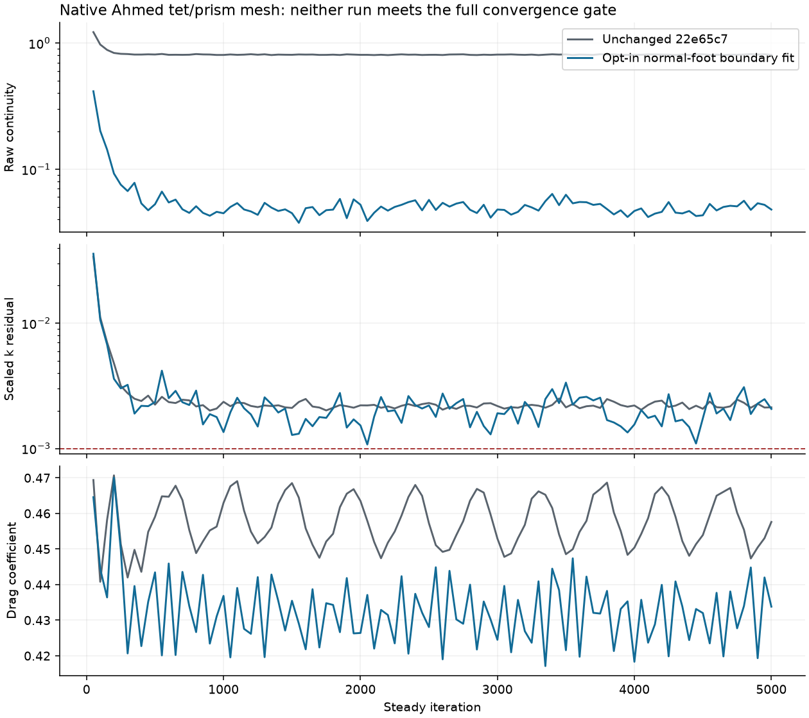
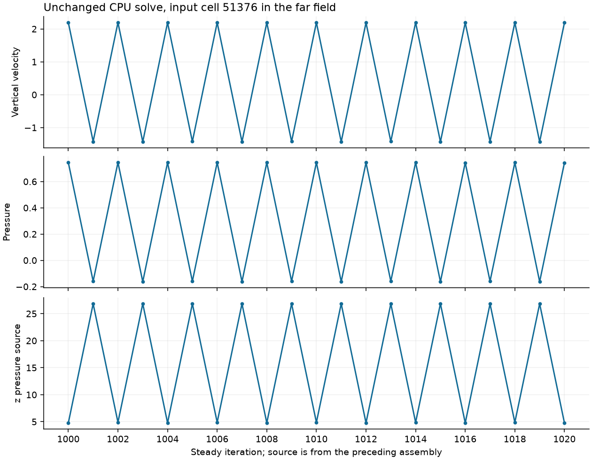
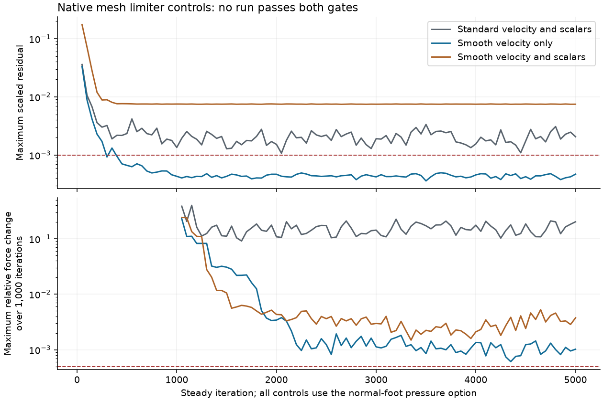

Default native tet/prism convergence is **not achieved**. I isolated a numerical
far-field pressure/velocity cycle and added an opt-in correction with a fast
CPU/Metal regression. It removes the cycle in an 11-tet problem with a known
uniform-flow solution. On the full native Ahmed mesh it reduces raw continuity,
but turbulent kinetic energy and the force histories still fail the original
gates. No default numerical setting, tolerance, reference or iteration budget
has changed.

This work starts at `22e65c7afa4df1c804a08d537c48cb74f7c61c8e`. The retained
mesh is 130,331 cells, comprising 55,371 tets and 74,960 prisms. Regeneration
with gmsh 4.15.2 reproduces SHA-256
`95bc6d879ce9d6e25b56d499a327bd2710cd9778cc983697767dceb4fd624829`
after changing only the generator comment's `35.0` to the retained `35`.
The untouched regenerated file has SHA-256
`35cee20eaef0052a00b09b2dbabd199b19d26c58a22cb2a6d1d33c97d9f9424e`.
Large meshes and restricted data are not committed.

Final solver verification uses frozen binaries built from implementation commit
`998a66634f59e2ee651d0993b0f1d583cfeedcd0`, with Apple Clang 21.0.0,
Release `-O3 -DNDEBUG`, CPU, Metal and HDF5 enabled. CUDA and the Qt app are
not built. `evidence/final_source.json` binds all solver sources and the frozen
executables by SHA-256. The later `fb0cb59` commit changes only the mesh utility's
existing-output guard; its separate tiny-mesh and dangling-symlink checks pass.
All 35 completed native benchmark records have memory receipts; the largest is
746,161,184 bytes. Heavy solves ran serially in this lane. No timing result is used
as performance evidence. The retained solver source has not changed since
`998a666`; rejected prototypes have separate receipts.
The baseline binaries
were frozen from untouched `22e65c7`. Its CLI-dependent cases (1–4) ran with the
matching baseline CLI before any CLI rebuild. Remaining baseline cases use the
statically linked baseline solver and do not invoke the CLI. The branch runner
checks the frozen branch CLI hash before and after every case.

I read the previous [tet/prism report](../tet_prism_robustness/REPORT.md) and
its evidence, [coupled plateau](../coupled_plateau/REPORT.md), the native-mesh
section of [Ahmed drag](../ahmed_drag/REPORT.md), and
[external 3D robustness](../external_3d_robustness/REPORT.md). The pressure
interface shielding from `f0fa072` remains intact.

The dominant original mode is numerical. A fresh unchanged Metal SIMPLEC run
reproduces every printed non-timing monitor value in the previous lane's
5,000-iteration history. The deterministic CPU diagnostic run reproduces the
previous CPU history through iteration 1,500. Its field readbacks cover every
iteration from 1,000 through 1,099. During that window:

| Observation | Measured value |
| --- | ---: |
| Mean sum of absolute cell continuity imbalance | 0.823375 |
| Far-field share | 98.9826% |
| Tet share | 99.7464% |
| Cells carrying half the continuity imbalance | 15 |
| Dominant far-field pressure, velocity and limiter period | 2 iterations |
| Cells changing at least one velocity limiter by more than 0.05 per step | 13,424 on average |
| Flagged poor cells | 2,709, fixed at construction |

Here far field means `x > 1`, `x < -1.5`, `abs(y) > 0.5`, or `z > 0.6`,
in metres. The body and wake regions partition the remaining cells at `x = 0`.
The diagnostic continuity field is the predictor imbalance before pressure
correction, matching the solver monitor contract. At the iteration-1,500
monitor, the far field also carries 98.39%, 98.76% and 99.39% of the absolute
u, v and w equation residuals. The largest continuity cells are unflagged
far-field tets. Input cell 51376,
before RCM, lies at `(3.44721, -0.843364, 0.076609)`. Its vertical velocity
alternates approximately `+2.193, -1.423`; pressure alternates
`+0.74475, -0.15960`. Its vertical pressure-source standard deviation is
10.9822, versus 0.00857 for the remaining assembled momentum source. These
are local source terms, not integrated body forces.

The LSQ stencil there is not singular. Its normal-matrix condition number is
about 78.6; other leading cycle cells have condition numbers around 2 to 3.
Poor-cell flag flicker is ruled out by construction: those flags are computed
once, with no iteration update. Limiter switching accompanies the cycle, but
the frozen-limiter control became nonfinite and did not isolate the limiter
as its cause. The roughly 130 switching cells in the earlier external-aero
limiter report do not explain this different, much larger far-field mode.

The shared pressure-gradient fit contains a concrete boundary-data error. It is
used for both physical pressure and pressure correction. Second-order pressure
normally omits extrapolated boundary data. Where extrapolation gain exceeds
one, it instead observes the owner pressure at the face centroid. On a skew
symmetry face, that observation suppresses a tangential pressure gradient.
For the manufactured field `p = x`, input cell 51376 reconstructs
`(1.00000012, 0.00000148, -0.1916464)` instead of `(1, 0, 0)`.
Observing the same pressure at the normal foot gives
`(1, 0.00000045, -1.43e-16)`. Moving that row changes its mathematical
meaning; it is not an LSQ conditioning adjustment.

Fluent specifies zero normal gradients at symmetry boundaries in the
[User's Guide, 7.4.17.2](https://ansyshelp.ansys.com/public/Views/Secured/corp/v242/en/flu_ug/flu_ug_bcs_sec_bound_cond.html).
The retained correction uses Kutta's existing `NormalFootValue` observation
for every symmetry pressure gradient and for the existing amplified
stored-pressure fallback rows at walls and inlets. It leaves the gain threshold
and prescribed-pressure observations unchanged. Symmetry follows the documented
boundary condition. Moving a fallback wall/inlet datum preserves tangential
variation of that stored datum; the guides do not document Fluent's corresponding
LSQ row policy. It does not establish
term-by-term equivalence with Fluent's implementation. The cited guides are
Fluent 2024 R2. Fluent's
[Theory Guide, 23.3.3](https://ansyshelp.ansys.com/public/Views/Secured/corp/v242/en/flu_th/flu_th_sec_eval_derivatives.html)
documents its LSQ gradient reconstruction on irregular meshes.

The 11-cell regression retains native far-field tet geometry and cuts away the
body and wake. Original outer faces become slip faces; cut faces receive
uniform velocity inflow or zero-pressure outflow. Uniform velocity `(1,0,0)`
and zero pressure solve the flow equations exactly, including with the tiny
SST background used in the test. A spatially varying pressure perturbation
excites the original period-two cycle. With the same 300 iterations:

| Regression result | Original fit | Opt-in normal-foot fit |
| --- | ---: | ---: |
| Symmetry: raw continuity | 6.97864e-2 | 1.73531e-8 |
| Symmetry: maximum velocity component error | 0.670493 | 3.57628e-7 |
| Symmetry: maximum absolute pressure | 0.141582 | 1.22069e-7 |
| Moving wall: raw continuity | 7.42761e-2 | CPU 6.66023e-9; Metal 1.81188e-12 |
| Moving wall: maximum velocity component error | 0.766424 | CPU 1.70050e-7; Metal 7.96540e-7 |
| Moving wall: maximum absolute pressure | 0.169887 | CPU 1.00818e-7; Metal 2.37652e-7 |

The moving walls translate tangentially at `(1,0,0)`, so the same uniform field
is an exact solution. This catches the wall fallback that symmetry-only rows
missed. The original symmetry-only implementation passes the slip case but
fails all six moving-wall flow assertions. Both boundary variants pass on CPU
and Metal with the final implementation: 15 assertions, including mesh identity
and two unsupported Green-Gauss checks. The original bounds remain `1e-6` for
continuity and `1e-5` for velocity and pressure, with 300 iterations. No existing
acceptance bound was changed. The fixture and test are
`tests/data/meshes/native_farfield_tets.msh` and
`tests/fv/test_native_farfield.cpp`.

The build/test runner rejects failed builds, a different checkout, zero selected
cases, or missing CPU/Metal/boundary combinations. Its failing-build and
zero-case guards were exercised. A failed experimental build initially led to
a stale binary selecting zero cases; that result was discarded. The runner
makes that error fail before a result can be accepted.

The original code reuses the physical-pressure LSQ fit for pressure correction.
Those fields have different boundary contracts: pressure may extrapolate, while
pressure correction has homogeneous Neumann conditions at fixed-velocity faces.
The retained option changes their shared fit, so its small-case recovery alone
does not distinguish the two paths.

A separate control leaves physical pressure unchanged and gives only pressure
correction normal-foot observations on every fixed-velocity boundary, with
zero face values at fixed-pressure boundaries. On CPU at 300 iterations it
recovers both small cases: symmetry raw continuity `3.057e-9`, velocity error
`1.313e-7`; moving-wall raw continuity `1.414e-12`, velocity error `2.980e-7`.
This isolates a correction-gradient contribution to the numerical cycle.
On the full native Metal run, however, it still fails after 5,000 iterations:
maximum scaled residual `0.00252171`, lift/drag changes `0.227830 / 0.061856`.
Physical pressure used its original default fit in this run. The separate-fit
prototype is not retained. Combining it with the physical-pressure normal-foot
option under the Standard limiter also fails: maximum scaled residual
`0.00303884`, lift/drag changes `0.335490 / 0.052367` after 5,000 iterations.
Adding the existing velocity-only differentiable limiter meets the residual
threshold (maximum `0.000529098`) but still fails force settling:
lift `0.00245441`, drag `0.000959516`. Both controls finish 5,000 iterations.
The correction-only and combined-fit prototypes are rejected; the retained
library source remains unchanged.

The retained library option is
`SolverSettings::pressure_boundary_gradient = PressureBoundaryGradient::NormalFoot`.
The validation benchmark exposes it as
`--pressure-boundary-gradient normal-foot`. The default is `Extrapolated`.
Normal-foot rows change the discrete pressure reconstruction and can change its
fixed point. The full slow tier checks unchanged defaults; it does not establish
this option's accuracy across the Fluent corpus. The benchmark now rejects
unknown options before device creation, so an obsolete or misspelled flag
cannot silently produce a default run. Last-occurrence option overrides remain
supported for the existing sweep driver.
The standard pressure interpolation path already uses normal-foot rows, so
this option leaves that path unchanged. No generated kernel changes are needed;
CPU, Metal and CUDA share the host-built fit. CUDA runtime is unverified.

On the native mesh, the original criteria remain every Fluent-scaled residual
at most `1e-3`, and both lift and drag changing by at most `5e-4` relative to
the current force over the preceding 1,000 iterations. Every complete
screening run below uses the same 5,000-iteration cap. The force columns use
the existing benchmark's maximum relative difference from the final sample,
not a standard deviation or a fitted trend.

The clean retained Metal SIMPLEC run at implementation commit `998a666` matches
all 100 printed non-timing history samples of the combined fallback/symmetry
prototype exactly. Both finish 5,000 iterations:

| Final native result | Unchanged 22e65c7 | Opt-in normal-foot fit |
| --- | ---: | ---: |
| Raw continuity | 0.8068714 | 0.0477401 |
| Maximum scaled residual | 0.00825425 | 0.00206879 (k) |
| Scaled continuity | 0.00825425 | 0.000498747 |
| Lift change over 1,000 iterations | 0.0917024 | 0.2018861 |
| Drag change over 1,000 iterations | 0.0224256 | 0.0357136 |
| Meets full gate | no | no |

The force histories become less settled despite the smaller equation residuals.
The opt-in run's final drag is 0.4338149. Its last-2,000-iteration sample mean is
0.4315591, spanning 0.4171111–0.4473903. This is an unconverged iteration average,
not a physical time average or an accepted drag value. A final clean CPU Ahmed
run of this option is unverified; the fast reproducer covers both backends.





The boundary defect therefore explains a dominant numerical mode, not the
whole force plateau. Body and wake fields also vary on a slower scale. In the
100-iteration diagnostic window their strongest frequency is the lowest FFT
bin; that means unresolved drift or a period at least as long as the window.
It does not measure a wake-shedding period. A separate exact-normal-gradient
Coupled screening run moved much of the velocity and pressure variation to
the body/prism region, while 68.3% of continuity still lay in the far field.
At iteration 5,000, its k residual is 48.0% wake, 27.7% body and 24.3% far field;
omega is 94.6% body and 96.0% prisms. Input cell 6370 at
`(0.05835,-0.36003,0.13613)` carries a leading k residual with limiter zero.
Leading omega residuals lie in near-body prisms, including input cell 60619 at
`(-0.00932,-0.19452,0.09861)`. The corresponding states are k `0.0368075` and
omega `75933.2`, far above their default floors `1e-14` and `1e-20`. These leading
residual cells are not at the floors; this does not rule out floor effects
elsewhere. The state, source and sink coefficients are retained in
`evidence/constrained_turbulence_localization.json`; no isolating experiment
establishes which turbulence term causes the slow mode. That stronger constraint
is not the retained weighted normal-foot fit.

The evidence does not support declaring the remaining mode physical. There
is no time-accurate URANS calculation, physical-time spectrum, or matched
Fluent run. A longer steady iteration budget also has not been shown to
converge. The persistent period-two crop is a counterexample to treating the
original failure as merely insufficient iteration count. Any means reported
for the final 2,000 steady iterations are iteration averages of unconverged
fields, not physical time averages or accepted drag predictions.

Fluent's [Theory Guide, 23.3.4](https://ansyshelp.ansys.com/public/Views/Secured/corp/v242/en/flu_th/flu_th_sec_grad_limit.html)
explains that the standard Barth-Jespersen limiter can stall residual decay,
and describes its differentiable alternative. The native controls do not
show that switching this limiter alone resolves the target. The
[User's Guide, 36.14](https://ansyshelp.ansys.com/public/Views/Secured/corp/v242/en/flu_ug/flu_ug_sec_solve_pseudo.html)
uses global pseudo time by default for Coupled and permits smaller time-scale
factors such as 0.1. With normal-foot symmetry rows and that factor, Coupled
reaches 5,000 iterations with maximum scaled residual 0.102211 and relative
lift/drag changes 0.023346 / 0.005778. SIMPLEC becomes nonfinite after its
iteration-800 monitor. Neither is a convergence recovery. Pseudo time is not
physical time, so these trials do not establish a shedding frequency.

A separate SIMPLEC control combines the retained pressure fit with the existing
velocity-only differentiable limiter, using its unchanged coefficient 0.05.
At 5,000 iterations, every residual passes (maximum `0.000470226`), as does
drag settling (`0.000394268`). Lift settling is still `0.00102337`, above
`0.0005`, so the run fails. Relative to the retained Standard-limiter run,
velocity limiting reduces force variation substantially but changes the final
lift from `0.456998` to `0.572226`. Its fixed point and Fluent accuracy cannot
be inferred from the smaller residual. The earlier
[limiter report](../flux_limiter/REPORT.md) measured regressions against Fluent
for this option, which is why it remains opt-in.

Kutta deliberately keeps Barth-Jespersen for k and omega: the same report
records differentiable-scalar residual stalls on the wing. To test whether
those scalar limiters drive this native case, a separate control applies the
same 0.05 global-range threshold to k and omega too, with all other inputs
matching the velocity-only control. It finishes 5,000 iterations with maximum
scaled residual `0.00747967`, lift change `0.00375467` and drag change
`0.00136144`. All three gates fail. This does not isolate scalar limiter
switching as the remaining cause, and the prototype is rejected.



I also tested local low-order transport on faces incident to flagged cells.
Fluent's [User's Guide, 36.21](https://ansyshelp.ansys.com/public/Views/Secured/corp/v242/en/flu_ug/flu_ug_sec_solve_conv_stab.html)
documents first-order treatment and reduced non-orthogonal contributions in
poor-mesh numerics. The prototype removed deferred convection/diffusion and
high-order face-velocity corrections there. Combined with the stronger
symmetry constraint, its final maximum scaled residual is 9.515e-4, but
lift/drag changes remain 0.189713 / 0.051702. I did not retain it.

Other screening trials are recorded in `evidence/native_runs.json`. Whole
outer-update damping, high-order-term relaxation, pressure relaxation 0.7,
Gauss pressure-correction gradients, frozen limiters, and fuller Coupled
pressure Jacobians all failed the target. Some diverged. Anderson mixing
with several history lengths reduced residuals in some trials, but none met
the force criterion. Later Anderson trials used fresh unlagged residual audits.
Early Anderson controls use the original monitor; controls marked fresh audit
refresh the unlagged discrete residual. No trial is accepted on a lagged
residual. Selected completed controls illustrate why smaller reported residuals
were insufficient:

| Rejected control | Maximum scaled residual | Lift / drag relative change |
| --- | ---: | ---: |
| Exact symmetry + differentiable limiter, Coupled | 0.0355425 | 0.022117 / 0.016680 |
| Exact symmetry + local poor-cell transport | 0.0009515 | 0.189713 / 0.051702 |
| Anderson, memory 10, stride 11 | 0.0004946 | 0.050142 / 0.009369 |
| Pair-aware flow Anderson, memory 25, stride 11, fresh audit | 0.0008534 | 0.036338 / 0.017056 |
| Whole outer update relaxed by 0.5 | 0.0029273 | 0.410422 / 0.070009 |

These were rejected prototypes, not validated implementations of Fluent algorithms. All scratch instrumentation
and rejected solver paths have been removed from the retained source.

A separate affine strain probe found that the SST face-jump correction also
interprets the saved symmetry velocity as a face-centroid value. For `u_x=y`
on 48 tets with z-symmetry, the maximum base gradient error is 0.348485;
the jump correction makes it 0.382992. Normal-foot base rows reduce the base
error to 1.19e-7, but the original jump correction reintroduces error 0.2.
A control using normal-foot strain rows and zero symmetry face-jump contributions
becomes nonfinite before iteration 50 on the native mesh. It is rejected.
History records the jump-corrected strain as an intentional SST change
(`5de28d4`); an earlier normal-foot-only strain control gave no meaningful gain
in the [Fluent pipe case](../k_wall_cells/REPORT.md). A second control extrapolates the symmetry tangential velocity to the physical
face centroid and projects away only its normal component, retaining the normal
constraint. That makes the affine jump-corrected gradient accurate to `2.98e-7`
and preserves the 11-tet uniform-flow result. It still fails the full native run:
maximum scaled residual `0.00254649`, lift/drag changes `0.127262 / 0.070062`
at 5,000 iterations. This was a host-side numerical prototype, not a production
GPU implementation, and is not retained. The affine inconsistency is observed;
its causal role in the remaining native mode is unproven.

The optional mesh control merges only convex tet pairs, ordered by descending
shared-face area. It preserves all coordinates, all 8,988 exterior faces and
boundary roles, and all 74,960 prisms. Merging 18,857 pairs leaves 17,657 tets
and 18,857 polyhedra: 111,474 cells total. The mesh round trip checks connectivity,
positive volume and every merged-cell volume (maximum relative difference
`1.63e-15`).
The utility refuses existing outputs. The mesh SHA-256 is
`a86a6569d512c4a9496087c306a94284ac30a382ceeae29cefc9c987d8e2b74d`.
It is a controlled native agglomeration, not an imported Fluent Meshing case.

The default Metal SIMPLEC polyhedral run finishes 5,000 iterations but fails:
raw continuity `0.0103261`, maximum scaled residual `0.00132894` (k), and relative
lift/drag changes `0.0676150 / 0.0127234`. Its final drag is `0.4476403`.
This control changes topology and cell centroids; it does not isolate one
operator. It demonstrates that agglomerating tets reduces the reported predictor
continuity imbalance without resolving the full convergence problem. A separate polyhedral run of
the opt-in correction is unverified.

The fresh untouched `22e65c7` full slow baseline executes 37 cases with
201,571 passing and 62 failing assertions. The failures match the supplied
inventory: V6 25, V2 tet 8, V5 plate 6, V5 bump 8, V7 SA 14 and V12 1.
Against the older `8866cc0` XML, the canonical comparator reports zero
regressions, zero recoveries, 31 changed expanded values and no missing or
new assertions/cases. Those 31 before/after pairs exactly match the previous
`f0fa072` lane's comparison: Ahmed original 1, Ahmed y+≈1 4, SST bump 12 and
SA flat-plate/bump 14 (`evidence/known_31_changes.json`).

The full slow tier runs as 37 serial case processes because the prior
single-process tier peaked at 5.50 GB, above this task's memory bound. Only
process boundaries change. Every case retains its backends, subcases, solver
budgets, assertions and references. Both runs use the requested
`KUTTA_FLUENT_EXAMPLES` and `KUTTA_RUNS`. The runner validates each case's
identity, assertion count, exit status and memory receipt,
then merges the unchanged assertion records. The fresh baseline's maximum
per-case footprint is 2,149,353,512 bytes. The baseline SA case and branch
Tyrrell and transition cases were paused while separate native controls ran serially;
their stopping rules were checked to be iteration/convergence based. They were
resumed in `finally` blocks. These pauses do not change solver budgets or
assertions. No timing comparison is meaningful.

The shared runs root lacks the existing wing conversion case's `.msh` and
`.kutta.json` files, so that case's existing early return executes one ledger
assertion in the full tier. I regenerated both files locally with their exact
ledger hashes and ran the complete conversion case separately on the baseline:
19 assertions pass. This uses no new skip and writes nothing to the reference
checkout. The branch supplemental run also passes all 19 assertions; both XML
identities are recorded in `evidence/supplemental_wing.json`.
The existing corpus-physics case executes zero assertions: all 21 selected
original cases report setup holds and none converts. This is retained coverage,
not a claim of equivalence for those originals. All 21 full hold messages match
the branch exactly (`evidence/corpus_holds.json`).

The required elbow controls are exact against the untouched `22e65c7` CLI:

| Case and explicit approximation | CPU, 40 iterations | Metal, 40 iterations |
| --- | --- | --- |
| `mixing_elbow.cas.h5 --approximate wfgc` | exact | exact |
| `elbow_param.cas.h5 --approximate compressibility,ke-options` | exact | exact |

All output field/artifact files are byte-identical, including `view-input.bin`.
Every non-timing residual CSV cell matches exactly. Every summary field matches
except the recorded commit, setup time and solve time. The comparison preserves
those excluded values and both hashes in `evidence/elbow_parity.json`.
These runs use defaults, not the experimental normal-foot pressure option.

The quick tier passes all 280 executed cases and 7,457,646 assertions, including
the CPU/Metal boundary regression. Its peak footprint is 1,316,046,672 bytes.
Portability lint and `git diff --check` pass.

The verification turn was interrupted during case 23. Its incomplete output
was archived and excluded from acceptance. The runner resumed from the 22
immutable completed receipts, checking binary/CLI hashes, XML hashes, case
identities, assertion counts and memory readbacks, then restarted case 23 from
its initial state with its full original budget. Mismatched-binary and
changed-XML rejection checks pass (`evidence/interruption_recovery.json`).
No completed case was rerun or replaced.

The complete branch tier has the same 201,571 passing assertions and 62 known
failures: 31 passing and six failing cases. No gate was weakened. Both canonical
comparators exit zero:

| Comparison | Regressions | Recoveries | Changed expanded values | Missing/new assertions or cases |
| --- | ---: | ---: | ---: | ---: |
| Fresh 22e65c7 → branch | 0 | 0 | 0 | 0 |
| Older 8866cc0 → branch | 0 | 0 | 31 | 0 |

Every older-baseline value change is identical to the fresh-22 change described
above; the complete before/after list is in `evidence/branch_vs_8866.json`.
The fresh comparison is `evidence/branch_vs_base22.json`. The branch's largest
per-case footprint is 2,144,602,224 bytes. These results validate retained
defaults, not the rejected prototypes or the opt-in option's corpus accuracy.

The remaining work is to isolate the slower body/wake/turbulence mode after
removing the far-field cycle, with longer cell histories and an independently
checked pressure/flux linearization. Physical unsteadiness remains a question.
The default native tet/prism acceptance gate is still failing. The opt-in
boundary correction must not be presented as completion of that target.

All 269 task-created fixture symlinks were verified against the approved
reference checkout and removed after verification. No tracked fixture was
removed. Retained solver source and frozen executable hashes still match the
verification receipts. Large meshes, raw traces and slow XML remain under
ignored runs for audit; source instrumentation is removed.

Reproduction starts from `<checkout>`:

```sh
cmake -S . -B build -G Ninja -DCMAKE_BUILD_TYPE=Release \
  -DKUTTA_BUILD_APP=OFF -DKUTTA_ENABLE_CUDA=OFF \
  -DKUTTA_ENABLE_METAL=ON -DKUTTA_ENABLE_HDF5=ON
cmake --build build -j 4
python3 validation/results/tet_prism_convergence/run_boundary_regression.py \
  runs/tet_prism_convergence/repeated_boundary_check
build-py/bin/python tools/fsae_aero/ahmed.py --slant 35 --level 1 \
  --first 1.5e-5 --refinement-reach 3 --wake-padding 2 \
  --cell-type tet-prism --out runs/tet_prism_convergence/native_L1.msh
MallocSpaceEfficient=1 build/bench_fsae_aero \
  --mesh runs/tet_prism_convergence/native_L1.msh --backend metal \
  --re 2.78e6 --length 1.044 --area 0.112032 --walls body --lift-z \
  --tu 0.01 --window 1000 --iterations 5000 \
  --pressure-boundary-gradient normal-foot \
  --out runs/tet_prism_convergence/normal_foot
# Omit --pressure-boundary-gradient for the unchanged default.
build/mesh_agglomerate_tets runs/tet_prism_convergence/native_L1.msh \
  runs/tet_prism_convergence/new_native_poly.msh
export KUTTA_FLUENT_EXAMPLES='<reference-checkout>/validation/fluent_examples'
export KUTTA_RUNS='<reference-checkout>/runs'
build/kutta-tests --test-suite-exclude=slow
python3 validation/results/tet_prism_convergence/run_slow_serial.py \
  build/kutta-tests runs/tet_prism_convergence/repeated_slow
python3 tools/forensics/compare_slow_assertions.py \
  '<baseline22-results>/slow.xml' runs/tet_prism_convergence/repeated_slow/slow.xml
python3 tools/forensics/compare_slow_assertions.py \
  '<baseline-8866>/slow.xml' runs/tet_prism_convergence/repeated_slow/slow.xml
python3 validation/results/tet_prism_convergence/check_elbow_parity.py \
  '<baseline22-build>/kutta' build/kutta "$KUTTA_FLUENT_EXAMPLES" \
  runs/tet_prism_convergence/repeated_elbows
python3 tools/lint_portability.py
```
