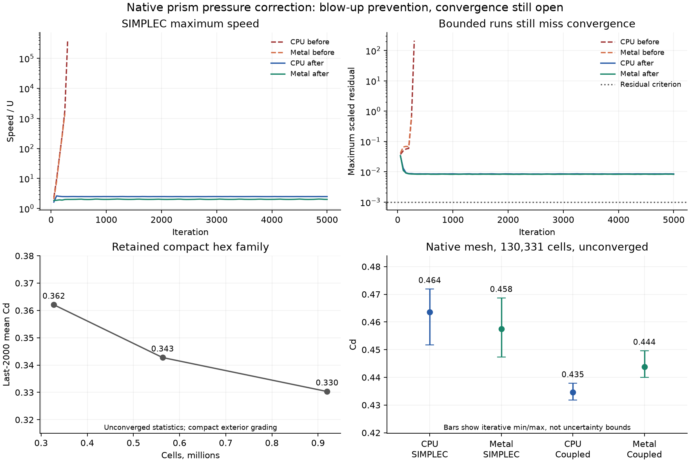

# Native tet/prism pressure robustness

The requested default convergence target is not established. A correction to
mixed-order pressure faces removes the reproduced Ahmed blow-up, but the
native mesh still misses the unchanged convergence criteria after 5,000
iterations. This is a stability recovery, not a converged drag result.

## Mesh and acceptance

The reproduction uses the retained native Ahmed 35-degree mesh, with 130,331
cells, 55,371 tetrahedra and 74,960 prisms. Its SHA-256 is
`95bc6d879ce9d6e25b56d499a327bd2710cd9778cc983697767dceb4fd624829`.
It uses the original exterior grading, refinement reach 3 m and wake padding
2 m. It is not the compact exterior used by the 0.33M/0.56M/0.92M hex family.

The settings are those of the retained drag study. SST, Re 2.78e6, U and rho
1, length 1.044 m, reference area 0.112032 m², turbulence intensity 1%,
viscosity ratio 1, second-order pressure, second-order upwind convection,
Standard limiter, uniform freestream initialization. SIMPLEC uses 0.7/1.0
momentum/pressure relaxation; Coupled uses its existing 0.5/0.5 defaults.
The cap remains 5,000 iterations. Acceptance requires every scaled residual
at most 1e-3 and both lift and drag changing by at most 5e-4 relative over
1,000 iterations. A bounded run which misses either condition is unconverged.
There is no wall-clock stopping criterion. Timings on the shared M4 Pro are
not performance measurements. One heavy solve ran at a time in this lane.

## Identified blow-up mechanism

The existing poor-cell treatment flags 2,709 cells at orthogonal quality
at most 0.05. At an interior face between a poor cell P and an unflagged cell N,
it replaces only P's second-order pressure reconstruction. The face still has

```
p_f = 0.5 * [p_P + p_N + grad(p_N) . (x_f - x_N)].
```

That leaves the poor cell's Green-Gauss pressure force exposed to N's
extrapolation error. On a prism formed by marching different vertex normals,
the nonuniform thickness shifts the volume centroid sideways. A face centroid
can then sit many layer heights from the centroid link. The remaining
extrapolation enters a large face area divided by a very small cell volume.
The poor-cell flag does not protect that pressure-force stencil.

The Metal reproduction matches the retained default run at the printed
precision, including its final 250-iteration monitor. After the impulsive
startup, persistent growth appears in underside prism layers near
x = -0.37436, y = 0.187, z = 0.05 m. It does not start at a prism–tet transition.
Input cell indices identify the same triangle through successive layers.
All indices here use Kutta's zero-based input order before RCM. For this
contiguous native file, the Fluent cell ID is one greater.
On Metal, the largest source at iteration 50 is cell 72668, on the opposite
underside side-edge band near x = -0.690 and y = -0.187 m. By iteration 60,
cell 76428 on the other band dominates. The CPU and Metal starts select
different early cells in the same unstable layer pattern.
Cells 76428, 80176 and 95168 occupy the sixth, seventh and eleventh prism
layers out of twenty, well inside the layer stack.

| Input cell index, zero-based | Orthogonal quality | Largest face extrapolation gain | Role |
| --- | ---: | ---: | --- |
| 76428 | 0.04157 | 77.29 | flagged; largest pressure-force source |
| 80176 | 0.05559 | 57.38 | unflagged neighbour across the order cutoff |
| 95168 | 0.16951 | 17.62 | fastest cell during late growth |

The gain is `sum_j |r_f . M^-1 w_j d_j|`, the amplification of neighbour
pressure differences in an LSQ face extrapolation. These are interior cells.
Their normal matrices are well-conditioned; cell 76428 has eigenvalues
about 1.153, 1.511 and 2.336. This is not a singular least-squares fit.
The Metal maximum speed rises from 2.05 U at iteration 50 to 7.98 at 100,
46.62 at 150, 255.77 at 200 and 1,442.27 at 250. Cell 95168 carries the last
three maxima. Changing only the mixed-order face pressure removes that growth
through 5,000 iterations. The gradient reconstruction, limiter, non-orthogonal
diffusion, wall distance and omega treatment remain unchanged.

The default CPU trace completes iteration 308 and rejects nonfinite input in
the SST omega solve on iteration 309. Metal reaches the same guard on
iteration 294. Equation-labelled diagnostic histories match their respective
original monitor histories exactly after excluding time. The omega solve is
the first rejecting equation; that does not identify wall treatment as the
cause of the much earlier pressure-force growth.
Cell 76428 first enters the five largest momentum-source cells
at iteration 33 and is the largest by iteration 40. At iteration 40 its normal
pressure acceleration is 21,171.5, against a total source of 21,076.0. The
pressure term dominates; the transpose-stress contribution is small there.
At iteration 100, cell 80176 has pressure acceleration 725,284 against total
source 637,452. These readbacks locate the growing equation term directly.
A separate CPU run monitored every iteration also fails at iteration 309.
The sampled histories differ after changing the force-sampling cadence, so
only the default-cadence trace is used for the cell and term attribution.

This isolates the pressure-force feedback. It does not isolate every source
of the initial gradient error or explain the remaining convergence defect.

## Correction

`fv_poor_pressure_interfaces` replaces the whole mixed-order interior face
pressure with `0.5 * (p_P + p_N)`. Both cell contributions are low order there.
The existing kernel still handles poor-cell sides and boundary pressures.
Faces with matching orders keep their previous bits. Prescribed pressure
boundaries and the Rhie-Chow jump are unchanged. Meshes with no poor cell
allocate no additional persistent storage and dispatch no additional kernel.

The Coupled pressure-force Jacobian drops its own-cell gradient term at an
interface with a poor neighbour too. This matches the corrected residual.
The old Jacobian change removed that term only when the current cell was poor.

[Fluent Theory Guide 23.4.1.1](https://ansyshelp.ansys.com/public/Views/Secured/corp/v242/en/flu_th/flu_th_sec_solver_pb_mom_eq.html)
defines the second-order central face reconstruction used by the unaffected
path, equation 23–43. The local reduction of order follows the approach in
[Fluent User's Guide 36.21.5](https://ansyshelp.ansys.com/public/Views/Secured/corp/v242/en/flu_ug/flu_ug_sec_solve_conv_stab.html).
Fluent does not document its poor-cell correction term by term. The shared-face
rule here is Kutta's correction to its incomplete stencil treatment, not a
claim to reproduce Fluent's undocumented implementation.

## Fast regression

`Poor prism pressure interfaces exclude amplified neighbour gradient noise`
builds two triangular prisms with varying vertex normals, without an external
fixture. Their orthogonal qualities are 0.02576 and 0.14059, on opposite sides
of the unchanged 0.05 cutoff. A unit tangential gradient error in the good cell
produces a normal pressure-force error greater than eight in the poor cell
through the old side-only correction. The complete face correction makes that
contribution exactly zero. The test also checks unchanged boundary pressures,
Rhie-Chow jumps and bit parity when both cells have the same order.
It passes 29 assertions on CPU and Metal. This is an operator regression for
the measured amplification mechanism; it is not a miniature end-to-end Ahmed
nonfinite solve.

## Unsuccessful controls

- Extending low-order cells by LSQ extrapolation gain above five marked 11,733
  cells, including ten far-field tetrahedra. It went nonfinite after the
  150-iteration monitor. Adding the shared-face correction to that expanded
  set also went nonfinite after 150. Neither change is retained.
- The shared-face correction alone prevents blow-up but exposes a far-field
  continuity plateau. One persistent maximum sits in original cell 51376,
  near x = 3.447, y = -0.843, z = 0.0766 m. Its absolute mass defect remains
  about 0.09. This is separate from the growing underside prism mode.
- Normal-foot pressure rows at every symmetry boundary reduce that far-field
  defect by roughly two orders of magnitude. With the face correction, the
  native Metal solve remains finite for 5,000 iterations, final Cd 0.42734
  and maximum residual 0.00251, but its forces still oscillate. The same row
  change alone makes a separate 936-cell seeded prism/tet case go nonfinite
  before iteration 20. Combined with the face correction, maximum speed on
  that case grows to about 3.5e12 by iteration 400. The original and
  shared-face-only versions stay bounded at about 1.012. The symmetry-row
  change is rejected and removed.
- A simple 936-cell graded prism layer with a tetrahedral cap converges on
  the original solver. It did not reproduce the Ahmed failure. It is not
  presented as an end-to-end regression.

- A temporary bound on the Rhie-Chow jump, keeping its sign and magnitude
  within the cell-pressure difference, does not resolve the 4,608-cell SST
  tet-channel stall. At 1,000 Coupled CPU iterations, raw continuity changes
  from 0.00831 to 0.00744 and remains unconverged. This experiment is not
  retained and was not promoted to a native-mesh solve.

The gain-five control does not reproduce Fluent's tangent-skewness metric.
[Fluent's beta documentation](https://ansyshelp.ansys.com/public/Views/Secured/corp/v242/en/fluent_beta_doc/flu_beta_chp_solver_tang.html)
provides a threshold of five for its own metric but no matching formula.
No drag value was used to choose a coefficient or acceptance threshold.

## Native convergence and drag

All four final-artifact runs use the unchanged default Standard limiter and
second-order pressure. A run reaching its iteration cap is not convergence.
The historical Coupled result in the Ahmed study used the differentiable
limiter, so it is not a matched before/default control.

| Scheme / backend | Iterations | Maximum scaled residual | Raw continuity | Relative lift / drag change | Converged |
| --- | ---: | ---: | ---: | ---: | --- |
| SIMPLEC CPU | 5,000 | 0.0084793 | 0.848619 | 0.016421 / 0.005059 | no |
| SIMPLEC Metal | 5,000 | 0.0082543 | 0.806871 | 0.091702 / 0.022426 | no |
| Coupled CPU | 5,000 | 0.125064 | 0.048040 | 0.026974 / 0.003837 | no |
| Coupled Metal | 5,000 | 0.156675 | 0.060182 | 0.047447 / 0.011700 | no |

Residual normalization is scheme-dependent. Raw continuity is included to
avoid interpreting the different normalized values as comparable rates.

| Mesh / run | Cells | Last-2,000 mean Cd | Iterative Cd range |
| --- | ---: | ---: | ---: |
| Native SIMPLEC CPU | 130,331 | 0.463528 | 0.451703–0.471880 |
| Native SIMPLEC Metal | 130,331 | 0.457524 | 0.447348–0.468657 |
| Native Coupled CPU | 130,331 | 0.434570 | 0.431805–0.437865 |
| Native Coupled Metal | 130,331 | 0.443770 | 0.439952–0.449581 |
| Retained hex L1 | 327,584 | 0.36207 | see original Ahmed report |
| Retained hex L2 | 563,140 | 0.34275 | see original Ahmed report |
| Retained hex L3 | 919,620 | 0.33032 | see original Ahmed report |

These are iteration statistics, not accepted drag predictions or uncertainty
bounds. The retained hex family also misses its force-window criterion.
Its compact exterior grading differs from this native mesh, so these values
are shown alongside each other without pooling them into a mesh trend.
Native backend/scheme differences remain material and unexplained.

Before the correction, default SIMPLEC rejects nonfinite omega input at
iteration 309 on CPU and 294 on Metal. Afterward, all four scheme/backend
combinations remain finite through 5,000 iterations. Every combination still
fails convergence. Final-run footprints range from 0.31 to 0.48 GB.



## Verification status

The implementation is commit `f0fa0724e49b867de717f7b55e908451fb409eeb`,
based on `c80ab8168df07b9b269c78284d50e0914ac9f178`. The measured source
and executable hashes are in `evidence/source.json`; the solver files stayed
unchanged throughout validation. Executable build stamps still name the base
commit, so the hash manifest identifies the correction actually measured.

The supplied completed main baseline contains 37 executed cases, 201,571
passing assertions and the expected 62 failures. Its immutable XML hash is
recorded in `evidence/baseline.json`.

The full quick tier passes, 278 tests and 7,457,621 assertions. No existing
threshold, reference, budget, skip or expected-failure marker changes.
Portability lint and `git diff --check` pass.

The focused existing y+ ~ 1 Ahmed hex guard also passes all eight assertions.
SIMPLEC finishes 2,000 iterations at Cd 0.354459, maximum residual 5.61e-6.
Coupled remains inside the unchanged force-agreement bounds. This exercises
the affected poor-cell path on the 446,364-cell hex fixture, with 2,127 flagged
cells. Full-tier and native results are recorded separately below.

Forty-iteration `kutta solve` runs of the Fluent mixing elbow with
`--approximate wfgc` are byte-identical to the base on CPU and Metal.
Both use the case's Coupled scheme. `fluxes.csv`, `forces.csv`, `loads.json`
and `result.vtu` match in full; `residuals.csv` matches after excluding its
`seconds_per_iteration` column. File hashes are in `evidence/elbow_parity.json`.

The full slow tier executes all 37 cases: 201,571 assertions pass and 62 fail,
with 31 passing and six failing cases, matching main. No existing gate is
changed. The supplied comparator reports zero outcome regressions, zero
recoveries and 31 changed expanded values. Its exit status is nevertheless
one: 266 assertions in two CLI cases have volatile process pointers, temporary
paths and printed timings inside their INFO identity. It labels those
identities missing/new, despite identical assertion counts and passing
outcomes. The raw result is retained in `evidence/slow_comparison_raw_summary.json`.

`compare_cli_context.py` supplements that result using the canonical reader
and comparator, normalizing only those volatile CLI context fields. It keeps
every expression, expanded value, residual, outcome and nonvolatile context.
All 201,633 identities then match: zero regressions, zero recoveries, zero
missing/new assertions or cases. Its complete output, including all 31
changed values and before/after values, is in
`evidence/slow_comparison_cli_context.json`. The canonical comparator itself
is unchanged; its raw nonzero status is not presented as a pass.

| Changed-value case | Changed expanded values | Outcome changes |
| --- | ---: | ---: |
| Standard Ahmed drag guard | 1 | 0 |
| Thin-layer Ahmed SIMPLEC/Coupled guard | 4 | 0 |
| V5 SST bump | 12 | 0 |
| V7 SA plate/bump | 14 | 0 |

The 62 retained failures remain V6 25, V2 tet 8, V5 plate 6, V5 bump 8,
V7 SA 14 and V12 fan 1. V2 tet accuracy and the Coupled tet-channel stall
are not recovered by this correction. No common cause with their remaining
failures has been established.

Every native solve has a measured peak footprint below 0.5 GB. The required
single-process full slow tier reports 2.92 GB maximum resident size and
5.50 GB peak footprint; it exceeded the requested approximate 3 GB footprint
limit despite `MallocSpaceEfficient=1`. These are resource readbacks, not
solver performance measurements.

Default convergence on this native mesh remains unresolved. A native
polyhedral external-aero case and CUDA runtime are unverified. Passing the
existing polyhedral slow cases does not establish that broader target.

## Reproduction

From `<checkout>`, with gmsh 4.15.2 and numpy installed in `build-py`:

```sh
cmake -S . -B build -G Ninja -DCMAKE_BUILD_TYPE=Release
cmake --build build
build-py/bin/python tools/fsae_aero/ahmed.py --slant 35 --level 1 \
  --first 1.5e-5 --refinement-reach 3 --wake-padding 2 \
  --cell-type tet-prism --out runs/tet_prism/mesh/native_L1.msh
MallocSpaceEfficient=1 build/bench_fsae_aero \
  --mesh runs/tet_prism/mesh/native_L1.msh --backend metal \
  --re 2.78e6 --length 1.044 --area 0.112032 --walls body --lift-z \
  --tu 0.01 --window 1000 --iterations 5000 --cells \
  --out runs/tet_prism/candidate_metal_simplec
# Repeat with --backend cpu. Add --coupled for the Coupled controls.
KUTTA_FLUENT_EXAMPLES="<reference-checkout>/validation/fluent_examples" \
KUTTA_RUNS="<reference-checkout>/runs" \
  build/kutta-tests --test-suite-exclude=slow
KUTTA_FLUENT_EXAMPLES="<reference-checkout>/validation/fluent_examples" \
KUTTA_RUNS="<reference-checkout>/runs" \
  build/kutta-tests -ts=slow -r=xml --success > runs/tet_prism/branch.xml
python3 tools/forensics/compare_slow_assertions.py \
  "<baseline>/slow.xml" runs/tet_prism/branch.xml > runs/tet_prism/comparison.json
python3 validation/results/tet_prism_robustness/compare_cli_context.py \
  "<baseline>/slow.xml" runs/tet_prism/branch.xml > runs/tet_prism/comparison_cli_context.json
python3 validation/results/tet_prism_robustness/analyze.py runs/tet_prism
```

Wait for the supplied baseline directory's `DONE` file before comparing.
The native mesh regenerates byte for byte after its first comment line. The
CLI writes `35.0` in that comment where the retained imported call wrote `35`.
The regenerated file hash is
`35cee20eaef0052a00b09b2dbabd199b19d26c58a22cb2a6d1d33c97d9f9424e`.
No mesh or restricted reference data is committed.
