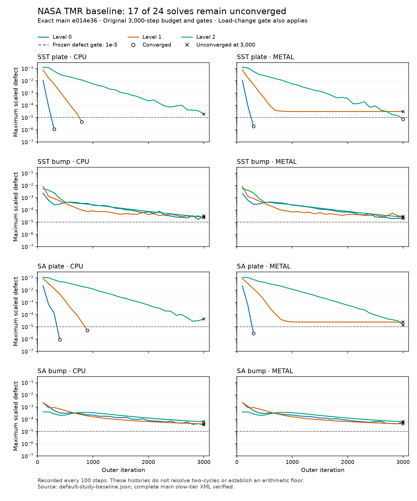

# NASA TMR convergence investigation

The rebased source completes all 37 slow cases and matches all 201,633 assertion
identities against main `8866cc0`. TMR failures fall from 28 to
17; total slow failures fall from 62 to 51.
There are 11 recoveries, zero regressions and zero missing or new
assertions. All four previously failing TMR accuracy assertions pass.
The remaining TMR failures are convergence gates; this matrix does not fully pass.

Quick validation passes 307 cases and 7,990,154 assertions. All six requested
40-iteration elbow case/backend pairs match main `271b31f` byte for byte across
five outputs. The standard-k-epsilon JumpCorrected opt-in also matches main on
CPU and Metal in exported cell fields and wall diagnostics.

## 2026-11-06: six defaults qualified after owner pause

The six-control candidate now qualifies on all slow-tier gate outcomes and
is promoted. Momentum and pressure absolute tolerances become `1e-20`.
SST and SA default to compensated scalar transport, no scalar pseudo-time,
steady inner tolerance `1e-6` and scalar absolute tolerance `1e-20`. Both TMR
setups now inherit these values. Momentum compensation, slack 16 and the
bump time step remain opt-in because their studies regressed other gates.

The complete comparison has zero regressions, zero recoveries and 264 changed
values, with 76 missing/new passing INFO identities. All 201,633 assertions
and all 37 case counts remain present; the 51 known failures, including all
17 TMR convergence failures, remain. The comparator retains its nonzero exit
for the identity gaps. The joint cost includes a measured 26.6% ordinary SA
Metal time penalty. The detailed audit and cost ranges appear below.

The owner stopped the active selected-default qualification with SIGSTOP on
November 4 at 17:48 PST and continued it on November 6 at about 09:33 PST.
The Mac did not reboot during this pause; both sides ran on macOS 27.2
(Darwin 27.2.0). This pause is separate from the earlier OS migration and its
reproduction controls documented below.

The isolated runner retained its solver state and advanced from case 21 to
case 22 after continuation. Case 21 completed with all 14 assertions passing.
The candidate source and binary hashes still match the frozen qualification
plan. No second solve was started. Case 21's elapsed time and the whole-run
elapsed span include about 40 hours of pause; neither is used as a timing or
iteration-cost figure. The earlier alternating cost pairs were completed on
the same OS before this pause and remain separate measurements.

The outer qualification driver exited, while the isolated runner and its
per-case footprint guard remained alive. Its lost whole-run wait status will
not be represented as an observed exit code. The completed shard receipts and
unchanged canonical comparator will determine the numerical comparison.
The completed qualification and decision are detailed below. No convergence
fix is established by this default promotion.

## Protocol and provenance

The original baseline is main `8866cc0e16df5b0642b2243611099ddccd7f3cd3`.
The branch is rebased onto `271b31f7a96bbbc39eda3dd59721c9667d51ff46`.
The final numerical source and validation revision is
`96d8b34615f88b28fb5db2cefe45baad13cb4446`. It adds the paired poor-interface integration
correction after the derivative correction in `355e80b`. The concluding commit updates evidence
only. Binary and XML hashes below bind the completed run to this source.

The machine is an Apple M4 Pro with 24 GB unified memory. CPU is the serial
reference backend and Metal uses the actual GPU. One heavy solve ran at a time.
Shared-machine wall times are not performance evidence.

Every NASA grid/backend keeps its 3,000-step outer budget. Uniform initialization,
meshes, freestream data, turbulence formulations, first-order turbulence
advection, second-order momentum/pressure reconstruction, boundaries,
reference values, and all convergence/accuracy gates are retained. No
reference field seeds a run. No assertion is removed, weakened or skipped.

The completed coordinator baseline on exact main supplies all 24 target
solves, each at 3,000 steps. This lane also ran a partial exact-main target
reproduction before that full baseline became available. None converged. The
full baseline has 28 failing target assertions: 24 convergence and four
aft-bump Cf accuracy assertions. Every failure is enumerated below.
All `failure.empty()`, finite-value and load-availability assertions pass;
there is no reproduced coarse-grid divergence on starting main `8866cc0`.

| Model/case | Backend | Level | Continuity | Largest transport defect | Load change | Classification of failed convergence assertion |
| --- | --- | ---: | ---: | ---: | ---: | --- |
| SST plate | cpu | 0 | 0.0001487815 | 3.478709e-07 | 2.61297e-07 | Continuity floor; loads settled |
| SST plate | cpu | 1 | 0.0004876112 | 1.48377e-07 | 7.114497e-08 | Continuity floor; loads settled |
| SST plate | cpu | 2 | 0.007514194 | 8.368414e-08 | 7.325466e-07 | Continuity floor; loads settled |
| SST plate | metal | 0 | 0.0001835793 | 3.384738e-07 | 4.203027e-07 | Continuity floor; loads settled |
| SST plate | metal | 1 | 0.0004031023 | 1.404783e-07 | 0 | Continuity floor; loads settled |
| SST plate | metal | 2 | 0.005696822 | 8.21644e-08 | 1.662186e-06 | Continuity floor; loads settled |
| SST bump | cpu | 0 | 2.269245e-05 | 0.000208247 (progress maximum) | 0.0002074413 | Continuity and turbulence plateau |
| SST bump | cpu | 1 | 1.549432e-05 | 3.567575e-05 (progress maximum) | 0.0001271153 | Continuity and turbulence plateau |
| SST bump | cpu | 2 | 1.654531e-05 | 0.0001197847 (progress maximum) | 0.0123655 | Slow convergence: loads and transport unresolved |
| SST bump | metal | 0 | 3.513322e-05 | 0.0002082479 (progress maximum) | 9.510323e-05 | Continuity and turbulence plateau |
| SST bump | metal | 1 | 2.633376e-05 | 3.56816e-05 (progress maximum) | 0.0001055961 | Continuity and turbulence plateau |
| SST bump | metal | 2 | 1.397719e-05 | 0.0001197803 (progress maximum) | 0.01236376 | Slow convergence: loads and transport unresolved |
| SA plate | cpu | 0 | 0.0002559519 | 8.825898e-06 | 4.60888e-07 | Continuity floor; loads settled |
| SA plate | cpu | 1 | 0.0006237517 | 9.858658e-06 | 3.406633e-08 | Continuity floor; loads settled |
| SA plate | cpu | 2 | 0.006870226 | 6.943274e-06 | 4.694171e-06 | Continuity floor; loads settled |
| SA plate | metal | 0 | 0.0003023776 | 7.153247e-06 | 1.539584e-07 | Continuity floor; loads settled |
| SA plate | metal | 1 | 0.0004093038 | 9.564456e-06 | 1.105921e-07 | Continuity floor; loads settled |
| SA plate | metal | 2 | 0.005286517 | 6.710996e-06 | 5.631781e-06 | Continuity floor; loads settled |
| SA bump | cpu | 0 | 3.560498e-05 | 0.0007388555 | 0.0003563521 | Continuity and turbulence plateau |
| SA bump | cpu | 1 | 1.393743e-05 | 0.0002499332 | 0.0001048261 | Continuity and turbulence plateau |
| SA bump | cpu | 2 | 2.786607e-05 | 0.0002351986 | 0.01228497 | Slow convergence: loads and transport unresolved |
| SA bump | metal | 0 | 3.013505e-05 | 0.0007388047 | 0.0007059305 | Continuity and turbulence plateau |
| SA bump | metal | 1 | 2.966741e-05 | 0.0002499212 | 0.00013187 | Continuity and turbulence plateau |
| SA bump | metal | 2 | 1.204483e-05 | 0.0002351449 | 0.01228709 | Slow convergence: loads and transport unresolved |

For SST bump, the CPU maximum transport/progress defects at levels 0/1/2
are approximately 2.08247e-4 / 3.56757e-5 / 1.19785e-4. The fine-grid
load change is about 1.24%, exceeding 0.1%. These runs combine a residual
plateau with incomplete load convergence; the mechanism of each plateau
has not been isolated. A continuity floor is observed, but its entire cause
is not established.

| Additional failing accuracy assertion | Before relative Cf error | Frozen maximum | Classification |
| --- | ---: | ---: | --- |
| SST bump, CPU, level 2, x=0.8678025 | 0.145326 | 0.10 | Accuracy on an unconverged field |
| SST bump, Metal, level 2, x=0.8678025 | 0.145348 | 0.10 | Accuracy on an unconverged field |
| SA bump, CPU, level 2, x=0.8678025 | 0.149930 | 0.10 | Accuracy on an unconverged field |
| SA bump, Metal, level 2, x=0.8678025 | 0.149882 | 0.10 | Accuracy on an unconverged field |

All other target Cf, CD, Cp and three-grid-trend assertions pass on main.
Passing accuracy at an unconverged endpoint is not verification acceptance.

## Retained changes

`SolverSettings::compensated_momentum` preserves the momentum RHS sum/product
remainders, the under-relaxation subtraction remainder, and the difference
between the physical diagonal sum and its positive upward-rounded matrix
coefficient. The paired defect uses these low words. The stored positive
linear operator stays unchanged. The same option computes the existing
bounded Rhie-Chow pressure jump after cancelling the common cell pressure,
rather than subtracting two already-rounded reconstructed traces.

The option defaults off. `paired_state_slack_ulps` defaults to the previous
one feeding-scale epsilon. The SST and SA TMR setups opt into compensation,
16-epsilon high-word hysteresis, and momentum/pressure inner absolute
tolerances of `1e-20`. Relative tolerances and linear iteration limits stay
unchanged. The hysteresis retains low-word corrections while allowing the
high-word nonlinear coefficients to settle. It is a numerical setting, not
a change to the outer residual gate. Other case setups keep their prior
settings. The bump setup uses fixed flow pseudo-time .1 and momentum
relaxation .7, compared with .01 and .5 on main; pressure relaxation remains
.3. These change the iteration, not the steady spatial equation.

The precision path also evaluates the same low-word pressure, velocity,
projected/secondary diffusion, deferred advection, transpose-stress and wall
operators as the high word. Flux normalization retains products between
low flux and low velocity. Physical low-state reaction is evaluated directly,
instead of subtracting two large rounded pseudo-time products. Green–Gauss
force accumulation carries the high-word product/sum errors as well as low
face pressures. Prescribed low boundary values are zero; symmetry projects
the low velocity. Normal backflow selects its direction from the physical flux sign
and its incremental speed from the low flux. The compensated flux high word
is rebased when necessary to preserve that sign.

Two later checks corrected the nonlinear limiter treatment. An intermediate
full-low-word prototype bounded the high and low projected face fields
independently. With high reconstruction 1.5 inside [1,2], and a cloud low
perturbation 2^-20, it returned a low increment 2^-20 instead of the correct
4*2^-20. The complete reconstruction stays inside [1,2]; clipping its
increment loses 2.86102295e-6. `momentum_increment` now bounds the total pair
and subtracts the high reconstruction. Walk-cloud extrema retain point
identities, including prescribed boundary points, so an active bound carries
the low word of the actual extremum.

The cell limiter also used paired extrema with only the high gradient.
A local extremum carried entirely in the low gradient incorrectly received
limiter 1 instead of 0. The precision path now uses both gradients and the
actual low boundary observations. This includes projected symmetry data,
which need not equal the owner's low component. Both fixes leave the
legacy/default path unchanged. The new focused checks pass on CPU and Metal;
the walk predictor differs from reconstructing a representable total field
by at most 3.05532e-7 in the checked mesh.

The pressure least-squares reduction now carries both state words and the
sum/product errors through the same geometry rows. Independent float fits
of the two words lose the high fit's error. A cancellation check with a true
gradient 2^-40 fails that old arithmetic; the paired fit retains 2^-40 under
two equivalent state partitions. Canonical full face pressures retain curvature
2^-31 below a common pressure of one. Neumann boundary low traces also carry
the high trace's rounding remainder. This is an operator consistency fix;
fixed-velocity boundary fluxes ignore that pressure jump, so the boundary
trace correction did not change the measured TMR runs by itself.

Rhie–Chow accumulation now combines both face velocity words with carried
products and sums, and cancels full pressure pairs before rounding the small
pressure curvature. Previously, separately rounded high and low fluxes omitted
the high dot-product remainder. The native counterexample 1 + 2^-25 - 1
loses 2^-25 in the old float reduction and retains it in the corrected flux.
The coefficient and boundary flux policies stay the same.

Nonlinear turbulence rates, scalar mass fluxes and viscous forces in this
option read the physical velocity/flux pair independently of its held high
word. Velocity values round once for wall data. Velocity derivatives now
apply the existing least-squares and SST face-jump operators to both state
words before rounding the final derivative to float32. The constitutive
kernels and their outputs remain float32.

An intermediate version rounded the velocity pair before differentiating it.
That erased a physical derivative 2^-27 in the native affine-field check.
The corrected derivative retains 2^-27 under two equivalent state partitions
on CPU and Metal. The SST face-jump correction uses the same full traces;
its geometric rows and reconstruction order are unchanged. SIMPLEC's
compensated pressure update normalizes overlapping words before applying
local pressure hysteresis. An isolated pressure 2^-43 with a correction
2^-60 is retained instead of lost under a global feeding-scale slack.
Velocity and flux keep feeding-scale hysteresis. Coupled retains its prior
pressure-update policy; the final TMR driver uses SIMPLEC.

Scalar transport can opt into a compensated delta solve. TMR enables it,
omits scalar pseudo-time damping, lowers scalar absolute tolerance to
1e-20, and checks an inner physical L1 defect tolerance of 1e-6. This is ten
times below the unchanged outer 1e-5 gate. The source is re-evaluated at
every solve, so a previously settled component resumes when coupling changes
its equation. Fixed wall omega values are imposed before and after the
increment solve. Outer monitors use the carried physical equation.

Independent arithmetic checks in
[`test_paired_precision.cpp`](../../../tests/fv/test_paired_precision.cpp)
cover the following failures. The focused final run passes 23 cases / 470
assertions across CPU and Metal, including the independent SA correction and
the unchanged legacy SA equation oracle. These checks establish local
arithmetic behavior; the full matrix determines whether a flow passes.

| Reproduction | Before | After |
| --- | --- | --- |
| Steady source 0.125-q, pseudo-time diagonal eight orders larger, q=1 | Physical defect -0.875 erased | Error below 1e-8 at all three checked q values |
| Constant diffusion field, face coefficients 1, 1e-8, 1e-12 | False defect 4.36837e-7 | Defect below 1e-12; stored matrix identical |
| Pressure curvature with gauge offset 0 or 1 | True -2^-31 erased at offset 1 | Both jumps within 1e-14 of -2^-31 |
| Constant advected/diffused boundary field | Boundary factor/product carry lost | Defect below 1e-12 |
| Opposing integrated source and volume product | Remainder erased or counted twice in an intermediate candidate | Source and equal source/sink cancellation retained |
| Flux increment 2^-10, scalar increment 2^-20 | Missing physical product 9.31323e-10 | Expected total-flux advection within 1e-13 |
| Low-state reaction +/-2^-19 under strong pseudo-time | Physical reaction rounded to zero | Both defects within 1e-13 of the reaction |
| Uniform-pressure face sum with areas 1, 2^-25, -1, -2^-25 | High reduction leaves false -2^-25 | Carried force cancels it |
| Normal backflow, high flux -1, low flux 2^-20, area 2 | High speed -0.5 incorrectly enters low data | Incremental speed +2^-21 |
| Low projected perturbation inside the total bounds | Increment clipped from 4*2^-20 to 2^-20 | Full increment retained; active total bounds retain their own low word |
| Extremum carried only by the low gradient | Limiter 1 permits an undershoot | Limiter 0; actual low boundary observations retained |
| Scalar already below inner tolerance; then change its source | Repeated roundoff chasing | Initial hold, followed by a real solve when source changes |

## Integrated TMR measurements

These are the complete final integrated results, compared with the original
`8866cc0` baseline. Main's poor-cell correction is included in the final source,
so bump differences combine that change with this lane's retained changes.
No final field shift is attributed to an individual fix without an isolating
experiment.

| Model/case | Backend | Level | Converged before -> after | Steps after | Continuity before -> after | Maximum defect before -> after |
| --- | --- | ---: | --- | ---: | --- | --- |
| SST plate | cpu | 0 | False -> True | 300 | 0.0001487815 -> 1.086581e-06 | 0.0001487815 -> 1.086581e-06 |
| SST plate | cpu | 1 | False -> True | 800 | 0.0004876112 -> 4.278579e-06 | 0.0004876112 -> 4.278579e-06 |
| SST plate | cpu | 2 | False -> False | 3000 | 0.007514194 -> 1.90981e-05 | 0.007514194 -> 1.90981e-05 |
| SST plate | metal | 0 | False -> True | 300 | 0.0001835793 -> 1.86489e-06 | 0.0001835793 -> 1.86489e-06 |
| SST plate | metal | 1 | False -> False | 3000 | 0.0004031023 -> 3.045154e-05 | 0.0004031023 -> 3.045154e-05 |
| SST plate | metal | 2 | False -> True | 3000 | 0.005696822 -> 7.407654e-06 | 0.005696822 -> 7.407654e-06 |
| SST bump | cpu | 0 | False -> False | 3000 | 2.269245e-05 -> 3.143857e-05 | 0.000208247 -> 3.143857e-05 |
| SST bump | cpu | 1 | False -> False | 3000 | 1.549432e-05 -> 2.308443e-05 | 3.567575e-05 -> 2.308443e-05 |
| SST bump | cpu | 2 | False -> False | 3000 | 1.654531e-05 -> 1.210993e-05 | 0.0001197847 -> 2.573423e-05 |
| SST bump | metal | 0 | False -> False | 3000 | 3.513322e-05 -> 1.51518e-05 | 0.0002082479 -> 1.991881e-05 |
| SST bump | metal | 1 | False -> False | 3000 | 2.633376e-05 -> 2.81366e-05 | 3.56816e-05 -> 2.81366e-05 |
| SST bump | metal | 2 | False -> False | 3000 | 1.397719e-05 -> 1.08788e-05 | 0.0001197803 -> 2.572706e-05 |
| SA plate | cpu | 0 | False -> True | 400 | 0.0002559519 -> 4.356717e-08 | 0.0002559519 -> 9.231233e-07 |
| SA plate | cpu | 1 | False -> True | 900 | 0.0006237517 -> 4.993192e-06 | 0.0006237517 -> 4.993192e-06 |
| SA plate | cpu | 2 | False -> False | 3000 | 0.006870226 -> 4.282008e-05 | 0.006870226 -> 4.282008e-05 |
| SA plate | metal | 0 | False -> True | 300 | 0.0003023776 -> 2.887325e-06 | 0.0003023776 -> 2.887325e-06 |
| SA plate | metal | 1 | False -> False | 3000 | 0.0004093038 -> 2.417789e-05 | 0.0004093038 -> 2.417789e-05 |
| SA plate | metal | 2 | False -> False | 3000 | 0.005286517 -> 1.397759e-05 | 0.005286517 -> 1.397759e-05 |
| SA bump | cpu | 0 | False -> False | 3000 | 3.560498e-05 -> 3.439757e-05 | 0.0007388555 -> 3.439757e-05 |
| SA bump | cpu | 1 | False -> False | 3000 | 1.393743e-05 -> 2.368411e-05 | 0.0002499332 -> 4.124983e-05 |
| SA bump | cpu | 2 | False -> False | 3000 | 2.786607e-05 -> 7.859322e-06 | 0.0002351986 -> 6.128235e-05 |
| SA bump | metal | 0 | False -> False | 3000 | 3.013505e-05 -> 5.78428e-05 | 0.0007388047 -> 5.78428e-05 |
| SA bump | metal | 1 | False -> False | 3000 | 2.966741e-05 -> 2.251525e-05 | 0.0002499212 -> 4.124282e-05 |
| SA bump | metal | 2 | False -> False | 3000 | 1.204483e-05 -> 1.033504e-05 | 0.0002351449 -> 6.129666e-05 |

| SST plate raw continuity | Level | Before | After |
| --- | ---: | ---: | ---: |
| cpu | 0 | 2.726211e-08 | 1.989631e-10 |
| cpu | 1 | 1.33167e-08 | 1.16349e-10 |
| cpu | 2 | 3.258206e-08 | 8.092247e-11 |
| metal | 0 | 3.363881e-08 | 3.414859e-10 |
| metal | 1 | 1.100876e-08 | 8.280803e-10 |
| metal | 2 | 2.470181e-08 | 3.138772e-11 |

The full slow driver prints raw continuity for SST plates only. Unprinted raw
values are not inferred from separate representative probes. Complete public
station values and printed transport defects are in [`measurements.json`](measurements.json).

| Plate Cf | Backend | Before | After |
| --- | --- | ---: | ---: |
| SST | cpu | 0.002713813 | 0.002713727 |
| SST | metal | 0.002713817 | 0.002713699 |
| SA | cpu | 0.002726861 | 0.002727054 |
| SA | metal | 0.002726862 | 0.002727054 |

| Plate CD | Backend | Before | After |
| --- | --- | ---: | ---: |
| SST | cpu | 0.002876909 | 0.002876801 |
| SST | metal | 0.002876906 | 0.002876764 |
| SA | cpu | 0.002880514 | 0.002880676 |
| SA | metal | 0.00288051 | 0.002880676 |

| Bump aft Cf | Backend | Before | After |
| --- | --- | ---: | ---: |
| SST | cpu | 0.00298066 | 0.002553902 |
| SST | metal | 0.002980718 | 0.002553883 |
| SA | cpu | 0.003079214 | 0.002638858 |
| SA | metal | 0.003079086 | 0.002638848 |

| Finest bump aft Cf relative error | Backend | Before | After | Frozen limit |
| --- | --- | ---: | ---: | ---: |
| SST | cpu | 0.1453259 | 0.01865692 | 0.10 |
| SST | metal | 0.1453479 | 0.01866434 | 0.10 |
| SA | cpu | 0.1499296 | 0.01452083 | 0.10 |
| SA | metal | 0.149882 | 0.01452457 | 0.10 |

## Rebase and compatibility

The conflict in `update_turbulence()` was resolved around main's shared
`reconstruct_strain()`. For compensated flow, velocity derivatives and the
jump correction are formed from both state words before rounding. SST and
standard k-epsilon JumpCorrected use that same helper. Other standard k-epsilon
and SA paths consume `model_gradient()`; constitutive velocities, boundary
velocities and mass fluxes use their corresponding model accessors. When
compensated momentum is disabled, those accessors return main's original
buffers and reconstruction follows main's original operators.

The normal-foot pressure option and its gradient configuration guards from
main are retained; the TMR setup keeps the default extrapolated mode.
Main's harmonic-k transition setting and SST molecular omega-production
parameter are also preserved through the existing settings copies. TMR keeps
harmonic k disabled and the molecular ratio zero; no new model option is
enabled by this lane.
The standard k-epsilon opt-in branch, its variant/LSQ guards, the Péclet option,
poor-pressure-interface correction and main's performance caches are retained.
The duplicate comparator commit `6a74dc5` was dropped. The comparison uses
main's `tools/forensics/compare_slow_assertions.py` unchanged, including its
existing CLI-context normalization from `971fbb3`.

| Original SHA | On d8e26c7 | On 05ef218 | Final SHA on 271b31f | Change |
| --- | --- | --- | --- | --- |
| `deb6781` | `948993f` | `42b0137` | `7738484` | Preserve momentum assembly remainders in paired solves |
| `6c7c9e9` | `6eaa7f5` | `c26a3fd` | `a6bbb99` | Use compensated paired precision in NASA TMR cases |
| `4bfb039` | `75a597f` | `2d7d9ee` | `6344a69` | Carry boundary and source products consistently in paired assembly |
| `9479942` | `8faea41` | `aa9f521` | `2599c39` | Keep TMR SA production separate from the strain safeguard |
| `180c717` | `60afafb` | `921a0ce` | `3497c70` | Carry consistent low-word flow operators and scalar defects |
| `a789dc2` | `b2aef1d` | `d5809d7` | `60dd9f4` | Use physical scalar stopping in NASA TMR solves |
| `a5e8067` | `d594855` | `06899e8` | `dbf8dde` | Bound paired face predictors using the complete field |
| `3cac7f0` | `4a9067c` | `09a1464` | `577fdce` | Limit paired gradients with their low-word boundary observations |
| `b62295c` | `72984a2` | `fcb8f65` | `7f4a55e` | Carry complete paired pressure traces into momentum forces |
| `86a665a` | `c4d1461` | `a55bda8` | `1645a31` | Keep compensated flow operators consistent with the physical pair |
| `6a74dc5` | dropped | dropped | main supplies normalization | Normalize transient CLI context in slow assertion comparisons |
| `d823d6e` | `9bc07c2` | `6506725` | `355e80b` | Take constitutive velocity derivatives before rounding paired state |
| `8bbebfb` | `a50d195` | `681b728` | `8ea334f` | Record TMR convergence results and interrupted final validation |
| new integration fix | `4cf62d9` | `4a0050a` | `96d8b34` | Preserve poor-interface pressure correction in paired reconstruction |

The integration fix, `96d8b34` (previously `4cf62d9` and `4a0050a`), carries main's poor-interface rule into
the compensated pressure-face operator. The paired reconstruction previously
rebuilt face pressure after the default correction and retained the good
cell's extrapolation at a mixed interface. An isolated check produced 0.75
or 1.625 instead of the required 1.5 on CPU and Metal: eight assertions
failed. The corrected operator omits both extrapolations and preserves the
low-word cell mean; all eight assertions pass without changing an existing
expected value or threshold. The first rebased slow attempt was stopped
after this gap was found, and the final complete run was restarted on the
corrected source. The intermediate `4cf62d9` attempt was then stopped when
the requested main moved to `05ef218`. Both partial XML files are excluded
from acceptance evidence. The subsequent `4a0050a` run was also stopped
when the requested main moved to `271b31f`. A subsequent turn interruption
terminated the first `96d8b34` attempt; all 37 cases were restarted on its
unchanged source and binary. Only the complete final run is compared.

The requested CLI checks used the same 40-step budget, initialization,
approximations and allocator for both binaries. They compared `fluxes.csv`,
`forces.csv`, `loads.json` and `result.vtu` in full. For `residuals.csv`, only
`#` comment lines and the `seconds_per_iteration` column were excluded; the
last recorded iteration was checked to be 40.

| CLI case | Approximation | CPU | Metal |
| --- | --- | --- | --- |
| mixing_elbow | `wfgc` | all five outputs identical | all five outputs identical |
| elbow_param | `compressibility,ke-options` | all five outputs identical | all five outputs identical |
| mixing_elbow converted to SIMPLEC | `wfgc` | all five outputs identical | all five outputs identical |

The SIMPLEC conversion used `kutta convert --setup` with
`{"v":1,"overrides":{"methods/pressure-velocity-coupling":"simplec"}}`.
The separate opt-in check used `bench_elbow_turbulence`, cold initialization,
40 iterations and `jump` on elbow_param. `cells.csv` and `walls.csv` match main
on each backend, including strain, production and wall quantities.
All 30 final output hashes also match the archived 40-step `d8e26c7`
reference outputs, using the same residual normalization. This preserves the
original reference comparison alongside the fresh `271b31f` comparison.
Binary and output hashes are in [`elbow-parity.json`](elbow-parity.json).

## SA definition audit

The frozen [plate](https://tmbwg.github.io/turbmodels/flatplate_sa.html)
and [bump](https://tmbwg.github.io/turbmodels/bump_sa.html) datasets specify
standard SA with ft2, as recorded in the pinned
[fixture manifest](../../data/nasa_tmr/SOURCE.md). [TMR](https://tmbwg.github.io/turbmodels/spalart.html)
recommends SA-neg for robustness. Kutta clips nu-tilde at zero and lacks
SA-neg's negative branch. SA-neg normally uses Note 1(c); Kutta's reported
TMR safeguard is Note 1(b). The production safeguard error described below was corrected explicitly; ft2
and the reference variant remain unchanged.

| Term or condition | Current implementation and source |
| --- | --- |
| Eddy viscosity | rho nu-tilde fv1; chi=nu-tilde/nu, cv1=7.1 (`sa_coefficients`) |
| Production | cb1 (1-ft2) S-tilde nu-tilde; vorticity base with the fv2 correction |
| Destruction | [cw1 fw - cb1 ft2/kappa^2] (nu-tilde/d)^2; cw1 derived from cb1, cb2, sigma and kappa |
| Diffusion | div[(mu+rho nu-tilde)/sigma grad(nu-tilde)], plus rho cb2/sigma times the squared gradient |
| Damping | TMR ft2=1.2 exp(-0.5 chi^2); Fluent formulation omits ft2 |
| Safeguards | TMR Note 1(b), S-tilde at least 0.3 Omega, and r at most 10; the published production rate remains unclipped in the TMR setup |
| Wall and inflow | nu-tilde=0 at resolved walls; freestream nu-tilde=3 nu; geometric nearest-wall distance |
| Source linearization | Full local negative derivative is implicit with a compensating explicit term; net reaction source is unchanged |

An isolated positive-nu-tilde state with negative raw modified strain
exposed a model error: the Note 1(b) denominator safeguard was also applied
to production. The [TMR definition](https://tmbwg.github.io/turbmodels/spalart.html)
and [NASA CFL3D source at 776d5169](https://github.com/nasa/CFL3D/blob/776d5169f34d26ae65701c87038e63b125b7d86a/source/cfl3d/libs/spalart.F#L1380)
retain raw modified strain in production while safeguarding r. Kutta now
separates those quantities and their local derivatives. This is not evidence
that the downloaded historical CFL3D reference used the same optional r
safeguard; the current source's standard branch uses Note 1(a).

The lane first kept the clipped production behind a compatibility option.
At integration the option was removed: every `TmrStandard` SA solve now uses
the published form, and the legacy equation oracle in `tests/turbulence/test_sa.cpp`
was corrected to match. Fluent's existing form is unaffected. The independent test uses
nu-tilde=.003, nu=.001, wall distance=.1 and Omega=1. Before the correction,
the production-rate error was 1.9385 and the net reaction error 7.77496e-4.
Four assertions failed across CPU/Metal. The corrected form passes all eight
assertions, including nonnegative explicit production and implicit sink.
This proves the equation correction. The final field comparison combines
precision and iteration changes, so its load shifts are not attributed to
this production correction alone. The legacy equation oracle remains unchanged.

Fluent Theory Guide 2026 R1 sections 4.2.2 (4-15), 4.2.3 (4-16 to 4-18),
4.2.4 (4-19 to 4-25), 4.2.5 (4-26 to 4-29), 4.2.6 and 4.2.7
were checked against the implementation. The transport, production and destruction
SVG equations were downloaded and rendered because the text view omits their
mathematics. Fluent production and destruction omit ft2; the TMR branch
adds it explicitly. The automatic-wall blend described in section 4.2.7
is distinct from these resolved-wall TMR runs.

Resolved-wall, inlet and backflow data were checked against the setup. The
low-word boundary operator used zero prescribed low inlet/wall
values, homogeneous pressure-correction data and projected symmetry velocity.
It did not establish boundary treatment as the cause of the remaining plateau.

The existing independent double-equation test covers both legacy configured forms,
source splitting, boundary data and CPU/Metal parity. Passing that constitutive
test alone does not establish converged flow verification. Fluent automatic
walls remain unavailable; resolved molecular walls are used here.

Sources: [TMR SA equations and variants](https://tmbwg.github.io/turbmodels/spalart.html),
[TMR plate SA reference](https://tmbwg.github.io/turbmodels/flatplate_sa.html),
[TMR bump SA reference](https://tmbwg.github.io/turbmodels/bump_sa.html),
[Fluent Theory Guide 2026 R1, section 4.2.4, production](https://ansyshelp.ansys.com/public/Views/Secured/corp/v261/en/flu_th/flu_th_sec_spal_turb_prod.html).
The Fluent formula contract and its other section citations are in
[`car_models.md`](../../../src/kutta/fv/turbulence/car_models.md).

## What did not work

These isolating experiments predate the rebase. Their numbers belong to the
configurations named here; the integrated matrix above is the final evidence.

Each exploratory solve used at most 3,000 outer steps. Intermediate variants
below are not the final solver. The retained operators and TMR controls are described above. Earlier
prototype numbers below are diagnostics, not final acceptance.

| Isolating experiment | Observed result |
| --- | --- |
| Lower momentum or pressure absolute tolerances alone | CPU coarse SST plate still failed; continuity 6.8803e-5 or 1.48553e-4. Lowering both gave 2.81011e-4. |
| Wider high-word hysteresis alone | 16 epsilons passed coarse CPU plate at 400 steps, continuity 3.49234e-6; middle/fine still failed at 5.74774e-5 / 2.5566e-3. 256 epsilons still failed the middle grid at 3.30734e-5. |
| Freeze turbulence after step 1000 | Middle CPU plate still failed, continuity 7.99189e-5. |
| Freeze all flow high words after step 1000 | Middle plate reached 2.92726e-6 at 1100. Freezing velocity, pressure or flux alone still failed. This was diagnostic instrumentation, removed. It is not an accepted solution. |
| Consistent low pressure, face-velocity, diffusion, advection, transpose-stress and wall terms | Fine CPU plate continuity improved from about 3.1e-3 with the earlier compensated-RHS prototype to 4.38298e-5; still above 1e-5. Adding the physical-diagonal remainder gave 3.01106e-5. That early prototype was discarded; the corrected low-word operators above were rebuilt and retained. |
| Tighter relative momentum, pressure and scalar solves with that full reconstruction | Fine CPU plate remained at 3.01642e-5. Coarse bump retained k near 2.09e-4. |
| Increase bump pseudo-time step from .01 to .05 alone | Coarse k improved to 6.38385e-5 but continuity was 8.688e-5. Fine Metal bump still had continuity 1.59196e-5, load change .0118142 and aft Cf .002941025. |
| Existing differentiable limiter | Coarse CPU plate continuity 1.65420e-4. With bump dt=.05 and momentum relaxation .7, continuity 2.32530e-5, k 1.45272e-5 and omega 1.31402e-5; still failed. Coupled bump also failed. No limiter change retained. |
| Coupled plus full paired reconstruction | Fine CPU plate passed at 600 with continuity 2.56369e-6, but coarse plate failed at 3.44269e-5. |
| Component steady stopping at 1e-7 with Coupled/full reconstruction | Coarse CPU plate passed at 300 with continuity 3.05581e-7, but middle plate remained at 1.33269e-5. Coarse bump developed a bounded limit cycle, continuity 2.4946 and load change 14.247 at 3000. Removed. |
| Tighter Coupled block solve | Middle plate continuity worsened to about 8.74e-5; tighter linear termination did not remove the nonlinear plateau. |
| Compensated scalar increments plus component stopping | Coarse SA plate passed in 200 (continuity 2.81086e-6); middle SST plate still failed at 1.08169e-5. Fine Metal SST plate passed in 600 (1.59899e-6), but this was not a passing common configuration. The final configuration uses a different inner stopping tolerance. |
| Disable scalar pseudo-time, retaining the full prototype | Coarse CPU bump at 3000 still failed: continuity 2.84891e-5, k 8.75590e-6, omega 2.08179e-5. This alone was insufficient. |

The final arithmetic path was also tested separately from those earlier
prototypes:

| Later controlled check, CPU | Result |
| --- | --- |
| Fine SST plate, full low operators, carried physical reaction, scalar inner stopping 1e-7 | Continuity 3.31229e-5 at 3000; failed |
| Same with compensated Green–Gauss force | 2.82884e-5, raw 1.19910e-10 at 3000; failed |
| Same binary, scalar inner stopping 1e-6 | Passed at 2900: continuity 4.66468e-6, raw 1.97728e-11, k 4.85604e-7, omega 9.17301e-7, zero measured load change |
| Wider flow hysteresis, 256 epsilons | Fine plate 4.30620e-5 at 3000; failed |
| Coarse SST bump, dt=.1, momentum relaxation .7, scalar stopping 1e-6 | Continuity 1.70541e-5, k 5.79433e-6, omega 1.21983e-5; failed |
| Same, both scalar relaxation factors .3 | Continuity 4.90779e-6, k 1.20001e-4, omega 7.61034e-6; failed |
| Same, only omega relaxation .3 | Continuity 4.08207e-5, k 2.34429e-5, omega 1.51188e-5; failed |
| Corrected SA coarse bump, dt=.1, scalar stopping 1e-7 | Continuity 3.18097e-5 and nu-tilde 2.67610e-5; failed |
| Corrected SA coarse bump, scalar relaxation .3 and stopping 1e-6 | Continuity 2.76500e-5 and nu-tilde 1.70707e-4; failed |

The scalar-stopping pair is an isolating experiment: the binary, uniform
start and all other inputs match. It shows that allowing an already small
scalar defect to settle can reduce the pressure–velocity iteration floor.
It does not show that all remaining plateaus have this cause. The final
full-suite run rechecks the chosen common controls on all grids/backends.
No source, load, iteration-budget or acceptance gate was frozen or bypassed.

After the limiter corrections, the following checks still did not produce a
passing common configuration:

| Check | Observed result |
| --- | --- |
| Coarse SST bump, retained scalar relative tolerance 1e-3 | Continuity 1.98756e-5, k 5.90183e-6, omega 2.27048e-5; scalar inner solves converged in 6 / 5 iterations |
| Same, scalar relative tolerance 1e-6 | Continuity 1.24490e-5, k 5.58984e-6, omega 1.16941e-5; inner solves converged in 12 / 9 iterations |
| Same tighter solves, scalar stopping 8e-6 | Continuity 1.32611e-5, k 7.90939e-6, omega 1.16934e-5; still failed |
| Fine Metal SA plate, scalar stopping 1e-6 / 5e-6 / 8e-6 | Continuity 5.72649e-5 / 1.52547e-5 / 1.84223e-5; all failed at 3000 |

A read-only CPU probe captured every scalar update in the last 100 of the
3,000 coarse-bump steps. With the tighter relative solve tolerance, the median
changed-cell count was 2,455 of 3,520 for k and 2,022 for omega. Among changed
cells, the median jump was 41.5 / 22 ulps; median per-step p95 jumps were
5,559.5 / 2,873 ulps. Median relative L1 field movement was 8.08e-6 / 1.84e-6.
This is continued nonlinear motion, not a demonstrated all-cell one-ulp
storage stall. The inner linear solves converge, and tightening them does
not remove the failure. These observations do not identify its sole cause.
No extra outer steps or extra monitor calls were used for this probe.

The final pressure/flux consistency work was measured separately on the
fine Metal SA plate and coarse CPU SST bump. These are representative
experiments, not substitutes for the final suite.

| Isolated later configuration | Fine SA continuity at 3000 | Coarse SST bump continuity / omega at 3000 |
| --- | ---: | ---: |
| Full paired pressure fit and canonical constitutive inputs, feeding-scale pressure hysteresis | 1.29405e-4 | 1.24805e-5 / 1.15592e-5 |
| Same, compensated full Rhie–Chow flux | 1.71804e-5 | 1.47958e-5 / 1.16993e-5 |
| Same, local compensated SIMPLEC pressure update (retained) | 1.64536e-5 | 1.22855e-5 / 2.17146e-5 |
| Same, classic steady flow without pseudo-time (rejected) | 4.07637e-5 | 2.66522e-5 / 1.17152e-5 |

The flux pair is an isolating check: it reduces the fine-plate raw
continuity defect from 6.67230e-10 to 8.85415e-11 with the same flow settings.
Local pressure updating then gives 8.47958e-11. Neither clears the gate.
An earlier local-pressure prototype, before completing flux accumulation,
had continuity about 9.32e-3. Applying local hysteresis to velocity and flux
as well was also rejected (about 8.93e-3). Gradient and boundary trace
corrections alone did not cure that behavior. These experiments establish
specific lost arithmetic terms and their measured consequences; they do not
establish that one term explains every remaining plateau.

Correcting the order of velocity rounding and differentiation was then
measured with the same uniform starts and settings:

| Representative solve | Before derivative correction | After |
| --- | --- | --- |
| Coarse CPU SST plate | Failed at 3000, continuity 2.79749e-5 | Passed at 300, continuity 1.08658e-6 |
| Fine Metal SA plate | Failed at 3000, continuity 1.64536e-5 | Failed at 3000, continuity 1.39776e-5 |
| Coarse CPU SST bump | Continuity 1.22855e-5, omega 2.17146e-5 | Continuity 3.19929e-5, omega 1.42903e-5, still failed |

The native affine-field check isolates the lost derivative. These flow
probes measure its effect without changing another setting. They recover
one convergence gate and leave the other two failing. The final full run
checks every grid/backend together.

In the classic-steady experiment, the raw fine-plate defect falls slightly
to 7.81911e-11, but its frozen initial continuity normalization also differs,
so normalized continuity is worse. The gate is always reported as defined;
a smaller raw residual is not substituted for acceptance.

Lower inner tolerances, larger time steps and the alternative limiter each
left failures. The paired operators recover specific arithmetic terms, but
the remaining nonlinear convergence failures still need a cause established
by a controlled experiment.

## Full validation

The complete final process ran `build/kutta-tests -ts=slow -r=xml --success`
in the foreground and was polled to completion. All 37 cases executed in one
process. The nonzero test exit reflects retained failing numerical gates;
the exact assertion comparison exits zero.

- 201,633 assertions in both baseline and final XML.
- 62 -> 51 failed assertions; 11 recoveries, zero regressions.
- Zero missing/new cases or assertions.
- 52 changed expanded values, all in TMR or already moved by main's poor-cell fix.
- All 34 off-target failures remain: V6 25, V2 tet eight, V12 one.

| Slow case | Assertions before / after | Failures before -> after | Changed expanded values |
| --- | ---: | ---: | ---: |
| Kutta cases converted from Fluent cases solve to the same bytes on every backend | 68 / 68 | 0 -> 0 | 0 |
| The NACA ground-effect wing from a bare mesh and a Kutta case solves like its donor Fluent case | 1 / 1 | 0 -> 0 | 0 |
| Native FSAE Fluent physics convert and solve to byte-identical Kutta outputs | 477 / 477 | 0 -> 0 | 0 |
| Corpus FSAE physics preserve strict solver holds or convert with identical outputs | 0 / 0 | 0 -> 0 | 0 |
| FV V3 Re1000 cavity refinement against Erturk | 16 / 16 | 0 -> 0 | 0 |
| FV V3 Re100 and Re400 cavity reported deviations | 4 / 4 | 0 -> 0 | 0 |
| FV V4 Fluent cavity matches its actual grid | 763 / 763 | 0 -> 0 | 0 |
| Fluent standard k-epsilon elbow and SST nozzle match converged Fluent fields | 17044 / 17044 | 0 -> 0 | 0 |
| Fluent k-epsilon elbow converges with second-order pressure | 11220 / 11220 | 0 -> 0 | 0 |
| Fluent laminar 2D cylinder matches converged Fluent fields | 207 / 207 | 0 -> 0 | 0 |
| FV V6 Fluent mixing elbow fixed point and cold start | 2565 / 2565 | 25 -> 25 | 0 |
| FSAE aero: Tyrrell 026 sectional Cl in ground effect vs thesis CFL3D k-omega | 28 / 28 | 0 -> 0 | 0 |
| FSAE aero: Ahmed body 35 deg drag, level 1 | 4 / 4 | 0 -> 0 | 1 |
| FSAE aero: Selig S1223 at Re 2e5, alpha 4.76 deg vs UIUC | 9 / 9 | 0 -> 0 | 0 |
| FSAE aero: Ahmed body 35 deg at y+ ~ 1, level 1, SIMPLEC and Coupled | 8 / 8 | 0 -> 0 | 4 |
| FSAE V12 native Fluent polynomial fan import acceptance | 1 / 1 | 1 -> 1 | 0 |
| V8 realizable KE scalable channel MKM DNS profile and momentum balance | 18 / 18 | 0 -> 0 | 0 |
| FV V2 manufactured Navier Stokes hex refinement | 16 / 16 | 0 -> 0 | 0 |
| FV V2 manufactured Navier Stokes tet refinement | 18 / 18 | 8 -> 8 | 0 |
| FV V1 manufactured scalar diffusion and upwind refinement | 48 / 48 | 0 -> 0 | 0 |
| FV SIMPLEC develops planar Couette flow with moving and slip walls | 14 / 14 | 0 -> 0 | 0 |
| V5 TMR flat plate SST accuracy and three-grid trend | 36 / 36 | 6 -> 2 | 11 |
| V5 TMR bump SST station accuracy and three-grid trend | 47 / 47 | 8 -> 6 | 12 |
| V7 SA TMR flat plate and bump accuracy convergence and three-grid trend | 70 / 70 | 14 -> 9 | 24 |
| Transition: ERCOFTAC T3A skin friction vs experiment (REGRESSION GUARD) and vs the documented equations (VERIFICATION) | 161470 / 161470 | 0 -> 0 | 0 |
| Transition: Selig S1223 at Re 2e5, alpha 4.76 deg vs UIUC | 11 / 11 | 0 -> 0 | 0 |
| FSAE V7.1 translating-wall Couette hex and poly | 104 / 104 | 0 -> 0 | 0 |
| FSAE V7.2 rotating-wall Taylor Couette hex and poly | 6668 / 6668 | 0 -> 0 | 0 |
| FSAE V8 Darcy Forchheimer pressure drop and oblique directions | 24 / 24 | 0 -> 0 | 0 |
| FSAE V9 absolute-velocity MRF analytic solutions and frame invariance | 48 / 48 | 0 -> 0 | 0 |
| FSAE V10 incompressible pressure and mass-flow inlets | 12 / 12 | 0 -> 0 | 0 |
| FSAE V11 internal fan polynomial and porous jump pressure discontinuity | 312 / 312 | 0 -> 0 | 0 |
| FSAE V7.3 SST moving-wall and translating-frame invariance | 16 / 16 | 0 -> 0 | 0 |
| FSAE V9.2 conformal MRF interface preserves absolute Taylor Couette | 4 / 4 | 0 -> 0 | 0 |
| FSAE V10.2 SST pressure and mass inlets match velocity-inlet transport | 12 / 12 | 0 -> 0 | 0 |
| FSAE V9.3 rotation and translation preserve Taylor Couette pressure | 6 / 6 | 0 -> 0 | 0 |
| Fluent research downloads retain published byte identities | 264 / 264 | 0 -> 0 | 0 |

### Changed-value audit

There are 5 changed values outside TMR. Each matches
both the identity and the exact before/after expanded strings in the
31-value comparison committed with main's `22e65c7`. They are the standard
Ahmed drag guard and four thin-layer Ahmed guards: SIMPLEC mean y+, SIMPLEC
drag error, Coupled/SIMPLEC drag agreement and lift agreement. There are no
other changed-value findings. Counts, identities and hashes are in
[`changed-value-audit.json`](changed-value-audit.json); restricted expanded
values remain in local build artifacts. Public TMR assertion changes are in
[`tmr-assertion-changes.json`](tmr-assertion-changes.json).

| Changed-value case | Count |
| --- | ---: |
| FSAE aero: Ahmed body 35 deg drag, level 1 | 1 |
| FSAE aero: Ahmed body 35 deg at y+ ~ 1, level 1, SIMPLEC and Coupled | 4 |
| V5 TMR flat plate SST accuracy and three-grid trend | 11 |
| V5 TMR bump SST station accuracy and three-grid trend | 12 |
| V7 SA TMR flat plate and bump accuracy convergence and three-grid trend | 24 |

Relative to the complete `86a665a` candidate, final TMR convergence outcomes
have 2 gains and 2 losses. This is separate from the required comparison
against main `8866cc0`; zero regressions against main does not mean every
historical candidate pass is retained. Compensated momentum remains opt-in;
the table records this trade-off within its TMR setup.

| TMR case | Backend | Level | Converged at 86a665a -> final | Steps at 86a665a -> final |
| --- | --- | ---: | --- | --- |
| SST plate | cpu | 0 | False -> True | 3000 -> 300 |
| SST plate | metal | 1 | True -> False | 800 -> 3000 |
| SST plate | metal | 2 | False -> True | 3000 -> 3000 |
| SA plate | metal | 1 | True -> False | 900 -> 3000 |


The historical complete `86a665a` run had 51 total failures, 17 TMR failures,
11 recoveries and 48 changed values, all in TMR. Its public measurements remain
in [`measurements-86a665a.json`](measurements-86a665a.json). The interrupted
`d823d6e` run is superseded by this complete rebased run; its partial historical
measurements remain explicitly labeled in
[`measurements-d823d6e-partial.json`](measurements-d823d6e-partial.json).
No partial XML is used for the final acceptance comparison.

| Evidence | Result |
| --- | --- |
| Quick tier | 307/307 cases and 7,990,154/7,990,154 assertions pass |
| Portability lint | passes |
| Elbow default CLI byte parity | 30/30 file comparisons pass, six CPU/Metal case pairs |
| Standard k-epsilon JumpCorrected | CPU/Metal cell fields and wall diagnostics identical to main |
| Full slow comparison | zero regressions and zero missing/new assertions |

| Artifact | SHA-256 |
| --- | --- |
| Main baseline XML | `9e60b5b5c8795f5aaacd4465e94cc67ee7bcccce12f0bf1f848bc70e164ce26a` |
| Final test binary | `133aed593c8ffe03df9c05b2bb4dd7b296f27355e39b0534cdfc20c90de816b0` |
| Final slow XML | `5162e44126c63274c64901f87230c9d7d36f26604eccd691c0e06c7969bc378d` |

The final process used `MallocSpaceEfficient=1`, matching the existing CLI
allocator setup. It recorded 1,253,163,008 bytes maximum RSS and 5,542,384,392 bytes
peak memory footprint. This exceeds the approximate 3 GB guidance; one heavy process ran at a time.
Baseline memory was not recorded in the supplied artifact. The earlier
complete run, before enabling allocator relief, had a 6,075,110,392-byte peak.
These are resource measurements, not performance claims.

Reproduction from the checkout root, with read-only fixtures linked from the
shared checkout and the fixture environment set:

```sh
cmake -S . -B build -G Ninja -DCMAKE_BUILD_TYPE=Release
cmake --build build
python3 tools/lint_portability.py
export MallocSpaceEfficient=1
build/kutta-tests --test-suite-exclude=slow
build/kutta-tests -ts=slow -r=xml --success > branch.xml
python3 tools/forensics/compare_slow_assertions.py "$BASELINE_XML" branch.xml
```

`BASELINE_XML` is the completed coordinator baseline for main `8866cc0`.
`KUTTA_FLUENT_EXAMPLES` and `KUTTA_RUNS` select its same read-only fixture
sources. Full XML, restricted outputs and off-target expanded values are local
ignored build artifacts. No home-directory paths or restricted data are added
to the committed evidence.

## Remaining work

There are 17 remaining TMR convergence assertions.
Every solve completed within its unchanged 3,000-step budget. All TMR accuracy
gates now pass, but the remaining nonlinear convergence mechanism is not
isolated. The arithmetic checks prove specific lost terms and derivatives;
they do not prove a sufficient fix for every floor. The scalar-update probe
also rules out claiming every bump failure is an all-cell one-ulp storage stall.

SA-neg's negative branch and Fluent automatic SA wall treatment remain
unsupported. They are model-coverage gaps; this investigation did not prove
them to cause the remaining convergence failures. The pinned reference variant,
ft2, numerical gates and budgets remain unchanged.

CUDA compilation/runtime is unverified. Default elbow parity and the full
slow comparison validate integration with main `271b31f` on CPU and Metal.
After validation, this lane's fixture links and temporary main-source worktree
were removed. No lane processes remain running. No push or PR was made.

## 2026-11-03–05 UTC: defaults and remaining convergence study

This follow-up is in progress on base `e014e36`. All nine singleton and
three grouped default studies are complete and reviewed. Momentum
compensation, slack 16, fixed flow time and the precision bundle regress
gates and remain opt-in. The six other singleton controls and the two
smaller groups preserve gate outcomes, with the passing CLI INFO identity
changes retained in each comparison. All six earlier timing studies have
also been replayed with both sides on macOS 27.2; their observed costs and
ranges are below. No default has yet been promoted: the selected six still
need qualification together with their TMR overrides removed. All 17 TMR
convergence failures remain, and their causal experiments are pending.
The 3,000-step budget, reference values and outer gates remain unchanged.

The first candidate changes only the default of `compensated_momentum` to
true. Its quick tier passes 307 cases and 7,990,154 assertions. The complete
slow comparison rejects this default: the Fluent standard k-epsilon elbow
pressure-drop relative error becomes 2.00753% on CPU and Metal, failing the
unchanged 1.5% gate that main passes. It stays opt-in.
An earlier attempt was stopped in its first case because
memory profiling appeared in captured CLI assertion context; that interrupted
XML is excluded. The replacement runs without profiling. The comparator is
main's unchanged `tools/forensics/compare_slow_assertions.py`.

Each study executes all 37 slow cases in fresh test-case processes with its
frozen test and CLI binaries, then merges their XML for that comparator.
Nothing is skipped. This bounds process memory while retaining the entire
assertion comparison. Its maximum case footprint is a different measurement
from the earlier monolithic-suite peak; it establishes no fix for retention
across cases in one process.

### Reboot and OS control, 2026-11-04 UTC

The owner paused this work. The Mac subsequently rebooted and changed from
Darwin 25.6.0 (recorded macOS 26.6.2) to macOS 27.2, build 26B123,
Darwin 27.2.0. The matrix controllers were gone on resumption; this agent
did not kill those CFD processes. The scalar-steady study had 22 complete,
receipted cases. Case 23 was interrupted and has no completed receipt.
The remaining six option/group studies had not run. The uncommitted
scalar-steady candidate header remained intact.

The frozen exact-main binary still loads and matches its archived hash.
Before reusing any completed case, it replayed V6's CPU/Metal seeded and
cold-start solves and all six SST flat-plate solves on the new OS. A third
control replayed the frozen scalar-steady candidate's V6 case against its
own archived result. Main's unchanged canonical comparator reports zero
regressions, recoveries, changed values, missing/new assertions or
missing/new cases for **all three controls**. Their iteration counts also
reproduce. The known convergence/accuracy failures remain; these controls
prove reproduction, not recovery. No binary rebuild was needed.

The scalar-steady candidate's quick tier also passes again on the new OS:
307 cases and 7,990,154 assertions. Its measured new-OS process peak is
1,331,791,768 bytes, below the guard.

The resume validator separately verifies all 22 complete cases against their
frozen test/CLI hashes, commands, resource receipts, manifest and original
assertion fragments. The interrupted case-23 XML and stderr are preserved
in a reboot archive and excluded. Case 23 restarts in full on the new OS.
The resumed study records old-OS cases 1–22 and new-OS cases 23–37 as
separate measurement segments. The controls support this numerical reuse;
they do not establish universal OS parity. A later failure to reproduce an
otherwise unchanged case requires a fresh comparison, not mixed values.

The completed cost pairs for options 1–6 belong entirely to the old OS.
They remain historical measurements. Future timing pairs run **both sides
on the new OS**, using a fresh OS-specific baseline cache while preserving
the old cache. No timing ratio crosses the OS change. Process-memory
samples also retain their OS labels; an OS-related footprint change is not
claimed as solver memory savings. Control hashes, complete comparison
counts, CPU/Metal iteration samples and new-OS peaks are in
[os27-numerical-control.json](os27-numerical-control.json).

The restarted SST bump case subsequently completes all six CPU/Metal grids.
Its 47 assertions reproduce exact-main's archived identities, outcomes and
expanded values with all seven canonical difference counts zero. Its six
known convergence failures remain, and its new-OS peak is 372,294,640 bytes.
This compares the completed case already needed by the study; no additional
solve or timing pair was run. The SA case then reproduces all 70 assertions exactly, including its nine
known failures, with a 385,418,416-byte new-OS peak. Together with the plate
control, these cover all 153 TMR assertions and all 24 solves on the new OS.
The full scalar-steady run completes 37 cases with 51 failures; its gate
audit is reported below. See
[os27-bump-followup-control.json](os27-bump-followup-control.json) and
[os27-sa-followup-control.json](os27-sa-followup-control.json).

A separate exact-main cost baseline is now rebuilt on the new OS from 165
verified solver files and the unchanged diagnostic benchmark. All 30 physical
report samples, all 30 inner-work samples, actual controls and exit status
reproduce for each ordinary SST/SA CPU/Metal control. The scalar-pseudo-time
pairs below use this build and a candidate incrementally rebuilt and linked on the new OS.
Options 1–6 have completed their new-OS SIMPLEC timing replays below,
using both frozen old-build artifacts in each pair. Their old-OS timings
remain historical; old seconds enter no new ratio.

The candidate builds are incremental: unchanged CPU/Metal backend and
kernel objects compiled before the reboot were retained. They are not clean
rebuilds of every object. A read-only check against the clean new-OS cost
baseline finds the generated CPU instructions/constants, host dispatch code
and metadata, and embedded Metal shader source byte-identical. The native
backend instruction differences are confined to diagnostic `source_filename`
path-length arguments: 19 Metal instructions and six CPU instructions.
Other backend string differences are only the checkout root; numeric
constants and exception tables match. No solver output or assertion is
normalized by this object inspection.

The checked archived new-OS cost candidates and baseline also record the same
linked minimum OS 26.5, SDK 26.5 and linker 1267.0. Both sides of every pair
run on macOS 27.2. This check covers the stated objects, not full linked-binary
identity or every cached object. The separate numerical/work controls still
apply. Hashes and scope are in
[os27-backend-build-control.json](os27-backend-build-control.json).

### Six earlier options: complete current-OS timing replays, 2026-11-05 UTC

All six earlier options have now been replayed on **macOS 27.2 / Darwin 27.2.0**, using both frozen old-build artifacts in each pair. All **96 of 96** runs reproduce their archived actual controls, numerical stopping endpoints and cumulative inner work. The first five studies run on November 4 UTC; the sixth finishes November 5 UTC. No old-OS seconds enter these ratios. This validates these endpoints and controls on the new runtime; it is not full-field identity or a clean rebuild with a new SDK. The separate exact-main CPU/Metal numerical controls above remain the basis for resuming complete old-OS cases.

The table gives two alternating AB/BA pairs per model/backend. Ratios are candidate/main. F means the unchanged 3,000-step budget ends unconverged; C means the solver converges. Early stops are retained, so their time ratios are not equal-accuracy speedups against accepted baseline solutions. Late timing covers steps 1,501–3,000 only when both runs reach 3,000; unavailable is not zero.

| Option | Model/backend | Outer steps/status, main → candidate | Solver time to stop, median (range) | Late time per iteration, median (range) |
| --- | --- | --- | --- | --- |
| Compensated momentum | SST cpu | 3000 F → 300 C | 0.197096 (0.192808–0.201385) | Unavailable |
| Compensated momentum | SST metal | 3000 F → 300 C | 0.083332 (0.082623–0.084042) | Unavailable |
| Compensated momentum | SA cpu | 3000 F → 3000 F | 1.594154 (1.540785–1.647524) | 1.578626 (1.528872–1.628381) |
| Compensated momentum | SA metal | 3000 F → 3000 F | 1.061173 (0.853747–1.268600) | 1.164754 (0.727023–1.602486) |
| Paired-state slack 16 | SST cpu | 3000 F → 400 C | 0.123081 (0.122425–0.123738) | Unavailable |
| Paired-state slack 16 | SST metal | 3000 F → 400 C | 0.107424 (0.104436–0.110413) | Unavailable |
| Paired-state slack 16 | SA cpu | 3000 F → 3000 F | 0.913982 (0.899529–0.928435) | 0.894363 (0.864133–0.924592) |
| Paired-state slack 16 | SA metal | 3000 F → 500 C | 0.139020 (0.115655–0.162386) | Unavailable |
| Momentum absolute tolerance | SST cpu | 3000 F → 3000 F | 0.975383 (0.941464–1.009303) | 0.989180 (0.978281–1.000078) |
| Momentum absolute tolerance | SST metal | 3000 F → 3000 F | 1.068361 (1.037110–1.099612) | 1.042054 (1.038927–1.045181) |
| Momentum absolute tolerance | SA cpu | 3000 F → 3000 F | 1.200688 (0.981210–1.420165) | 1.189951 (0.931164–1.448738) |
| Momentum absolute tolerance | SA metal | 3000 F → 3000 F | 1.045201 (1.017835–1.072567) | 1.058316 (1.025317–1.091316) |
| Pressure absolute tolerance | SST cpu | 3000 F → 3000 F | 0.906817 (0.826166–0.987467) | 0.860301 (0.736597–0.984004) |
| Pressure absolute tolerance | SST metal | 3000 F → 3000 F | 1.495527 (1.384927–1.606127) | 1.659542 (1.159870–2.159214) |
| Pressure absolute tolerance | SA cpu | 3000 F → 3000 F | 1.020741 (1.018837–1.022644) | 1.038728 (1.008449–1.069007) |
| Pressure absolute tolerance | SA metal | 3000 F → 3000 F | 0.929652 (0.915722–0.943582) | 0.921625 (0.813523–1.029727) |
| Scalar compensation | SST cpu | 3000 F → 3000 F | 1.012593 (0.956528–1.068658) | 1.035127 (0.988424–1.081829) |
| Scalar compensation | SST metal | 3000 F → 3000 F | 0.689347 (0.648120–0.730575) | 0.756818 (0.592230–0.921406) |
| Scalar compensation | SA cpu | 3000 F → 3000 F | 1.028257 (1.019199–1.037315) | 1.020368 (1.006511–1.034226) |
| Scalar compensation | SA metal | 3000 F → 3000 F | 0.929295 (0.875506–0.983085) | 0.906375 (0.811923–1.000827) |
| Scalar steady tolerance | SST cpu | 3000 F → 3000 F | 0.835224 (0.804565–0.865883) | 0.831676 (0.802730–0.860622) |
| Scalar steady tolerance | SST metal | 3000 F → 3000 F | 0.663198 (0.656906–0.669491) | 0.634225 (0.614785–0.653665) |
| Scalar steady tolerance | SA cpu | 3000 F → 3000 F | 1.001345 (1.000250–1.002441) | 0.994595 (0.991259–0.997932) |
| Scalar steady tolerance | SA metal | 3000 F → 3000 F | 1.018339 (1.011067–1.025611) | 1.020464 (1.009795–1.031132) |

**Material measured costs remain part of the default decision.** Compensation takes 1.594× SA CPU time (1.541–1.648×), with both sides unconverged. Momentum tolerance takes 1.201× SA CPU time with a wide 0.981–1.420× range. Pressure tolerance takes 1.496× SST Metal time (1.385–1.606×), and 1.660× late time per iteration. These are observations on the shared machine, not an attribution to the OS or proof of a uniform intrinsic overhead. Scalar compensation takes 1.013× SST CPU time here, despite substantially reduced scalar inner work; its SST Metal ratio is 0.689×. Scalar steady stopping gives SST ratios 0.835× CPU / 0.663× Metal. Reducing work at a failed-budget endpoint does not establish an accepted steady solution.

The largest individual paired-run footprint is **152,879,752 bytes**. Every cohort finishes within its 3 GB continuous guard with actual wait status zero. The publication itself returns zero and peaks at 13,877,704 bytes. The public receipt includes all six pairs of binary hashes, all 24 before/after endpoint and inner-work profiles, direct allocation deltas, paired ranges and process peaks: [os27-prior-option-costs.json](os27-prior-option-costs.json).

The earlier old-OS timing sections remain historical measurements. No cross-OS timing difference is claimed. Earlier Coupled startup and larger T3A timings are not replayed here; the actual selected six-default combination still needs its own new-OS ordinary/Coupled costs and full qualification.

### Option decisions and allocation cost

Momentum compensation and slack 16 are rejected by their completed full slow tiers;
slack 16 also fails the quick tier. Fixed flow pseudo-time `.1` fails quick
with seven assertions across four cases and one slow-tier regression. Momentum and pressure tolerances preserve
all slow gates and pass the quick tier. Scalar compensation also preserves
all outcomes and passes quick; its canonical comparison retains 76 passing
missing/new INFO identities. Scalar steady stopping preserves all outcomes
and passes quick with 74 such identity changes. Disabling scalar pseudo-time also
preserves all outcomes and passes quick, with 76 such identity changes. Scalar
absolute tolerance preserves outcomes with 20 such identity changes and a
material ordinary-solve cost. All nine singleton and three group studies
are complete. The combined precision group is rejected by two new failures;
the two smaller groups preserve outcomes. The six individually nonregressing controls now pass their actual combined
default qualification and are promoted; its identity gaps and costs are
reported below. Allocation measurements
come from independent one-step CPU plate probes, changing one setting at a
time from ordinary settings, on 816 cells. The compensation row instead uses
the current actual-root fine-bump delta after both cleanups below. These allocations are
not convergence or timing measurements. The exact data and probe hashes are
in [default-study-memory.json](default-study-memory.json) and
[lean-sst-parity.json](lean-sst-parity.json), and
[root-gradient-scratch-os27-parity.json](root-gradient-scratch-os27-parity.json).

| Candidate | Slow-tier effect | Iteration cost | Extra device B/cell, SST / SA | Decision |
| --- | --- | --- | ---: | --- |
| Compensated momentum | Full: 2 new elbow failures, 0 recoveries; 1,173 changed values, 84 missing/new INFO identities | New-OS ordinary SST plate: unconverged 3,000 → converged 300 both. SA remains failed at 3,000; total time CPU 1.594x / Metal 1.061x | 268.76 / 332.76, current fine bump | Keep opt-in |
| Paired-state slack 16 | Full: 45 regressions, 0 recoveries, 1,237 changed values; 84 missing / 88 new identities; quick adds two failures | New-OS ordinary SST stops at 400 both; SA CPU fails at 3,000 / Metal converges 500. Finest cavity steps: 900 → 2,800 CPU / 4,400 Metal | 0 / 0 | Keep opt-in |
| Momentum absolute tolerance 1e-20 | Full: 0 regressions/recoveries, 6 changed cavity values, 0 missing/new identities; quick passes | Momentum inner work 3.19–3.47x; all four ordinary plates fail at 3,000. New-OS total time SST / SA: CPU 0.975x / 1.201x, Metal 1.068x / 1.045x | 0 / 0 | Default; exact combined qualification reviewed |
| Pressure absolute tolerance 1e-20 | Full: 0 regressions/recoveries/changed values, 0 missing/new identities; quick passes | All four ordinary plates fail at 3,000. New-OS total time SST / SA: CPU 0.907x / 1.021x, Metal 1.496x / 0.930x; SST Metal late 1.660x | 0 / 0 | Default; exact combined qualification reviewed |
| Compensated scalar transport | Full: 0 regressions/recoveries, 231 changed values, 76 missing/new passing INFO identities; quick passes | All four ordinary plates fail at 3,000. SST scalar work 72,239→10,677 CPU / 73,502→10,910 Metal; SA unchanged. New-OS total time SST / SA: CPU 1.013x / 1.028x, Metal 0.689x / 0.929x | 32 / 16 | Default; combined qualification and identity gaps reviewed |
| Scalar pseudo-time off | Full: 0 regressions/recoveries, 240 changed values, 76 missing/new passing INFO identities; quick passes | Ordinary plates all fail at 3,000. SST scalar inner work: 72,239→71,700 CPU / 73,502→71,812 Metal; SA 417→495 / 492. New-OS late time, SST / SA: CPU 0.976x / 1.006x, Metal 1.012x / 0.990x | 0 / 0 | Default; combined qualification and identity gaps reviewed |
| Scalar steady tolerance 1e-6 | Full: 0 regressions/recoveries, 234 changed values, 74 missing/new passing INFO identities; quick passes | All four ordinary plates fail at 3,000. SST scalar work 72,239→4,677 CPU / 73,502→4,530 Metal; SA unchanged. New-OS total time SST / SA: CPU 0.835x / 1.001x, Metal 0.663x / 1.018x | 24 / 12 | Default; combined qualification and identity gaps reviewed |
| Scalar absolute tolerance 1e-20 | Full: 0 regressions/recoveries, 43 changed values, 20 missing/new passing INFO identities; quick passes | Ordinary plates all fail at 3,000. SST scalar work: 72,239→155,816 CPU / 73,502→155,771 Metal; SA 417→138,240 / 144,778. New-OS total time, SST / SA: CPU 1.176x / 1.259x, Metal 1.416x / 1.966x | 0 / 0 | Default; combined qualification and material cost disclosed |
| Fixed flow pseudo-time .1 | Full: 1 regression, 2 recoveries, 940 changed values, 88 missing / 80 new passing identities; quick adds 7 failures in 4 cases | Cavity steps 600/600/900→1,400/1,000/1,200 on both backends; V6 seeded 200→150 / cold 250→200 but all 25 accuracy failures remain. Four ordinary plates still fail at 3,000. New-OS total time, SST / SA: CPU 0.990x / 1.009x, Metal 1.018x / 1.001x | 0 / 0 | Keep opt-in |
| Three inner absolute tolerances together | Full: 0 regressions/recoveries, 49 changed values, 20 missing/new passing INFO identities; quick passes | All four ordinary plates fail at 3,000. Momentum work 3.32–3.60x; SST scalar work 2.12–2.17x, SA 317–324x. New-OS total time, SST / SA: CPU 1.173x / 1.268x, Metal 1.445x / 2.031x | 0 / 0 | Included in the six defaults; combined qualification and cost reviewed |
| Four scalar controls together | Full: 0 regressions/recoveries, 258 changed values, 76 missing/new passing INFO identities; quick passes | All four ordinary plates fail at 3,000. SST scalar work 72,239/73,502→8,076/7,907; SA 417→1,322/1,325. New-OS total time, SST / SA: CPU 0.773x / 1.007x, Metal 0.654x / 1.015x. Coupled startup CPU 1.069x / Metal 1.020x | 56 / 28 | Included in the six defaults; combined qualification and cost reviewed |
| Combined precision controls | Full: 2 regressions, 0 recoveries, 1,239 changed values, 88 missing/new passing identities; quick passes | Ordinary plates: all baseline failures at 3,000 → SST converged at 300 both, SA converged at 400 CPU / 300 Metal. New-OS time to stop, SST / SA: CPU 0.190x / 0.240x, Metal 0.069x / 0.114x. Coupled startup CPU 2.526x / Metal 1.175x | 377.97 / 389.97, coarse plate | Keep opt-in; material Coupled cost disclosed |
| Actual selected six controls | Full: 0 regressions/recoveries, 264 changed values, 76 missing/new passing INFO identities; quick 307/7,990,154 passes | All four ordinary plates fail at 3,000. M/P/scalar work and paired ranges below. New-OS total time SST / SA: CPU 0.812x / 1.038x, Metal 0.652x / 1.266x. Early Coupled CPU 1.318x / Metal 1.089x, wide ranges | 56 / 28 | Default; full joint review complete; SA Metal cost disclosed |

Momentum relaxation .7 is already the ordinary solver default. The bump
harness's fixed time step is a separate candidate from its relaxation.
The completed groups are the three inner absolute tolerances, the four scalar
controls, and the combined precision controls. A group does not substitute
for the singleton checks. Any regression leaves the setting opt-in.

After the first 36 B/cell SST cleanup, before the additional scratch reuse
documented below, compensated momentum added 17,840,128 device bytes on the
56,320-cell SST bump (316.76 B/cell). SA added 20,092,928 bytes (356.76 B/cell).
The table above uses the later actual-root measurements, 268.76 / 332.76 B/cell. These deltas keep the TMR scalar controls fixed. With
walk reconstruction active, the increments are
`148*Ncells + 28*Nfaces + 28*Nboundary` for SST and
`188*Ncells + 28*Nfaces + 28*Nboundary` for SA. They include the 64 B/cell
paired walk scratch allocated on first use. The original allocation receipt
records SST before that cleanup: 19,867,648 bytes (352.76 B/cell); the linked
parity receipt records its exact 2,027,520-byte reduction. These are device
allocation deltas, not process-footprint savings.

### Remove unused SST fits without changing its solution

The compensated SST path allocated and evaluated three general velocity
gradient fits. SST instead consumes its dedicated strain fit, which overwrites
the shared low scratch before using it. The general fits have no consumer on
this path. Omitting their nine cell arrays saves exactly 36 B/cell and removes
three unused gradient calls per model-velocity refresh. Other models retain
their general fits. No time saving is claimed without paired timing runs.

On the fine bump, SST device bytes at solver-ready fall from 179,067,872 to
177,040,352, a 2,027,520-byte reduction. Compensation's extra device storage
therefore falls from 352.76 to 316.76 B/cell. SA remains at 163,938,028 bytes
with compensation active.

The following checks compare exact-main `e014e36` with this cleanup, retaining
the ordinary defaults. All checks pass on CPU and Metal. Hashes and complete
comparison results are in [lean-sst-parity.json](lean-sst-parity.json).

| 40-step path | Compared outputs | Result |
| --- | --- | --- |
| V6 mixing elbow, `wfgc` | fluxes, forces, loads, VTU, residual columns 1–7 | Identical on both backends |
| elbow_param, `compressibility,ke-options` | Same five outputs | Identical on both backends |
| Finest SST bump, compensation active | Cell fields, wall Cf, full history | Identical on both backends |
| Finest SST and SA bumps, compensation active | Binary downloads of public velocity, pressure, mass flux, boundary pressure, scalars and eddy viscosity | Identical for all four model/backend pairs |

The cleanup's full quick tier passes 307 cases and 7,990,154 assertions, and
portability lint passes. The completed isolated default-candidate experiment
includes this cleanup; its source and runtime qualifications are recorded
below. No default was promoted by the byte-parity checks.

### Ordinary-solve cost of compensation

Four alternating baseline/candidate pairs per backend (`AB, BA, AB, BA`)
measure the V6 SST mixing elbow with ordinary settings, a cold start and
40 outer steps. Only compensated momentum is enabled in the candidate,
which includes the unused-fit cleanup. Timing uses steps 21–40. The machine
is contended, so these are short-startup measurements, not an end-to-end
throughput claim. Raw measurements and binary hashes are in
[compensation-cost.json](compensation-cost.json).

| Backend | Median baseline ms/step | Median compensation ms/step | Median paired ratio | Paired ratio range |
| --- | ---: | ---: | ---: | ---: |
| CPU | 99.40 | 291.89 | 2.906 | 2.575–4.029 |
| Metal | 63.29 | 77.38 | 1.224 | 1.128–1.294 |

Both binaries use four Coupled block iterations at step 40 in every repeat.
The option materially increases this ordinary solve's measured startup cost,
in addition to its pressure-drop regression on the separate k-epsilon case.

Two resource-only experiments did not explain the previous 5.54 GB full-suite
peak. A single Metal device executing 102,400 launches remains near 111 MB
with and without an outer autorelease pool. Six create/use/destroy cycles
remain near 107 MB after destruction in both modes. These probes rule out
those specific simple lifetime paths; they do not establish that every
runtime path is free of retention.

A separate replay-buffer allocation prototype rounded each list to native
pages and reused the smallest adequate completed buffer. Its 40-step public
states and the required CLI output comparisons were byte-identical. Fine SST
bump peak footprint fell from 333,562,672 to 324,174,592 bytes; SA fell from
319,521,536 to 311,722,752. Four alternating ordinary-SST pairs measured a
Metal paired time ratio of 1.235 (range 0.942–1.432); the CPU control ratio
was 1.029 (0.891–1.132). These contended measurements do not justify shipping
the allocation change for a roughly 9 MB saving. The prototype was reverted.
See [sequence-buffer-experiment.json](sequence-buffer-experiment.json).

The original single-process compensated-default slow run was stopped after
14 complete cases when its footprint reached 3,852,733,848 bytes. That partial
run is not a full-tier comparison. The replacement executes all 37 slow test
cases in fresh processes, with their original assertions and solve budgets.
It preserves each actual test-case XML element and uses the unchanged main
comparator. There are no expression or INFO rewrites. This measures individual
case peaks without allocator/driver retention across unrelated cases. A
3,000,000,000-byte guard stops the run rather than hiding a resource excess.
The isolated thin-wall Ahmed case completes both SIMPLEC and Coupled with
eight passing assertions and a 2,307,148,032-byte peak. The complete 37-case
isolated run finishes below the guard; its heaviest case is this thin-wall
Ahmed case. This is a different execution protocol
from the original single-process suite, not a like-for-like solver memory
reduction.

The replacement compensation binary includes the byte-identical SST cleanup
and the since-reverted replay-buffer prototype. Its exact hashes are retained
in the experiment metadata. Its numerical gate effects are compared, while
its memory/time results are kept separate from the final source. Future
option binaries use the retained source only.

A turn interruption stopped the momentum-tolerance study's controllers after
25 fully receipted cases. The in-flight transitional S1223 process survived;
it was monitored to completion below 3 GB. Its output is preserved separately
and excluded from the combined tier because the original waiting parent's
exit receipt was unavailable. Only that unreceipted case is repeated under
the continuous guard. The first 25 cases are reused after checking their
frozen test/CLI hashes, manifest order, commands, resource receipts, canonical
assertion completeness, and exact agreement between each original XML case
and its saved fragment. Resume validation accepts that prefix and rejects a
different CLI binary before starting a solve. Gates and budgets are unchanged.

### Additional scratch reuse: historical private-build proof

An isolated source variant reuses the low-word gradient scratch across
sequential component fits, and the base scratch across paired strain fits.
The fitted output gradients remain separate. It keeps the same kernel calls
and their order. On the 56,320-cell finest bump it saves another 48 device
B/cell for SST and 24 B/cell for SA, on both CPU and Metal:

| Model | Device bytes before → after | Additional saving |
|---|---:|---:|
| SST | 177,040,352 → 174,336,992 | 2,703,360 bytes / 48 B per cell |
| SA | 163,938,028 → 162,586,348 | 1,351,680 bytes / 24 B per cell |

The required 40-step CPU/Metal common-case comparisons keep all 20 file
checks identical against main. Six finest-SST-bump CSV comparisons and four
SST/SA public-state comparisons also remain byte-identical. These checks are
recorded in [gradient-scratch-parity.json](gradient-scratch-parity.json).
No timing improvement is claimed. This was a private-build proof while the
per-option matrix held a frozen source. Only the 36 B/cell SST cleanup was
retained at that point; the separate current-OS actual-root proof below
qualifies the additional change.

Four subsequent alternating AB, BA pairs per model and backend measure the
same fine-bump configuration for 40 steps, timing only steps 21–40. All 32
runs reproduce the same physical reports and cumulative inner work within
each model/backend. The measured additional device saving remains exactly 48
B/cell for SST and 24 B/cell for SA in every pair.

| Model / backend | Paired time ratio, median (range) |
|---|---:|
| SST CPU | 1.0213 (0.9890–1.0303) |
| SST Metal | 0.9930 (0.9596–1.0907) |
| SA CPU | 0.9994 (0.9068–1.1303) |
| SA Metal | 0.9862 (0.9527–1.0054) |

These contended samples establish no speedup. They show a small SST CPU
median cost, rather than a consistently large penalty in this window.
Whole-process peaks must remain separate from exact buffer bytes. SST CPU
peaks span 154.6–198.6 MB before and 154.8–209.8 MB after; SA CPU spans
155.0–171.2 MB before and 153.5–200.0 MB after. CPU process-peak improvement is
unproven, and no cause is assigned to that variation. The unchanged baseline
binary itself has variable peaks. Metal process-peak medians fall from
323.8 to 320.9 MB for SST and 314.0 to 312.5 MB for SA; each of their four
pairs falls. These were old-OS private-build timings while the matrix held the root
source. They are not current-OS timing measurements. Data, controls and
frozen input hashes are in
[gradient-scratch-cost.json](gradient-scratch-cost.json).

### Scratch reuse: actual-root acceptance on macOS 27.2, 2026-11-05 UTC

The additional scratch change is now qualified on the **actual root build**
with original numerical defaults and original TMR settings. It reuses two
low-word gradient vectors across sequential component fits and two strain
bases in paired SST strain reconstruction. Kernel calls and their order are
unchanged. Each previous consumer runs before a later component overwrites
its scratch.

All ten numerical comparison pairs pass against frozen exact-main artifacts:

- CPU and Metal, 40 steps each, for `mixing_elbow --approximate wfgc` and
  `elbow_param --approximate compressibility,ke-options`: all 20 `cmp` checks
  of `fluxes.csv`, `forces.csv`, `loads.json`, `result.vtu` and non-comment
  residual columns 1–7 pass.
- Six CSV `cmp` checks for the finest SST bump pass across CPU and Metal.
- Four finest-bump SST/SA public-state comparisons pass byte-for-byte.

| Model, both backends | Frozen main device bytes → actual root | Total saving versus main | Additional saving beyond the retained cleanup |
| --- | ---: | ---: | ---: |
| SST, 56,320 cells | 179,067,872 → 174,336,992 | 4,730,880 bytes / **84 B/cell** | 2,703,360 bytes / 48 B/cell |
| SA, 56,320 cells | 163,938,028 → 162,586,348 | 1,351,680 bytes / **24 B/cell** | 1,351,680 bytes / 24 B/cell |

Separate one-step off/on probes hold the TMR scalar settings fixed and
measure compensated momentum's remaining cost directly. CPU and Metal
agree: SST **159,200,224 → 174,336,992 bytes**, adding **15,136,768 bytes /
268.76 B/cell**; SA **143,845,100 → 162,586,348 bytes**, adding **18,741,248
bytes / 332.76 B/cell**. These are measured on this finest-bump topology,
not universal per-cell constants or convergence evidence.

An allocation bookkeeping assertion initially mistyped the predicted SST
difference as 15,136,608. The measured subtraction is 15,136,768. The
incomplete receipt is preserved; all eight resource profiles were rerun,
and the ten already-passed numerical pairs were retained only after every
original input hash was verified unchanged. No numerical gate or resource
limit changed. The published receipt records this correction explicitly.

Quick passes **307 cases and 7,990,154 assertions**, with actual status zero
and peak **1,341,376,456 bytes**. Portability lint passes. The largest
individual parity/resource run peaks at **335,364,936 bytes**; publication
returns zero and peaks at 37,192,208 bytes. Exact device allocation savings
remain separate from process footprint. No current-OS timing improvement is
claimed, and these results do not fix or explain the previous monolithic
suite's retention. CUDA remains unbuilt on this machine.

This source change is byte-identical on the mandated CPU/Metal paths, so a
separate full slow tier is not needed to claim these allocation savings.
The next selected-default qualification will execute all 37 slow cases with
this root change integrated. Source, binary and probe hashes, every file
check, allocation profiles and quick results are in
[root-gradient-scratch-os27-parity.json](root-gradient-scratch-os27-parity.json).

### Complete compensation-default comparison

All 37 slow cases execute with 201,633 assertions. Main has 51 failures;
the compensated-default candidate has 53. The unchanged comparator reports
two regressions, zero recoveries and 1,173 changed expanded values. It also
reports 84 missing and 84 new identities because physical CLI residual logs
inside INFO changed. There are no missing or added test cases. These identity
changes are retained; this is not a clean canonical comparison.

The two new failures are k-epsilon elbow pressure-drop relative errors:
CPU `0.0101201 -> 0.0200753`, Metal `0.0101167 -> 0.0200753`, against the
unchanged `0.015` limit. All 153 TMR assertions retain their exact identities,
outcomes and expanded values. Compensated momentum stays opt-in.

[default-study-compensation.json](default-study-compensation.json) contains
the complete case-by-case assertion counts, failed-gate counts and changed-value
counts, the original binary/source hashes and the explicit runtime-prototype
qualification. The full XML and raw comparison stay outside version control.
The full quick tier remains green: 307 cases, 7,990,154 assertions.

### Slack 16: full slow-tier rejection and cost

Changing only the ordinary slack default from 1 to 16 adds two failures in
`Normal-foot pressure boundary gradients recover uniform flow on native tetrahedra`,
for the moving-wall variant. The errors are `1.48279e-5` on CPU and
`1.48278e-5` on Metal against the unchanged `1e-5` gate. The run executes all
307 quick cases: 306 pass, with 7,990,154 passing and two failing assertions.
The candidate test binary SHA-256 is
`19b03b060494386aa685a2ec911d51357ad7ef9c953d69fe7444f15141cd0591`.
Slack 16 stays opt-in. Its full slow tier completes all 37 cases with 201,637
assertions and 96 failures, against main's 201,633 assertions and 51 failures.
The unchanged comparator reports 45 regressions, zero recoveries, 1,237 changed
expanded values, 84 missing identities and 88 new identities. No test cases
are missing or added. The canonical comparison is not clean.

The 84 missing/new pairs are CLI-context identities in conversion cases.
The other four new assertions are passing V6 finite-value and maximum-speed
safety checks. The unchanged loop executes two extra 50-step checkpoints:
saved-state CPU convergence takes 200 → 300 steps. Cold-start CPU stays 250;
Metal saved/cold stay 200/250. These are measured iteration costs, not
contended wall-clock comparisons. All identity changes are retained.

All 45 regressions are in the Fluent cavity case, comparing imported-mesh
and equivalent generated-mesh velocity profiles. That case has 715 changed
expanded values and no missing/new identities. Main passes all 763 assertions;
the candidate passes 718 and fails 45. The failures split into u/v counts of
12/11 on CPU and 15/7 on Metal.

The corrected cost run checks every emitted setting against an exact-main
solver baseline. Four alternating elbow pairs measure median time ratios of
1.0017 on CPU (range 0.9439–1.0311) and 1.5586 on Metal (1.1153–2.4918).
The Metal slowdown is observed under contention; no cause is attributed.
At 40 steps, the coupled block uses 162 inner iterations for both settings
on both backends. This is stored in `IterationReport.pressure`, which the
benchmark labels `pressure`; it includes the joint momentum/pressure solve. CPU scalar work is 439 → 438, Metal 438 → 438. Peak footprint is
63,832,520 → 89,965,000 bytes on CPU and 205,537,976 → 205,538,000 on Metal.
These process peaks do not establish a setting-specific allocation increase;
the independent one-setting device measurement is unchanged at zero bytes.

The completed Re1000 cavity case also shows a material iteration cost. All
16 assertions pass, but the same stopping rule takes:

| Grid | CPU outer steps, before → after | Metal outer steps, before → after |
|---|---:|---:|
| 65² | 600 → 1,000 | 600 → 1,000 |
| 129² | 600 → 1,100 | 600 → 1,000 |
| 257² | 900 → 2,800 | 900 → 4,400 |

These are iteration counts on identical cases and gates, not contended
wall-clock ratios. The finest-grid cost increases by 211% on CPU and 389%
on Metal. The complete slow comparison confirms the rejection.

On the ordinary-control coarse plate, SST remains unconverged at 3,000
baseline steps but converges at 400 with slack 16 on both backends. SA remains
unconverged on CPU at 3,000, while Metal reaches the gate at 500. These are
separate ordinary-control probes, not the TMR harness or its 17 failures.
[default-study-slack.json](default-study-slack.json) preserves the hashes,
paired measurements, cumulative work and quick-tier rejection.

The completed thin-wall Ahmed case passes all eight assertions and peaks
at 2,215,168,184 bytes, below the 3,000,000,000-byte guard. This slack candidate
uses the retained original Metal runtime. It is a different default candidate
from the earlier compensation run, so their peak difference is not attributed
to a memory optimization. All 37 case processes remain below the 3 GB guard.

A private field-motion diagnostic observes the true high-plus-low flow pairs
and stored scalar fields without extra monitor or force calls. With downloads
enabled every step, four 40-step finest-bump SST/SA CPU/Metal comparisons keep
all public state bytes identical. The full slack run uses this instrumented
binary to gather per-component residuals and lag-one/lag-two field motion.
The diagnostic data cannot establish a cause until examined and tested with
an isolating experiment.

### Corrected ordinary-control iteration cost of compensation

These probes use the coarse TMR plate geometry with ordinary solver controls,
independently of the TMR harness opt-ins. The baseline is rebuilt from exact
main `e014e36` solver sources, with only the independent diagnostic benchmark
added; all 165 solver source files match main. Each sample's emitted settings
are checked with
[`check_solver_controls.py`](../../../tools/forensics/check_solver_controls.py).
That check accepts the corrected baseline log and rejects the actual mislabeled
log. Enabling only compensated momentum gives:

| Model/backend | Outer steps, before → after | Momentum inner steps | Pressure inner steps | Scalar inner steps |
|---|---:|---:|---:|---:|
| SST cpu | 3,000 → 300 | 8,974 → 1,093 | 60,635 → 5,329 | 72,239 → 4,453 |
| SST metal | 3,000 → 300 | 9,303 → 1,080 | 58,694 → 4,952 | 73,502 → 4,475 |
| SA cpu | 3,000 → 3,000 | 9,415 → 4,076 | 34,727 → 24,674 | 417 → 416 |
| SA metal | 3,000 → 3,000 | 9,750 → 9,442 | 34,514 → 24,677 | 417 → 417 |

The SST baseline remains unconverged at 3,000 steps on both backends;
compensation converges in 300. Both SA variants remain unconverged at 3,000.
SA's terminal maximum defect drops from `2.04057944461e-4` to
`1.31528557856e-5` on CPU, and from `1.83064395142e-4` to
`3.40673138094e-5` on Metal. No unpaired timing comparison is claimed.
The earlier alternating elbow timings remain a separate experiment.

This is a useful opt-in trade-off, not a universal default: the full slow
tier adds two elbow failures. Both iteration-cost binaries use the original
Metal runtime; the candidate includes the byte-identical SST memory cleanup.
[compensation-iteration-cost.json](compensation-iteration-cost.json) records
the hashes, controls and endpoints.

The first supplemental comparison mislabeled a compensation-enabled binary
as baseline. Its equal-work conclusion is withdrawn. The interrupted slack
cost run used that same incorrect baseline and is excluded. Both attempts
are retained privately, and the public receipt identifies the rejected
baseline. Neither invalid cost run changes the completed slow-tier comparison
or slack's quick-tier regression.

### Momentum tolerance: measured inner work

Changing only momentum absolute tolerance from `1e-10` to `1e-20` passes the
quick tier (307 cases, 7,990,154 assertions). The full slow tier now passes its
comparison with main, as recorded below.
The ordinary-control coarse plate uses SIMPLEC, where this tolerance is
active. Its cumulative momentum work and final maximum defect are:

| Model / backend | Momentum inner iterations, before → after | Maximum defect, before → after |
|---|---:|---:|
| SST CPU | 8,974 → 30,084 | 1.487815e-4 → 6.880296e-5 |
| SST Metal | 9,303 → 32,275 | 1.835793e-4 → 8.711917e-5 |
| SA CPU | 9,415 → 32,631 | 2.040579e-4 → 1.940796e-4 |
| SA Metal | 9,750 → 31,136 | 1.830644e-4 → 1.914472e-4 |

All four before/after solves remain unconverged at 3,000 steps. There is no
direct device allocation increase. These are iteration measurements, not
paired timing results. Data and binary identities are in
[momentum-absolute-cost.json](momentum-absolute-cost.json).

The existing four alternating elbow pairs use its saved Coupled scheme.
That path solves a joint block and does not use the separate momentum
absolute tolerance. Its CPU time ratio of 0.9984 and Metal ratio of 1.0098
therefore do not measure this option's active-path cost. They must not hide
the extra SIMPLEC work above.

`tools/forensics/measure_default_plate_cost.py` adds alternating AB, BA runs
on this ordinary-control plate, with both turbulence models and backends.
It retains early convergence and the original 3,000-step budget. It reports
time to the actual stop and late per-step time only when both runs reach
3,000; a failed baseline and successful candidate do not imply equal
accuracy. Every repeated numerical endpoint and inner-work total must
reproduce the checked receipt exactly before its timing is accepted.
Binary, receipt and mesh hashes are frozen, and actual controls are checked
against independent ordinary-setting definitions. Validation accepts the
three existing corrected receipts and rejects an already-compensated
baseline despite its claimed checked marker. The paired plate measurements below are complete for these first three
options.

### Complete momentum-tolerance comparison

Only the ordinary momentum absolute tolerance changes from `1e-10` to
`1e-20`. The full tier completes all 37 cases and 201,633 assertions, retaining
main's 51 failed assertions. Main's unchanged comparator exits zero:
zero regressions or recoveries, six changed expanded values, and zero
missing/new assertions or cases. The quick tier also passes all 307 cases
and 7,990,154 assertions. This candidate qualifies numerically for a default;
promotion awaits the remaining option studies and final combined-default
proof. Its active-path paired cost is recorded below. The matrix continues with ordinary defaults restored between candidates.

All six changed values are passing Re=1,000 cavity checks. Their changed
quantities are:

| Backend | Quantity | Before → after |
|---|---|---:|
| CPU | Middle-grid v deviation | 0.00711187 → 0.00711191 |
| CPU | v refinement order | 2.71436 → 2.71437 |
| Metal | Middle-grid u deviation | 0.00435289 → 0.004353 |
| Metal | Middle-grid v deviation | 0.00711203 → 0.00711196 |
| Metal | u refinement order | 2.87464 → 2.87468 |
| Metal | v refinement order | 2.71455 → 2.71454 |

All 153 TMR assertion identities, outcomes and expanded values match main
exactly: plate still has two convergence failures, bump six, and SA nine.
ERCOFTAC T3A uses 6,000 outer iterations in both runs. The full-tier elapsed
times are unpaired and are not attributed to this option. The measured
ordinary-plate inner-work increase above remains material.

The heaviest completed case is thin-wall Ahmed at 2,214,447,264 bytes; the
heaviest TMR case is 389,645,248 bytes. Both remain below the 3 GB guard.
After the controller interruption, the repeated S1223 case records its exit
and resource receipt and reproduces all 11 preserved assertion payloads
exactly. The excluded orphan contributes no assertion to the combined tier.
Complete per-case counts, source/binary/XML hashes, changed values and the
cost scope are in
[default-study-momentum-absolute.json](default-study-momentum-absolute.json).

### Paired ordinary SIMPLEC cost of the first three options

Each row uses two alternating AB, BA pairs on the 816-cell plate, with
ordinary controls and one changed option. Every endpoint and cumulative
inner-work total reproduces its earlier checked receipt. Binary, control,
mesh and receipt hashes are verified before and after the runs. The exact
rows, process peaks and hashes are in
[paired-ordinary-plate-cost.json](paired-ordinary-plate-cost.json).

Ratios are candidate / baseline. Late-step ratios cover steps 1,501–3,000
and exist only when both solves reach 3,000. The machine is shared; ranges
show both pairs. These small ordinary cases do not bound costs on other
meshes or models. A failed baseline and passing candidate achieve different
accuracy, so their time-to-stop ratio is not an equal-accuracy speedup.

| Option | Model / backend | Outer steps, before → after | Converged, before → after | Total solver time ratio | Late-step ratio (range) |
|---|---|---:|---|---:|---:|
| Compensated momentum | SST cpu | 3,000 → 300 | no → yes | 0.197 | — |
| Compensated momentum | SST metal | 3,000 → 300 | no → yes | 0.101 | — |
| Compensated momentum | SA cpu | 3,000 → 3,000 | no → no | 1.611 | 1.581 (1.580–1.582) |
| Compensated momentum | SA metal | 3,000 → 3,000 | no → no | 0.895 | 0.853 (0.828–0.879) |
| Slack 16 | SST cpu | 3,000 → 400 | no → yes | 0.125 | — |
| Slack 16 | SST metal | 3,000 → 400 | no → yes | 0.123 | — |
| Slack 16 | SA cpu | 3,000 → 3,000 | no → no | 0.762 | 0.711 (0.656–0.766) |
| Slack 16 | SA metal | 3,000 → 500 | no → yes | 0.161 | — |
| Momentum abs 1e-20 | SST cpu | 3,000 → 3,000 | no → no | 1.001 | 0.988 (0.985–0.990) |
| Momentum abs 1e-20 | SST metal | 3,000 → 3,000 | no → no | 1.087 | 1.046 (0.793–1.299) |
| Momentum abs 1e-20 | SA cpu | 3,000 → 3,000 | no → no | 0.975 | 0.936 (0.906–0.967) |
| Momentum abs 1e-20 | SA metal | 3,000 → 3,000 | no → no | 1.187 | 1.260 (0.984–1.536) |

Compensated momentum increases ordinary SA CPU late-step time by 58.1%
while decreasing it by 14.7% on Metal. It still fails both ordinary SA
convergence gates at 3,000. Slack 16 changes stopping behavior substantially,
but its full-tier and quick-tier regressions already reject a default.

The tighter momentum tolerance leaves all four ordinary solves unconverged
at 3,000, with no direct device allocation increase. In these pairs it adds
18.7% to SA Metal total time and 26.0% to its late-step time; the late-step
pair range is 0.984–1.536. SST Metal's total ratio is 1.087 and late ratio
1.046, also with a wide range. CPU totals are 1.001 for SST and 0.975 for SA.
The 3.19–3.47x momentum inner-work increase is deterministic. This option
must not be described as free, nor can these contended timings establish a
uniform slowdown across ordinary solves. No default has yet been changed.

### Momentum tolerance on a larger ordinary solve

The existing T3A transition case uses SIMPLEC, whose momentum solves read
this tolerance. Two alternating AB, BA pairs compare the frozen exact
main test binary with the archived momentum-tolerance candidate. All other
settings and runtime inputs match. This is the original T3A budget of 6,000;
the TMR budget remains 3,000. All four runs use Metal, reach 6,000 steps,
and reproduce all 161,470 original assertion payloads through the unchanged
canonical comparator.

| Pair and order | Baseline elapsed seconds | Candidate elapsed seconds | Candidate / baseline |
|---|---:|---:|---:|
| 0, AB | 367.03 | 369.39 | 1.0064 |
| 1, BA | 355.93 | 372.91 | 1.0477 |

The median paired increase is 2.7%, with a 0.6–4.8% pair range. These are
whole-test times including setup, output and assertions, on the shared
machine. They do not establish a cost bound on other cases. The candidate
peaks at 340,706,024 process bytes; baseline peaks vary from 340,443,856 to
355,762,920. No direct device allocation changes, and that process-peak
variation is not attributed to the tolerance. T3A's documented continuity
stall is not gated here; passing these unchanged assertions does not claim
physical convergence.

The donor checkout has advanced since `e014e36`. The baseline here is its
frozen copied binary, with its embedded runtime paths checked and its data,
mesh, ledger and independent equation reference matched to the candidate's
inputs. Its current C++ source and current build are not substituted. This
case calls the solver API and does not invoke the current root CLI. Protocol,
input and binary hashes, all four receipts and the scope limits are in
[momentum-t3a-cost.json](momentum-t3a-cost.json).

The ordinary SA plate's 18.7% total and 26.0% late-step Metal increases above
remain part of the decision. The larger SST transition result does not make
the option free across ordinary solves.

### Pressure tolerance: complete comparison and cost

Changing only pressure absolute tolerance from `1e-12` to `1e-20` passes the
quick tier: 307 cases and 7,990,154 assertions. The full slow tier completes
all 37 cases and 201,633 assertions, retaining main's 51 failed assertions.
The unchanged canonical comparator exits zero: no regressions, recoveries,
changed expanded values, missing/new assertion identities or missing/new
cases. Every recorded assertion payload matches main, including all 153 TMR
assertions and the 17 remaining convergence failures. This qualifies
numerically; promotion awaits the remaining studies and combined-default
proof. The matrix continues to restore ordinary defaults between candidates.

The heaviest completed case peaks at 2,201,946,248 bytes; the heaviest TMR
case peaks at 388,613,008 bytes. Both stay below the 3 GB guard. Full per-case
counts and source, binary, XML and comparator hashes are in
[default-study-pressure-absolute.json](default-study-pressure-absolute.json).

All four ordinary-control plate probes still fail convergence at 3,000.
SST CPU pressure inner work changes from 60,635 to 59,608, with final maximum
defect `1.487815e-4` → `1.485530e-4`. SST Metal changes from 58,694 to 59,039,
with defect `1.835793e-4` → `1.276474e-4`. Both SA endpoints and all three
inner-work counters reproduce baseline exactly; all 30 monitor and 30 cumulative-work samples
are identical. Direct device storage
is unchanged.

Two alternating AB, BA pairs per model/backend give the following late-step
time ratios over steps 1,501–3,000. They measure a fixed budget, with both
solves unconverged, and do not establish costs on other cases.

| Model / backend | Candidate / baseline, median (range) | Total solver time ratio |
|---|---:|---:|
| SST CPU | 1.021 (0.982–1.060) | 0.999 |
| SST Metal | 1.006 (0.929–1.083) | 1.025 |
| SA CPU | 1.012 (0.994–1.029) | 1.019 |
| SA Metal | 0.980 (0.962–0.998) | 0.982 |

These shared-machine timing variations accompany unchanged SA numerical work;
they are not evidence of a pressure-solver speedup. The paired probes peak
at 152,584,792 process bytes. The earlier elbow timing uses Coupled and its
separate pressure tolerance is inactive. Checked controls, endpoints, work,
binary hashes and paired ranges are in
[pressure-absolute-cost.json](pressure-absolute-cost.json).

### Scalar compensation: complete comparison and cost

The fifth singleton enables compensated scalar transport for SST and SA.
Its quick tier passes 307 cases and 7,990,154 assertions. The full slow tier
completes all 37 cases and 201,633 assertions, retaining main's 51 failures.
The unchanged canonical comparator reports zero regressions and recoveries,
231 changed expanded values, 76 missing and 76 new assertion identities,
and no missing/new cases. It exits **one**, because the 76 passing CLI
assertions carry changed physical solver histories in INFO. All 76 original
missing identities pass in baseline; all 76 new identities pass. No identity
is normalized or paired with a different one to turn that result green.

Every gate retains its outcome. All 153 TMR assertion identities and values
match exactly, so the 17 convergence failures remain. Scalar compensation
qualifies on gate outcomes, with the identity gaps disclosed; promotion still
awaits the remaining studies and combined-default proof. Full source,
binary and comparator identities are in
[default-study-scalar-compensation.json](default-study-scalar-compensation.json).

The 231 changes comprise 119 serialized-output equality assertions, 48
interpolation-bound assertions and 64 derived metrics. The first two groups
remain passing. The equality checks still confirm identical donor/converted
outputs within each candidate run; the output contents change across the
default study. Their full fields and interpolation reference endpoints stay
in the ignored local canonical comparison. All 64 remaining changed metric
pairs are in [scalar-compensation-effects.json](scalar-compensation-effects.json).

| Case | Changed expanded values |
|---|---:|
| Native Fluent physics conversion | 103 |
| T3A transition | 55 |
| V6 mixing elbow | 24 |
| General Fluent/Kutta conversion | 16 |
| Standard k-epsilon elbow / SST nozzle | 11 |
| SST moving-wall/frame invariance | 5 |
| Thin-wall Ahmed SIMPLEC/Coupled | 4 |
| SST pressure/mass inlets | 4 |
| Tyrrell lift | 3 |
| S1223 transition | 3 |
| S1223 without transition | 2 |
| Ahmed drag | 1 |

Eighteen existing failed V6 metrics change: ten improve and eight worsen.
Their largest absolute movement in the printed metrics is `1e-6`; none
recovers or introduces a failed gate. The maximum field L2 error is
`0.144782` → `0.144783` on both backends and still fails. T3A's verified
laminar/turbulent Cf errors change from `0.0169599` / `0.0134799` to
`0.0169701` / `0.0134984`, retaining their `0.03` gates. These are changed
values, not new accuracy acceptance. V6 still takes 200 seeded and 250
cold-start steps on both backends; T3A still takes its original 6,000 steps.

The heaviest completed case peaks at 2,216,233,072 bytes; the heaviest TMR
case peaks at 397,050,792 bytes. These fresh case processes stay below the
3 GB guard. They do not prove a monolithic-suite retention fix.

All four ordinary-control plate solves still miss convergence at 3,000.
SST scalar inner work falls from 72,239 to 10,677 on CPU and from 73,502
to 10,910 on Metal. SA scalar work remains 417 on both backends. Device
storage increases by 32 B/cell for SST and 16 B/cell for SA. This is scalar
storage alone, separate from compensated momentum's larger allocation.

Two alternating AB, BA pairs per model/backend measure late-step time over
steps 1,501–3,000. Candidate/baseline median ratios are:

| Model / backend | Late time ratio, median (range) | Total solver time ratio |
|---|---:|---:|
| SST CPU | 0.845 (0.841–0.849) | 0.855 |
| SST Metal | 0.634 (0.633–0.634) | 0.626 |
| SA CPU | 0.992 (0.982–1.002) | 0.996 |
| SA Metal | 1.079 (0.967–1.190) | 1.048 |

SST CPU's final maximum defect worsens from `1.487815e-4` to `1.649299e-4`;
SST Metal improves from `1.835793e-4` to `7.874356e-5`. Neither meets the
unchanged gate. Reduced inner work and faster failed-budget runs do not
establish a convergence or accuracy improvement. SA's paired Metal spread
includes both faster and slower steps, so its measured median is not a
uniform slowdown claim. The paired runs peak at 152,126,040 process bytes.
Actual settings, numerical endpoints, inner work, binary/receipt hashes and
ranges are in [scalar-compensation-cost.json](scalar-compensation-cost.json).

Pressure and scalar-compensation peaks above use the larger of the live
sample and final process-footprint receipt. Earlier text quoted only their
live samples, 388,137,872 and 396,608,424 bytes respectively. The full-suite
case maxima are unchanged; this correction claims no memory improvement.

### Scalar steady tolerance: complete comparison and historical cost

The sixth singleton changes SST and SA scalar steady tolerance from zero to
`1e-6`. Quick passes 307 cases and 7,990,154 assertions, including its new-OS
rerun. All 37 slow cases complete with 201,633 assertions and 51 failures,
matching main's counts. The unchanged comparator records zero regressions,
zero recoveries, 234 changed values, 74 missing and 74 new assertion
identities, and no missing/new cases. Its exit remains **1** and its
`no_new_failures` flag remains false because of those identity gaps.

The gaps belong to passing CLI INFO contexts: eight original identities in
the general conversion case and 66 in the native-physics conversion case.
Every missing original assertion passes, as do all 74 new assertions. No
assertion is rematched or normalized. Of the 234 changed values, 117 are
passing serialized-output equality assertions and 48 are passing
interpolation bounds. Their full fields and raw reference endpoints remain
private. All other 69 derived metric pairs are published.

Twenty-two already failing V6 metrics change: 13 improve and nine worsen,
with a maximum printed absolute change of `5e-6`. For example, seeded maximum
L2 error changes from `0.144782` to `0.144787` on both backends and remains
above its unchanged `0.001` gate. Passing metrics also move:

| Metric | Before | After | Unchanged gate |
|---|---:|---:|---:|
| Resolved-wall Ahmed Coupled/SIMPLEC lift difference | 0.0100257 | 0.0150626 | <= 0.03 |
| Pressure/mass-inlet kinetic-energy difference, both backends | 1.68922e-6 | 1.65543e-5 | < 1e-4 |
| Pressure/mass-inlet omega difference, both backends | 1.00763e-6 | 1.61349e-5 | < 1e-4 |
| T3A turbulent Cf error versus documented equations | 0.0134799 | 0.0147083 | <= 0.03 |

These hold their gates; they do not establish improved accuracy. V6 retains
200 seeded and 250 cold-start steps on both backends. T3A retains 6,000
steps and all 161,470 assertions pass. Every one of the 153 TMR identities,
outcomes and expanded values is exact; all 17 convergence failures remain.
This candidate qualifies on gate outcomes. Promotion awaits the remaining
studies and actual combined-default proof.

The run spans two verified OS segments. Completed cases 1–22 peak at
2,213,087,344 bytes on the old OS; cases 23–37 peak at 881,935,656 bytes on the
new OS. The heaviest TMR case peaks at 385,418,416 bytes on the new OS.
These are separate observations, not paired OS or solver memory savings.
Full case counts, resources, frozen source/binary hashes and OS provenance
are in [default-study-scalar-steady.json](default-study-scalar-steady.json);
the derived changes are in [scalar-steady-effects.json](scalar-steady-effects.json).

The cost pairs below belong to the old OS and will be replayed on the new OS.

On the ordinary-control plate, all four solves still miss convergence at
3,000. SST scalar inner work falls from 72,239 to 4,677 on CPU and from
73,502 to 4,530 on Metal. SA remains at 417; its terminal printed physical
monitors and all three inner-work totals match baseline on both backends.
This is printed-observation agreement, not full-state byte proof. Extra
device storage is 24 B/cell for SST and 12 B/cell for SA.

Two alternating AB, BA pairs per model/backend measure:

| Model / backend | Late time ratio, median (range) | Total solver time ratio |
|---|---:|---:|
| SST CPU | 0.820 (0.812–0.828) | 0.836 |
| SST Metal | 0.629 (0.619–0.638) | 0.650 |
| SA CPU | 1.000 (0.999–1.002) | 1.002 |
| SA Metal | 1.014 (1.011–1.017) | 1.014 |

Late means steps 1,501–3,000. Both baseline and candidate remain unconverged,
so reduced work and time are not convergence acceptance. In the separate
40-step Coupled elbow startup, scalar work increases from 439 / 438 to 464
on CPU / Metal. Four alternating pairs give late-step ratios of 1.012
(0.999–1.017) on CPU and 1.032 (1.023–1.045) on Metal. These shared-machine
measurements do not establish costs on other cases.

The paired plate runs peak at 149,570,088 process bytes. Actual controls,
reproduced endpoints/work, allocation deltas, hashes and all ranges are in
[scalar-steady-cost.json](scalar-steady-cost.json).

### Scalar pseudo-time off: complete comparison and new-OS cost

The seventh singleton disables pseudo-time only in SST and SA scalar
transport. Quick passes 307 cases and 7,990,154 assertions. All four ordinary plate runs still fail convergence
at 3,000 steps. SST scalar inner work changes from 72,239 to 71,700 on CPU
and 73,502 to 71,812 on Metal. SA changes from 417 to 495 / 492 respectively.
Momentum and pressure work also change; all actual totals are in the receipt.
No device storage is added on either backend for either model.

The CPU SST maximum defect worsens from `1.48782e-4` to `3.25658e-4`, while
Metal SST improves from `1.83579e-4` to `1.00840e-4`. Both SA maximum defects
worsen. All remain unconverged, so these timings establish neither accuracy
improvement nor faster convergence.

Both sides of two alternating AB, BA pairs run on macOS 27.2:

| Model / backend | Late time ratio, median (range) | Total solver time ratio |
|---|---:|---:|
| SST CPU | 0.976 (0.971–0.981) | 0.982 |
| SST Metal | 1.012 (0.992–1.033) | 1.018 |
| SA CPU | 1.006 (1.005–1.007) | 1.002 |
| SA Metal | 0.990 (0.990–0.991) | 0.994 |

Late means steps 1,501–3,000. In the separate 40-step Coupled elbow startup,
scalar work rises from 439 / 438 to 552 on CPU / Metal and block work falls
from 162 to 160. Four alternating pairs give late-step ratios 1.004
(1.000–1.005) on CPU and 1.010 (1.007–1.015) on Metal. The paired plate peak
is 149,488,288 process bytes. These are shared-machine observations on the
named cases, not a cost guarantee for other solves.

The full run completes all 37 cases, 201,633 assertions and 51 failures.
The unchanged canonical comparator finds zero regressions, zero recoveries,
240 changed values, 76 missing and 76 new assertion identities, and no
missing/new cases. Its exit remains **1** and `no_new_failures` remains false
because of those identity gaps. All 76 missing original assertions pass
(eight general-conversion and 68 native-conversion INFO contexts), as do all
76 new assertions. Nothing is rematched or normalized.

Of the changed values, 122 are passing serialized-output equality assertions
and 48 are passing interpolation bounds. All other 70 derived metric pairs
are published. Twenty-two already failing V6 metrics move: five improve and
17 worsen, by at most `4.5e-6` in printed absolute value. Passing metrics
also move. Resolved-wall Ahmed Coupled/SIMPLEC lift difference rises from
`0.0100257` to `0.0186965` against its unchanged `0.03` gate; its drag
difference rises from `0.000414598` to `0.000807311` against `0.01`. T3A's
turbulent Cf error versus documented equations rises from `0.0134799` to
`0.0134882` against `0.03`. These outcomes establish no accuracy improvement.

V6 still takes 200 seeded and 250 cold-start steps on both backends. T3A
still reaches 6,000 steps and all 161,470 assertions pass. All 153 TMR
identities, outcomes and expanded values reproduce exactly; all 17
convergence failures remain. The candidate qualifies on gate outcomes;
promotion awaits the remaining studies and actual combined-default proof.

The full run, entirely on the new OS, peaks at 2,201,995,472 process bytes.
Its heaviest TMR case peaks at 384,926,728 bytes. These isolated-process
measurements do not establish a monolithic-suite memory fix. Complete counts,
resources and frozen source/binary hashes are in
[default-study-scalar-no-pseudotime.json](default-study-scalar-no-pseudotime.json);
all derived changes are in
[scalar-no-pseudotime-effects.json](scalar-no-pseudotime-effects.json).
New-OS build controls, physical/work reproduction, allocation deltas and
all timing ranges are in
[scalar-no-pseudotime-cost.json](scalar-no-pseudotime-cost.json).

### Scalar absolute tolerance: complete comparison and new-OS cost

The eighth singleton changes SST and SA scalar linear absolute tolerance to
`1e-20`. Quick passes 307 cases and 7,990,154 assertions. All 37 slow cases
complete with 201,633 assertions and 51 failures. The unchanged comparator
records zero regressions, zero recoveries, 43 changed values, 20 missing and
20 new assertion identities, and no missing/new cases. Its exit remains
**1** and `no_new_failures` remains false because of the identity gaps.

All 20 missing original assertions pass, as do all 20 new assertions. They
are native-conversion CLI INFO contexts; nothing is rematched or normalized.
Ten changed values are passing serialized-output equality assertions. There
are no changed interpolation bounds. All other 33 derived metric pairs are
published. Thirteen already failing V6 metrics change: eight improve and
five worsen, by at most `4.6e-7` in printed absolute value.

Passing metrics also change. T3A drag settling changes from `6.06069e-7` to
`3.5306e-6` against its unchanged `5e-4` gate. Its turbulent Cf error versus
documented equations changes from `0.0134799` to `0.0134804` against `0.03`.
These are held gates, not demonstrated accuracy improvements. V6 retains
200 seeded and 250 cold-start steps on both backends. T3A retains 6,000 steps and all 161,470 assertions pass. All 153 TMR identities,
outcomes and expanded values are exact; all 17 convergence failures remain.
The candidate qualifies on gate outcomes, with the material cost below
explicitly retained. Promotion awaits the remaining studies and actual
combined-default proof.

This complete new-OS run peaks at 2,201,372,880 process bytes. Its heaviest
TMR case peaks at 384,877,600 bytes. These are isolated case-process maxima,
not a demonstrated monolithic retention fix. Complete counts, resources and
frozen hashes are in
[default-study-scalar-absolute.json](default-study-scalar-absolute.json);
all derived changes are in
[scalar-absolute-effects.json](scalar-absolute-effects.json).

Every ordinary plate run still misses convergence at 3,000. Scalar inner
iterations rise:

| Model / backend | Before | After |
|---|---:|---:|
| SST CPU | 72,239 | 155,816 |
| SST Metal | 73,502 | 155,771 |
| SA CPU | 417 | 138,240 |
| SA Metal | 417 | 144,778 |

SA scalar work increases by more than 330 times. Its terminal maximum defect
also worsens on both backends, while SST's improves; none reaches its frozen
gate. No device storage is added. Both sides of two alternating AB, BA pairs
run on macOS 27.2:

| Model / backend | Late time ratio, median (range) | Total solver time ratio |
|---|---:|---:|
| SST CPU | 1.173 (1.167–1.179) | 1.176 |
| SST Metal | 1.428 (1.425–1.431) | 1.416 |
| SA CPU | 1.270 (1.269–1.271) | 1.259 |
| SA Metal | 2.045 (2.039–2.052) | 1.966 |

Late means steps 1,501–3,000. This setting has a material cost on these
ordinary solves, especially SA on Metal. The separate 40-step Coupled elbow
startup retains its original scalar and block work; four alternating pairs
give late-step ratios 1.002 (1.000–1.005) on CPU and 0.989 (0.979–1.003) on
Metal. The plate pairs peak at 149,619,336 process bytes. These observations
show case dependence; they do not establish a cause for any remaining TMR
failure. TMR already explicitly uses tighter tolerance with compensated
scalar transport and steady stopping.

Actual controls, full endpoint and work totals, new-OS build provenance,
allocation deltas and timing ranges are in
[scalar-absolute-cost.json](scalar-absolute-cost.json).

### Fixed flow time .1: quick rejection and new-OS cost

The ninth singleton changes the flow default from automatic time stepping
(`0`) to a fixed `.1`. Quick completes 307 cases: 303 pass and four fail,
with seven failed assertions out of 7,990,047. The assertion count is 107
lower than green; a fatal default-contract REQUIRE ends the monitor-cadence
test before its later checks. No test is intentionally skipped or weakened.

Three independent numerical cases fail on both CPU and Metal:

| Case | Frozen steps | Automatic-time control | Fixed .1, both backends | Unchanged gate |
|---|---:|---|---:|---:|
| Closed-box symmetry | 100 | Pass | max velocity 0.0715005 | < 1e-5 |
| Pressure-outlet backflow | 10 | Pass | max absolute pressure 1.05209e-6 | < 1e-6 |
| Float-pair channel continuity | 200 | Pass | continuity 2.63454e-7 | < 1e-7 |

The preceding new-OS scalar-tolerance quick run passes all 307 cases and
7,990,154 assertions. It changes only SST/SA scalar tolerance, leaving these
laminar cases at the original automatic time control. Its passing log does
not retain their expanded values; “Pass” above is not an invented zero.
The additional failed monitor-cadence REQUIRE expects automatic time (`0`)
and receives `.1`. The three numerical counterexamples reject this default
independently of that contract check and the imported-case issue below.

All four ordinary plate probes still miss convergence at 3,000. Their inner
work changes as follows; triples are momentum / pressure / scalar iterations:

| Model / backend | Before | After |
|---|---:|---:|
| SST CPU | 8,974 / 60,635 / 72,239 | 7,765 / 61,136 / 72,603 |
| SST Metal | 9,303 / 58,694 / 73,502 | 7,058 / 64,196 / 72,220 |
| SA CPU | 9,415 / 34,727 / 417 | 7,639 / 36,236 / 404 |
| SA Metal | 9,750 / 34,514 / 417 | 8,572 / 35,412 / 404 |

SST maximum defects improve on both backends. SA improves on CPU and worsens
on Metal. None converges; less inner work is not convergence acceptance.
No counted solver device storage is added. Both sides of two alternating
AB, BA pairs run on macOS 27.2:

| Model / backend | Late time ratio, median (range) | Total solver time ratio |
|---|---:|---:|
| SST CPU | 0.993 (0.989–0.996) | 0.990 |
| SST Metal | 1.024 (1.023–1.025) | 1.018 |
| SA CPU | 1.015 (1.012–1.019) | 1.009 |
| SA Metal | 0.997 (0.995–0.999) | 1.001 |

Late means steps 1,501–3,000. The paired plate peak is 149,586,616 process
bytes. In the separate 40-step Coupled elbow startup, block work rises from
162 to 174 and scalar work from 439 / 438 to 491 on CPU / Metal. Four
alternating pairs give late-step ratios 1.010 (1.009–1.014) on CPU and 1.006
(1.002–1.009) on Metal. These are case-specific costs on a shared machine.

The Fluent adapter currently relies on default zero when a case explicitly
requests automatic pseudo-time. A nonzero default would also need that
explicit automatic choice preserved. No adapter change is made here; the
independent numerical quick regressions already reject `.1` as a default.
It remains an opt-in; its completed slow-tier comparison follows.
Quick counts, failures, source and control hashes are in
[fixed-flow-time-quick.json](fixed-flow-time-quick.json). Cost controls,
endpoints, allocation deltas and all timing ranges are in
[fixed-flow-time-cost.json](fixed-flow-time-cost.json).

### Fixed flow time .1: completed full comparison

The ninth study completes all 37 slow cases on macOS 27.2, with 201,625
assertions and 50 failures versus main's 201,633 assertions and 51 failures.
The unchanged comparator reports **one regression, two recoveries, 940
changed values, 88 missing assertions and 80 new assertions**, with no
missing/new cases. It exits 1 and reports `no_new_failures=false`; its status
and identity gaps are retained.

All three changed gate outcomes are TMR convergence gates. The lower total
failure count hides a new failure, so this default is rejected independently
of its quick-tier counterexamples:

| Solve | Automatic time | Fixed .1 | Outcome |
|---|---|---|---|
| SST plate CPU L0 | Pass, 300 steps; continuity 1.08658073802e-6 | Fail, 3,000 steps; continuity 1.7064779633e-5 | Regression |
| SST plate CPU L2 | Fail, 3,000 steps; continuity 1.9098099621e-5 | Pass, 3,000 steps; continuity 7.47400090404e-6 | Recovery |
| SA plate Metal L1 | Fail, 3,000 steps | Pass, 900 steps | Recovery |

SST Metal L1 still fails: continuity changes from 3.04515373356e-5 to
2.93558629639e-5. Both bumps already explicitly use `.1`, and their assertion
identities, values and outcomes are unchanged. TMR has 14 changed assertion
values in total, no missing/new identities and 16 remaining failures in this
**rejected trial**. Production still has the original 17. No grid-specific
time setting is adopted, and these gate changes establish no mechanism for
the classified plate failures.

All 88 original missing identities were passing: eight in the general CLI
case, 72 in native Fluent CLI coverage and eight V6 checkpoint assertions.
All 80 new identities pass. The first two groups retain different physical
CLI INFO, not just timings. The eight fewer V6 assertions match its four
solves each stopping one 50-step checkpoint earlier; every checkpoint makes
a finite-residual and maximum-speed assertion. They are not removed or
rematched. All 25 V6 accuracy failures remain. The existing eight V2 tet
failures and single fan failure also remain.

The 940 changed values comprise 150 passing serialized-output equality
assertions, 787 numeric derived pairs and the three boolean convergence
changes above. The numeric pairs include 688 passing imported/generated
cavity differences. Among those changed pairs, maximum u difference falls
from 1.90735e-6 to 2.68221e-7 and v from 1.81049e-6 to 3.57628e-7; all stay
under 2e-6. All other changed passing accuracy, force and refinement gates
remain passing. The 22 changed existing failed V6 metrics split 16 better /
six worse, with maximum absolute printed change 2.362e-5. Eight changed
failed tet refinement orders split four better / four worse, at most
0.00023. Refinement orders are better upward; error norms are better
downward. Boolean changes are excluded from those numeric counts. No
overall accuracy improvement is claimed. Every changed numeric derived
pair and boolean gate is recorded in
[fixed-flow-time-effects.json](fixed-flow-time-effects.json); restricted
serialized output fields and raw reference values are not republished.

Stopping iterations also cut both ways on the new OS:

| Solve, both CPU and Metal | Automatic time | Fixed .1 |
|---|---:|---:|
| Re1000 cavity, grid 65 | 600 | 1,400 |
| Re1000 cavity, grid 129 | 600 | 1,000 |
| Re1000 cavity, grid 257 | 900 | 1,200 |
| V6 seeded | 200 | 150 |
| V6 cold start | 250 | 200 |

All these solver convergence checks pass, while V6's reference errors still
fail. The cavity control is the preceding new-OS scalar-tolerance study:
its scalar setting is unused by these laminar solves. V6's control is the
frozen exact-main new-OS replay. These are iteration comparisons, with no
elapsed-time pairing across the OS change. See
[fixed-flow-time-iteration-cost.json](fixed-flow-time-iteration-cost.json).

Six aero cases explicitly assign their Options time setting and therefore
retain automatic time despite the changed header. Their 161,530 assertions
reproduce exact-main's identities, outcomes and expanded values, with every
canonical difference category zero. They cover Tyrrell, both Ahmed paths,
both S1223 paths and T3A. This adds numerical OS-control coverage; it is not
a universal byte-parity claim.

The heaviest completed case peaks at 2,202,126,568 process bytes, and the
heaviest TMR case at 388,269,064 bytes. Both are isolated-case measurements,
not a reduction of monolithic retention. The guarded comparison publication
peaks separately at 1,707,083,480 bytes and is not a CFD run. Full counts,
binary/source hashes, per-case resources and control comparisons are in
[default-study-fixed-flow-time.json](default-study-fixed-flow-time.json).

### Three inner tolerances: grouped new-OS cost

The tenth study sets momentum, pressure and SST/SA scalar absolute
tolerances to `1e-20` together. Quick passes all 307 cases and 7,990,154
assertions. Its full 37-case comparison is complete, as reported below;
no default is promoted from the cost probes alone.

All four ordinary plate probes still miss convergence at 3,000. Their
actual inner work is:

| Model / backend | Before: momentum / pressure / scalar | After |
|---|---:|---:|
| SST CPU | 8,974 / 60,635 / 72,239 | 31,712 / 57,299 / 156,968 |
| SST Metal | 9,303 / 58,694 / 73,502 | 33,204 / 57,573 / 155,965 |
| SA CPU | 9,415 / 34,727 / 417 | 33,864 / 33,856 / 135,290 |
| SA Metal | 9,750 / 34,514 / 417 | 32,392 / 34,330 / 132,229 |

Momentum work rises 3.32–3.60x, SST scalar work 2.12–2.17x and SA scalar
work 317–324x. Maximum defects improve for SST on both backends and SA on
CPU, but worsen for SA on Metal. None reaches its unchanged convergence
gate. No counted device storage is added on either backend.

Both sides of two alternating AB, BA pairs run on macOS 27.2:

| Model / backend | Late time ratio, median (range) | Total solver time ratio, median (range) |
|---|---:|---:|
| SST CPU | 1.171 (1.168–1.174) | 1.173 (1.172–1.174) |
| SST Metal | 1.467 (1.465–1.470) | 1.445 (1.444–1.447) |
| SA CPU | 1.281 (1.277–1.284) | 1.268 (1.267–1.269) |
| SA Metal | 2.087 (2.084–2.089) | 2.031 (2.023–2.038) |

Late means steps 1,501–3,000. The grouped tolerances retain a material
ordinary-solve penalty, reaching about twice the SA Metal solver time.
No ordinary iteration-count or convergence benefit offsets it in these
probes. These are costs of failed-budget solves, not timings at equal
accepted accuracy. The peak process footprint among the plate pairs is
149,537,440 bytes.

In the separate 40-step Coupled elbow startup, block and scalar work are
unchanged. Four alternating pairs give late-step ratios 1.003
(1.001–1.007) on CPU and 0.999 (0.990–1.006) on Metal. This different path
does not erase the SIMPLEC cost. Actual controls, new-OS baseline build
proof, complete endpoints/work, direct allocation deltas and paired ranges
are in [inner-absolute-group-cost.json](inner-absolute-group-cost.json).

### Three inner tolerances: completed full comparison

All 37 slow cases complete on macOS 27.2 with 201,633 assertions and 51
failures. Main's unchanged comparator reports **zero regressions, zero
recoveries, 49 changed values, 20 missing assertions and 20 new assertions**,
with no missing/new cases. Its exit remains 1 and `no_new_failures=false`;
those identity gaps are retained. All 20 original missing identities and
all 20 new identities pass. They are native Fluent CLI assertions whose
physical INFO changed, not assertions omitted or normalized by this study.

The group preserves every gate outcome and passes quick. It is numerically
eligible, with the substantial ordinary-solve cost above disclosed.
Promotion still requires the remaining groups and the actual combination
of selected defaults. This result does not qualify momentum compensation,
slack 16 or fixed flow time, whose singleton regressions remain.

The 49 changed values comprise ten passing serialized-output equality
assertions and 39 numeric derived pairs, with no changed boolean outcomes
or interpolation-bound assertions. Six derived pairs are passing cavity
error/refinement values. Thirteen are existing failed V6 metrics: eight
improve and five worsen, with maximum absolute printed change 4.6e-7.
All 25 V6 failures remain. The other 20 derived pairs cover passing Fluent
elbow/nozzle accuracy, V6 speed/wall-force and T3A checks. Every derived
pair, including passing changes, is listed in
[inner-absolute-group-effects.json](inner-absolute-group-effects.json).
No overall accuracy improvement or full-state byte identity is inferred.

T3A drag settling changes from 6.06069e-7 to 3.5306e-6, below 5e-4.
Its documented-equation turbulent Cf error changes from 0.0134799 to
0.0134804, below 0.03. T3A still uses all 6,000 steps and passes all
161,470 assertions. Its continuity stall is explicitly not gated by that
test, so this is not a claim of fully converged T3A flow. V6 still stops at
200 seeded / 250 cold-start steps on both backends. The cavity grids still
stop at 600 / 600 / 900 on both backends. Thus none of those recorded outer
counts offsets the extra inner work measured above.

All 153 TMR assertions reproduce main's exact identities, outcomes and
expanded values, with no regressions, recoveries, changed values or gaps.
All 17 TMR convergence failures remain, as do the eight tet failures and
single fan failure. The heaviest completed isolated case peaks at
2,202,143,000 process bytes; the heaviest TMR case at 397,951,984 bytes.
These are per-case measurements, not a monolithic retention fix. The
separate guarded comparison publication peaks at 1,333,872,728 bytes and
is not a CFD run. Complete counts, frozen binary/source hashes, costs and
per-case resources are in
[default-study-inner-absolute-group.json](default-study-inner-absolute-group.json).

### Four scalar controls: grouped new-OS cost

The eleventh study combines compensated scalar transport, physical steady
stopping at `1e-6`, omission of scalar pseudo-time and scalar absolute
tolerance `1e-20`. Momentum and pressure controls stay at their original
defaults. Quick passes all 307 cases and 7,990,154 assertions. The complete
slow tier is running; this cost result alone promotes nothing.

All four ordinary plate probes still miss convergence at 3,000. Their actual
inner work is:

| Model / backend | Before: momentum / pressure / scalar | After |
|---|---:|---:|
| SST CPU | 8,974 / 60,635 / 72,239 | 9,115 / 59,270 / 8,076 |
| SST Metal | 9,303 / 58,694 / 73,502 | 9,282 / 59,551 / 7,907 |
| SA CPU | 9,415 / 34,727 / 417 | 9,583 / 34,580 / 1,322 |
| SA Metal | 9,750 / 34,514 / 417 | 9,633 / 34,277 / 1,325 |

SST scalar work falls by about nine times. SA work rises about 3.17x, far
less than the 331–347x cost of tighter scalar tolerance alone. The grouped
controls therefore must be measured together. Maximum defects worsen on
CPU for both models and improve on Metal; all four remain above their
unchanged gates. Less work is not convergence or reference-accuracy
acceptance. The measured allocation increase is 56 device B/cell for SST
and 28 for SA on both backends, with the original Metal runtime.

Both sides of two alternating AB, BA pairs run on macOS 27.2:

| Model / backend | Late time ratio, median (range) | Total solver time ratio, median (range) |
|---|---:|---:|
| SST CPU | 0.739 (0.662–0.816) | 0.773 (0.728–0.819) |
| SST Metal | 0.651 (0.644–0.659) | 0.654 (0.653–0.655) |
| SA CPU | 1.004 (1.002–1.007) | 1.007 (1.006–1.009) |
| SA Metal | 1.012 (1.009–1.015) | 1.015 (1.014–1.016) |

Late means steps 1,501–3,000. These shared-machine probes show lower SST
solver time and a small SA increase, while all four still exhaust their
budget. They are not timings at equal accepted accuracy. The maximum
process footprint among the plate pairs is 149,734,072 bytes.

The separate 40-step Coupled elbow startup has a different trade-off.
Block work changes from 162 to 160, while scalar work rises from 439 / 438
to 585 on CPU / Metal. Four alternating pairs give late-step ratios
**1.069 (1.037–1.110) on CPU** and **1.020 (1.011–1.066) on Metal**.
That measured startup penalty is not erased by the SIMPLEC plate savings.
Actual controls, complete endpoints/work, new-OS build provenance, allocation
deltas and all paired ranges are in
[scalar-group-cost.json](scalar-group-cost.json).

### Four scalar controls: completed full comparison

The four-control scalar group completes all 37 slow cases and 201,633
assertions, retaining the baseline's 51 failed assertions. The unchanged
canonical comparator reports **0 regressions, 0 recoveries, 258 changed
values, 76 missing assertions and 76 new assertions**, with no missing or
new cases. Every case retains its baseline assertion count. The quick tier
passes all 307 cases and 7,990,154 assertions.

The canonical exit remains 1 and `no_new_failures` remains false. All 76
missing identities originally passed: eight in general Fluent-to-Kutta CLI
coverage and 68 in native FSAE CLI coverage. All 76 new identities pass.
These are physical-output INFO identity changes. No assertion identities or
payloads were normalized or rematched to obtain a green comparison.

Of the 258 changed values, 138 are passing file-equality assertions, 48 are
passing interpolation-bound assertions, and 72 are numeric derived metrics.
The equality checks still compare the two import paths within each candidate
run; their common output can differ from main. All 72 numeric pairs are in
[scalar-group-effects.json](scalar-group-effects.json). The 22 changed
already-failed V6 metrics improve five times and worsen 17 times; the largest
absolute change in the printed metric is 8e-6. The V6 accuracy failures are
not recovered.

The following changed errors all remain inside their frozen gates:

| Passing metric | Main → scalar group | Frozen limit |
| --- | ---: | ---: |
| Ahmed Coupled/SIMPLEC relative lift difference | 0.0100257 → 0.00416406 | <=0.03 |
| Transition S1223 absolute lift error | 0.0988863 → 0.0988877 | <=0.10 |
| Inlet transport k difference, CPU and Metal | 1.68922e-6 → 1.61967e-5 | <1e-4 |
| Inlet transport omega difference, CPU and Metal | 1.00763e-6 → 1.54297e-5 | <1e-4 |
| T3A turbulent Cf error against documented-equation reference | 0.0134799 → 0.0146874 | <=0.03 |
| T3A turbulent Cf error against experiment | 0.0694313 → 0.0662699 | <=0.075 |

All **153 TMR assertion identities, outcomes and expanded values are exact**
against main. The two SST plate, six SST bump and nine SA convergence failures
remain. V6 still stops at 200 seeded and 250 cold-hybrid steps on each
backend. T3A and transition S1223 still reach 6,000 steps and pass their
existing guards; this does not establish complete flow/load convergence
beyond the specific checks those tests assert.

The maximum completed-case footprint is **2,227,112,144 bytes**; the maximum
TMR case is **394,052,832 bytes**. These remain isolated case processes, so
neither number establishes that monolithic-suite retention is fixed. The
summary and effects publications themselves were guarded below 3 GB, peaked
at 1,704,560,296 and 739,902,448 bytes, and returned actual status zero. They
ran after the next option's timing pairs ended.

The group is eligible on gate outcomes. Promotion still awaits the final
precision-group review and the actual chosen default combination. The
previous subsection's 56/28 B/cell allocation cost and 6.85% CPU / 1.99%
Metal Coupled startup penalties remain part of that decision. No solver
default or TMR override changes in this publication. Full counts, source and
binary hashes, per-case assertions and memory are in
[default-study-scalar-group.json](default-study-scalar-group.json).

### Eight precision controls: grouped new-OS cost

The final planned group combines compensated momentum, slack 16, the three
inner absolute tolerances and the four scalar controls; scalar absolute
tolerance appears in both smaller groups and is counted once. Fixed flow
time `.1` is excluded. Quick passes all 307 cases and 7,990,154 assertions,
including the checks that failed with slack 16 alone. The completed full slow comparison below rejects this bundle as a global default.

All 16 alternating new-OS ordinary SIMPLEC timing runs reproduce their
checked controls, numerical endpoints and cumulative inner work. Both
binaries execute on macOS 27.2. The candidate's linked SDK, deployment target
and linker metadata match the rebuilt exact-main cost control, and all five
checked cached backend objects retain their pinned hashes. The sixth
candidate entry is added to
[os27-backend-build-control.json](os27-backend-build-control.json).

| Model/backend | Outer steps and status, main → group | Momentum / pressure / scalar inner iterations, main → group | Paired solver time to stop, group/main, median (range) |
| --- | --- | --- | --- |
| SST CPU | 3,000 failed → 300 converged | 8,974 / 60,635 / 72,239 → 2,201 / 5,646 / 1,163 | 0.190039 (0.189047–0.191031) |
| SST Metal | 3,000 failed → 300 converged | 9,303 / 58,694 / 73,502 → 1,567 / 5,464 / 1,165 | 0.068577 (0.068104–0.069049) |
| SA CPU | 3,000 failed → 400 converged | 9,415 / 34,727 / 417 → 3,042 / 4,045 / 1,174 | 0.240478 (0.239783–0.241172) |
| SA Metal | 3,000 failed → 300 converged | 9,750 / 34,514 / 417 → 1,637 / 2,962 / 1,171 | 0.114281 (0.111940–0.116622) |

Final maximum defects are 1.0865807e-6 / 1.8648895e-6 for SST CPU / Metal,
and 9.2312331e-7 / 2.8873253e-6 for SA CPU / Metal. All four baseline controls
remain unconverged at the unchanged 3,000-step limit. These are actual times
to their respective stopping points. They are not an equal-accuracy speedup
comparison with four converged baseline solutions. Late per-iteration ratios
are null because the candidate never reaches step 3,000; null is not zero.

The group adds 308,424 device bytes for SST and 318,216 for SA on this
816-cell plate: **377.97 / 389.97 B/cell**. CPU and Metal agree on those
allocation deltas. The maximum process peak in the 16 paired plate runs is
152,208,032 bytes. Allocation deltas and process footprints measure different
things.

**The bundle has a material Coupled startup cost.** At elbow steps 21–40,
its paired CPU time ratio is **2.526331** (2.316322–2.573860); Metal is
**1.175059** (1.151276–1.188162). The block inner counter changes 162→160 and
the scalar counter 439→585 on CPU / 438→585 on Metal. The momentum counter is
zero for Coupled because its block work is reported under pressure. These
40-step samples do not establish a fully converged elbow solution. The faster
stopping of the SIMPLEC plate does not remove this measured cost on another
ordinary solver path.

No default is promoted from these cost results. Complete controls, binary
hashes, work, allocation deltas and paired ranges are in
[precision-group-cost.json](precision-group-cost.json). The actual chosen
default combination still requires its own qualification.

### Eight precision controls: complete slow-tier rejection

The final planned study completes all **37 slow cases, 201,633 assertions
and 53 failures**, against main's 51 failures. The unchanged canonical
comparator reports **2 regressions, 0 recoveries, 1,239 changed values,
88 missing assertions and 88 new assertions**, with no missing or new
cases. All 37 assertion counts match main. The canonical exit is 1 and
`no_new_failures` is false; neither is rewritten.

Both regressions are standard k-epsilon elbow pressure-drop error: CPU
**0.0101201 → 0.0200742**, Metal **0.0101167 → 0.0200752**, against the frozen
`<0.015` gate. The group therefore **stays opt-in**, even though its quick
tier passes and its ordinary plate controls converge sooner. This is an
observed bundle result; it does not establish which interaction caused it.

All 88 missing identities originally pass: 16 general CLI and 72 native
FSAE CLI assertions. All 88 new identities pass. These physical-output INFO
identity changes remain in the canonical comparison. The 1,239 changed
values comprise 158 passing file-equality assertions, 96 passing
interpolation bounds, and **985 numeric derived metrics**. Every numeric
pair is in [precision-group-effects.json](precision-group-effects.json);
serialized output fields and raw reference endpoints are not republished.
The 32 changed already-failed metrics improve 14 times and worsen 18 times;
the largest printed absolute change is 0.00055 (tet velocity refinement
order, upward is better). V6 and tet failures remain failures.

Passing errors also move. The inlet k/omega differences rise from
1.68922e-6 / 1.00763e-6 to 1.55842e-5 / 1.55457e-5, below 1e-4.
Transition S1223 lift error rises 0.0988863→0.0989593, below 0.10.
T3A turbulent Cf error changes 0.0134799→0.0147854 against the documented
equations (limit 0.03), and 0.0694313→0.0662534 against experiment (0.075).
Cylinder pressure-drop error reaches 0.00611863, below 0.0076.
Imported/generated cavity differences retain the 2e-6 bound. The public
pairs also include every changed analytic moving-wall, porous, MRF,
inlet, force and refinement value; those gates pass.

**All 153 TMR identities, outcomes and expanded values are exact.** The
17 production failures remain: SST plate 2, SST bump 6, SA 9. V6 seeded/cold
stopping counts remain 200/250 on both backends. The maximum completed-case
footprint is **2,338,883,864 bytes**, and maximum TMR case **397,952,008
bytes**. Isolated process peaks do not prove monolithic retention is fixed.
The guarded summary/effects publications return actual zero statuses and
peak at 1,908,066,104 / 943,948,928 bytes. Full provenance, per-case counts
and resource receipts are in
[default-study-precision-group.json](default-study-precision-group.json).

All nine singleton and three grouped slow studies are complete and reviewed.
The six individually nonregressing controls subsequently qualify together,
including removal of their TMR overrides, as reported below.

### Selected six: joint quick and current-OS cost checks

The actual selected combination was built for full 37-case qualification;
its completed gate audit follows this cost section. It combines momentum and pressure absolute tolerances 1e-20 with compensated SST/SA scalar transport, scalar steady stopping at 1e-6, scalar pseudo-time off and scalar absolute tolerance 1e-20. Both TMR harnesses remove those six explicit assignments and redundant momentum relaxation .7 before this qualifying build. Every byte outside their settings blocks is unchanged. Compensated momentum, slack 16 and the bump flow-time opt-ins remain explicit.

Quick passes **307 cases and 7,990,154 assertions**. Both compiled harnesses are archived and hashed with the candidate. All **16 ordinary SIMPLEC timing runs** reproduce checked controls, numerical endpoints and inner work, with both binaries running on macOS 27.2. The linked SDK/minimum OS/linker metadata and five cached backend objects match the recorded incremental-build cohort; this is not a clean rebuild of every object.

| Model/backend | Maximum defect, main → candidate | Momentum / pressure / scalar inner work, main → candidate | Solver time to stop, candidate/main, median (range) | Late time per iteration, median (range) |
| --- | --- | --- | --- | --- |
| SST cpu | 0.0001487815 → 9.0192605e-05 | 8,974 / 60,635 / 72,239 → 32,003 / 58,254 / 7,570 | 0.811941 (0.777106–0.846775) | 0.786107 (0.703275–0.868939) |
| SST metal | 0.00018357933 → 8.423389e-05 | 9,303 / 58,694 / 73,502 → 33,330 / 57,067 / 8,126 | 0.651839 (0.575386–0.728291) | 0.659806 (0.603817–0.715794) |
| SA cpu | 0.00020405794 → 0.00017301074 | 9,415 / 34,727 / 417 → 31,051 / 34,623 / 1,260 | 1.037784 (1.025396–1.050171) | 1.026592 (0.993236–1.059948) |
| SA metal | 0.0001830644 → 8.9688337e-05 | 9,750 / 34,514 / 417 → 31,512 / 34,163 / 1,335 | 1.265877 (1.205673–1.326081) | 1.345728 (1.160875–1.530582) |

All four final maximum defects improve, but **all four before/after solves remain unconverged at 3,000 steps**. These are measured costs at failed-budget endpoints, not equal-accuracy speedups between accepted steady solutions. SST scalar work falls about 89–90%; the tighter momentum solve increases momentum work about 3.2–3.6 times.

**The ordinary SA Metal control is materially slower:** its time ratio is **1.265877** (1.205673–1.326081), and its late per-iteration ratio is **1.345728** (1.160875–1.530582). SA CPU takes 1.037784× (1.025396–1.050171). SST takes 0.811941× CPU / 0.651839× Metal, with the complete ranges above. The default decision must disclose the SA penalty rather than present only the SST reduction.

The group adds **56 device B/cell for SST and 28 B/cell for SA** with compensated momentum off: 45,696 / 22,848 bytes on this 816-cell plate. The separate gradient-scratch saving applies to compensated momentum, so it does not offset this ordinary-setting allocation increase. The largest paired plate footprint is **152,421,048 bytes**.

| Early Coupled elbow backend | Paired step-21–40 time ratio, median (range) | Block inner work | Scalar inner work |
| --- | --- | --- | --- |
| CPU | 1.318065 (0.503650–3.131248) | 162 → 160 | 439 → 585 |
| Metal | 1.089006 (0.741930–1.414002) | 162 → 160 | 438 → 585 |

The timing comparison is also shown in [the paired-cost chart](eligible-defaults-cost.svg), including the observed ranges.

The Coupled ranges are wide under contention; the measured median CPU penalty is 31.8% and Metal 8.9%, without evidence for a uniform intrinsic timing overhead. All four repeats per backend/configuration have the same work counters. Coupled block work is reported under pressure, so its separate momentum counter is zero. These 40-step startup samples do not establish a converged elbow solution.

The guarded publication returns zero and peaks at 18,203,104 bytes. The full slow decision was pending at cost publication; the completed
qualification below supplies the promotion evidence. Exact controls, candidate and baseline hashes, compiled-harness hashes, root-memory proof and paired ranges are in [eligible-defaults-cost.json](eligible-defaults-cost.json) and [os27-backend-build-control.json](os27-backend-build-control.json).

### Selected six: complete qualification and promotion, 2026-11-06 UTC

The actual combined candidate, including removal of the matching overrides
from both TMR setups, completes all 37 slow cases. Each case retains its
original assertion count; total assertions remain 201,633 and failures
remain 51. The unchanged canonical comparator reports:

| Category | Count |
| --- | ---: |
| Regressions / recoveries | 0 / 0 |
| Changed expanded values | 264 |
| Missing / new assertion identities | 76 / 76 |
| Missing / new cases | 0 / 0 |
| TMR changes in any category | 0 |

Every missing original identity passed: eight belong to general converted
CLI cases and 68 to native FSAE CLI cases. Every new identity also passes.
No failed identity disappears. These physical INFO changes are retained;
the comparator returns 1 and `no_new_failures=false`. Nothing is rematched
or normalized beyond the unchanged comparator's existing behavior.

The 264 changed values comprise 138 passing serialized-output equality
assertions, 48 passing interpolation bounds and 78 derived numeric pairs.
All 78 were reviewed. Twenty-two are already-failing V6 metrics: five
improve and 17 worsen, by at most `8e-6` in the printed metric. Their gates
remain failed. Notable passing changes include:

| Metric | Before | After | Frozen limit |
| --- | ---: | ---: | ---: |
| Ahmed Coupled/SIMPLEC relative lift difference | .0100257 | .00416406 | .03 |
| Transitional S1223 absolute lift error | .0988863 | .0988877 | .10 |
| SST inlet kinetic-energy difference, both backends | 1.68922e-6 | 1.61967e-5 | 1e-4 |
| SST inlet omega difference, both backends | 1.00763e-6 | 1.54297e-5 | 1e-4 |
| T3A turbulent Cf error versus documented equations | .0134799 | .0146874 | .03 |
| T3A turbulent Cf error versus experiment | .0694313 | .0662699 | .075 |

V6 seeded/cold solves still stop at 200/250 steps. T3A and transitional
S1223 still use their existing 6,000-step limits; passing their specific
guards is not proof of fully converged flow. All 153 TMR assertion identities,
outcomes and expanded values are exact. The SST plate/bump and SA convergence
failures remain 2/6/9. This promotion does not fix them.

Quick validation passes 307 cases and 7,990,154 assertions. The exact tested
three-file candidate is promoted: momentum/pressure `abs_tol=1e-20`, and the
four SST/SA scalar controls in the table above. Their matching TMR overrides
are removed. The redundant bump momentum relaxation `.7` is also removed;
`.7` was already the ordinary default. Compensation, slack 16, bump time
`.1` and bump pressure relaxation `.3` remain explicit.

The ordinary cost measurements above are unchanged. All four baseline and
candidate SIMPLEC plates remain unconverged at 3,000 steps. Paired total-time
ratios are SST CPU `.81194`, SST Metal `.65184`, SA CPU `1.03778` and SA Metal
`1.26588`. The latter is a **26.6% measured penalty**, with pair range
`1.20567–1.32608`; it is not dismissed as contention. Allocation increases
on this ordinary path are 56 SST / 28 SA device B/cell. The earlier measured
momentum-compensation increments remain topology-specific 268.76 / 332.76
B/cell on the fine TMR bump. This is no universal performance claim.

The largest completed slow case is Ahmed at 2,240,219,344 bytes. The largest
TMR case is SA at 398,820,384 bytes; SST plate and bump peak at 201,393,160 and
365,659,144 bytes. These fresh-case process peaks include shared Metal memory
and stay below 3 GB. They do not prove a fix for monolithic-suite retention.

The owner pause, lost outer-driver wait status and excluded case-21/whole-run
timings are preserved in the receipt. Every shard's test exit was observed;
the complete combined XML and canonical comparator exit were verified after
the retained runner finished. The three trial files were first restored,
then the exact qualified candidate was applied for promotion. Source and
binary hashes, all 37 counts and per-case memory are in
[default-study-eligible-defaults.json](default-study-eligible-defaults.json).
Every changed derived pair is in
[eligible-defaults-effects.json](eligible-defaults-effects.json); paired
costs remain in [eligible-defaults-cost.json](eligible-defaults-cost.json).

### Fresh remaining-failure baseline

The supplied exact-main run has completed all 24 TMR solves and reproduces
all 17 remaining convergence failures: SST plate 2, SST bump 6, SA 9. Their
maximum-defect and load-change endpoints match the preceding report. Main's
whole baseline subsequently completes all 37 slow cases with 51 failed
assertions in 16,993 seconds. The complete candidate comparison is above.
[default-study-baseline.json](default-study-baseline.json) records every
100-step observation and the supplied binary hash. The absent first load
comparison is null, not zero.

The completed TMR subset matches all 153 baseline assertion identities,
outcomes and expanded values exactly: SST plate 36 assertions with two
failures, SST bump 47 with six, SA 70 with nine. There are no changed values,
regressions or recoveries in that subset. This confirms that the existing TMR
opt-ins make the global compensation-default experiment numerically unchanged
on these cases. All 17 convergence failures remain.

### Initial classification of all 17 failures

The exact-main 100-step histories show 15 declining envelopes and two
plateaus. The ratio below is the maximum defect at step 3,000 divided by
its value at 2,000. This is an initial classification, not a causal result.
A declining envelope can contain a superposed two-cycle; a flat envelope
does not establish an arithmetic residual floor. Per-step diagnostics and
controlled experiments remain required for every row.

| Failing solve | Terminal maximum defect | Defect ratio, 3,000 / 2,000 | Initial observed shape |
|---|---:|---:|---|
| SST plate cpu L2 | 1.90981e-05 | 0.084034 | Slow approach in envelope |
| SST plate metal L1 | 3.045154e-05 | 1.0019 | Plateau |
| SST bump cpu L0 | 3.143857e-05 | 0.45292 | Slow approach in envelope |
| SST bump cpu L1 | 2.308443e-05 | 0.5394 | Slow approach in envelope |
| SST bump cpu L2 | 2.573423e-05 | 0.34281 | Slow approach in envelope |
| SST bump metal L0 | 1.991881e-05 | 0.30103 | Slow approach in envelope |
| SST bump metal L1 | 2.81366e-05 | 0.67352 | Slow approach in envelope |
| SST bump metal L2 | 2.572706e-05 | 0.34277 | Slow approach in envelope |
| SA plate cpu L2 | 4.282008e-05 | 0.071949 | Slow approach in envelope |
| SA plate metal L1 | 2.417789e-05 | 1.0005 | Plateau |
| SA plate metal L2 | 1.397759e-05 | 0.024291 | Slow approach in envelope |
| SA bump cpu L0 | 3.439757e-05 | 0.44899 | Slow approach in envelope |
| SA bump cpu L1 | 4.124983e-05 | 0.65014 | Slow approach in envelope |
| SA bump cpu L2 | 6.128235e-05 | 0.49282 | Slow approach in envelope |
| SA bump metal L0 | 5.78428e-05 | 0.70232 | Slow approach in envelope |
| SA bump metal L1 | 4.124282e-05 | 0.64986 | Slow approach in envelope |
| SA bump metal L2 | 6.129666e-05 | 0.49293 | Slow approach in envelope |

The cause of each row remains unestablished. No row is declared a stationary
floor or a two-cycle from even-spaced samples. The complete endpoints,
including load changes, are in
[initial-classification.json](initial-classification.json).



The plot shows all 24 recorded solves, including the seven that converge.
A terminal cross means the unchanged convergence gates are not met by step
3,000; the dashed line shows the maximum-defect gate. Load change also applies.

### Per-step classification of the eight SST failures

All SST plate and bump field-motion captures have completed. The unchanged
canonical comparator confirms all 83 SST assertions retain their exact
identities, outcomes and expanded values: zero regressions, recoveries,
changed values or missing/new identities. The same eight convergence gates
still fail. This subset result is not the unfinished whole-tier comparison.

| Failing solve | k defect | Omega defect | Continuity defect | Observed failure mode |
|---|---:|---:|---:|---|
| SST plate cpu L2 | 9.906767e-07 | 4.136047e-07 | 1.90981e-05 | Slow approach with fluctuations |
| SST plate metal L1 | 9.306819e-07 | 5.835587e-07 | 3.045154e-05 | Pressure–velocity two-cycle |
| SST bump cpu L0 | 5.89877e-06 | 1.4441e-05 | 3.143857e-05 | Omega plateau + continuing flow motion |
| SST bump cpu L1 | 2.040069e-05 | 3.23637e-06 | 2.308443e-05 | Slow approach with fluctuations |
| SST bump cpu L2 | 2.573423e-05 | 8.517128e-07 | 1.210993e-05 | Slow approach with fluctuations |
| SST bump metal L0 | 6.84309e-06 | 1.991881e-05 | 1.51518e-05 | Omega plateau + continuing flow motion |
| SST bump metal L1 | 2.04067e-05 | 3.234025e-06 | 2.81366e-05 | Slow approach with fluctuations |
| SST bump metal L2 | 2.572706e-05 | 8.419657e-07 | 1.08788e-05 | Slow approach with fluctuations |

The fine CPU plate is a slow approach. Over steps 2,800–3,000, median relative
streamwise-velocity movement is `4.2498073e-9` per step; lag-two movement is
`1.9991` times lag-one. The pressure and mass-flux ratios are `1.3217` and
`1.7371`. Continuity remains the failing component.

The middle Metal plate has a strong pressure–velocity two-cycle with small
drift. Its median lag-two / lag-one movement ratios are `0.006692` for u,
`0.004219` for v, `0.001978` for pressure and `0.002364` for mass flux.
Pressure moves `2.00757324e-6` in relative L1 per step, almost returning after
two steps. k, omega and eddy viscosity are bitwise unchanged through all
201 sampled steps. This is observed alternation, not a stationary floor.

The coarse bumps need a more specific classification than their declining
maximum-defect envelopes suggested. Omega ends at `1.44410010558e-5` on CPU
and `1.99188050291e-5` on Metal. Its 3,000 / 2,000 ratios are `1.1753` and
`1.0494`; it plateaus while k and continuity decline. Omega still moves by
median relative L1 `1.97561e-6` / `2.27687e-6` per step. These are plateaus
with continuing nonlinear field motion; an arithmetic floor is not established.

On the middle and fine bumps, k continues moving with median lag-two /
lag-one ratios between `1.9947` and `1.9999`. The fine-grid k contraction over
steps 2,000–3,000 is about `0.99893` per outer step on both backends.
Fine Metal continuity also has a near-flat noisy tail and remains above its
gate. Accelerating k alone has not been shown to cure that component.

[field-motion-classification.json](field-motion-classification.json) records
all eight component profiles and motion metrics. The causes are still
unestablished. The SA classifications follow below. Controlled experiments remain;
no iteration budget or acceptance criterion has changed.

### SA plate classification

All three failing SA plate captures have completed. The fine CPU and Metal
plates show slow continuity approach: over the final 1,000 steps their
continuity ratios are `0.07195` and `0.02429`. Streamwise velocity lag-two /
lag-one movement is `1.9998` and `2.0001`; mass flux gives `1.9778` and
`1.9780`. Their final continuity defects remain `4.28200779547e-05` on CPU
and `1.39775922557e-05` on Metal. The transported scalar already meets its gate.

The middle Metal SA plate is a plateau with irregular paired-flow motion,
not the nearly repeating two-cycle seen in SST. Its pressure lag-two /
lag-one ratio is `0.9148`, with u `1.2461`, v `1.1657` and mass flux `2.2690`.
Transported viscosity and eddy viscosity are unchanged through all final
201 sampled steps. Continuity remains `2.41778890637e-05`. These observations
do not establish its cause or a stationary arithmetic floor.

The six SA bump classifications follow below. Controlled causal results
remain unfinished.

### All 17 classifications and complete TMR subset proof

The six SA bumps show slow transported-viscosity approach with continuing
field motion. The final 1,000-step scalar defect ratios and final 201-step
field-motion ratios are:

| Failing solve | Nu-tilde defect | Continuity defect | Scalar defect, 3,000 / 2,000 | Scalar field lag-two / lag-one |
|---|---:|---:|---:|---:|
| SA bump cpu L0 | 2.6725204e-05 | 3.4397567e-05 | 0.44044 | 1.9827 |
| SA bump cpu L1 | 4.1249825e-05 | 2.3684114e-05 | 0.65014 | 2.0001 |
| SA bump cpu L2 | 6.1282351e-05 | 7.8593215e-06 | 0.49282 | 2.0002 |
| SA bump metal L0 | 2.6721403e-05 | 5.78428e-05 | 0.44044 | 1.9826 |
| SA bump metal L1 | 4.1242816e-05 | 2.2515254e-05 | 0.64986 | 2 |
| SA bump metal L2 | 6.1296664e-05 | 1.0335044e-05 | 0.49293 | 2.0002 |

The fine CPU SA bump already meets continuity; nu-tilde alone prevents its
convergence. Fine Metal still misses both components. The coarser cases have
superposed flow fluctuations, while the transported scalar continues its
slow approach. No stationary scalar storage stall is demonstrated.

All 17 failing solves now have a per-step temporal classification: 13 slow
approaches, three plateaus and one near-two-cycle. This does not establish
their causes or exclude arithmetic contributions. No positive causal
experiment has run, and no convergence fix is accepted.

The unchanged canonical comparator confirms all 153 TMR assertions retain
their exact identities, outcomes and expanded values, with zero regressions,
recoveries, changed values or missing/new identities. All 17 convergence
failures remain. The complete 37-case slack comparison is reported above.

In this field-motion diagnostic comparison, the heaviest TMR case peaks at
392,692,648 bytes, below 3 GB. These are fresh test-case processes; the
previous 5.54 GB figure measured the monolithic suite. This observation does
not claim that monolithic-process retention has been fixed. The byte-identical
36 B/cell SST cleanup remains the only retained solver memory change.

### Exact fine-bump reproduction

The finest SST bump on Metal completes 3,000 steps on exact base `e014e36`.
Its printed physical endpoint matches the preceding report: k defect
`2.57270639969e-5`, omega `8.41965737184e-7`, continuity
`1.08788010059e-5`, load change `0.000803104893041`, and aft Cf
`0.00255388300098`. It remains unconverged.

The k defect decreases from `2.61183114633e-4` at step 1,000 to
`5.95866563549e-5` at 2,200 and `2.57270639969e-5` at 3,000. Its median
per-step contraction inferred from the last ten 100-step intervals is
0.998928. This component is a slow approach. Its cause has not yet been
isolated. It must not be grouped with the plate continuity floors solely
because both fail the same convergence assertion.

This isolated complete solve peaks at 350,667,544 bytes of process footprint,
including shared Metal memory, below 3 GB. The preceding report's
5,542,384,392-byte figure measured the entire slow-suite process. It did not
isolate one TMR solve. No reduction of that full-suite peak is claimed here.

### Reproducible diagnostics

`bench_convergence` now exposes the compensation, slack, scalar stopping and
individual absolute-tolerance controls independently. It prints their actual
values, cumulative inner-iteration work and process/device bytes. Optional
`--motion-start` samples lag-one and lag-two field movement on every step
without inserting extra monitor or force calls. Scalar samples are their
actual storage; flow samples are high words and cannot prove the full pair
is stationary.

Against the preceding benchmark, coarse-plate CPU and Metal runs preserve
every printed physical value at 40 steps with motion sampling enabled for
the last two steps. This checks the diagnostic path; it does not earn a
solver default. Portability lint passes.

The following command selects the retained SST TMR controls explicitly;
changing one option makes the corresponding controlled probe. It retains
the 3,000-step limit and removes the benchmark's exploratory wall-time stop.

```sh
build/bench_convergence --case bump --model sst --backend metal --level 2 \
  --iterations 3000 --max-seconds 1000000000 --dt .1 \
  --momentum-relaxation .7 --pressure-relaxation .3 \
  --compensated-momentum 1 --paired-state-slack 16 \
  --absolute-tolerance 1e-20 --scalar-compensation 1 \
  --scalar-pseudo-time 0 --scalar-steady-tolerance 1e-6 \
  --motion-start 2700
```

The per-option comparisons, cost measurements and selected-six default
qualification are complete above. Classification covers all 17 remaining
failures, but their controlled causal experiments, convergence fixes and
final verification remain unfinished. CUDA runtime remains unavailable.

### Controlled middle-plate experiments, 2026-11-06 UTC

The first controlled case is the middle SST flat plate on Metal. Its fresh
3,000-step baseline reproduces the complete archived physical residual
history and every stored high/low field word exactly on macOS 27.2.
All interventions below retain the same first 2,000 steps: snapshots at
1,998/1,999/2,000, residual reports and cumulative inner work match exactly.
Actual setting changes are read back. The original gates and 3,000-step
budget stay fixed.

| Intervention after step 2,000 | Stop | Continuity | Converged |
| --- | ---: | ---: | --- |
| Original baseline | 3,000 | 3.04515373356e-5 | No |
| Hold both momentum source halves at the old iterate | 3,000 | 3.04328308772e-5 | No |
| Refresh both source halves at the current component state | 3,000 | 3.04515373356e-5 | No |
| Restore high-stress reduction/source-addition remainder | 3,000 | 3.04408905108e-5 | No |
| Pressure relaxation 1 → .5 | 2,100 | 6.06489092452e-6 | Yes |
| Pressure relaxation 1 → .7 | 2,100 | 7.00228784772e-6 | Yes |

The matched-current-state endpoint is byte-identical to the baseline's
complete terminal snapshot. Holding the old source state changes the result
slightly but leaves the near-two-cycle; it also adds two missed momentum
inner terminations. Neither source-time-level intervention establishes a
fix on this case.

A separate one-cell CPU call to the actual stress-source kernel shows a
rounding gap: initial source 1 plus face terms `[-1, 2^-25]` returns zero,
where the exact input sum is `2^-25 = 2.9802322387695312e-8`. The diagnostic
intervention restores only the high-face reduction and source-addition
remainder, while retaining the existing face operator. Observe/apply cohorts
perform matching reads/uploads, and the observe-only baseline reproduces
the original words and history. This correction alone does not remove the
TMR cycle. The kernel property is proven; this controlled correction does not resolve
the failure on the tested case. No production rounding patch is accepted.

The pressure controls do resolve the cycle. Their first-five continuity
normalization remains exactly `2.7193381232758072e-5`. Raw continuity falls
from `8.28080263892e-10` to `1.64924891045e-10` at .5 or
`1.90415882945e-10` at .7. The recovery is not a changed denominator.
The projected pressure-update ratio in the first two post-switch updates
changes from about `-.999922` to `-.569703` or `-.744971`. These are observed
temporal projections, not exact Jacobian eigenvalues. Pressure-update gain
therefore contributes to the alternating mode on this case. This establishes
no universal pressure-kernel error or safe default gain.

At .7, cumulative momentum/pressure/scalar inner work is
21,957/31,551/4,245 at step 2,100, versus 32,997/45,118/4,245 at the baseline's
step 3,000. All baseline momentum and pressure inner solves terminate;
exhausting their inner budgets does not explain this cycle. These are
iteration counts from delayed controls, not startup or wall-time speedups.
The largest process peak is 139,379,408 bytes across these studies.

The production solver still has 17 failures. Startup behavior, the other
failing plates and the full slow-tier effect must be checked before choosing
a production pressure change. Complete source/binary/fixture hashes,
normalization, applied controls, prefix checks, work and memory are in
[middle-plate-controlled-causes.json](middle-plate-controlled-causes.json).

### Startup and scalar controls, 2026-11-06 UTC

These nine completed studies change no production code. Every fresh baseline
reproduces the archived complete 3,000-step residual history and every captured
high/low float32 word, including signed zeros, on macOS 27.2. The private
settings-readback probe also passes four CPU/Metal SST/SA 40-step state-byte
controls. The 3,000-step budget, first-five continuity normalization rule and
all gates remain unchanged. The complete results, actual waits, resources,
source/binary hashes and normalization observations are in
[post-default-controls.json](post-default-controls.json).

Starting pressure relaxation at .7 gives the following actual continuity
results. All baselines fail at 3,000; all candidates except the first still
fail at 3,000.

| Plate | Baseline scaled continuity | Startup .7 scaled continuity | Baseline raw → candidate raw | Candidate steps |
|---|---:|---:|---:|---:|
| SST Metal L1 | 3.045154e-5 | 3.468712e-6 | 8.280803e-10 → 4.002956e-11 | 800, passes |
| SA Metal L1 | 2.417789e-5 | 5.659728e-5 | 6.951282e-10 → 6.054570e-10 | 3,000 |
| SA Metal L2 | 1.397759e-5 | 3.305705e-5 | 7.203552e-11 → 4.124452e-11 | 3,000 |
| SST CPU L2 | 1.909810e-5 | 3.248591e-5 | 8.092247e-11 → 4.069825e-11 | 3,000 |
| SA CPU L2 | 4.282008e-5 | 7.056140e-5 | 2.206795e-10 → 8.803784e-11 | 3,000 |

The middle SST recovery is supported by a smaller raw defect, despite its
stricter startup normalization. The other four cases do not recover. Their
candidate normalization is 24–37% of baseline, which explains why an improved
raw defect can accompany a worse scaled result. This observation does not
permit substituting the baseline normalization in the gate. Constant .7 is
not accepted as a general fix or a new default.

On the coarse Metal SST bump, matching the current high/low source frame after
2,000 identical steps changes omega defect from 1.991881e-5 to 1.138255e-5;
holding both halves at the old frame gives 1.337407e-5. Neither passes. The
held-old case worsens continuity from 1.515180e-5 to 3.446090e-5; the current-frame
case ends at 1.409740e-5. Existing-monitor cell sums show three cells at the
omega floor contribute 32.43% of baseline raw omega defect and 56.69% after
current-frame matching. Their absolute contribution changes little. Removing
that contribution alone would still leave the baseline above its gate, and
excluding clipped cells from the gate is not a fix. These are contributions
to inspect, not proof of a source-frame or boundary-condition cause. All active
u/v, pressure and scalar inner solves converge; the negligible out-of-plane w
component has 437/459 missed inner terminations in baseline/current-frame runs.

Full scalar relaxation is rejected. On the fine Metal SA bump it changes
nu-tilde defect from 6.129666e-5 to 1.292294e-4 and scalar inner work from
10,928 to 272,223 iterations, with 2,999 missed scalar terminations versus zero.
Neither field has cells at the zero floor. Simple scalar overdamping is not
established as the cause.

On the fine Metal SST bump, full k relaxation superficially recovers the
convergence gate at step 3,000: k defect 2.572706e-5 → 5.448136e-6 and continuity
1.087880e-5 → 7.675492e-6. But raw k defect grows 1.249615e-7 → 2.944195e-7,
its normalization grows 0.00485720 → 0.0540404, and 3,764 cells hit the k floor
versus zero. Scalar inner work grows 25,051 → 292,157, with 2,986 missed k
terminations versus zero. At the baseline denominator the candidate k defect
would be 6.061507e-5. That auxiliary observation does not replace the real gate;
it explains why this gate recovery is insufficient evidence of a sound fix.
The candidate is not promoted. Both scalar studies peak below 369 MB.

Production still has all 17 failures. The temporal classifications above remain
valid; only the middle SST plate currently has an experimentally established
pressure-gain contribution. The other causes require further isolation.

### Metal transfer lifetime fix, 2026-11-06 UTC

The repeated-solve resource experiment establishes avoidable retention on the
Metal host-transfer path. Six fresh Device/solver lifetimes of the same
40-step finest SST bump peak at 781 MB without an outer autorelease pool and
324 MB with one. Allocator pressure relief does not remove the growth. All
19 physical endpoint double bit patterns agree across all six cycles and
all four pool/relief cohorts. These are resource transients, not convergence
runs or full-state identity proofs.

Fifteen additional controls isolate the path. Changing ARC return conventions,
adding allocation/destruction pools, pooling encoder entries or pooling copies
does not remove the growth. A pool around host reductions does not help.
Pooling uploads alone gives 327 MB; pooling downloads alone gives 772 MB;
pooling both gives 324 MB. This establishes the transfer-boundary contribution,
without identifying a particular internal driver object. The production fix
adds those two pool scopes. Synchronization and memcpy ordering are preserved;
no solver storage, arithmetic, setting, iteration budget or gate changes.

The final experiment uses the actual root libraries before and after that
change, with the same six earned defaults and the same current TMR harness:

| Six repeated finest-bump solves, Metal | Peak before → after | Footprint after sixth destruction, before → after |
|---|---:|---:|
| SST | 779,142,320 → 321,176,416 B | 562,070,704 → 5,407,512 B |
| SA | 747,488,432 → 312,787,832 B | 521,618,608 → 5,292,824 B |

All six and cross-cohort endpoint bit patterns agree for both models. The
current-root before/after comparison also passes every required 40-step CPU
and Metal V6 and elbow_param file check: fluxes.csv, forces.csv, loads.json,
result.vtu, and residuals.csv columns 1–7 after comments are removed. Four
finest-bump SST/SA public-state pairs match byte for byte. A separate build
with the original numerical defaults passes the same files and target states
against the frozen exact-main binaries. This separates the earlier intentional
default changes from the transfer-only byte-parity proof: sixteen comparison
pairs pass in total.

Quick passes all 307 cases and 7,990,154 assertions; the 37 slow cases are
excluded by the quick-tier selector. Its guarded peak is 905,955,176 B.
Portability lint passes. The full slow comparison for the six earned defaults
remains the 37-case result above: zero regressed or recovered gates, 264 changed
values and the disclosed passing identity gaps. The transfer change's evidence
is byte parity, not a fresh full-slow numerical comparison. Its full monolithic
suite peak has not yet been measured. The earlier 5.54 GB monolithic peak must
not be presented as having fallen to 321 MB: those measurements cover different
workloads. No timing improvement is claimed.

[transfer-pool-memory.json](transfer-pool-memory.json) records all 19 discovery
cohorts, actual-root resources, sixteen parity pairs, current OS, source/library/
binary hashes and the quick/lint receipts. The 17 production convergence
failures remain unchanged by this memory-only fix.

### Further arithmetic and scalar attribution, 2026-11-06 UTC

The flux-only paired-velocity-gradient experiment is negative on the middle
Metal SST plate. After an identical 2,000-step prefix, it computes the true
paired LSQ gradient, retaining its remainder relative to the unchanged ordinary
high gradient for flux reconstruction and its limiter. Model and momentum
assembly gradients remain unchanged. The implementation uses host downloads
and subtraction as a diagnostic; it is not proposed as a production path.

Continuity changes 3.04515373356e-5 → 3.04417427985e-5 and still fails at 3,000.
Pressure lag-two/lag-one movement remains near a two-cycle: 0.00197938 →
0.00196115. The baseline reproduces the complete archived residual history and
all field words; the candidate's captured prefix, reports and work match the
baseline exactly before activation. The actual activation is read back at step
2,001. Maximum peak footprint is 139,510,432 B. This rejects that arithmetic
correction alone as this case's remedy; it does not test the independently
assembled momentum-gradient remainder.

A read-only observer on the existing SA scalar monitor also reproduces the
fine Metal bump's complete archived history and all 15 captured field arrays.
Its cell residual and normalization sums agree with the existing monitor to
less than 1e-10 relative error. At 3,000, raw nu-tilde defect is 2.730639e-8,
normalization 0.0004454792, and scaled defect 6.129666e-5. No cells are at the
zero floor. The largest residual cells lie downstream near the wall, around
x=3 and y=1e-4, rather than at a few clipped cells. All scalar inner solves meet
their stopping criterion. One pressure solve and 480 negligible out-of-plane
momentum solves miss theirs; this is not an all-inner-solves-pass claim.
The peak is 348,062,560 B. This excludes clipping as an explanation for this
particular scalar failure, while leaving nonlinear coefficient coupling and
flow drift to be isolated.

Both private observers pass the required off-control 40-step V6/elbow file
checks, four SST/SA state-byte comparisons, and six existing-monitor cell-sum
checks. Results and frozen inputs are in
[flux-gradient-and-sa-observer.json](flux-gradient-and-sa-observer.json).
No numerical production change or new default follows from these experiments.

### SA relaxation and preconditioner factorial control, 2026-11-06 UTC

The finest Metal SA bump now has separate preconditioner and relaxation
controls. Each fresh baseline reproduces the archived complete 3,000-step
history and every captured field word. The private AMG path uses BiCGStab with
a General operator, initializes its hierarchy from the first actual assembled
scalar matrix, and retains the original 100 scalar-inner and 3,000 outer limits.
It changes no model equation, reference, normalization rule or gate.

| Scalar relaxation / preconditioner | Nu-tilde defect | Raw nu-tilde defect | Scalar inner iterations | Missed scalar terminations |
|---|---:|---:|---:|---:|
| .75 / Jacobi | 6.129666e-5 | 2.730639e-8 | 10,928 | 0 |
| 1 / Jacobi | 1.292294e-4 | 4.447927e-8 | 272,223 | 2,999 |
| .75 / AMG | 6.128469e-5 | 2.730196e-8 | 3,000 | 0 |
| 1 / AMG | 9.749870e-7 | 2.167043e-9 | 20,159 | 2 |

AMG alone leaves the slow nonlinear approach essentially unchanged. Removing
scalar underrelaxation with the existing Jacobi solver makes the linear solves
unreliable. Combining full scalar updates with the stronger preconditioner
reduces the raw defect by 12.6 times. At the baseline normalization its defect
would be 4.864521e-6, also below the unchanged 1e-5 gate; the improvement is not
solely a larger normalization. Neither AMG candidate has clipped scalar cells.
This establishes the interaction between scalar underrelaxation and inner-solve
capability as a contributing algorithmic bottleneck on this particular case.
It does not isolate every nonlinear coefficient or establish every SA failure's
cause.

The combined candidate also reduces continuity 1.033504e-5 → 3.601779e-6, but
load change grows 0.000927413 → 0.001650236 and misses its 0.001 gate. The full
solve still fails at step 3,000. Cf changes 0.00522218073 → 0.00522093520 and Cd
0.00361754189 → 0.00362485913. Momentum/pressure inner work changes
26,098/72,222 → 24,991/72,551. AMG uses a six-level V-cycle with operator
complexity 1.186, so its scalar iteration count is not comparable in cost to
one Jacobi-preconditioned iteration. The combined run peaks at 374,735,760 B;
the AMG-only run peaks at 380,371,880 B. No paired timing claim is made.

[sa-relaxation-preconditioner-controls.json](sa-relaxation-preconditioner-controls.json)
contains the factorial results, actual hierarchy readbacks, raw/common-denominator
observations, source/library hashes and resource receipts. The off-control
passes the same twenty CLI file checks, four target state-byte pairs and six
monitor-cell sum checks. This remains private experimental code; production
still has 17 convergence failures and no new numerical default.

### Scalar AMG and boundary-fit controls, 2026-11-06 UTC

The finest Metal SST bump has the same factorial comparison. AMG alone at the
original .75 relaxation changes k defect only 2.572706e-5 → 2.563151e-5;
raw defect changes 1.249615e-7 → 1.243452e-7. With AMG and full k updates
(omega relaxation remains .75), the private iterative gate passes at 3,000:
k 9.328278e-7, omega 8.846953e-7, continuity 3.391092e-6 and load change
0.000901276. This has no k-floor cells, compared with 3,764 in the rejected
full-k/Jacobi control. However, raw k defect improves only 22%, to 9.707553e-8,
while its normalization grows 21.4 times. At the baseline denominator it would
be 1.998590e-5. That auxiliary calculation does not replace the real gate,
but prevents claiming a normalization-independent k recovery. There are 48
missed k inner terminations, zero omega misses, and 37,943 scalar iterations
versus 25,051; an AMG V-cycle iteration has a different cost from Jacobi.
The candidate peaks at 404,325,288 B. Full NASA station and grid-trend gates
have not yet been run on this candidate, so this is not a production recovery.

The field change merits an independent physical check: maximum k and eddy
viscosity rise in the far wake. At x=.75, the published SST-2003m profiles give
eddy-viscosity relative L2 errors of 7.164% → 6.830% against CFL3D and
7.486% → 7.146% against FUN3D; k errors are 1.360% → 1.350% and
1.353% → 1.347%. Omega errors remain large, 58.50% and 60.59%, and nearly
unchanged. These diagnostics cover common supported points, with no
extrapolation or new acceptance limit. They use the model-specific
[SST-2003m source](https://tmbwg.github.io/turbmodels/bump_sst2003.html),
not the different SSTm data. They do not validate the downstream maximum.
The receipt records unit conversions, support exclusions and wall-coordinate
interpolation; the original reference files and frozen fixture tree are unchanged.

A separate coarse-bump experiment changes only omega's quadratic face fit in
clouds touching same-facing mixed wall/symmetry junctions. Shared edges and
face normals identify four seed cells out of 3,520; perpendicular extrusion
caps do not qualify. The number of corrected faces falls from 6,950 to 6,864.
After an identical 2,000-step prefix, both backends improve omega substantially:

| Backend | Omega defect before → after | Continuity before → after | Full convergence gate |
|---|---:|---:|---|
| CPU | 1.444100e-5 → 1.339571e-6 | 3.143857e-5 → 1.270629e-5 | Still fails |
| Metal | 1.991881e-5 → 1.453059e-6 | 1.515180e-5 → 1.409024e-5 | Still fails |

On Metal, raw omega defect falls 0.0168037 → 0.00122590. Floor-cell count
rises from three to eight, while their absolute residual contribution falls
0.005449 → 0.0005375. Count alone would misdescribe the result. This
establishes a local reconstruction contribution to these omega plateaus;
it does not establish the cause of the remaining flow defect. K and momentum
fits are unchanged. This spatial change remains private pending startup,
accuracy and cross-case qualification. Peaks are 143,196,904 B on Metal and
22,725,040 B on CPU.

Further fine-SA controls do not recover the full gate. All use scalar AMG and
full nu-tilde relaxation; the baseline for the delayed-pressure controls has
those options from the start in every cohort.

| Flow intervention | Continuity | Load change | Observation |
|---|---:|---:|---|
| Original momentum .7, pressure .3, time .1 | 3.601779e-6 | .001650236 | Load still fails |
| Pressure .5 after identical 2,000-step prefix | 3.529332e-6 | .001561960 | Still fails |
| Pressure .7 after identical 2,000-step prefix | 4.035039e-6 | .001478273 | Still fails |
| Momentum .9 from startup | 4.052726e-5 | .02053544 | Worsens flow and load |
| Momentum 1 from startup | Unavailable | Unavailable | Nonfinite failure at step 8 |
| Automatic time from startup, late time about .325 | 7.791986e-6 | .001112854 | Load still fails |
| Fixed time 1 from startup | 4.957974e-5 | .003417785 | Still fails |
| Existing Coupled solver, Courant 200 | .07552272 | .04349275 | Strongly worsens flow |

Startup time controls change the first-five normalization: fixed time 1 has
continuity raw defect 4.003436e-7 with scale .008074742, versus original
1.862838e-6 with scale .18024485. A worse scaled result alone therefore does
not establish worse raw continuity. Load change also worsens. Delayed time
controls are needed to isolate damping while preserving normalization.
The Coupled control is worse even in raw continuity, 1.570148e-4. Its reported
pressure work is block-solver work, with momentum work stored in that block;
zero separate momentum counts do not mean omitted momentum equations.
The nonfinite control's printed zero placeholders are not measured residuals.
No new momentum, pressure or time default follows from these experiments.

[scalar-amg-and-junction-controls.json](scalar-amg-and-junction-controls.json)
contains the positive and negative controls, exact baseline/prefix checks,
actual setting readbacks, raw residuals, inner work, profiles and resources.
The production failure count remains 17. Only the diagnosed contributions
above are established; the remaining mechanisms and full fixes remain open.

### Reusable scalar preconditioner opt-in, 2026-11-06 UTC

SST and SA now expose `linear_preconditioner=TransportPreconditioner::Amg`.
Jacobi remains the default. Both choices use nonsymmetric BiCGStab; the AMG
option uses General operator structure and builds its hierarchy from the first
actual assembled scalar matrix, then refreshes its values on subsequent
solves. It retains the existing shared outer Krylov workspace. Ordinary solves
make no new device allocations or extra matrix downloads on this path.
The TMR harness has not yet enabled this option.

Twelve 40-step comparison pairs pass: default V6 and elbow_param CPU/Metal
file comparisons, four default SST/SA target state-byte comparisons, and four
selected-AMG target state comparisons against the controlled private AMG
implementation. The earlier separate original-numerical-default parity against
exact main remains recorded in transfer-pool-memory.json. No additional global
numerical default follows from this opt-in API; the qualified six-default
full slow comparison above remains applicable.

A new manufactured anisotropic transport regression checks the physical linear
solution after three bounded compensated defect corrections, then repeats with
changed diffusivity. With identical controls and the same 2e-4 physical error
criterion, Jacobi fails all four CPU/Metal checks (maximum errors .459–.501)
and AMG passes all four. The first draft also required every inner solve to
report convergence at a newly chosen relative tolerance of 1e-6. That demand
hit float roundoff even when the physical solution was accurate. The final
new test uses the existing SST/SA 1e-3 inner tolerance and accepts the physical
solution after the bounded corrections; it does not promise an inner status
that the float solver cannot always supply. Both red and green were rerun on
that final physical criterion. No existing test or frozen gate was changed.

Quick passes 308 cases and 7,990,158 assertions; actual exit is zero, peak
897,042,064 B. Portability lint passes.
[scalar-preconditioner-api.json](scalar-preconditioner-api.json) binds the
checks to their sources, libraries, binaries and current OS. No opt-in timing
claim or production TMR recovery is made.

### Delayed flow-time control, 2026-11-06 UTC

On the fine Metal SA bump with AMG and full scalar relaxation already active
from startup, increasing the flow time step from .1 to 1 after an identical
2,000-step prefix passes the private convergence gate at 2,900. Continuity is
2.739711e-6, nu-tilde 7.452494e-7 and load change .000647587. The baseline
still fails at 3,000 with load change .001650236. The raw continuity defect
falls 6.462512e-7 → 4.915742e-7; both use exactly the same first-five scale
.1794255614. Complete captured fields, reported residuals and inner work agree
before the switch, with the actual time step read back as 1 at step 2,001.
The gain therefore does not come from changing startup normalization.

This is conditional evidence for conservative startup followed by less late
flow damping. Fixed time 1 from startup had failed; delayed automatic time
(about .325) also fails, with load change .002835072 despite continuity
2.713569e-6. A larger step alone is not a universally established remedy.
The diagnostic's hardcoded switch at 2,000 is not proposed as production
policy. A general bounded ramp needs its own qualification.

The passing private solve has momentum/pressure/scalar work
25,770/78,022/20,262 versus baseline 24,991/72,551/20,159. Pressure inner
misses rise from one to eighteen; the original 300-inner limit is unchanged.
Scalar misses remain two. Its peak is 359,678,888 B. Cf .00522174519 and
Cd .00362709430 are observed endpoints; the full station and trend gates
have not yet been run on this intervention. No timing claim is made.
[delayed-time-control.json](delayed-time-control.json) records the controls,
exact prefixes, actual settings, normalization, work and resources.
The production TMR failure count remains 17.

### Scalar steady-threshold control, 2026-11-06 UTC

The AMG/full-update fine SA run holds nu-tilde fixed in 307 of 309 sampled
late solves. Two samples perform substantial scalar updates. Disabling only
the scalar physical steady tolerance after an identical 2,000-step prefix
reduces final nu-tilde defect 9.749870e-7 → 2.852608e-8 and load change
.001650236 → .001209580. Continuity rises 3.601779e-6 → 6.505012e-6, remaining
below its gate. Both complete 3,000 steps, and the candidate still fails load.
Captured fields, reports and work are exact before activation at step 2,001.
This establishes a contribution from the threshold's hold/release behavior
on this conditional case; it does not establish a sole cause or a full fix.

Scalar work grows 20,159 → 62,276 and missed scalar terminations grow two →
eight. Momentum/pressure work is 25,063/72,525 versus 24,991/72,551. All original
inner caps remain unchanged. The candidate peaks at 359,662,456 B, Cf is
.00522482435 and Cd .00363105134. No timing claim is made. The default physical
steady tolerance remains 1e-6; the existing zero setting stays opt-in.
[scalar-hold-control.json](scalar-hold-control.json) records the actual waits,
raw residuals, prefixes, source/binary hashes, work and resources. Its observer
off-control passes the same twenty CLI file checks, four target state-byte
comparisons and six scalar-monitor sum checks. Production still has 17 failures.

### General flow-time ramp experiment, 2026-11-06 UTC

A bounded exponential ramp tests the startup/late-time explanation without a
special switch iteration. It starts from the configured .1 step, increases
by a fixed factor per outer step and caps at 1. The value depends on absolute
iteration; monitoring does not advance it. All cohorts use scalar AMG and
full SA relaxation from startup, with the same original limits and gates.
The fresh baseline reproduces every archived field word and residual report.

| Growth per outer step | Stopping result | Continuity | Nu-tilde | Load change | Momentum / pressure / scalar work |
|---|---|---:|---:|---:|---:|
| No ramp | Fails at 3,000 | 3.601779e-6 | 9.749870e-7 | .001650236 | 24,991 / 72,551 / 20,159 |
| 1.001, cap 1 | Private convergence passes at 2,500 | 2.688035e-6 | 8.952137e-7 | .000957993 | 22,814 / 69,929 / 19,775 |
| 1.002, cap 1 | Fails at 3,000 | 3.295410e-6 | 7.234690e-7 | .001074781 | 29,193 / 93,802 / 19,741 |

The passing ramp's first-five continuity scale changes by only 0.0114%.
Its raw continuity improvement is therefore not a large-normalization effect.
The faster ramp is retained as a negative result; increasing time more quickly
is not uniformly better. Passing-run Cf is .00523741196 and Cd .00364900156.
The peak is 372,704,096 B. These are private convergence results, not full
NASA accuracy/trend qualification or paired timing measurements.
[time-ramp-control.json](time-ramp-control.json) records actual ramp readbacks,
normalization ratios, raw defects, clipping observations, work and resources.
Production still has 17 failures; the public ramp API and complete physical
reference checks are separate pending work.

### Public opt-in ramp and byte verification, 2026-11-06 UTC

`SolverSettings::pseudo_time_ramp` now accepts `PseudoTimeRamp{maximum_step,
growth_factor}` alongside a positive fixed `pseudo_time_step`. It is absent
by default. The solver computes the capped exponential value from absolute
outer iteration, during the step; monitoring does not advance it. The initial
and maximum must be representable as positive device time values. No extra
solve or device storage is introduced.

The final implementation passes twelve 40-step byte-comparison pairs: four
CPU/Metal V6/elbow file comparisons, four default target state pairs and four
ramped/full-scalar AMG target state comparisons against the private prototype.
The ordinary fixed and automatic paths retain their prior values. The expanded
monitor-cadence test passes 196 assertions, including SST/SA SIMPLEC and SST
Coupled on both backends. Before the implementation, eight new cap assertions
failed because the requested ramp stayed at .1. Two boundary checks also fail
before the representability guard and pass afterward. No existing physical
gate or reference is changed.

Quick is green: 309 cases, 7,990,218 assertions, actual exit zero and peak
900,826,744 B. Portability lint passes.
[time-ramp-api.json](time-ramp-api.json) records the source/binary bindings,
byte checks and test receipts. The root TMR harness has not yet selected the
new option. Full TMR station/drag/trend qualification runs separately; a private
fine-case convergence pass does not establish those results. No new default
or timing improvement is claimed.

### Default study status, 2026-11-07 UTC

The completed per-option decision table is in [Option decisions and allocation
cost](#option-decisions-and-allocation-cost), including all nine single settings,
three groups and the actual selected six. Six defaults are promoted; momentum
compensation, slack 16 and fixed flow time .1 remain opt-in. The original 17
TMR convergence failures remain in the root harness. The private ramp/AMG
qualification is still running, with a plate regression already observed;
its complete canonical comparison and remaining flow controls follow separately.

### Complete ramp/AMG target qualification, 2026-11-07 UTC

The private configuration completes all 24 TMR solves and all 153 original
assertions. It uses scalar AMG, k relaxation 1 with omega .75, SA relaxation
1, plate pressure relaxation .7, and the bump time ramp .1 → 1 at growth
1.001. All other original controls, inner caps and the 3,000-step limit hold.
The unchanged canonical comparator reports **eight recoveries, one regression,
52 changed expanded values and no missing/new identities or cases**. Its
actual exit is 1. SST plate remains two failed gates, SST bump falls six →
two, and SA falls nine → six. Every station, drag and refinement gate passes.
The other 34 slow cases are not executed by this target qualification.

The table covers every original failure and the new finest-Metal plate
regression. Maximum defect alone is insufficient: load change must also be
below its unchanged .001 gate.

| Solve | Maximum defect, original → candidate | Candidate load change | Candidate steps | Candidate stopping gate |
|---|---:|---:|---:|---|
| SST plate CPU L2 | 1.90981e-5 → 1.290813e-5 | 4.821202e-7 | 3,000 | Fails |
| SST plate Metal L1 | 3.045154e-5 → 2.842377e-6 | 6.019478e-6 | 900 | Passes |
| SST plate Metal L2, originally passing | 7.407654e-6 → .0005614321 | 1.713101e-6 | 3,000 | Regresses |
| SST bump CPU L0 | 3.143857e-5 → 2.806015e-5 | 2.643421e-5 | 3,000 | Fails |
| SST bump CPU L1 | 2.308443e-5 → 9.067481e-6 | .000195255 | 2,400 | Passes |
| SST bump CPU L2 | 2.573423e-5 → 1.991803e-6 | .000861605 | 3,000 | Passes |
| SST bump Metal L0 | 1.991881e-5 → 2.071770e-5 | 2.529486e-5 | 3,000 | Fails |
| SST bump Metal L1 | 2.813660e-5 → 9.215831e-6 | .000199493 | 2,300 | Passes |
| SST bump Metal L2 | 2.572706e-5 → 2.190109e-6 | .000839466 | 3,000 | Passes |
| SA plate CPU L2 | 4.282008e-5 → 7.378200e-5 | 4.954350e-6 | 3,000 | Fails |
| SA plate Metal L1 | 2.417789e-5 → 5.353363e-5 | 0 | 3,000 | Fails |
| SA plate Metal L2 | 1.397759e-5 → 9.337294e-5 | 4.596699e-6 | 3,000 | Fails |
| SA bump CPU L0 | 3.439757e-5 → 2.929495e-5 | 9.829668e-5 | 3,000 | Fails |
| SA bump CPU L1 | 4.124983e-5 → 9.752521e-6 | .000606435 | 2,400 | Passes |
| SA bump CPU L2 | 6.128235e-5 → 2.407922e-6 | .002764316 | 3,000 | Fails load |
| SA bump Metal L0 | 5.784280e-5 → 3.800845e-5 | .000101067 | 3,000 | Fails |
| SA bump Metal L1 | 4.124282e-5 → 8.433051e-6 | .000260338 | 2,200 | Passes |
| SA bump Metal L2 | 6.129666e-5 → 2.688035e-6 | .000957993 | 2,500 | Passes |

This whole group is rejected for the plates. The finest Metal SST plate's
raw continuity worsens 3.138772e-11 → 7.038727e-10, by 22.4 times. Its
regression is therefore not just a smaller startup denominator. The fine
CPU SA bump is also still a real failure: its scalar and flow residuals
pass, while load changes rise again late in the run. The earlier fine Metal
factorial and ramp experiments do not establish a complete CPU remedy.
All 25 printed fine Metal SA progress reports reproduce the archived private
ramp trajectory exactly through its actual stop at 2,500.

The earlier raw-k/common-denominator and far-wake caveats still apply to the
SST scalar intervention. Passing the frozen physical reference checks does
not independently establish the far-wake field or a cause for each newly
passing row. The separate pressure, scalar-preconditioner, time and boundary
controls provide the causal evidence; this grouped qualification measures
their actual combined gates and trade-off.

The actual single process containing all three target cases peaks at
**342,803,440 B**, including shared Metal memory. It finishes naturally under
the continuous 3 GB guard. This is not the full 37-case monolithic process,
whose peak remains unmeasured. No paired timing comparison is made.
[tmr-ramp-candidate.json](tmr-ramp-candidate.json) contains every endpoint,
the unchanged canonical comparison, source/binary/input hashes and actual
resource/wait receipts. The root harness has not selected this group;
production still has 17 convergence failures at this checkpoint.

### Boundary and arithmetic controls, 2026-11-07 UTC

Ten fresh NormalFoot-only experiments reproduce their original full residual
histories and terminal field words before changing the existing boundary fit.
Pressure gain, time, scalar relaxation, preconditioner and all budgets stay
fixed. The two middle Metal plates recover, but the originally passing fine
Metal SST plate fails. The option remains unselected. The table separates
raw continuity from the first-five normalization; a ratio below one means
less raw imbalance, while a larger denominator can lower the displayed ratio
without improving that imbalance.

| Model / geometry / backend / level | Continuity, original → NormalFoot | Raw imbalance ratio | Normalization ratio | Stopping outcome |
|---|---:|---:|---:|---|
| sa-bump-cpu-3520 | 3.439757e-05 → 2.511491e-05 | 1.123799 | 1.539163 | Fail → fail |
| sa-bump-metal-3520 | 5.78428e-05 → 3.623644e-05 | 0.9642305 | 1.539163 | Fail → fail |
| sa-plate-cpu-13056 | 4.282008e-05 → 4.725648e-05 | 1.103605 | 0.9999992 | Fail → fail |
| sa-plate-metal-3264 | 2.417789e-05 → 4.674476e-06 | 0.1933341 | 0.9999862 | Fail → pass |
| sa-plate-metal-13056 | 1.397759e-05 → 1.835145e-05 | 1.312918 | 0.9999992 | Fail → fail |
| sst-bump-cpu-3520 | 3.143857e-05 → 1.257946e-05 | 0.6297613 | 1.573898 | Fail → fail |
| sst-bump-metal-3520 | 1.51518e-05 → 1.226547e-05 | 1.27408 | 1.573898 | Fail → fail |
| sst-plate-cpu-13056 | 1.90981e-05 → 4.432747e-05 | 2.321052 | 1.000005 | Fail → fail |
| sst-plate-metal-3264 | 3.045154e-05 → 3.246784e-06 | 0.1066185 | 0.9999731 | Fail → pass |
| sst-plate-metal-13056 | 7.407654e-06 → 1.713392e-05 | 2.313014 | 1.000005 | Pass → fail |

In particular, coarse Metal SST and coarse CPU SA have lower displayed
continuity but worse raw imbalance. NormalFoot's middle-grid recovery
establishes a boundary-fit contribution on those cases; it does not establish
a universal pressure boundary defect or justify selecting by grid/backend.

Two delayed arithmetic controls on the middle Metal SST plate are negative.
Both preserve the exact first 2,000 field/report/work prefix. Restoring the
high LSQ rounding remainder in its original source frame plus the current
low-word gradient changes continuity 3.045154e-5 → 3.039196e-5. Restoring
high transpose-stress interpolation/product, reduction and source-add carry
changes it to 3.041898e-5. Both still fail at 3,000. The latter keeps the
same stored gradients and rounded face viscosity; neither result rules out
all other nonlinear or arithmetic mechanisms. Both private libraries pass
the twenty CLI-file, four target-state and six monitor-sum off controls.
No production precision patch follows from these negative experiments.

The geometric omega fallback also runs from startup on the coarse Metal
SST bump. Its four same-facing wall/symmetry edge cells remove 86 of 6,950
quadratic face fits; right-angle extrusion caps are excluded. Omega falls
1.991881e-5 → 9.469753e-6, but continuity rises 1.515180e-5 → 1.682704e-5
and the solve still fails. This supports the previously isolated omega-fit
contribution. Full NASA station/trend qualification of that fallback has not
run, so it remains a diagnostic, not a retained fix.

[boundary-and-arithmetic-controls.json](boundary-and-arithmetic-controls.json)
contains every endpoint, raw scale, actual inner work and memory, source and
input hashes, and completed wait receipts. These are controlled target solves,
not a full slow-tier comparison; no timing improvement is claimed. Production
still has the original 17 convergence failures.

### Bounded adaptive pressure control, 2026-11-07 UTC

A private Aitken factor scales only the original local pressure increment;
velocity and flux correction stay unchanged. It uses actual device dot
reductions of Float increments, clamps the factor to [.05, 1], and applies
a Float factor to the original paired pressure update. A factor-one shadow
performs the same reads, reductions and host application and reproduces every
archived terminal field word and the full residual history on all four cases.
The library also passes its twenty CLI-file, four target-state and six
monitor-sum off controls.

| Metal plate control | Original → candidate continuity | Candidate steps | Raw imbalance ratio | Stopping outcome |
|---|---:|---:|---:|---|
| sst-plate-metal-3264 after 2,000 | 3.045154e-05 → 5.227634e-06 | 2,100 | 0.1716706 | Pass |
| sa-plate-metal-3264 from startup | 2.417789e-05 → 6.635218e-06 | 1,000 | 0.2744333 | Pass |
| sst-plate-metal-3264 from startup | 3.045154e-05 → 2.240842e-06 | 1,000 | 0.07358714 | Pass |
| sst-plate-metal-13056 from startup | 7.407654e-06 → 3.160368e-05 | 3,000 | 4.266355 | Fails; loses original pass |

Every first-five continuity scale is identical between its cohorts. The
delayed SST middle-grid trial additionally preserves the exact 2,000-step
field/report/work prefix; its first adaptive factors are 1, .5000193,
.5042504, .0505040 and .05. This supports pressure-feedback participation
in that case's cycle. The startup policy nevertheless loses the originally
passing finest Metal SST plate, with 4.27 times worse raw imbalance. It is
rejected as a uniform remedy; no public adaptive-pressure setting is added.
The cause of its fine-grid regression has not been isolated. These controls
do not establish a universal pressure-gain fix or full NASA accuracy.

[pressure-aitken-controls.json](pressure-aitken-controls.json) preserves actual
work, resource receipts, factors and source/input bindings. No timing claim or
full slow-tier comparison is made. Production still has 17 convergence failures.

### Select the qualified bump configuration, 2026-11-07 UTC

The root SST and SA bump harnesses now select the public scalar AMG option,
k relaxation 1 / omega .75 or SA relaxation 1, and the public .1 → 1 time
ramp with growth 1.001. Pressure relaxation stays .3. These are exactly the
bump settings in the completed 24-solve qualification above. That qualification
recovers seven bump convergence gates and holds every bump station, drag and
refinement gate. Its plate settings are rejected and are not selected here.
No grid/backend-specific setting, reference, stopping condition or budget changes.

This commits the case setup, not a new global default. The current root build
succeeds; its solver library SHA is identical to the library used by the
completed private qualification. A fresh root full slow comparison and quick
tier remain required after the remaining controlled solver work. The original
five plate convergence failures and five bump failures have no retained remedy
at this checkpoint; the private grouped results are not relabelled as completed
root qualification.
