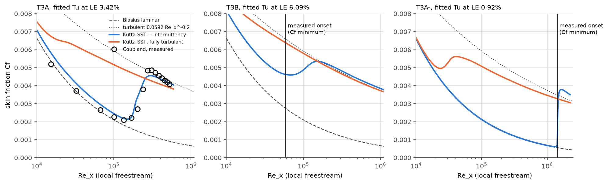
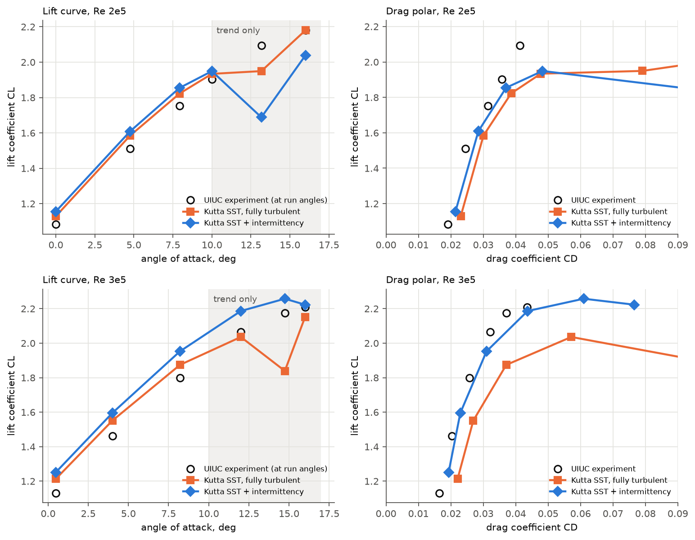
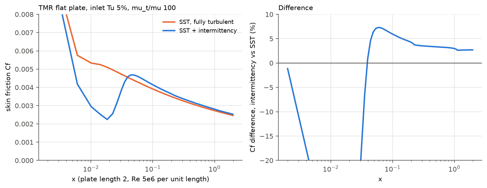

# Fluent Intermittency Transition Model in Kutta

Kutta now runs Fluent's **Intermittency Transition Model** (one-equation
gamma, Menter et al. 2015) on top of SST, on CPU and Metal from one kernel
source. A Fluent case with the model enabled is admitted, its constants and
numerics are read and checked, and other transition models are rejected with a
reason. Existing models are bitwise identical to main 256aeec.

Measured on an Apple M4 Pro, 2026-10-31. Tables are in [tables.md](tables.md),
generated by `tools/transition/report.py`; gzipped histories and logs are in
[runs/](runs).

| Check | Result |
| --- | --- |
| T3A (Tu 3.4%) | Onset Re_x 1.51e5 vs 1.35e5 measured (+12%); end of transition 2.98e5 vs 3.09e5. Turbulent Cf -6.9% to +1.6%. Pre-transition Cf +7.5% to +12% high. |
| T3B (Tu 6.1%) | Onset +15%, end 1.54e5 vs 1.24e5. Pre-transition Cf +23% to +36% (SST: +46% to +89%). Turbulent Cf within 6.6%. |
| T3A- (Tu 0.9%) | Onset 1.40e6 vs 1.44e6 (-3%), but transition completes by 1.6e6, while the measured Cf is still rising at 2.02e6. Laminar Cf within 9.2%. |
| S1223 Re 2e5 / 3e5 | CD error in the linear range drops from +21..+44% (SST) to +12..+21% at 6 of 7 points. CL rises by 0.02-0.08 over SST, which was already high: Re 3e5 now **fails** the CL +-0.10 gate (+0.12..+0.15). A suction-side laminar separation bubble is captured at every attached point. Stall improves at Re 3e5 and worsens at Re 2e5. |
| Fully turbulent regression (TMR plate, Tu 5%) | Cf(x = 0.97) +3.0% and plate drag +2.1% vs SST. The same turbulent-layer offset (+3.4%) appears on the T3B mesh. It is a property of the documented model, reproduced by an independent solver ([verification](../transition_verification/REPORT.md)). |
| CPU vs Metal | Transition run agrees as closely as plain SST does: wall shear 1.3e-5 relative (SST 0.96e-5), velocity 6e-6, gamma 2.1e-3 absolute, after 300 iterations. |
| Existing models | SST, standard k-epsilon (elbow_param), laminar and SA bitwise identical to main on CPU and Metal. |
| Tests | Quick tier 255 test cases, 7,453,826 assertions pass (31 skipped: slow suite). Slow T3A guard and S1223 gate pass. App `ctest -L app` 10/10. Portability lint clean. |

## 1. Model choice

Fluent offers two transport transition models for SST: **Transition SST**
(gamma-Re_theta, four equations) and the **Intermittency Transition Model**
(gamma only).

- The Fluent 2026 R1 Theory Guide prints the intermittency model completely:
  the gamma equation, every onset and pressure-gradient function, and every
  default constant (4.8.2). It also prints the k-equation coupling it shares
  with Transition SST (4.8.3 refers to 4.7.2.2, Eqs. 4-205..207).
- The Transition SST page gives the correlations only as `Re_theta_t =
  f(Tu, lambda)`, `F_length = f(...)` and `Re_theta_c = f(...)` (Eq. 4-201).
  It says that Re_theta_t "has been modified" from Langtry and Menter, without
  printing the modification. Implementing the paper would not reproduce Fluent.

So Kutta implements the intermittency model. Its equations, sources and every
inference are in
[src/kutta/fv/turbulence/transition.md](../../../src/kutta/fv/turbulence/transition.md):

```
d(rho g)/dt + div(rho U g) = P_g - E_g + div[(mu + mu_t/sigma_g) grad g]
P_g = 100 rho S g (1 - g) F_onset,  E_g = 0.06 rho Omega g F_turb (50 g - 1)
Re_theta_c = C_TU1 + C_TU2 exp(-C_TU3 Tu_L F_PG(lambda_thetaL))     (4.8.2, 4-215..217)
k: G*_k = g G~_k,  Y*_k = min(max(g, 0.1), 1) Y_k,  + P_k^lim;  omega unchanged  (4-205..207)
F1 = max(F1_SST, F3),  F3 = exp(-(R_y/120)^8)
```

Fluent names P_k^lim and F3 but does not print them. Kutta takes them from
Menter et al. 2015 as restated on NASA TMR's gamma page, as it does `dV/dy =
n . grad(n . U)`. Constants are Fluent's defaults, read from the case when one
is used: C_TU1/2/3 = 100/1000/1, C_PG1/2/3 = 1/-0.5/0, C_PG lims 1.5/3,
C_SEP = 1, sigma_gamma = 1. None was changed for these runs.

Inferences, marked as such in transition.md:

- `trans-one-eqn-tke-term-coef` is C_k of P_k^lim (inferred from the name).
- The rpvar names and defaults were read from mixing-elbow cases where the
  model is inactive. No saved case with the model active was available.
- Kutta uses the case's SST production option where the paper uses
  Kato-Launder, following Fluent's "original production term".

## 2. Implementation

- **Kernels** (`src/kutta/kernels/transition.kern.h`, generated for CPU, Metal
  and CUDA by `tools/kernelgen.py`):
  - gamma side: wall-normal derivative, sources, face diffusivity, inflow
    boundary values, clamp;
  - SST side: F1/F3 with the diffusivities that depend on F1, and the k
    production and destruction scaling plus P_k^lim. These run only when the
    coupling is on.
- **Gamma transport:** `IntermittencyTransport` (`src/kutta/fv/turbulence/intermittency.*`).
  - It reuses the k least-squares factorization, since gamma has k's boundary
    observations, and shares the scalar matrix storage that k and omega use.
  - The source is linearized as `(a+b) g` explicit and `(a + 50 b) g^2`
    implicit, with both coefficients nonnegative.
  - gamma is clamped to Fluent's `[trans-intermit/min-limit, max-limit]` =
    [1e-7, 1] after each solve.
- **Wall direction:** the unit vector from the nearest wall point, from a
  bounding-volume search (`wall_direction()` in `device_mesh.*`), computed once
  at setup. The existing `upload_mesh` path is unchanged.
- **SST coupling:** `SstOptions::intermittency` plus an optional gamma input.
  With it absent, `SstModel` runs exactly as on main.

**steady_solver edits (wiring only; no pressure, gradient or Rhie-Chow arithmetic touched):**

1. `#include "kutta/fv/turbulence/intermittency.hpp"` and an
   `Impl::transition` member.
2. SST construction:
   - require that `SstOptions::intermittency` is not set directly;
   - derive it from `SstSettings::transition`;
   - construct `IntermittencyTransport` on the existing scalar matrix, k
     least-squares fit and Krylov workspace.
3. `evaluate_turbulence`: pass `&transition->gamma()`, or null without transition.
4. `update_turbulence`: call `transition->update(...)` after the second SST evaluation.
5. `solve_turbulence`: after the omega solve, refresh (`update_turbulence(false)`)
   and solve gamma, in Fluent's order k, omega, gamma.
6. `monitor_turbulence`: the `intermittency` residual.
7. `initialize_fields`: an optional intermittency span.
8. Accessors `intermittency()` and `transition()`.

`steady_solver.hpp`: `IntermittencyOptions`/`IntermittencySettings`,
`SstSettings::transition`, an `intermittency` value on inflow boundary
conditions (default 1), `IterationReport::intermittency` and `transition`.

**Fluent case setup.**

- `fluent_case.cpp` classifies `rp-trans-one-eqn?`, `rp-trans-sst?` and
  `rp-transition-model`.
- An inconsistent or unknown combination is an issue at
  `case-config/rp-transition-model`.
- Transition SST and the algebraic model are typed for display and raised as
  unsupported issues, each with a plain reason. Transition SST keeps its
  existing issue path, `case-config/rp-trans-sst?`.
- With the intermittency model, `setup/fluent.cpp` admits SST only. It reads
  every constant and requires them finite, with sigma > 0, 0 < min < max <= 1
  and C_k, C_SEP >= 0.
- It rejects crossflow, intermittency smoothing and dudn methods other than 1,
  each with a reason.
- It reads `intermit/scheme`, the relaxation, the zone `intermit` values
  (checked to lie in [0, 1]), `SV_INTERMIT` from data files, and
  `intermit/default` for standard initialization.

**Protocol (v1 additive, documented in docs/app-protocol.md):**

- `models.transition` in `inspect --json`;
- the `intermit` residual after `omega`;
- an `intermittency` cell field in `result.vtu` and `export-view`;
- settings `models/transition`, `methods/intermittency-scheme`,
  `controls/intermit-relaxation` and `boundary/<zone>/intermittency`.

**Validation runners** (no solver arithmetic):

- `validation/cases/fsae_aero.hpp` gains `transition` and `laminar` options,
  and `bench_fsae_aero` the matching `--transition` and `--laminar` flags.
- `validation/cases/tmr.hpp` gains an inflow turbulence override, an optional
  transition model, a `wall_cf.csv` output and an intermittency column in
  `cells.csv`. `bench_tmr` gains the `high-tu` and `high-tu-transition` modes.
- The TMR stopping defect includes the gamma residual, which is 0 without the
  model.

## 3. ERCOFTAC T3A, T3B, T3A- flat plates

**Data.** ERCOFTAC Classic Collection case 020 (Coupland, Rolls-Royce), CC
BY-NC-SA 4.0. It is kept out of git; see
`validation/data/ercoftac_t3_flat_plate/SOURCE.md`.

**Setup** (`tools/transition/flatplate.py`):

- Domain: a 2D plate 1.7 m long, inlet 0.1 m upstream over a symmetry plane,
  symmetry top at 0.3 m.
- Mesh L1: 440 x 120 = 52,800 cells. First cell y+ about 0.3 turbulent and
  0.13 mean measured; leading-edge spacing 0.5 mm.
- Re_unit is the median of the measured Re_x/x.
- Inlet Tu and mu_t/mu are fitted to the measured freestream Tu decay with SST's
  freestream decay (RMS log error 1-2%). The fit gives Tu_in / ratio of
  4.68% / 11.9 for T3A (3.42% at the leading edge), 7.42% / 100 for T3B (6.09%)
  and 1.02% / 8.1 for T3A- (0.92%). Literature setups for these cases use
  similar values.
- Cf and Re_x use the local edge velocity, as the experiment's summary does.
- 6000 iterations per run.

**Mesh check.** A laminar run on the same mesh is within 1% of Blasius up to
Re_x 1e5, +1.9% at 2e5 and +4.0% at 4e5.



| case | onset Re_x (Cf min), Kutta / measured | end of transition (Cf max), Kutta / measured | max pre-transition Cf error | max turbulent Cf error |
| --- | --- | --- | --- | --- |
| T3A | 1.51e5 / 1.35e5 (+12%) | 2.98e5 / 3.09e5 | 12.1% | 6.9% (Re_x > 2.6e5) |
| T3B | 6.81e4 / 5.91e4 (+15%) | 1.54e5 / 1.24e5 | 36.1% | 6.6% |
| T3A- | 1.40e6 / 1.44e6 (-3%) | 1.64e6 / >= 2.02e6 (still rising at the last station) | 9.2% | n/a |

The T3A per-station table, with fully turbulent SST alongside, is in
tables.md. **What the model misses:**

- **Pre-transition Cf is high, by 12% at T3A Re_x 1.5e4 and 36% at T3B
  4.3e4.** In the T3A run, mu_t/mu reaches 3.6-6.6 inside the pre-transition
  boundary layer while gamma averages 0.13-0.25. The coupling scales
  production by gamma but floors destruction at 0.1 Y_k (4-206). An
  independent double-precision solution of the documented equations gives the
  same excess, within 1.7% (T3A) and 2.3% (T3B) of Kutta: freestream eddy
  viscosity enters the laminar layer undamped
  ([verification](../transition_verification/REPORT.md) §5).
- **Transition on T3A- is too abrupt.** The Cf rise completes in about 15% of
  Re_x, while the experiment's spreads over more than 40%. The documented model
  solved independently is just as abrupt; Kutta's onset is 6.6% later than
  that solution, on both L1 and L2 meshes (verification §5).
- **Transition completes 24% late on T3B** (1.54e5 vs 1.24e5). The independent
  solution ends at 1.537e5.

Convergence: drag settles to 2e-7 (T3A), 4e-4 (T3B) and 5e-6 (T3A-) relative
over 500 iterations. The largest scaled residual, continuity, stalls at
3.8e-3, 6.4e-3 and 1.6e-2. That is a similar level to the fully turbulent SST
runs on the same meshes (3.3e-3, 7.3e-3, 1.2e-2) and the laminar T3A run
(3.6e-3), so the stall is not a transition effect.
Mesh refinement (L2) was not run; see open items.

## 4. Selig S1223 (UIUC), Re 2e5 and 3e5

Same meshes (level 2, about 184k cells, wall y+ mean 0.1) and inflow (Tu 0.1%,
mu_t/mu 1) as the fully turbulent results in
[validation/results/fsae_aero](../fsae_aero/REPORT.md); `tools/fsae_aero/run.py
--extra=--transition`. Fluent's default constants. The SST columns are the
tracked fully turbulent results. Fresh SST runs at Re 2e5 alpha 4.76 and Re
3e5 alpha 8.21 reproduce them exactly.



Linear range (alpha <= 10). The acceptance is from
docs/research/verification-cases.md §4: CL within +-0.10, CD within +-25%.

| Re | alpha | CL gamma / SST / UIUC | dCL gamma (SST) | CD gamma / SST / UIUC | dCD gamma (SST) | suction-side bubble x/c |
| --- | ---: | --- | --- | --- | --- | --- |
| 2e5 | 0 | 1.156* / 1.129 / 1.083 | +0.073 (+0.046) | 0.0214* / 0.0231 / 0.0191 | +12% (+21%) | 0.33-0.54 |
| 2e5 | 4.76 | 1.609* / 1.585 / 1.510 | +0.099 (+0.075) | 0.0285* / 0.0301 / 0.0245 | +16% (+23%) | 0.28-0.43 |
| 2e5 | 7.93 | 1.854 / 1.822 / 1.753 | **+0.101** (+0.069) | 0.0371 / 0.0386 / 0.0314 | +18% (+23%) | 0.25-0.40 |
| 2e5 | 10 | 1.949 / 1.934 / 1.902 | +0.047 (+0.031) | 0.0483 / 0.0477 / 0.0357 | **+35%** (+34%) | 0.23-0.39 |
| 3e5 | 0.48 | 1.251 / 1.213 / 1.131 | **+0.120** (+0.082) | 0.0193 / 0.0221 / 0.0164 | +18% (+35%) | 0.33-0.47 |
| 3e5 | 4 | 1.595 / 1.551 / 1.461 | **+0.134** (+0.090) | 0.0229 / 0.0269 / 0.0203 | +13% (+32%) | 0.30-0.40 |
| 3e5 | 8.21 | 1.953 / 1.874 / 1.800 | **+0.153** (+0.074) | 0.0310 / 0.0371 / 0.0257 | +21% (+44%) | 0.27-0.34 |

\* Not settled: at 6000 iterations the drag still changes by 0.1-0.4% over the
500-iteration window. Lift is steady and all residuals are below 1e-3. The value is the mean of the last
2000 iterations.

Results against the acceptance:

- **Drag improves at every linear-range point except Re 2e5 alpha 10**: 6 of 7
  points are inside +-25% (SST: 3 of 7).
- **Lift gets worse**: 4 of 7 points fail +-0.10 (SST: 0 of 7). The model
  moves CL up, away from the experiment, by 0.02-0.08. The laminar separation
  bubble adds camber, and the fully turbulent CL was already high.
- The UIUC tunnel's own corrections, and the as-tested geometry's blunt
  trailing edge, are unchanged from the fully turbulent comparison.
  Fluent on the same mesh, the gate the verification plan says matters most,
  has not been run (open items).

**Laminar separation bubble.** Every attached point has a suction-side
reversed-flow region that reattaches. It moves forward with alpha (Re 2e5:
x/c 0.33-0.54 at 0 deg to 0.23-0.39 at 10 deg) and is shorter at Re 3e5
(0.30-0.40 at 4 deg, 0.27-0.34 at 8.21 deg). These are the trends expected of
a laminar separation bubble. There is no measured bubble location in the
reference data, so its position is not validated. Fully turbulent SST has
no bubble at these points. Both models separate at the trailing edge: with
the model over the last 4-14% of chord in the linear range, and with SST over
the last 8% at 4.76 deg (the one SST wall distribution available).

**Beyond the linear range (trend only):**

| Re | alpha | CL gamma / SST / UIUC | CD gamma / SST / UIUC | stop |
| --- | ---: | --- | --- | --- |
| 2e5 | 13.17 | 1.688* / 1.949 / 2.094 | 0.166* / 0.079 / 0.041 | unsettled; separated from x/c 0.13 |
| 2e5 | 16 | 2.039* / 2.180* / 2.181 | 0.137* / 0.166* / n/a | unsettled |
| 3e5 | 12 | 2.186 / 2.036 / 2.064 | 0.044 / 0.057 / 0.032 | converged |
| 3e5 | 14.74 | 2.257 / 1.839* / 2.175 | 0.061 / 0.114* / 0.037 | converged |
| 3e5 | 16 | 2.223 / 2.151* / 2.207 | 0.077 / 0.145* / 0.044 | converged |

At Re 3e5 the model holds the flow attached past 12 deg: CLmax 2.26 near 14.7
deg vs UIUC 2.21 at 15.6 deg, where SST stalled early. Drag stays 36-76% high.
At Re 2e5 it stalls early instead: at 13.17 deg the flow separates from 13%
chord and does not settle.

## 5. Fully turbulent regression: TMR flat plate at high freestream turbulence

TMR 2DZP flat plate, 137 x 97 grid. Inflow Tu 5% and mu_t/mu 100 (about 2%
at the leading edge after decay), Re 5e6 per unit length, 1500 s budget,
force change below 1e-5. Both runs stall at the continuity defect of about
0.08 seen in every TMR plate run (validation/results/tmr_v5).



| quantity | SST | SST + intermittency | difference |
| --- | --- | --- | --- |
| Cf at x = 0.97 | 0.002737 | 0.002819 | +3.0% |
| plate drag | 0.002906 | 0.002966 | +2.1% |
| Cf at x = 0.01 | 0.005340 | 0.002972 | -44% (laminar start) |
| Cf at x = 0.05 / 0.5 / 1.9 | 0.004381 / 0.003026 / 0.002476 | 0.004668 / 0.003127 / 0.002543 | +6.5% / +3.3% / +2.7% |

The intermittency model transitions between x = 0.02 and 0.045 (Re_x 1e5 to
2.3e5) and is fully turbulent downstream. In the turbulent layer, gamma = 1 apart from
the viscous sublayer (at x = 0.95, gamma is 0.04 in the wall cell, 0.12 at
y+ 8 and 0.99 by y+ 19). Cf stays **2.7-3.3% above SST** downstream, though: it does not
decay as a pure shift of the turbulent origin would.

**Where the offset comes from** (superseded by
[../transition_verification/REPORT.md](../transition_verification/REPORT.md),
which has the evidence):

- **A property of the documented model (verified).** Below y+ of about 15,
  F_onset = 0 and F_turb is about 1, so the documented destruction term drives
  gamma towards 1/c_e2. Kutta's gamma matches the documented equation solved
  on its own fields to 0.0018. G*_k = gamma G~_k then cuts buffer-layer
  production, and the 0.1 floor of Y*_k cuts sublayer destruction (4-206/207).
  The net is +3.0% to +4.0% Cf in an independent channel solution for Re_tau
  500-20000, and +3.3% at x = 0.97 on an independent solution of this plate.
- **Whether Fluent shows the same offset** is still unchecked (open item 1).
- **The upstream symmetry-plane layer was an iteration transient, not a model
  difference.** The runs above stopped on a wall-clock budget at unequal
  iteration counts: 13,100 iterations with the model against 17,600 without.
  The layer decays in both models. At 30,000 iterations each it is gone, and
  upstream k and omega agree to 0.045% beyond 5 mm from the leading edge. The
  earlier statement that the difference was "between fixed points" was wrong.
  At 30,000 iterations Cf(0.97) is 0.002737 / 0.002819 (+3.0%) and drag
  +2.07%, as above.

## 6. CPU and Metal parity

Transition runs use the same kernels on both backends. Both runs below are the
T3A L1 case for 300 iterations, from the same uniform start; the differences
are float summation order.

| quantity (max over the field) | transition: CPU vs Metal | plain SST: CPU vs Metal |
| --- | --- | --- |
| u, relative to max | 5.8e-6 | 5.6e-6 |
| k, relative to max | 4.9e-5 | 4.9e-5 |
| mu_t, relative to max | 1.7e-4 | 7.0e-5 |
| plate wall shear, relative per face (max / median) | 1.3e-5 / 4.5e-6 | 9.6e-6 / 3.9e-6 |
| drag | 0.0081473464 / 0.0081473752 | 0.01034724626 / 0.01034721113 |
| gamma, absolute | 2.1e-3 (1,924 of 52,800 cells above 1e-4, in the developing outer layer at x 1.0-1.6) | n/a |

The quick test `Fluent intermittency transition settings are read, checked and
solved` also runs a 4-iteration elbow solve with the model on both backends
and compares them. The kernel oracle tests compare CPU and Metal against
independent double-precision formulas.

## 7. Existing models unchanged

[parity_existing_models.txt](parity_existing_models.txt) compares this
branch's final source with main 256aeec (built separately) on CPU and Metal.

- **`kutta solve --iterations 40`** on V6 (`mixing_elbow.cas.h5 --approximate
  wfgc`, SST) and elbow_param (`elbow_param.cas.h5 --approximate
  compressibility,ke-options`, standard k-epsilon): `fluxes.csv`,
  `forces.csv`, `loads.json`, `result.vtu` and `residuals.csv` (without the
  timing column) are byte-identical.
- **Laminar and SA:** a scratch library driver (12x8x3 channel, 30
  iterations; not committed) wrote the raw float bytes of velocity, pressure,
  mass flux, wall shear, nu~ and the residuals. They are identical.
- **The fsae_aero runner** reproduces the tracked fully turbulent S1223
  histories (Re 2e5 alpha 4.76, Re 3e5 alpha 8.21) exactly, apart from timing.

## 8. Tests

- **Quick** (`tests/turbulence/test_transition.cpp`, 5 cases, 36,588
  assertions, about 11 s):
  - gamma sources against an independent double-precision oracle for two
    constant sets, including the F_PG and lambda clips;
  - normal derivative, inflow boundary values, face diffusivity and clamp;
  - the SST coupling (F1/F3, diffusivities, P_k^lim, k source and sink;
    bitwise unchanged fields where the coupling is an identity);
  - wall direction;
  - Fluent setup admission, values and every rejection, plus a 4-iteration
    elbow solve on CPU and Metal.

  The existing allowlist test keeps Transition SST rejected at
  `case-config/rp-trans-sst?`.
- **Full quick tier:** `./build/kutta-tests --test-suite-exclude=slow` passes
  255 test cases and 7,453,826 assertions (31 skipped, all slow). The first run
  found one regression, the allowlist path above, which is fixed.
- **Slow** (`tests/fv/test_transition_validation.cpp`; each skips with a
  message when its data or mesh is absent):
  - `Transition: ERCOFTAC T3A skin friction vs experiment (REGRESSION GUARD)
    and vs the documented equations (VERIFICATION)`. No T3A acceptance is
    documented, so the experiment checks guard the measured accuracy rather
    than claiming one: onset within 13%, pre-transition Cf within 13%,
    turbulent Cf within 7.5%. Measured: 11.8%, 12.1% and 6.9%. **Passes**
    (Metal, 6000 iterations). The verification checks, added later, compare
    the same solve with an independent solution of the documented equations
    ([verification](../transition_verification/REPORT.md)).
  - `Transition: Selig S1223 at Re 2e5, alpha 4.76 deg vs UIUC` gates on the
    documented acceptance (verification-cases.md §4: CL +-0.10, CD +-25%),
    using the mean of the last 2000 iterations. **Passes**: CL 1.6088 vs
    1.510 (+0.099, a margin of 0.001) and CD 0.02849 vs 0.0245 (+16%).
- **App:** `ctest --test-dir build-app/app -L app` passes 10/10 with the real
  CLI and elbow case. `python3 tools/lint_portability.py` is clean.

## 9. Open items

1. **Fluent cross-check.** No Fluent run with the intermittency model was
   available, so neither the case adapter's reading of an active case nor the
   results above are compared with Fluent. The rpvar names come from inactive
   defaults. That comparison (T3A and S1223 on the same meshes) is the next
   step and would settle items 2-4.
2. **Turbulent Cf +3.4% above SST** with the model on (T3B, TMR) and
   pre-transition Cf 12-36% high (T3A, T3B). An independent solution of the
   documented equations reproduces both
   ([verification](../transition_verification/REPORT.md)). Whether Fluent shows
   them is item 1.
3. **S1223 lift**: the model raises CL by 0.02-0.08, and Re 3e5 fails the
   +-0.10 gate at all three linear points, as does Re 2e5 at 7.93 deg
   (+0.101). Drag improves at 6 of 7 points. The slow S1223 gate passes at Re
   2e5, 4.76 deg with a 0.001 margin on CL.
4. **Re 2e5 stall**: early, unsettled separation at 13.17 deg (CL 1.69 vs
   2.09).
5. **T3A- transition length**: the computed transition is too abrupt
   (completes by Re_x 1.6e6; the measured Cf is still rising at 2.0e6). The
   documented model gives the same length. Kutta's onset is 6.6% later than the
   independent solution, and the source is not isolated (verification §5).
6. **TMR upstream symmetry-plane layer**: resolved. It was a slowly decaying
   iteration transient in both models (section 5, verification §4).
7. **Mesh refinement**: the T3 cases ran on one mesh (L1, verified against
   Blasius within 1% to Re_x 1e5). T3A- at L2 (4x cells) gives the same
   onset, 1.405e6 against 1.404e6 (verification §5). T3A and T3B at L2 were not run.
8. **Convergence**: the T3 continuity residual stalls at 4e-3 to 1.6e-2, as it
   does in the laminar and SST runs on the same meshes. S1223 at Re 2e5 keeps
   a 0.1-0.4% drag wander at 0 and 4.76 deg, and does not settle at 13.17 and
   16 deg.
9. **Not implemented** (rejected with reasons): Transition SST, the algebraic
   model, crossflow, intermittency smoothing, roughness and dudn methods
   other than 1.
10. **CUDA**: the kernels are generated for CUDA but compile only in CI; no
    CUDA run was made here.
