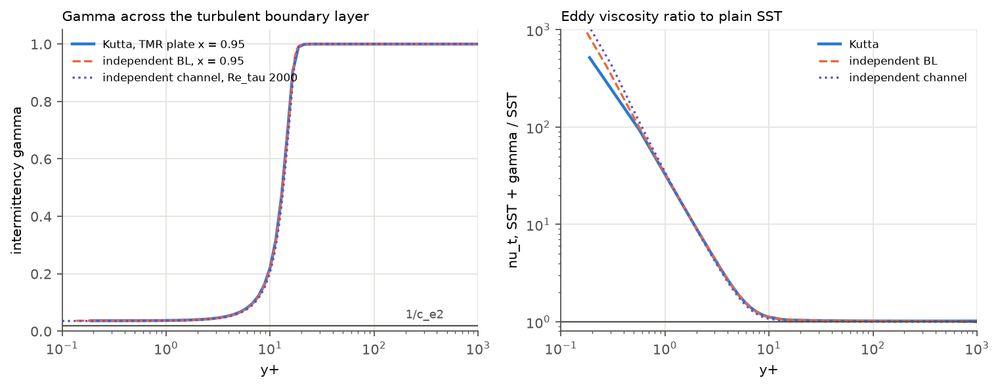
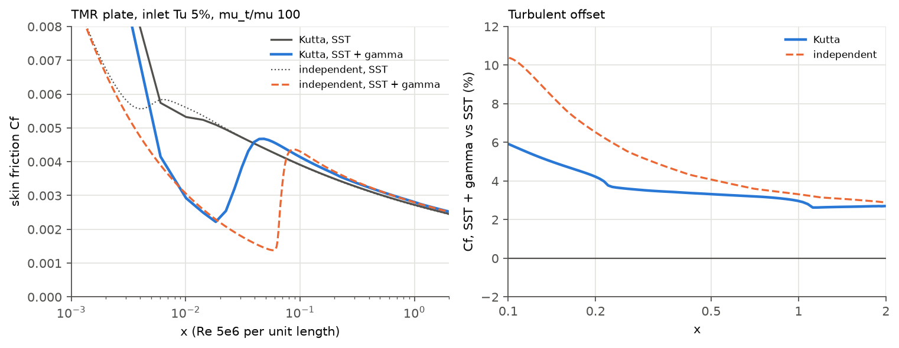
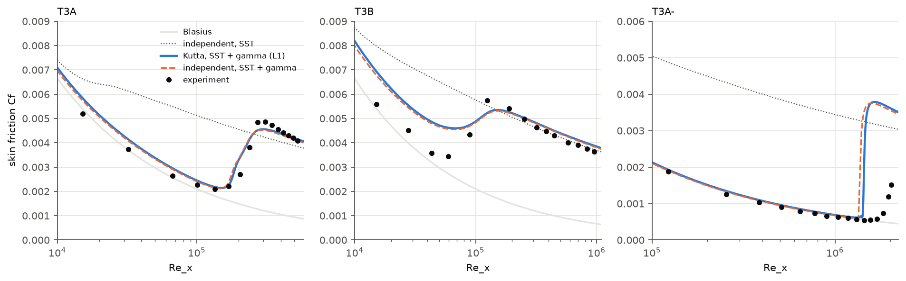

# Intermittency transition model: verification against the documented equations

This report asks whether each transition-model discrepancy in
[../transition/REPORT.md](../transition/REPORT.md) is:

- (a) an implementation defect,
- (b) a faithful property of the documented model, or
- (c) a numerical or mesh effect.

**Result:** Kutta implements the documented model correctly.

- No defect was found. No solver code changed, and no constant or equation was
  touched.
- Two independent double-precision solvers of the documented equations
  reproduce Kutta's results, with no Kutta code involved:
  - the turbulent-layer offset;
  - the high pre-transition Cf;
  - the abrupt T3A- transition;
  - the late end of transition on T3B.
- Two earlier explanations were wrong and are corrected here:
  - the TMR upstream symmetry-plane layer was a slowly decaying iteration
    transient in both runs. It was not a model difference.
  - Kutta's early transition on the TMR grids is leading-edge resolution. With
    0.05 mm leading-edge cells, Kutta matches the documented model.

Measured on an Apple M4 Pro, 2026-10-31, at 2747dd2 plus this branch. The branch
changes no compiled solver source. Tables are in [tables.md](tables.md),
generated by `tools/transition/verify/figures.py`.

| Question | Class | Evidence (sections 2-6) |
| --- | --- | --- |
| Turbulent Cf above SST (TMR +3.0%, T3B +3.4%) | **(b) faithful** | Independent channel: +3.0% to +4.0% for Re_tau 500-20000, independent of grid and the k wall condition. Independent plate: +3.3% at TMR x = 0.97 and +3.3% on T3B. Kutta's gamma matches the documented gamma equation solved on Kutta's own fields to 0.0018. |
| TMR upstream symmetry-plane k difference | **(c) numerical** | An iteration transient in both models, compared at unequal iteration counts. At 30,000 iterations each, k and omega agree to 0.045% beyond 5 mm from the leading edge. |
| Pre-transition Cf 7-36% high (T3A, T3B) | **(b) faithful** | The independent plate gives +10% (T3A) and +22% to +34% (T3B) against the experiment. Kutta is within 1.7% (T3A) and 2.3% (T3B) of it. |
| T3A- transition too abrupt | **(b) faithful** | Independent: Re_x 1.32e6 to 1.59e6. Kutta: 1.40e6 to 1.65e6. The experiment is still rising at 2.02e6. |
| T3B transition ends late | **(b) faithful** | End: Kutta 1.544e5, independent 1.537e5, experiment 1.245e5. |
| Kutta onset later than independent on T3A- (+6.6%) | **(c) numerical, source not isolated** | Unchanged on a 4x mesh (L2), so not FV mesh resolution. Not wall treatment, freestream decay or edge velocity either. T3A and T3B are +2.5% and +2.6%. |
| Kutta transition early on the TMR grids | **(c) mesh** | All three TMR grids have 2-8 mm leading-edge cells (Re_dx 1e4-4e4), and Kutta's onset there is x 0.012-0.018. With 0.05 mm cells at the same leading-edge state, Kutta's onset is x 0.054 against an independent 0.058. Turbulent Cf is unaffected. |

## 1. Term-by-term check against the sources

### Sources

- **Fluent 2026 R1 Theory Guide (TG)**, read from Ansys's public help pages on
  2026-10-31:
  - 4.8.2, Transport Equations for the Intermittency Transition Model;
  - 4.8.3, Coupling with the Other Models, which refers to 4.7.2.2;
  - 4.7.2.2, Coupling the Transition Model and SST Transport Equations
    (Eqs. 4-205..207).
- **NASA TMR, "SST-2003-Menter-gamma-2015" page** (tmbwg.github.io/turbmodels).
  It restates Menter, Smirnov, Liu and Avancha 2015 (Flow Turbul. Combust.
  95:583-619).
- **The 2015 paper itself was not read.** It is closed access (Springer;
  OpenAlex lists it as closed), and no open copy was found.

### Terms

Each Kutta term is in `src/kutta/kernels/transition.kern.h`, the SST coupling in
`sst_transition_f1` / `sst_transition_k`.

| Term | Documented form | Kutta | Status |
| --- | --- | --- | --- |
| Transport and diffusion | d(rho g)/dt + div(rho U g) = P - E + div[(mu + mu_t/sigma_g) grad g], sigma_g = 1 (TG 4.8.2) | `transition_face_diffusion`, `IntermittencyTransport::assemble` | matches |
| Production | P_g = F_length rho S g (1-g) F_onset, F_length = 100 (TG) | `transition_sources`, a = 100 rho S F_onset | matches |
| Destruction / relaminarization | E_g = c_a2 rho Omega g F_turb (c_e2 g - 1), c_a2 = .06, c_e2 = 50, Omega the vorticity magnitude (TG) | b = .06 rho Omega F_turb | matches |
| Onset | F_onset1 = Re_V/(2.2 Re_theta_c), F_onset2 = min(F_onset1, 2), F_onset3 = max(1-(R_T/3.5)^3, 0), F_onset = max(F_onset2 - F_onset3, 0) (TG 4-215) | same | matches |
| F_turb, R_T, Re_V | exp(-(R_T/2)^4), rho k/(mu omega), rho d^2 S/mu (TG) | same | matches |
| Re_theta_c | C_TU1 + C_TU2 exp(-C_TU3 Tu_L F_PG), 100/1000/1 (TG) | same, constants from the case | matches |
| Tu_L | min(100 sqrt(2k/3)/(omega d), 100) (TG) | same | matches |
| lambda_thetaL | -0.1111 (dV/dy) d^2/nu + 0.1875 (TG 4-216), bounded to [-10, 10] (TG 4-217) | same | matches TG. TMR bounds the paper's lambda to +-1 (+-14.68 in Fluent's units); Kutta follows Fluent. |
| F_PG | min(1 + C_PG1 lambda, C_PG1_lim) for lambda >= 0; min(1 + C_PG2 lambda + C_PG3 min(lambda + 1, 0), C_PG2_lim) otherwise; 1, -0.5, 0, 1.5, 3 (TG) | same, plus TMR's max(F_PG, 0), which cannot bind with C_PG3 = 0 | matches |
| dV/dy | grad(n . V) . n (TMR, general geometry) | `transition_normal_derivative`; n is the unit vector from the nearest wall point | matches TMR. That Fluent's dudn method 1 is this form is inferred. |
| Gamma BCs | zero normal flux at walls, gamma = 1 at inlets (TG 4.7.2.1 text; TMR) | zero wall flux; zone value (default 1) on inflow faces | matches |
| k production | G*_k = gamma G~_k, G~_k = SST's original production (TG 4-206) | `sst_transition_k`, after SST's limiter and wall-cell production | matches. The intermittency model has no gamma_sep, so gamma_eff = gamma. |
| k destruction | Y*_k = min(max(gamma, 0.1), 1) Y_k (TG 4-207) | same | matches |
| omega equation | not modified (TG 4.7.2.2 text) | not modified | matches |
| P_k^lim | 5 C_k max(g - .2, 0)(1 - g) F_on^lim max(3 C_sep mu - mu_t, 0) S Omega; F_on^lim = min(max(Re_V/(2.2*1100) - 1, 0), 3) (TMR) | same | matches TMR. Fluent names C_SEP as acting "through the source terms directly" but does not print the term. |
| F1 | max(F1_SST, F3), F3 = exp(-(R_y/120)^8), R_y = rho d sqrt(k)/mu (TMR) | `sst_transition_f1`; F1-dependent diffusivities recomputed | matches TMR. Not printed by Fluent. |
| P_k form | TMR: Kato-Launder mu_t S Omega. TG 4-206: SST's "original production term" | the case's SST production option | The sources differ. This is not a defect. On the plates and the channel, S = Omega, so both forms are identical. |

The kernel oracle tests in `tests/turbulence/test_transition.cpp` already
compare every row with double-precision formulas. They were written alongside
the implementation, though. So the formulas were re-read here from the TG pages
(rendered from Ansys's published SVG equations) and the TMR page. The
independent solvers below share no code with Kutta.

## 2. Independent solvers

`tools/transition/verify/` holds the independent solvers. They run in double
precision and share no code with Kutta.

| File | Contents |
| --- | --- |
| `model.py` | The documented terms, each with its source. |
| `channel.py` | Fully developed channel in wall units, cell-centred FV. |
| `boundary_layer.py` | Parabolic zero-pressure-gradient plate boundary layer. It has the same inlet Tu, mu_t/mu and inlet distance as Kutta's T3 and TMR runs, and the same freestream decay. |
| `column.py` | The documented gamma equation solved on one column of a Kutta run, with Kutta's k, omega, nu_t and S frozen. |
| `figures.py` | This report's figures and `tables.md`. |

**Plate solver convergence** (`boundary_layer.py <case> --check`). These
refinements were tried:

- 400 instead of 260 points;
- half the first spacing;
- a quarter of the streamwise step;
- 8 instead of 4 Picard sweeps;
- a taller domain.

Laminar and turbulent Cf change by at most 1.6% and onset by at most 1.3% on the
T3 cases (3.0% on TMR). The wall treatment changes the onset by under 0.5% and
Cf by under 0.2%: Menter's omega_wall = 60 nu/(beta1 dy^2) with k = 0, against
Fluent's fixed wall-cell omega with zero k flux.

The tracked `independent_<case>.csv` files are its zero-pressure-gradient
solutions. They depend on no Kutta output.

## 3. Turbulent layer: Cf above SST is a property of the documented model

**Channel** (`channel.py`, Re_tau 2000):

| k wall condition | first cell y+ | Cf SST | Cf SST + gamma | difference |
| --- | ---: | ---: | ---: | ---: |
| zero flux (Fluent) | 0.4 / 0.2 / 0.1 | 4.275e-3 / 4.332e-3 / 4.363e-3 | 4.446e-3 / 4.503e-3 / 4.534e-3 | +3.99% / +3.96% / +3.91% |
| k = 0 (Menter) | 0.4 / 0.2 / 0.1 | same | 4.446e-3 / 4.503e-3 / 4.534e-3 | +3.98% / +3.95% / +3.91% |

By Re_tau: +3.02% (500), +3.83% (1000), +3.96% (2000), +3.81% (5000) and
+3.38% (20000). The corresponding bulk-velocity shift is -0.27 to -0.45 u+, so
the log-law intercept drops by about 0.45.

**Ablation (channel):**

- **gamma = 1 everywhere, so only F3 differs: +0.00%.**
- The model's gamma with Y_k not scaled: -37%.
- The full model: +3.96%.

So the offset is the net of the two documented k-coupling terms (TG 4-206/207),
which nearly cancel:

- G*_k = gamma G~_k cuts buffer-layer production while gamma < 1.
- The 0.1 floor in Y*_k cuts viscous-sublayer destruction up to 10x.

**Why gamma < 1 near the wall.** Kutta's TMR column at x = 0.95 was evaluated
in double precision with `column.py`:

| y+ | R_T | F_turb | F_onset | gamma (Kutta) | gamma (documented equation on Kutta's fields) |
| ---: | ---: | ---: | ---: | ---: | ---: |
| 0.19 | 0.000 | 1.000 | 0 | 0.0366 | 0.0365 |
| 3.2 | 0.057 | 1.000 | 0 | 0.0471 | 0.0471 |
| 7.7 | 0.69 | 0.986 | 0 | 0.1227 | 0.1227 |
| 12.9 | 2.03 | 0.345 | 0 | 0.4719 | 0.4723 |
| 16.5 | 3.20 | 0.001 | 0.068 | 0.9071 | 0.9090 |
| 21.2 | 4.80 | 0.000 | 0.355 | 0.9989 | 0.9990 |

Below y+ of about 15, R_T < 3.5, so F_onset3 > F_onset2 and F_onset = 0. F_turb
is close to 1 there. The destruction term is then
c_a2 rho Omega g (c_e2 g - 1), which is positive at g = 1. It drives gamma
towards 1/c_e2 = 0.02 against diffusion from the outer layer. **The documented
gamma equation has no solution with gamma = 1 in the viscous sublayer**, so SST
cannot be recovered exactly there.

The maximum difference between Kutta's gamma and the documented equation on
Kutta's own fields is 0.0018 for y+ < 40. The independent plate and channel give
the same profile.

**On the premise.** The brief said the Fluent TG and the paper describe
gamma -> 1 in turbulent boundary layers, so that SST is recovered.

- **The TG says no such thing.** All of TG 4.7.x and 4.8.x was searched. Its
  only statement about fully turbulent behaviour is that free shear flows are
  predicted as fully turbulent.
- **The paper is not verified.** It was not available, so what it says is
  unknown here.
- **The equations decide it.** The demonstration above is independent of either
  text.

**TMR plate.** Kutta's runs are matched at 30,000 iterations each. The
independent solution is the plate boundary layer.

| x | offset, Kutta | offset, independent |
| ---: | ---: | ---: |
| 0.5 | +3.32% | +4.08% |
| 0.97 | +3.00% | +3.34% |
| 1.5 | +2.67% | +3.05% |
| 1.9 | +2.70% | +2.92% |

The absolute values at x = 0.97 agree:

- Cf SST: Kutta 0.002737, independent 0.002719.
- Cf SST + gamma: Kutta 0.002819, independent 0.002810.

Kutta's offset is slightly smaller because its transition on this grid is
earlier (section 6), so its turbulent layer is older.

Plate drag: SST 0.0029052, SST + gamma 0.0029653 (+2.07%). The earlier
budget-limited runs gave +2.1%. On T3B the independent offset at x = 1.5 is
+3.28%, and the transition report measured +3.3% to +3.5% in Kutta.

## 4. TMR upstream symmetry-plane layer: an iteration transient

The table gives k in the symmetry-plane cell relative to k at y = 0.15 in the
same column (TMR plate, 137x97, Metal).

| x | SST, 17,600 it | SST, 20,000 it | SST, 30,000 it | gamma, 9,600 it | gamma, 13,100 it | gamma, 30,000 it |
| ---: | ---: | ---: | ---: | ---: | ---: | ---: |
| -0.213 | +0.68% | +0.28% | -0.04% | +9.45% | +3.10% | -0.03% |
| -0.111 | +2.96% | +1.51% | +0.00% | +25.9% | +10.0% | +0.02% |
| -0.056 | +4.65% | +2.50% | +0.08% | +36.7% | +14.6% | +0.11% |
| -0.019 | +5.84% | +3.21% | +0.15% | +44.5% | +17.9% | +0.18% |
| -0.006 | +6.31% | +3.74% | +0.77% | +45.7% | +18.3% | +0.81% |

- **Both models carry the bump, and it decays with iterations.**
- **It decays more slowly with the transition model.** Its time constant is
  about 4,000 iterations.
- **The earlier comparison was unequal.** It set a gamma run at 9,600
  iterations against SST at 20,000, because both stopped on a wall-clock budget
  on a shared GPU. The earlier description, "a difference between fixed
  points", was wrong.
- **At 30,000 iterations each, the bump is gone in both runs.**
  - Upstream cells farther than 5 mm from the leading edge agree to 0.045% in k
    and omega.
  - The one larger difference is in the column 2 mm ahead of the leading edge:
    omega up to 8.7%, k 0.07%. There the plate's laminar start (gamma) and
    turbulent start (SST) feed back upstream, as expected.
- **Class (c).** This is slow iterative convergence in the long, thin cells
  along the upstream symmetry plane (aspect ratio near 1e4). The TMR plate's
  continuity defect stalls near 0.08 in every run, so drag settling alone does
  not show that this region has converged.
- **Not fixed here.** It is convergence speed, it affects SST equally, and it
  belongs to the solver lanes.

## 5. ERCOFTAC T3A, T3B, T3A-: Kutta reproduces the documented model

This section compares three things:

- Kutta at L1, rerun on this branch;
- the independent zero-pressure-gradient plate;
- the experiment.

The reruns are bitwise identical to the transition lane's runs: drag
0.006974937317, 0.007860527462 and 0.003481425455.

| case | onset Re_x, Kutta / independent / experiment | end Re_x, Kutta / independent / experiment | largest pre-transition Cf error: Kutta vs independent; independent vs experiment |
| --- | --- | --- | --- |
| T3A | 1.507e5 / 1.471e5 (+2.5%) / 1.348e5 | 2.985e5 / 2.932e5 (+1.8%) / 3.093e5 | 1.7%; +10.2% |
| T3B | 6.81e4 / 6.64e4 (+2.6%) / 5.91e4 | 1.544e5 / 1.537e5 (+0.4%) / 1.245e5 | 2.3%; +34.3% |
| T3A- | 1.404e6 / 1.317e6 (+6.6%) / 1.443e6 | 1.645e6 / 1.587e6 (+3.6%) / >= 2.02e6 | 2.2% (to Re_x 1.17e6); +7.1% |

Turbulent Cf agrees within 1.3% (T3A) and 1.0% (T3B) beyond 1.5 times the end
of transition.

**Pre-transition Cf high (b).** The documented model raises it 7-15% (T3A) and
21-34% (T3B) above the experiment.

- The coupling scales only the k sources. The freestream eddy viscosity
  therefore diffuses into the laminar layer undamped.
- In the independent T3A layer at Re_x 6.7e4, nu_t/nu reaches 6.4 at the edge,
  while gamma is 0.022 in the inner 30%.
- T3B's decay-fitted inlet (mu_t/mu 100) gives nu_t/nu of 21-37 at the edge.
- A laminar run on the same mesh is within 1-2% of Blasius (transition report
  §3), so the excess is not the mesh.

**T3A- abrupt and T3B late (b).** The independent solution has the same
transition lengths:

- T3A- rises from Re_x 1.32e6 to 1.59e6;
- T3B ends at Re_x 1.54e5.

**Kutta's T3A- onset is 6.6% later (c), source not isolated.** These were ruled
out:

| Candidate | Test | Result |
| --- | --- | --- |
| FV mesh | L2, 4x cells (211,200), 6000 iterations | onset 1.405e6 vs 1.404e6 at L1. L2 was not settled at 6000 iterations (drag change 5e-3), but its onset is unchanged. |
| Wall treatment | Menter's vs Fluent's, in the independent solver | onset moves under 0.5% |
| Freestream decay | Kutta's freestream Tu against the analytic decay | Kutta within 1% at every station |
| Edge velocity | the independent solver given Kutta's measured U_e(x) (core acceleration +0.6% to +1.9%) | removes about 1 point: onset differences +1.7% (T3A), +1.6% (T3B), +5.6% (T3A-) |

The two solutions agree in the laminar layer to Re_x of about 1.2e6 (k within
5%, gamma identical). They part only at the onset front. What remains differs
between the elliptic FV solution and the parabolic boundary layer: the leading
edge, and the boundary-layer approximation. At Tu 0.5% the onset is very
sensitive to the layer's k. This remains an open item.

## 6. Kutta's early transition on the TMR grids: leading-edge resolution

On the TMR grids Kutta's onset is at x of about 0.017 (Re_x 9e4). The
independent solution puts it at 0.058. On the T3 meshes the two agree within
2.6%.

| Mesh | leading-edge cell | Re_dx | onset x | end x |
| --- | ---: | ---: | ---: | ---: |
| TMR 69x49 | 8 mm | 4e4 | 0.0122 | 0.037 |
| TMR 137x97 | 4 mm | 2e4 | 0.0183 | 0.048 |
| TMR 273x193 (plate level 3, 8000 it) | 2 mm | 1e4 | 0.0173 | 0.043 |
| T3 layout at Re 5e6, same leading-edge k and omega (`tmr_leading_edge.py`, 6000 it) | 0.05 mm | 250 | **0.0543** | 0.083 |
| independent boundary layer, same leading-edge state | - | - | **0.0579** | 0.088 |

- **The TMR grids were built for fully turbulent runs.** Even the finest one
  starts with a cell reaching Re_x 1e4. At x = 4 mm the laminar layer is
  0.2 mm thick, and Kutta's near-wall k there is 3-5 times the independent
  value.
- **The coarse grids converge to the wrong onset.** Between 4 mm and 2 mm cells
  the onset barely moves (0.0183 against 0.0173), so the two coarse grids
  agreeing does not show convergence.
- **A resolved leading edge recovers the documented model.** Onset at
  0.05 mm cells is within 6% of the independent solution, the same agreement as
  on T3.
- **The freestream is a minor contributor.** Kutta's freestream on the TMR grid
  is 13% above the analytic decay in k and 10% in omega. Used in the
  independent solver, it moves the onset only from 0.058 to 0.052.
- **The turbulent Cf is unaffected.** Cf(0.97) is 0.002794, 0.002819 and 0.002821
  on the three TMR grids, against an independent 0.002810.

## 7. Changes on this branch

- **Solver:** none (`git diff 2747dd2 -- src` touches only `transition.md`).
- **`tools/transition/verify/`:** the independent solvers, the column check and
  the figures. They need `build-py`'s numpy, scipy and matplotlib.
- **`tests/fv/test_transition_validation.cpp`:** the slow T3A test also verifies
  Kutta against `independent_t3a.csv` in the same solve, at no extra cost. The
  limits are onset within 5%, and pre-transition and turbulent Cf within 3%. The
  experiment checks are unchanged and remain the named REGRESSION GUARD; the
  name now says both.
- **`validation/cases/tmr.hpp`, `bench/bench_tmr.cpp`:** plate level 3 selects
  the existing 273x193 TMR grid (expanded by `tools/prepare_tmr.py`) for the
  leading-edge mesh check. Levels 0-2 are unchanged.
- **`tools/transition/verify/tmr_leading_edge.py`:** the fine-leading-edge mesh
  and matched inlet of section 6.
- **`src/kutta/fv/turbulence/transition.md`:** the verified properties of the
  documented model.
- **[../transition/REPORT.md](../transition/REPORT.md):** sections 5 and 9
  corrected to these findings.

## 8. Before and after

No solver code changed, so every transition result is unchanged. These reruns
on this branch confirm it:

| Case | Before (transition report) | After (this branch) |
| --- | --- | --- |
| T3A L1 | drag 0.006974937317 | identical |
| T3B L1 | drag 0.007860527462 | identical |
| T3A- L1 | drag 0.003481425455 | identical |
| S1223 Re 2e5, 4.76 deg (slow test) | CL 1.6088, CD 0.02849 | CL 1.60883, CD 0.028485 |
| TMR Tu 5%, Cf(0.97) SST / gamma | 0.002737 / 0.002819 (budget-limited, 17,600 / 13,100 it) | 0.002737 / 0.002819 (30,000 it each) |

S1223 at Re 3e5 and at the other angles was not rerun.

## 9. Parity, tests

- **Existing models:** bitwise identical to main 2747dd2 on CPU and Metal. This
  covers `kutta solve --iterations 40` on V6 (SST, `--approximate wfgc`) and on
  elbow_param (standard k-epsilon, `--approximate compressibility,ke-options`).
  `fluxes.csv`, `forces.csv`, `loads.json`, `result.vtu` and `residuals.csv`
  (timing column masked) all match. See
  [parity_existing_models.txt](parity_existing_models.txt). Laminar and SA are
  unchanged by construction, since no compiled solver source changed.
- **Quick tier:** `./build/kutta-tests --test-suite-exclude=slow` with the
  fixtures: 255 test cases and 7,453,826 assertions pass (31 skipped, slow). Rerun on the final source, after the
  `tmr.hpp` change, with the same counts.
- **Slow transition tests:** 2 of 2 pass, 161,479 assertions.
  - T3A: the experiment guard gives onset +11.8%, laminar 12.1% and turbulent
    6.9%. The new verification against the independent solution gives onset
    +2.5%, laminar 1.7% and turbulent 1.3%.
  - S1223 Re 2e5, 4.76 deg: CL +0.099, CD +16%.
- **Full slow tier** (`--test-suite=slow`, this branch, 6,924 s on a shared GPU):
  31 cases, of which 25 pass and 6 fail (189,834 assertions, 63 failed). The 6
  failing cases fail identically on main 2747dd2: same 63 assertions, same test
  case, file:line and check, from main's test binary built separately.
  - V5 TMR plate and bump SST, and V7 SA TMR: not converged within 3000
    iterations.
  - V6 Fluent mixing elbow fixed point.
  - The V2 tet refinement order checks, known to be red on main.
  - FSAE V12: its fixture is absent from the checkout.

  None of them involves the transition model.
- **Portability lint:** `python3 tools/lint_portability.py` is clean.

## 10. Open items

1. **Fluent cross-check.** Still the deciding comparison. No Fluent run with the
   intermittency model is available. This report shows that Kutta solves the
   documented equations. It does not show that Fluent's implementation matches
   its documentation in the unprinted terms (P_k^lim, F3 and the production
   form).
2. **T3A- onset 5.6-6.6% later than the independent boundary layer.** It is not
   the FV mesh, wall treatment, freestream decay or edge velocity. The leading
   edge and the boundary-layer approximation remain.
3. **The TMR grids converge slowly and under-resolve the leading edge.**
   - The upstream transient has a time constant of about 4,000 iterations in
     both models, so comparisons on these grids need matched, iteration-limited
     runs.
   - Their leading-edge cells are too coarse for transition location (section
     6). Only their turbulent-layer results are meaningful with the transition
     model.
4. **The paper's text** (Menter et al. 2015) was not available. Nothing here
   depends on it beyond the TMR restatement.
