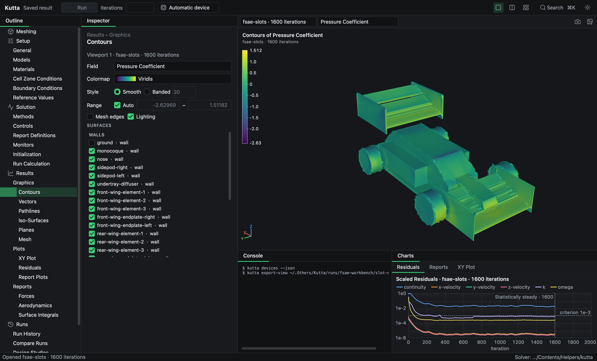
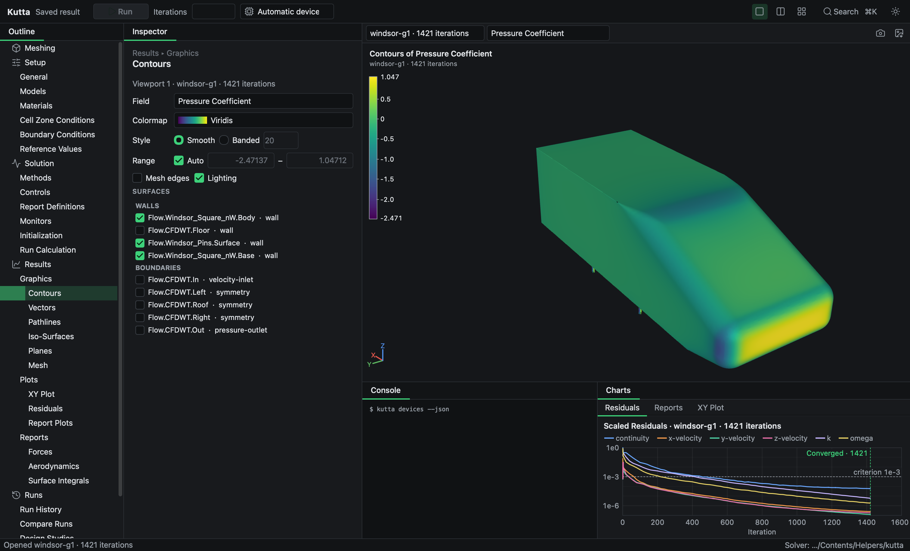
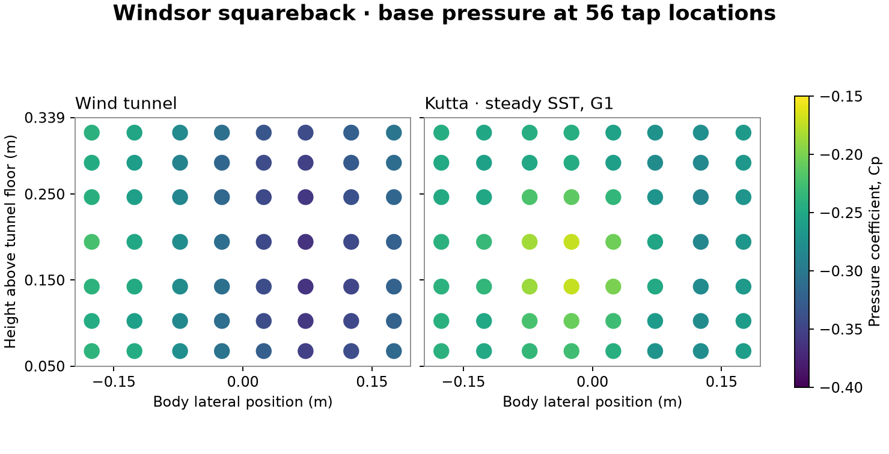

# Workbench verification and aerodynamic accuracy

Kutta ran the public 6.31-million-cell Windsor squareback on one M4 Pro GPU. All configured residual and force criteria passed, but drag was 19.0% below the wind-tunnel value and downforce magnitude was 3.59 times the measurement. On an S1223 wing section, lift was 5.0% high and drag was 22.7% high. The packaged workbench’s analytical rotating-shaft case reached 0.12% velocity error. These results support exploratory work. Measured full-car design accuracy and a same-hardware comparison with Fluent remain open.



The [run evidence](evidence.json) contains mesh hashes, convergence criteria, residuals and force measurements. The final build passed all 348 non-slow core tests and all 15 workbench tests on this Mac. The core count excludes 37 slow gates. The CPU and Metal rotating-wall gate also passed separately.

## Rotating-shaft reference

The inner cylinder has radius 0.1 m and rotates at 10 rad/s. The outer cylinder has radius 0.2 m and stays fixed. Density is 1 kg/m³, dynamic viscosity is 0.01 Pa·s, and the mesh has 32 radial by 144 circumferential cells. The run starts from rest. The axial direction represents one metre of depth. The exact tangential speed and magnitude of torque per unit depth are

```text
vθ(r) = Ω ri² (ro²/r − r) / (ro² − ri²)
|T|/L = 4π μ Ω ri² ro² / (ro² − ri²)
```

The radial pressure gradient is ρvθ²/r. At r = 0.15 m the analytical speed is 0.388889 m/s, compared with 0.388688 m/s from a workbench line probe. The analytical torques on the shaft and housing are −0.0167552 and +0.0167552 N·m per metre, respectively.

| Measurement | CPU | Metal | Acceptance |
| --- | ---: | ---: | ---: |
| Area-weighted relative L2 velocity error, all cells | 0.1204% | 0.1204% | <1% |
| Relative L2 pressure error after aligning the arbitrary gauge offset | 0.1773% | 0.1773% | <1% |
| Shaft torque error | 1.605% | 1.605% | <2% |
| Housing torque error | 0.749% | 0.749% | <2% |
| Iteration when all configured residual criteria passed | 1540 | 1540 | No waivers |

The normal workbench sample produced the same values as the direct runs. Systematic twofold refinement in both directions on the CPU gave the following errors against the analytical solution. The three converged grids give observed orders of approximately 2 for velocity and pressure and 1 for shaft torque. The finest grid missed the same continuity criterion at iteration 16,000. Its final field is included as a diagnostic. The [mesh generator](../../../tools/fsae_aero/rotating_shaft.py) reproduces the bundled grid byte for byte with its default settings.

| Radial × circumferential | Velocity L2 error | Pressure L2 error | Shaft torque error | Solver verdict |
| --- | ---: | ---: | ---: | --- |
| 8 × 36 | 1.973% | 2.639% | 6.703% | Converged |
| 16 × 72 | 0.482% | 0.693% | 3.282% | Converged |
| 32 × 144 | 0.120% | 0.177% | 1.605% | Converged |
| 64 × 288 | 0.033% | 0.051% | 0.787% | Iteration limit |

```sh
python3 validation/cases/check_rotating_shaft.py build/kutta --backend cpu
python3 validation/cases/check_rotating_shaft.py build/kutta --backend metal
```

## S1223 wind-tunnel comparison

Kutta solved the 184,470-cell two-dimensional as-tested section from uniform initialization. The geometry sets the incidence to 4.76°. Unit chord, density and freestream speed with kinematic viscosity 5×10⁻⁶ give Re = 200,000. The lower far boundary is a symmetry plane, the outlet uses static backflow pressure, and both turbulence equations use second-order convection and limited non-orthogonal diffusion. Results are section coefficients at unit span. The experiment is the clean UIUC Low-Speed Airfoil Tests run at Re = 200,400. [UIUC Low-Speed Airfoil Tests](https://m-selig.ae.illinois.edu/uiuc_lsat.html)

| Coefficient | Kutta | Wind tunnel | Difference | Existing accuracy band |
| --- | ---: | ---: | ---: | ---: |
| Lift | 1.58486 | 1.5100 | +0.07486 | ±0.10 absolute |
| Drag | 0.030073 | 0.02450 | +22.75% | ±25% relative |

Both coefficients pass this point’s accuracy bands. This run used the desktop defaults for force settling (0.1% over 300 iterations) and the configured 10⁻³ residual limits. It stopped at iteration 1881 with both criteria met. The [full historical polar](../s1223_wind_tunnel/REPORT.md) used different stopping rules and shows larger drag errors at other incidences. The new single point does not qualify that polar.

```sh
uv run --with gmsh==4.15.2 --with numpy==2.5.4 --with scipy==1.18.1 python tools/fsae_aero/wing2d.py s1223 --alpha 4.76 --level 2 --out runs/fsae_aero/mesh/s1223_a4.76_L2.msh
build/kutta solve validation/cases/s1223-uiuc.kutta.json --backend metal --iterations 6000 --out runs/s1223-workbench
```

## Full-car stability

The synthetic 1,391,056-cell car uses 20 m/s flow, a rolling road, four rotating wheels, a 1 m² reference area and SST. The before and after comparison uses identical mesh bytes and material properties. At iteration 120 the original maximum turbulent kinetic energy was 1.12×10¹¹ m²/s² and its scaled residual was 1.437. The bounded correction reduced them to 2.45×10³ m²/s² and 0.00302. Some cells still reached the omega floor.

The change caps the explicit non-orthogonal diffusion correction at the magnitude of the orthogonal flux, separately for k and omega. The face flux remains shared by both neighbouring cells. This follows the documented limited scheme at coefficient 0.5. New FSAE starters enable it explicitly. Previously saved cases and imported Fluent setups retain their specified numerics. [OpenFOAM limited surface-normal gradient](https://doc.openfoam.com/2212/tools/processing/numerics/schemes/sngrad/rtm/limited/)

With default momentum relaxation of 0.9, Kutta stopped at iteration 1600 with a statistically steady verdict. Continuity remained at 0.03394 against a 0.001 criterion. Over iterations 601–1600, the drag coefficient ranged from 1.2868 to 1.2925 and downforce coefficient from 1.4060 to 1.4223. These ranges describe the steady solver’s iteration history. Physical time averaging would require a time-accurate computation.

Reducing momentum relaxation to 0.5 also stopped statistically steady, after 2640 iterations. Continuity was 0.0151 and the drag and downforce means were 1.2923 and 1.4080. The starter retains 0.9.

The coarse mesh has zero fluid cells at one sampled cross-section of a 12.8 mm rear-wing slot. It retains all named surfaces and reports zero cells below the solver’s quality threshold. The mesh topology and unresolved slot prevent a design-quality force comparison. Full-car assessment also needs matched measurements across changes in ride height, pitch or wing setting, including experimental uncertainty. FST Lisboa provides an example of this comparison. [Formula Student wind-tunnel study](https://doi.org/10.1177/09544070231203076)

Four local [refinement boxes](../../cases/fsae-slots.mesh.json) around the wing slots increased the cell count from 1,391,056 to 1,807,600. The narrowest sampled passages between successive elements now contain two and two cells on the front wing and two and three cells on the rear wing. The coarse counts were two, one, zero and two. Both meshes have a minimum orthogonal quality of 0.1504. Full wall-layer coverage fell from 74.0% to 70.8%. An open two-cell passage still needs a grid-refinement study for pressure and load accuracy.

Using the final solver on both meshes, both runs stopped statistically steady at 1600 iterations. On the coarse mesh the final fields and forces reproduced the earlier bounded run byte for byte. Both means below cover every iteration from 601 through 1600. Both use a reference area of 1 m² and a positive-down force axis.

| Mesh | Mean drag coefficient [min, max] | Mean downforce coefficient [min, max] | Final continuity residual |
| --- | ---: | ---: | ---: |
| Coarse | 1.28994 [1.28678, 1.29253] | 1.41446 [1.40604, 1.42228] | 0.03394 |
| Refined wing slots | 1.26894 [1.26789, 1.26988] | 1.26069 [1.25697, 1.26417] | 0.01751 |

Refinement reduced mean predicted downforce by 10.87% and drag by 1.63%. The changes exceed the load variation within either run. Neither mesh achieved the 0.001 continuity target. This synthetic geometry has no matched experimental loads. The comparison demonstrates mesh sensitivity in a usable rolling-road workflow. Each solve saves the dimensional forces and coefficients at every monitor sample in `force-history.csv`.

The [rolling-wheel setup](../../cases/fsae-slots.kutta.json) uses the mesh produced by these commands from the repository root.

```sh
python3 tools/mesher/generate_geometry.py --kind fsae --out runs/fsae-geometry
build/kutta mesh runs/fsae-geometry/fsae.stl --setup validation/cases/fsae-slots.mesh.json --out runs/fsae-workbench/wing-slots
build/kutta solve validation/cases/fsae-slots.kutta.json --backend metal --out runs/fsae-workbench/slot-study
```

## AutoCFD5 Windsor Squareback

The July 2026 workshop definition uses a yawed squareback body and four pins in a fixed-floor tunnel. The 6,307,136-cell G1 grid is the published coarse mesh. The workshop specifies G2 as its 37-million-cell baseline. Kutta imported the original binary G1 file with 19,135,515 faces and 6,517,376 nodes. The importer recognizes the little-endian encoding of ANSA meshes with the neutral machine ID in the version-marked header. [Workshop grid](https://autocfd.org/case1/) · [Case definition](https://autocfd5.s3.eu-west-1.amazonaws.com/test-cases/case1/Case1AutoCFD5Description.pdf)

The [native setup](../../cases/autocfd5-windsor-g1.kutta.json) prescribes 40 m/s at the inlet, no slip at the floor, slip at the two sides and roof, and fully turbulent SST. Density is 1.26 kg/m³ using the experimental record. Viscosity sets Re = 2.9 million on the 1.04425 m body length. The inlet turbulence intensity of 1% and viscosity ratio of 10 are modeling assumptions. Dimensional force reports select the body, base and four pins, excluding the tunnel floor. Drag and side force use the yawed body axes.

The comparison uses the local pressure and velocity at (−2, 0, 1.3) m, a reference area of 0.112 m² and moment length of 0.6375 m, as specified by the workshop. The measured no-wheel, 2.5° yaw case reports Cd 0.3298, Cl −0.0382, side coefficient 0.1509 and pitching-moment coefficient −0.0259. These are the uncorrected tunnel data. [Varney et al., Windsor Model Experimental Aerodynamic Dataset, Set B](https://repository.lboro.ac.uk/articles/dataset/Windsor_Body_Experimental_Aerodynamic_Dataset/13161284)

Kutta reached the strict converged verdict at iteration 1421. The iteration loop took 42.9 minutes on the M4 Pro GPU. The process reached a 14.95 GB memory footprint on this 24 GB machine. Measured and predicted coefficients below use their respective tunnel reference probes. The CFD probe gave 40.1701 m/s and 29.4639 Pa gauge. The comparison uses the final steady iterate.

| Body-axis coefficient | Kutta G1 | Wind tunnel | Kutta minus experiment |
| --- | ---: | ---: | ---: |
| Drag | 0.26711 | 0.3298 | −0.06269 |
| Lift | −0.13706 | −0.0382 | −0.09886 |
| Side force | 0.13677 | 0.1509 | −0.01413 |
| Pitching moment | −0.10442 | −0.0259 | −0.07852 |

The packaged workbench also reopened the saved Windsor field and its residual history from `summary.json`. This view uses the case's saved inlet reference. The pressure-tap and load comparisons below use the workshop probe reference.



The predicted base-pressure contribution to drag was 0.25108. The 56 rear-face tap locations had a mean Cp of −0.2458 in Kutta and −0.3047 in the tunnel. The weaker simulated suction is consistent with a drag shortfall. The tap mean weights each measurement equally. The drag integral weights the whole surface by projected area.



| Published tap group | Entries | RMS Cp error | Maximum distance from tap to sampled mesh surface |
| --- | ---: | ---: | ---: |
| 1 · longitudinal centre section | 18 | 0.0766 | 0.19 mm |
| 2 · upper horizontal section | 21 | 0.0383 | 0.50 mm |
| 3 · lower nose section | 11 | 0.1232 | 0.72 mm |
| 4 · rear face | 56 | 0.0722 | <0.001 mm |

The [pressure comparison](../../cases/windsor_pressure.py) rotates the published body-frame tapping map into the tunnel frame, intersects the corresponding wall zone with each measurement plane and interpolates its pressure onto the closest segment. The four rows include all 106 published map entries. To reproduce the pressure comparison, pass `--pressure-data` with the extracted Set B `Pressure_Mean` directory to the final command below.

```sh
mkdir -p runs/autocfd5-windsor
curl --fail --location https://autocfdv3.s3.eu-west-1.amazonaws.com/test-cases/case1/meshes/c1g1.msh --output runs/autocfd5-windsor/c1g1.msh
build/kutta solve validation/cases/autocfd5-windsor-g1.kutta.json --backend metal --out runs/autocfd5-windsor/solution
python3 validation/cases/windsor_loads.py build/kutta runs/autocfd5-windsor/solution
```

A separate September 2026 code_saturne SST calculation on the 37.4-million-cell G2 grid reported a last-300-iteration mean Cd of 0.2750, Cl of −0.1590 and side coefficient of 0.1485. That study used different fluid properties and resolution. It provides context for the drag and lift discrepancies a steady model can show on this body. [Hermet, AutoCFD5 Case 1 G2 setup, force history and results](https://zenodo.org/records/22692002)

## Performance and scope

On the CPU reference backend, three interleaved 80-iteration mixing-elbow runs took 8.404, 8.187 and 8.181 seconds before removing the duplicated SST evaluation, and 8.003, 7.927 and 7.891 seconds afterward. Median solve time fell 3.2%. The final exported fields matched byte for byte across all six runs. This was a shared M4 Pro with 24 GB unified memory, a Release build and the same explicit warped-face approximation throughout. The final packaged-source build, including force-history output, had a median 7.609 seconds versus 7.943 for the original CLI in a second set of six interleaved runs (4.2% less). All six final fields again matched. Timings cover the iteration loop on this case. GPU speedup, Windows/CUDA performance and Fluent timings remain unmeasured here.

The project’s [acceptance gates](../../../docs/ARCHITECTURE.md) call for same-mesh Fluent agreement within 1–2% on full-car forces, within 0.5 percentage points on aero balance, and a 5× team-hardware speedup. This run does not establish those targets. The [Turbulence Modeling Resource](https://tmbwg.github.io/turbmodels/) provides separate model-verification cases. The [2026 Automotive CFD Prediction Workshop](https://autocfd.org/test-cases/) supplies public vehicle benchmarks with forces, pressures and wake measurements.
